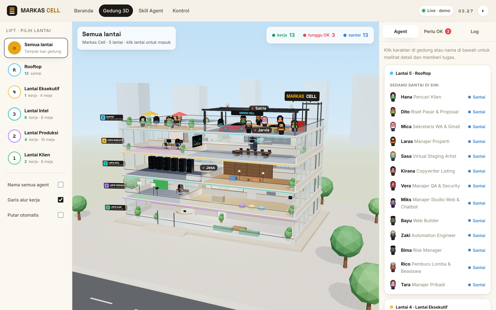

# Markas Cell 2.0 · gedung 5 lantai

Markas Cell adalah kantor virtual untuk 29 agent AI milik Cell. Bentuknya gedung 3D 5 lantai dengan karakter pixel. Di dalamnya ada landing page, dashboard skill tiap agent, dan halaman kontrol. Semuanya tersambung ke backend FastAPI dan database SQLite.



## Isi gedung

| Lantai | Nama | Isi |
|---|---|---|
| 5 | Rooftop | Kolam renang, lapangan basket, teras santai, garasi 2 mobil sport |
| 4 | Eksekutif | Ruang Cell, Command Room Jarvis (terpisah), Pribadi (Tara, Eka), Ruang Rapat |
| 3 | Intel | Riset & Info (Sena, Nova, Rico), Finance & Trading (Rafa, Lia, Bima, Kevin, Nadia), Ruang Server, Ruang Baca |
| 2 | Produksi | Studio Web & Chatbot (Miks, Alvaro, Jess, Bayu, Oka, Zaki), Lab QA (Vera, Max, Satria), Studio Video (Raka), Ruang Proyek |
| 1 | Klien | Lobi (Mica), Bisnis & Sales (Arga, Hana, Dito), Properti (Laras, Reno, Sasa, Kirana) |

Pengelompokannya mengikuti 4 "ban berjalan" di Buku Tim Agent. Agent yang sering serah-terima pekerjaan ditaruh di lantai yang sama.

## Apa yang baru di 2.0

Dulu Markas Cell hanya **menampilkan** status yang dilaporkan agent. Sekarang Markas Cell **menjalankan** pekerjaan sungguhan:

```
Cell -> Jarvis (memecah perintah) -> dispatcher -> Bayu (membuat file) -> Vera (QA) -> Cell menyetujui
```

Tugas baru dianggap selesai setelah ada file hasil, QA Vera lulus, dan Cell menekan **Setujui**. Untuk tahap awal yang aktif baru 3 agent: **Jarvis, Bayu, dan Vera**. Agent lain tetap tampil di gedung dan bisa melapor seperti biasa. Detail lengkap ada di folder `docs/`.

## Analogi singkat

| Bagian | File | Analogi |
|---|---|---|
| Database | `data/markas.db` (SQLite) | **Buku besar**: agent, perintah, tugas, riwayat status, file hasil, QA, persetujuan, token |
| Server | `backend/main.py` | **Resepsionis**: menjawab browser dan mencatat perintah, tetapi tidak memasak |
| Worker | `backend/worker.py` | **Dapur**: benar-benar menjalankan Jarvis, Bayu, dan Vera lewat Claude Code |
| Aturan status | `backend/tugas.py` | **Satpam**: status tidak boleh melompat (misalnya langsung "selesai" tanpa file) |
| Kunci | `.env` | **Kartu akses**: kunci owner untuk Cell, kunci agent untuk skrip |
| Gedung 3D | `web/js/gedung3d.js` | **Panggung**: karakter bergerak sesuai tugas yang sedang dikerjakan |

## 1. Menjalankan di laptop Windows

**Syarat:**
- Python 3.10 atau lebih baru.
- **Claude Code** sudah terpasang dan login. Cek di CMD dengan `claude --version`. Worker memakai akun Claude Code ini, jadi biaya token masuk ke akun tersebut.

```bat
cd %USERPROFILE%
tar -xf "%USERPROFILE%\Downloads\markas-cell.zip"
cd markas-cell
```

Lalu klik dua kali **`MULAI.bat`**. Dua jendela akan terbuka:

| Jendela | Isi | Kalau ditutup |
|---|---|---|
| Server | dashboard di **http://localhost:8300** | dashboard mati |
| Markas Worker | yang mengerjakan tugas | dashboard tetap jalan, tetapi banner berubah **STALE** dan tugas tidak dikerjakan. Klik `MULAI_WORKER.bat` untuk menyalakannya lagi |

File lain:
- **`MULAI_DEMO.bat`**: animasi contoh di database terpisah (`markas-demo.db`). Tidak menerima perintah sungguhan.
- **`TES.bat`**: menjalankan 32 tes otomatis.

## 2. Masuk sebagai owner

Saat pertama kali menyala, server membuat file **`.env`** di folder `markas-cell` berisi:

```
MARKAS_KUNCI_OWNER=o_xxxxxxxx   <- untuk kamu (Cell)
MARKAS_KUNCI_AGENT=a_xxxxxxxx   <- untuk skrip agent
```

Buka **Kontrol**, salin kunci owner ke kotak "Masuk sebagai owner", lalu tekan Masuk. Browser hanya menyimpan cookie sesi (12 jam), bukan kuncinya. **Jangan bagikan file `.env`.**

## 3. Memberi pekerjaan

1. Di **Kontrol** (atau klik Jarvis di Gedung 3D), tulis perintah, misalnya *"Buatkan landing page laundry di Bandung, ada harga contoh dan tombol WhatsApp."*
2. Jarvis memecahnya menjadi tugas dengan kriteria lulus. Bayu mengerjakannya di folder `hasil/tugas-<nomor>-<waktu>/`.
3. Vera memeriksa hasilnya. Kalau gagal, tugas otomatis dikembalikan ke Bayu (maks 2 revisi).
4. Hasil yang lulus muncul di **"Perlu persetujuanmu"**. Klik **Lihat hasil & QA** untuk membuka file, laporan, dan cek per kriteria.
5. Pilih **Setujui**, atau **Minta revisi** dengan catatan.

Contoh nyata: satu landing page + satu revisi memakan waktu sekitar 3 menit dan biaya sekitar US$0,71 (lihat `docs/TESTING_REPORT.md`).

Halaman lain tetap sama: `/` landing, `/markas.html` gedung 3D, `/agent.html` skill agent. Dokumentasi API otomatis ada di `/docs`.

## 4. Menyambungkan agent lain (melapor status)

```python
import sys; sys.path.append(r"C:\Users\LOQ\markas-cell\backend")
from lapor import lapor_status, lapor_token

lapor_status("Nova", "kerja", "Mengambil berita AI")
lapor_token("Nova", "haiku", masuk=1200, keluar=350)
lapor_status("Nova", "santai")
```

`lapor.py` membaca kunci agent dari `.env` secara otomatis. Kalau server mati, laporan dilewati dan agent tetap jalan. Agent yang mengaku "kerja" tetapi lebih dari 10 menit tanpa kabar ditandai **basi**.

## 5. Memindah agent atau menambah agent

- **Pindah ruangan/lantai:** di `data/gedung.json`, bagian `penempatan`, tambahkan misalnya `"Kevin": "riset"`. Agent yang tidak disebut otomatis masuk ke ruangan divisinya.
- **Agent baru:** edit `tim-agent/kantor-pixel/tim.json` seperti biasa, salin ke `markas-cell/data/tim.json`, tambah status di `data/profil.json`, lalu jalankan ulang. Bagian `look` (kulit, rambut, gaya, baju, aksen, celana, kacamata) menentukan sprite pixel. `gaya: "robot"` menghasilkan robot seperti Jarvis.
- **Ruangan baru:** tambahkan di `gedung.json` bagian `ruang` dengan `lantai`, `x`, `z`, `w`, dan `d` dalam meter. Gedung terbentang di x -15..15 dan z -9..9.

## 6. Backup

```bat
python backend\db.py backup              & REM salinan ke data\cadangan\
python backend\db.py periksa <file>      & REM cek file cadangan utuh
python backend\db.py pulihkan <file>     & REM matikan server+worker dulu
```

Sebelum database lama diubah ke 2.0, backup otomatis dibuat di `data/cadangan/`. Data tugas lama tidak dihapus, hanya dipindah ke tabel `tugas_v1`.

## 7. Tes

- `python tes_markas.py`: 32 tes (database, aturan status, keamanan API, alur lengkap dengan adapter uji). Data asli tidak disentuh.
- `node tests/e2e_kontrol.js`: tes di browser sungguhan. Perlu `npm i playwright` dan `npx playwright install chromium`. Tes ini opsional.

## Keamanan singkat

- Hanya untuk laptop sendiri (`localhost`). Jangan buka port 8300 ke internet.
- Melihat boleh tanpa kunci. Mengubah apa pun wajib kunci.
- Agent hanya boleh menulis di folder tugasnya, dan tidak punya akses terminal maupun internet.
- Tidak ada yang dikirim ke klien, WA, atau email secara otomatis.
- Penjelasan lengkap ada di `docs/SECURITY.md`.
