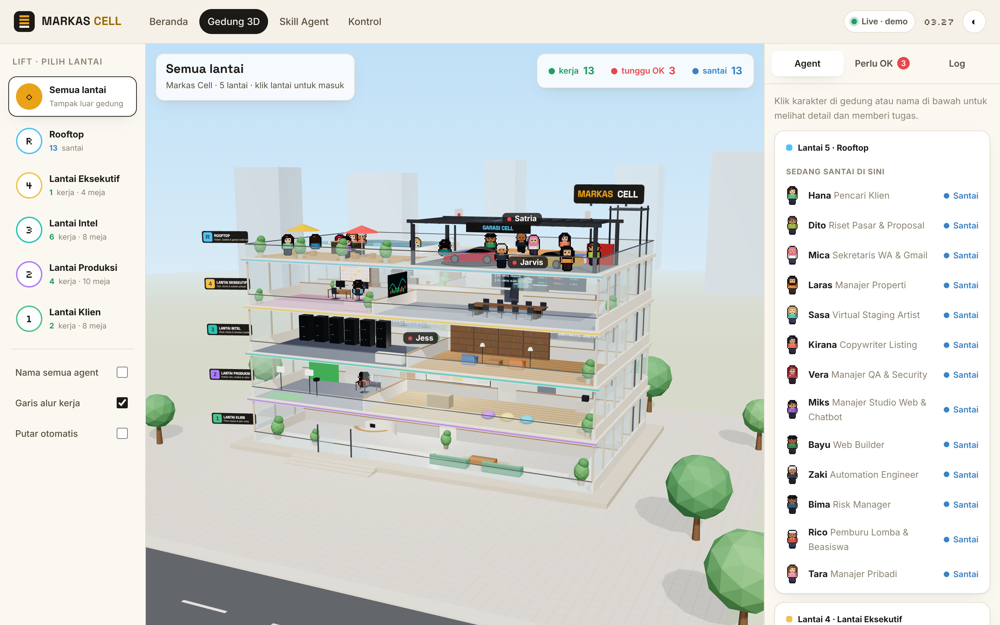

# Markas Cell 2.0 · kode lengkap

Semua file sumber Markas Cell dalam satu dokumen, berurutan dari backend ke frontend.
Library Three.js (`web/lib/`) tidak ditulis di sini karena itu kode pihak luar (sudah ada di zip). Dokumentasi teknis ada di folder `docs/`.

## Struktur folder

```
markas-cell/
├─ backend/        server (main.py), worker.py, orkestrator.py (Jarvis), qa.py (Vera)
│  │               tugas.py (state machine), db.py (migrasi/backup), database.py, keamanan.py, skema.py, config.py, lapor.py
│  └─ adapter/     claude_code.py (Claude Code headless) · uji.py (adapter tes) · dasar.py
├─ data/           tim.json · gedung.json · profil.json · markas.db (otomatis) · cadangan/
├─ hasil/          folder kerja tiap tugas (otomatis)
├─ web/            index.html · markas.html · agent.html · kontrol.html · css/ · js/ · img/ · lib/
├─ tests/          test_unit.py · test_api.py · test_integrasi.py · e2e_kontrol.js
├─ docs/           ARCHITECTURE · API_DOCUMENTATION · DATABASE_SCHEMA · AGENT_WORKFLOW · SECURITY · CHANGELOG · TESTING_REPORT
└─ MULAI.bat · MULAI_WORKER.bat · MULAI_DEMO.bat · TES.bat · tes_markas.py · requirements.txt
```

## CARA_JALANKAN.md  (126 baris)

````markdown
# Markas Cell 2.0 · gedung 5 lantai

Markas Cell adalah kantor virtual untuk 29 agent AI milik Cell. Bentuknya gedung 3D 5 lantai dengan karakter pixel. Di dalamnya ada landing page, dashboard skill tiap agent, dan halaman kontrol. Semuanya tersambung ke backend FastAPI dan database SQLite.



## Isi gedung

| Lantai | Nama | Isi |
|---|---|---|
| 5 | Rooftop | Kolam renang, lapangan basket, teras santai, garasi 2 mobil sport |
| 4 | Eksekutif | Ruang Cell, Command Room Jarvis (terpisah), Pribadi (Tara, Eka), Ruang Rapat |
| 3 | Intel | Riset & Info (Sena, Nova, Rico), Finance & Trading (Rafa, Lia, Bima, Kevin, Nadia), Ruang Server, Ruang Baca |
| 2 | Produksi | Studio Web & Chatbot (Miks, Alvaro, Jess, Bayu, Oka, Zaki), Lab QA (Vera, Max, Satria), Studio Video (Raka), Ruang Proyek |
| 1 | Klien | Lobi (Mica), Bisnis & Sales (Arga, Hana, Dito), Properti (Laras, Reno, Sasa, Kirana) |

Pengelompokannya mengikuti 4 "ban berjalan" di Buku Tim Agent. Agent yang sering serah-terima pekerjaan ditaruh di lantai yang sama.

## Apa yang baru di 2.0

Dulu Markas Cell hanya **menampilkan** status yang dilaporkan agent. Sekarang Markas Cell **menjalankan** pekerjaan sungguhan:

```
Cell -> Jarvis (memecah perintah) -> dispatcher -> Bayu (membuat file) -> Vera (QA) -> Cell menyetujui
```

Tugas baru dianggap selesai setelah ada file hasil, QA Vera lulus, dan Cell menekan **Setujui**. Untuk tahap awal yang aktif baru 3 agent: **Jarvis, Bayu, dan Vera**. Agent lain tetap tampil di gedung dan bisa melapor seperti biasa. Detail lengkap ada di folder `docs/`.

## Analogi singkat

| Bagian | File | Analogi |
|---|---|---|
| Database | `data/markas.db` (SQLite) | **Buku besar**: agent, perintah, tugas, riwayat status, file hasil, QA, persetujuan, token |
| Server | `backend/main.py` | **Resepsionis**: menjawab browser dan mencatat perintah, tetapi tidak memasak |
| Worker | `backend/worker.py` | **Dapur**: benar-benar menjalankan Jarvis, Bayu, dan Vera lewat Claude Code |
| Aturan status | `backend/tugas.py` | **Satpam**: status tidak boleh melompat (misalnya langsung "selesai" tanpa file) |
| Kunci | `.env` | **Kartu akses**: kunci owner untuk Cell, kunci agent untuk skrip |
| Gedung 3D | `web/js/gedung3d.js` | **Panggung**: karakter bergerak sesuai tugas yang sedang dikerjakan |

## 1. Menjalankan di laptop Windows

**Syarat:**
- Python 3.10 atau lebih baru.
- **Claude Code** sudah terpasang dan login. Cek di CMD dengan `claude --version`. Worker memakai akun Claude Code ini, jadi biaya token masuk ke akun tersebut.

```bat
cd %USERPROFILE%
tar -xf "%USERPROFILE%\Downloads\markas-cell.zip"
cd markas-cell
```

Lalu klik dua kali **`MULAI.bat`**. Dua jendela akan terbuka:

| Jendela | Isi | Kalau ditutup |
|---|---|---|
| Server | dashboard di **http://localhost:8300** | dashboard mati |
| Markas Worker | yang mengerjakan tugas | dashboard tetap jalan, tetapi banner berubah **STALE** dan tugas tidak dikerjakan. Klik `MULAI_WORKER.bat` untuk menyalakannya lagi |

File lain:
- **`MULAI_DEMO.bat`**: animasi contoh di database terpisah (`markas-demo.db`). Tidak menerima perintah sungguhan.
- **`TES.bat`**: menjalankan 32 tes otomatis.

## 2. Masuk sebagai owner

Saat pertama kali menyala, server membuat file **`.env`** di folder `markas-cell` berisi:

```
MARKAS_KUNCI_OWNER=o_xxxxxxxx   <- untuk kamu (Cell)
MARKAS_KUNCI_AGENT=a_xxxxxxxx   <- untuk skrip agent
```

Buka **Kontrol**, salin kunci owner ke kotak "Masuk sebagai owner", lalu tekan Masuk. Browser hanya menyimpan cookie sesi (12 jam), bukan kuncinya. **Jangan bagikan file `.env`.**

## 3. Memberi pekerjaan

1. Di **Kontrol** (atau klik Jarvis di Gedung 3D), tulis perintah, misalnya *"Buatkan landing page laundry di Bandung, ada harga contoh dan tombol WhatsApp."*
2. Jarvis memecahnya menjadi tugas dengan kriteria lulus. Bayu mengerjakannya di folder `hasil/tugas-<nomor>-<waktu>/`.
3. Vera memeriksa hasilnya. Kalau gagal, tugas otomatis dikembalikan ke Bayu (maks 2 revisi).
4. Hasil yang lulus muncul di **"Perlu persetujuanmu"**. Klik **Lihat hasil & QA** untuk membuka file, laporan, dan cek per kriteria.
5. Pilih **Setujui**, atau **Minta revisi** dengan catatan.

Contoh nyata: satu landing page + satu revisi memakan waktu sekitar 3 menit dan biaya sekitar US$0,71 (lihat `docs/TESTING_REPORT.md`).

Halaman lain tetap sama: `/` landing, `/markas.html` gedung 3D, `/agent.html` skill agent. Dokumentasi API otomatis ada di `/docs`.

## 4. Menyambungkan agent lain (melapor status)

```python
import sys; sys.path.append(r"C:\Users\LOQ\markas-cell\backend")
from lapor import lapor_status, lapor_token

lapor_status("Nova", "kerja", "Mengambil berita AI")
lapor_token("Nova", "haiku", masuk=1200, keluar=350)
lapor_status("Nova", "santai")
```

`lapor.py` membaca kunci agent dari `.env` secara otomatis. Kalau server mati, laporan dilewati dan agent tetap jalan. Agent yang mengaku "kerja" tetapi lebih dari 10 menit tanpa kabar ditandai **basi**.

## 5. Memindah agent atau menambah agent

- **Pindah ruangan/lantai:** di `data/gedung.json`, bagian `penempatan`, tambahkan misalnya `"Kevin": "riset"`. Agent yang tidak disebut otomatis masuk ke ruangan divisinya.
- **Agent baru:** edit `tim-agent/kantor-pixel/tim.json` seperti biasa, salin ke `markas-cell/data/tim.json`, tambah status di `data/profil.json`, lalu jalankan ulang. Bagian `look` (kulit, rambut, gaya, baju, aksen, celana, kacamata) menentukan sprite pixel. `gaya: "robot"` menghasilkan robot seperti Jarvis.
- **Ruangan baru:** tambahkan di `gedung.json` bagian `ruang` dengan `lantai`, `x`, `z`, `w`, dan `d` dalam meter. Gedung terbentang di x -15..15 dan z -9..9.

## 6. Backup

```bat
python backend\db.py backup              & REM salinan ke data\cadangan\
python backend\db.py periksa <file>      & REM cek file cadangan utuh
python backend\db.py pulihkan <file>     & REM matikan server+worker dulu
```

Sebelum database lama diubah ke 2.0, backup otomatis dibuat di `data/cadangan/`. Data tugas lama tidak dihapus, hanya dipindah ke tabel `tugas_v1`.

## 7. Tes

- `python tes_markas.py`: 32 tes (database, aturan status, keamanan API, alur lengkap dengan adapter uji). Data asli tidak disentuh.
- `node tests/e2e_kontrol.js`: tes di browser sungguhan. Perlu `npm i playwright` dan `npx playwright install chromium`. Tes ini opsional.

## Keamanan singkat

- Hanya untuk laptop sendiri (`localhost`). Jangan buka port 8300 ke internet.
- Melihat boleh tanpa kunci. Mengubah apa pun wajib kunci.
- Agent hanya boleh menulis di folder tugasnya, dan tidak punya akses terminal maupun internet.
- Tidak ada yang dikirim ke klien, WA, atau email secara otomatis.
- Penjelasan lengkap ada di `docs/SECURITY.md`.
````

## requirements.txt  (4 baris)

```text
# Versi yang sudah diuji bersama Markas Cell 2.0 (15 Nov 2026)
fastapi==0.162.5
uvicorn==0.54.0
psutil==7.2.2
```

## MULAI.bat  (14 baris)

```bat
@echo off
REM Klik dua kali: Markas Cell 2.0 terbuka di http://localhost:8300
REM Membuka 2 jendela: SERVER (dashboard) dan WORKER (yang benar-benar menjalankan agent).
REM Pertama kali: library dipasang otomatis dan file .env berisi kunci owner dibuat.
cd /d %~dp0
set PY=python
where python >nul 2>nul || set PY=py
%PY% -c "import fastapi, uvicorn, psutil" 2>nul || %PY% -m pip install -r requirements.txt
REM Ikut membaca papan absen kantor lama kalau ada (hook Claude Code yang sudah jalan langsung tampil)
set PAPAN=
if exist "%USERPROFILE%\tim-agent\kantor-pixel\status.json" set PAPAN=--papan "%USERPROFILE%\tim-agent\kantor-pixel\status.json"
start "Markas Worker" cmd /k "timeout /t 5 >nul & %PY% backend\worker.py"
%PY% backend\main.py %PAPAN%
pause
```

## MULAI_WORKER.bat  (8 baris)

```bat
@echo off
REM Menjalankan WORKER saja (kalau jendela worker tertutup). Server harus sudah menyala lewat MULAI.bat.
REM Worker memakai Claude Code di laptop ini: pastikan perintah "claude" sudah terpasang dan login.
cd /d %~dp0
set PY=python
where python >nul 2>nul || set PY=py
%PY% backend\worker.py
pause
```

## MULAI_DEMO.bat  (9 baris)

```bat
@echo off
REM Klik dua kali: lihat animasi contoh. Memakai database terpisah (data\markas-demo.db),
REM jadi data asli di data\markas.db tidak tersentuh. Tidak ada agent sungguhan yang bekerja.
cd /d %~dp0
set PY=python
where python >nul 2>nul || set PY=py
%PY% -c "import fastapi, uvicorn, psutil" 2>nul || %PY% -m pip install -r requirements.txt
%PY% backend\main.py --demo
pause
```

## TES.bat  (7 baris)

```bat
@echo off
REM Menjalankan semua tes otomatis (unit, API, integrasi). Data asli tidak disentuh.
cd /d %~dp0
set PY=python
where python >nul 2>nul || set PY=py
%PY% tes_markas.py
pause
```

## .gitignore  (8 baris)

```text
data/markas.db
data/markas-demo.db
data/*.db-wal
data/*.db-shm
data/cadangan/
hasil/
__pycache__/
.env
```

## tes_markas.py  (20 baris)

```python
"""Jalankan SEMUA tes Markas Cell dengan satu perintah (tanpa install tambahan):

    python tes_markas.py

Isi:
  tests/test_unit.py       aturan status tugas, validasi, foreign key, migrasi, backup/restore, token
  tests/test_api.py        backend sungguhan di port acak: kunci, peran, Host, enum, 409, idempotensi, demo terpisah
  tests/test_integrasi.py  perintah -> Jarvis -> Bayu -> QA Vera -> persetujuan (adapter UJI, tanpa AI)
Tes end-to-end browser (opsional, butuh Node + Playwright): node tests/e2e_kontrol.js
Semua tes memakai folder sementara. data/markas.db asli tidak disentuh.
"""
import sys
import unittest
from pathlib import Path

folder = Path(__file__).resolve().parent / "tests"
sys.path.insert(0, str(folder))
hasil = unittest.TextTestRunner(verbosity=2).run(unittest.defaultTestLoader.discover(str(folder), pattern="test_*.py"))
print(f"\n{'SEMUA TES LULUS' if hasil.wasSuccessful() else 'ADA TES GAGAL'}: {hasil.testsRun} tes")
sys.exit(0 if hasil.wasSuccessful() else 1)
```

## backend/config.py  (76 baris)

```python
"""Setelan Markas Cell: lokasi file, kunci rahasia, dan daftar agent yang aktif.

Analogi: ini "papan informasi" di ruang server. Semua bagian lain membaca dari sini,
jadi lokasi database atau kunci cukup diubah di satu tempat.

Semua lokasi bisa diganti lewat environment variable (dipakai oleh tes):
  MARKAS_DATA   folder data (bawaan: <proyek>/data)
  MARKAS_ENV    file .env berisi kunci (bawaan: <proyek>/.env)
  MARKAS_HASIL  folder hasil kerja agent (bawaan: <proyek>/hasil)
"""
from __future__ import annotations

import os
import secrets
from pathlib import Path

FOLDER = Path(__file__).resolve().parent.parent
DATA = Path(os.environ.get("MARKAS_DATA", FOLDER / "data"))
FILE_ENV = Path(os.environ.get("MARKAS_ENV", FOLDER / ".env"))
HASIL = Path(os.environ.get("MARKAS_HASIL", FOLDER / "hasil"))
CADANGAN = DATA / "cadangan"
FILE_DB = DATA / "markas.db"
FILE_DB_DEMO = DATA / "markas-demo.db"   # mode demo TIDAK PERNAH menulis ke markas.db
FILE_TIM = DATA / "tim.json"
FILE_GEDUNG = DATA / "gedung.json"
FILE_PROFIL = DATA / "profil.json"

# Markas 2.0 sengaja mulai dari 3 agent yang benar-benar bekerja.
# Agent lain tetap tampil di gedung, tapi berlabel "belum aktif".
AKTIF = {
    "Jarvis": "orkestrator",   # memecah perintah Cell menjadi tugas
    "Bayu": "specialist",      # mengerjakan tugas web
    "Vera": "qa",              # memeriksa hasil sebelum sampai ke Cell
}
SPECIALIST = [nama for nama, peran in AKTIF.items() if peran == "specialist"]

# batas kerja worker
MAKS_PERCOBAAN = 3          # percobaan per tugas sebelum FAILED
MAKS_REVISI = 2             # revisi dari QA/Cell sebelum FAILED
BATAS_WAKTU_AGENT = int(os.environ.get("MARKAS_BATAS_WAKTU", "900"))   # detik per panggilan AI
WORKER_BASI = 20            # detik tanpa detak -> worker dianggap mati (STALE)
AGENT_BASI = 600            # detik tanpa laporan saat "kerja" -> status dianggap basi


def baca_env(path: Path | None = None) -> dict:
    """Baca file .env sederhana (KUNCI=nilai per baris). Tanpa pustaka tambahan."""
    path = path or FILE_ENV
    hasil = {}
    if path.exists():
        for baris in path.read_text(encoding="utf-8").splitlines():
            baris = baris.strip()
            if baris and not baris.startswith("#") and "=" in baris:
                k, v = baris.split("=", 1)
                hasil[k.strip()] = v.strip().strip('"').strip("'")
    return hasil


def pastikan_env(path: Path | None = None) -> tuple[dict, bool]:
    """Buat .env berisi kunci acak kalau belum ada. Mengembalikan (isi, baru_dibuat).

    Kunci owner = untuk Cell (masuk dashboard & memberi perintah).
    Kunci agent = untuk skrip/hook yang melapor status & token.
    File ini tidak ikut di-commit (.gitignore) dan tidak pernah dikirim ke browser.
    """
    path = path or FILE_ENV
    isi = baca_env(path)
    perlu = {"MARKAS_KUNCI_OWNER": "o_", "MARKAS_KUNCI_AGENT": "a_"}
    kurang = {k: p + secrets.token_urlsafe(24) for k, p in perlu.items() if not isi.get(k)}
    if kurang:
        path.parent.mkdir(parents=True, exist_ok=True)
        lama = path.read_text(encoding="utf-8") if path.exists() else \
            "# Kunci rahasia Markas Cell. JANGAN dibagikan, JANGAN di-commit.\n"
        tambahan = "".join(f"{k}={v}\n" for k, v in kurang.items())
        path.write_text(lama.rstrip("\n") + "\n" + tambahan, encoding="utf-8")
        isi.update(kurang)
    return isi, bool(kurang)
```

## backend/db.py  (294 baris)

```python
"""Koneksi database, migrasi bernomor, dan backup.

Analogi:
  koneksi()  = meminjam buku besar dari rak, lalu wajib dikembalikan (ditutup) setelah dipakai.
               Dulu satu buku dipakai bergantian semua orang tanpa aturan; sekarang tiap
               permintaan meminjam salinannya sendiri.
  migrasi    = renovasi gedung bernomor. Database mencatat sudah sampai renovasi ke berapa,
               jadi renovasi yang sama tidak dikerjakan dua kali.
  backup     = fotokopi buku besar sebelum direnovasi.
"""
from __future__ import annotations

import shutil
import sqlite3
from contextlib import contextmanager
from datetime import datetime
from pathlib import Path

import config


def _sambung(path: Path) -> sqlite3.Connection:
    path.parent.mkdir(parents=True, exist_ok=True)
    con = sqlite3.connect(path, timeout=10, check_same_thread=False)
    con.row_factory = sqlite3.Row
    con.execute("PRAGMA foreign_keys = ON")      # relasi antar tabel benar-benar dicek
    con.execute("PRAGMA busy_timeout = 5000")    # tunggu 5 detik kalau sedang ditulis proses lain
    con.execute("PRAGMA journal_mode = WAL")     # worker & server bisa jalan bersamaan
    return con


@contextmanager
def koneksi(path: Path | None = None):
    """Pinjam satu koneksi, tutup otomatis. Kalau terjadi error, perubahan dibatalkan."""
    con = _sambung(path or AKTIF["db"])
    try:
        yield con
        con.commit()
    except Exception:
        con.rollback()
        raise
    finally:
        con.close()


# database yang sedang dipakai proses ini (markas.db, atau markas-demo.db saat demo)
AKTIF = {"db": config.FILE_DB}


def pakai(path: Path) -> None:
    AKTIF["db"] = path


# =====================================================================
#  MIGRASI
# =====================================================================
SKEMA_1 = """
CREATE TABLE IF NOT EXISTS lantai (
    no INTEGER PRIMARY KEY, nama TEXT, julukan TEXT, warna TEXT
);
CREATE TABLE IF NOT EXISTS ruang (
    id TEXT PRIMARY KEY, lantai INTEGER REFERENCES lantai(no), nama TEXT, jenis TEXT,
    divisi TEXT, x REAL, z REAL, w REAL, d REAL, santai INTEGER DEFAULT 0, bahan TEXT
);
CREATE TABLE IF NOT EXISTS agent (
    id TEXT PRIMARY KEY,
    jabatan TEXT, divisi TEXT, manajer INTEGER DEFAULT 0, owner INTEGER DEFAULT 0,
    lapor_ke TEXT, model TEXT, jenis TEXT, fase INTEGER,
    tugas_pokok TEXT, input TEXT, output TEXT, alat TEXT, alias TEXT,
    kondisi TEXT, status_label TEXT, prioritas TEXT,
    lantai INTEGER, ruang TEXT REFERENCES ruang(id),
    look TEXT, keadaan TEXT DEFAULT 'santai', pesan TEXT DEFAULT '', diperbarui TEXT
);
CREATE TABLE IF NOT EXISTS koneksi (dari TEXT, ke TEXT, label TEXT, PRIMARY KEY (dari, ke, label));
CREATE TABLE IF NOT EXISTS tugas (
    id INTEGER PRIMARY KEY AUTOINCREMENT, agent TEXT, judul TEXT, prioritas TEXT DEFAULT 'normal',
    status TEXT DEFAULT 'antri', hasil TEXT DEFAULT '', dibuat TEXT, mulai TEXT, selesai TEXT
);
CREATE TABLE IF NOT EXISTS log (
    id INTEGER PRIMARY KEY AUTOINCREMENT, waktu TEXT, agent TEXT, level TEXT DEFAULT 'info', teks TEXT
);
CREATE TABLE IF NOT EXISTS token (
    id INTEGER PRIMARY KEY AUTOINCREMENT, waktu TEXT, agent TEXT, model TEXT, masuk INTEGER, keluar INTEGER
);
CREATE TABLE IF NOT EXISTS metrik (id INTEGER PRIMARY KEY AUTOINCREMENT, waktu TEXT, cpu REAL, ram REAL);
CREATE INDEX IF NOT EXISTS i_log_agent ON log(agent);
CREATE INDEX IF NOT EXISTS i_token_waktu ON token(waktu);
"""

# kolom yang ditambahkan selama versi 1.x (database lama mungkin belum punya)
KOLOM_AGENT_V1 = {
    "owner": "INTEGER DEFAULT 0", "jenis": "TEXT", "fase": "INTEGER", "input": "TEXT", "output": "TEXT",
    "alat": "TEXT", "alias": "TEXT", "kondisi": "TEXT", "status_label": "TEXT", "prioritas": "TEXT",
    "lantai": "INTEGER", "ruang": "TEXT",
}


def _kolom(con, tabel: str) -> set[str]:
    return {r["name"] for r in con.execute(f"PRAGMA table_info({tabel})")}


def _ada_tabel(con, tabel: str) -> bool:
    return con.execute("SELECT 1 FROM sqlite_master WHERE type='table' AND name=?", (tabel,)).fetchone() is not None


def m001_awal(con):
    """Skema Markas Cell 1.x (aman dijalankan di database lama maupun baru)."""
    con.executescript(SKEMA_1)
    ada = _kolom(con, "agent")
    for kolom, tipe in KOLOM_AGENT_V1.items():
        if kolom not in ada:
            con.execute(f"ALTER TABLE agent ADD COLUMN {kolom} {tipe}")


def m002_tugas_v2(con):
    """Markas 2.0: tugas berkontrak, riwayat status, artefak, handoff, QA, persetujuan.

    Tabel tugas versi 1 (status antri/jalan/selesai) TIDAK dihapus, hanya diganti nama
    menjadi tugas_v1 supaya datanya tetap bisa dibaca.
    """
    if _ada_tabel(con, "tugas") and "tujuan" not in _kolom(con, "tugas"):
        con.execute("ALTER TABLE tugas RENAME TO tugas_v1")
        con.execute("DROP INDEX IF EXISTS i_tugas_agent")
    ada = _kolom(con, "agent")
    if "aktif" not in ada:
        con.execute("ALTER TABLE agent ADD COLUMN aktif INTEGER DEFAULT 0")
    if "peran" not in ada:
        con.execute("ALTER TABLE agent ADD COLUMN peran TEXT")
    ada_token = _kolom(con, "token")
    for kolom, tipe in {"sumber": "TEXT DEFAULT 'lapor'", "biaya_usd": "REAL", "kunci": "TEXT", "tugas": "INTEGER"}.items():
        if kolom not in ada_token:
            con.execute(f"ALTER TABLE token ADD COLUMN {kolom} {tipe}")
    con.executescript("""
    CREATE TABLE IF NOT EXISTS perintah (
        id INTEGER PRIMARY KEY AUTOINCREMENT,
        teks TEXT NOT NULL, prioritas TEXT NOT NULL DEFAULT 'normal',
        status TEXT NOT NULL DEFAULT 'BARU' CHECK (status IN ('BARU','DIPROSES','DIPECAH','DITOLAK','GAGAL')),
        catatan TEXT DEFAULT '', oleh TEXT, dibuat TEXT, diperbarui TEXT
    );
    CREATE TABLE IF NOT EXISTS tugas (
        id INTEGER PRIMARY KEY AUTOINCREMENT,
        perintah INTEGER REFERENCES perintah(id),
        judul TEXT NOT NULL, tujuan TEXT NOT NULL DEFAULT '',
        kriteria TEXT NOT NULL DEFAULT '[]',              -- JSON: daftar kriteria lulus
        agent TEXT NOT NULL REFERENCES agent(id),
        prioritas TEXT NOT NULL DEFAULT 'normal' CHECK (prioritas IN ('rendah','normal','tinggi')),
        status TEXT NOT NULL DEFAULT 'PENDING'
            CHECK (status IN ('PENDING','ASSIGNED','RUNNING','REVIEW','REVISION','APPROVED','FAILED')),
        qa_status TEXT NOT NULL DEFAULT 'belum' CHECK (qa_status IN ('belum','menunggu','lulus','gagal','error')),
        percobaan INTEGER NOT NULL DEFAULT 0, revisi INTEGER NOT NULL DEFAULT 0, qa_percobaan INTEGER NOT NULL DEFAULT 0,
        coba_setelah TEXT,                                -- jeda retry (backoff)
        worker TEXT, adapter TEXT, ringkasan TEXT DEFAULT '', error TEXT DEFAULT '',
        dibuat_oleh TEXT, dibuat TEXT, diperbarui TEXT, mulai TEXT, selesai TEXT
    );
    CREATE INDEX IF NOT EXISTS i_tugas_status ON tugas(status, prioritas, id);
    CREATE INDEX IF NOT EXISTS i_tugas_agent2 ON tugas(agent, status);
    CREATE TABLE IF NOT EXISTS riwayat_tugas (
        id INTEGER PRIMARY KEY AUTOINCREMENT,
        tugas INTEGER NOT NULL REFERENCES tugas(id) ON DELETE CASCADE,
        dari TEXT, ke TEXT NOT NULL, pelaku TEXT NOT NULL, peran TEXT NOT NULL, alasan TEXT DEFAULT '',
        ditolak INTEGER NOT NULL DEFAULT 0, waktu TEXT
    );
    CREATE INDEX IF NOT EXISTS i_riwayat_tugas ON riwayat_tugas(tugas, id);
    CREATE TABLE IF NOT EXISTS artefak (
        id INTEGER PRIMARY KEY AUTOINCREMENT,
        tugas INTEGER NOT NULL REFERENCES tugas(id) ON DELETE CASCADE,
        versi INTEGER NOT NULL DEFAULT 0, path TEXT NOT NULL, ukuran INTEGER, sha256 TEXT, jenis TEXT, waktu TEXT,
        UNIQUE (tugas, versi, path)                       -- retry tidak membuat artefak ganda
    );
    CREATE TABLE IF NOT EXISTS handoff (
        id INTEGER PRIMARY KEY AUTOINCREMENT,
        tugas INTEGER NOT NULL REFERENCES tugas(id) ON DELETE CASCADE,
        dari TEXT NOT NULL, ke TEXT NOT NULL, konteks TEXT NOT NULL, waktu TEXT
    );
    CREATE TABLE IF NOT EXISTS qa_hasil (
        id INTEGER PRIMARY KEY AUTOINCREMENT,
        tugas INTEGER NOT NULL REFERENCES tugas(id) ON DELETE CASCADE,
        versi INTEGER NOT NULL DEFAULT 0, lulus INTEGER NOT NULL, cek TEXT NOT NULL, catatan TEXT DEFAULT '',
        penilai TEXT NOT NULL, waktu TEXT
    );
    CREATE TABLE IF NOT EXISTS persetujuan (
        id INTEGER PRIMARY KEY AUTOINCREMENT,
        tugas INTEGER NOT NULL REFERENCES tugas(id) ON DELETE CASCADE,
        keputusan TEXT NOT NULL CHECK (keputusan IN ('setuju','revisi','tolak')), alasan TEXT DEFAULT '',
        oleh TEXT NOT NULL, waktu TEXT
    );
    CREATE TABLE IF NOT EXISTS idem (
        kunci TEXT PRIMARY KEY, jalur TEXT NOT NULL, respons TEXT NOT NULL, waktu TEXT
    );
    CREATE TABLE IF NOT EXISTS layanan (
        nama TEXT PRIMARY KEY, detak TEXT, info TEXT
    );
    CREATE UNIQUE INDEX IF NOT EXISTS u_token_kunci ON token(kunci) WHERE kunci IS NOT NULL;
    CREATE INDEX IF NOT EXISTS i_token_agent ON token(agent, waktu);
    CREATE INDEX IF NOT EXISTS i_log_waktu ON log(waktu);
    """)


MIGRASI = [(1, m001_awal), (2, m002_tugas_v2)]
VERSI_TERBARU = MIGRASI[-1][0]


def versi(con) -> int:
    con.execute("CREATE TABLE IF NOT EXISTS schema_version (versi INTEGER PRIMARY KEY, waktu TEXT)")
    r = con.execute("SELECT MAX(versi) v FROM schema_version").fetchone()
    return r["v"] or 0


def siapkan(path: Path | None = None) -> dict:
    """Jalankan migrasi yang belum. Backup otomatis dibuat sebelum database lama diubah."""
    path = path or AKTIF["db"]
    sudah_ada = path.exists() and path.stat().st_size > 0
    cadangan = None
    with koneksi(path) as con:
        v = versi(con)
        perlu = [(n, f) for n, f in MIGRASI if n > v]
        if perlu and sudah_ada and _ada_tabel(con, "agent"):
            con.commit()
            cadangan = backup(path, alasan=f"sebelum-migrasi-v{perlu[-1][0]}")
        for n, fungsi in perlu:
            fungsi(con)
            con.execute("INSERT INTO schema_version VALUES (?, ?)", (n, sekarang()))
            con.commit()
        cek = con.execute("PRAGMA foreign_key_check").fetchall()
    return {"versi_awal": v, "versi": VERSI_TERBARU, "dijalankan": [n for n, _ in perlu],
            "cadangan": str(cadangan) if cadangan else None, "pelanggaran_fk": len(cek)}


# =====================================================================
#  BACKUP & RESTORE
# =====================================================================
def sekarang() -> str:
    return datetime.now().strftime("%Y-%m-%d %H:%M:%S")


def backup(path: Path | None = None, tujuan: Path | None = None, alasan: str = "manual") -> Path:
    """Salin database memakai API backup SQLite (aman walau sedang dipakai)."""
    path = path or AKTIF["db"]
    tujuan = tujuan or config.CADANGAN / f"{path.stem}-{datetime.now():%Y%m%d-%H%M%S}-{alasan}.db"
    tujuan.parent.mkdir(parents=True, exist_ok=True)
    sumber = sqlite3.connect(path)
    salinan = sqlite3.connect(tujuan)
    try:
        sumber.backup(salinan)
    finally:
        salinan.close()
        sumber.close()
    return tujuan


def periksa(path: Path) -> dict:
    """Cek file cadangan: utuh? versi berapa? berapa tugas?"""
    con = sqlite3.connect(path)
    con.row_factory = sqlite3.Row
    try:
        utuh = con.execute("PRAGMA integrity_check").fetchone()[0] == "ok"
        v = (con.execute("SELECT MAX(versi) FROM schema_version").fetchone()[0] or 0) \
            if utuh and _ada_tabel(con, "schema_version") else 0
        tugas = con.execute("SELECT COUNT(*) FROM tugas").fetchone()[0] if _ada_tabel(con, "tugas") else 0
        return {"utuh": utuh, "versi": v, "tugas": tugas}
    finally:
        con.close()


def pulihkan(cadangan: Path, path: Path | None = None) -> Path:
    """Kembalikan database dari cadangan. Database yang sekarang dibackup dulu, tidak ditimpa begitu saja."""
    path = path or AKTIF["db"]
    info = periksa(cadangan)
    if not info["utuh"]:
        raise ValueError(f"cadangan rusak: {cadangan}")
    simpan = backup(path, alasan="sebelum-pulihkan") if path.exists() else None
    for akhiran in ("-wal", "-shm"):
        p = Path(str(path) + akhiran)
        if p.exists():
            p.unlink()
    shutil.copyfile(cadangan, path)
    return simpan or path


if __name__ == "__main__":
    import json
    import sys
    perintah = sys.argv[1] if len(sys.argv) > 1 else ""
    if perintah == "backup":
        print(f"Cadangan dibuat: {backup()}")
    elif perintah == "periksa" and len(sys.argv) == 3:
        print(json.dumps(periksa(Path(sys.argv[2])), indent=2, ensure_ascii=False))
    elif perintah == "pulihkan" and len(sys.argv) == 3:
        print("Hentikan server dan worker dulu sebelum memulihkan.")
        simpan = pulihkan(Path(sys.argv[2]))
        print(f"Dipulihkan. Database sebelumnya disimpan di: {simpan}")
    else:
        print("Pakai: python backend/db.py backup | periksa <file> | pulihkan <file>")
        sys.exit(1)
```

## backend/database.py  (317 baris)

```python
"""Data gedung Markas Cell: lantai, ruang, agent, log, token, metrik.

Analogi: database = buku besar gedung. Setiap tabel adalah satu bab:
  lantai, ruang      -> denah gedung (dari data/gedung.json)
  agent              -> karyawan: jabatan, skill, ruangan, dan sedang apa sekarang
  koneksi            -> siapa biasa menyerahkan pekerjaan ke siapa (untuk gambar organisasi)
  perintah, tugas    -> pekerjaan sungguhan (lihat tugas.py)
  log, token, metrik -> buku harian, pemakaian kuota AI, CPU/RAM laptop

Semua fungsi menerima `con` (koneksi pinjaman dari db.koneksi()). Fungsi ini tidak membuka
koneksi sendiri, jadi pemanggil yang menentukan kapan transaksi dimulai dan selesai.
"""
from __future__ import annotations

import json
import sqlite3
from datetime import datetime, timedelta
from pathlib import Path

import config
from db import sekarang

KEADAAN = ("kerja", "menunggu", "santai")
STATUS_TUGAS = ("PENDING", "ASSIGNED", "RUNNING", "REVIEW", "REVISION", "APPROVED", "FAILED")
PRIORITAS = ("rendah", "normal", "tinggi")


def _rows(cur) -> list[dict]:
    return [dict(r) for r in cur.fetchall()]


def _json(path: Path) -> dict:
    return json.loads(path.read_text(encoding="utf-8"))


def _detik_lalu(waktu: str | None) -> float | None:
    if not waktu:
        return None
    try:
        return (datetime.now() - datetime.strptime(waktu, "%Y-%m-%d %H:%M:%S")).total_seconds()
    except ValueError:
        return None


# ---------- tim & gedung ----------
def baca_tim(file_tim: Path | None = None) -> dict:
    return _json(file_tim or config.FILE_TIM)


def baca_gedung(file_gedung: Path | None = None) -> dict:
    return _json(file_gedung or config.FILE_GEDUNG)


def ruang_untuk(agent: dict, gedung: dict) -> dict:
    """Cari ruangan agent: dari 'penempatan' dulu, lalu dari divisi."""
    rid = gedung.get("penempatan", {}).get(agent["id"])
    for r in gedung["ruang"]:
        if r["id"] == rid or (rid is None and agent.get("divisi") in r.get("divisi", [])):
            return r
    return gedung["ruang"][0]


def isi_tim(con: sqlite3.Connection, file_tim: Path | None = None, file_gedung: Path | None = None,
            file_profil: Path | None = None) -> int:
    """Masukkan / perbarui gedung + agent + koneksi dari file JSON.

    Aman dengan foreign key: lantai & ruang di-upsert (bukan dihapus lalu diisi ulang),
    agent dipindah ke ruang barunya dulu, baru ruang yang tidak dipakai lagi dihapus.
    Keadaan agent (kerja/santai) yang sudah ada tidak diubah.
    """
    tim, gedung = baca_tim(file_tim), baca_gedung(file_gedung)
    fp = file_profil or config.FILE_PROFIL
    profil = _json(fp) if fp.exists() else {}
    for l in gedung["lantai"]:
        con.execute("""INSERT INTO lantai VALUES (?,?,?,?) ON CONFLICT(no) DO UPDATE SET
                       nama=excluded.nama, julukan=excluded.julukan, warna=excluded.warna""",
                    (l["no"], l["nama"], l["julukan"], l["warna"]))
    for r in gedung["ruang"]:
        con.execute("""INSERT INTO ruang VALUES (?,?,?,?,?,?,?,?,?,?,?) ON CONFLICT(id) DO UPDATE SET
                       lantai=excluded.lantai, nama=excluded.nama, jenis=excluded.jenis, divisi=excluded.divisi,
                       x=excluded.x, z=excluded.z, w=excluded.w, d=excluded.d, santai=excluded.santai, bahan=excluded.bahan""",
                    (r["id"], r["lantai"], r["nama"], r["jenis"], json.dumps(r.get("divisi", [])),
                     r["x"], r["z"], r["w"], r["d"], int(bool(r.get("santai"))), r.get("lantaiBahan")))
    for a in tim["agent"]:
        r, p = ruang_untuk(a, gedung), profil.get(a["id"], {})
        peran = config.AKTIF.get(a["id"])
        con.execute(
            """INSERT INTO agent (id, jabatan, divisi, manajer, owner, lapor_ke, model, jenis, fase, tugas_pokok,
                 input, output, alat, alias, kondisi, status_label, prioritas, lantai, ruang, look, diperbarui, aktif, peran)
               VALUES (?,?,?,?,?,?,?,?,?,?,?,?,?,?,?,?,?,?,?,?,?,?,?)
               ON CONFLICT(id) DO UPDATE SET jabatan=excluded.jabatan, divisi=excluded.divisi,
                 manajer=excluded.manajer, owner=excluded.owner, lapor_ke=excluded.lapor_ke, model=excluded.model,
                 jenis=excluded.jenis, fase=excluded.fase, tugas_pokok=excluded.tugas_pokok, input=excluded.input,
                 output=excluded.output, alat=excluded.alat, alias=excluded.alias, kondisi=excluded.kondisi,
                 status_label=excluded.status_label, prioritas=excluded.prioritas, lantai=excluded.lantai,
                 ruang=excluded.ruang, look=excluded.look, aktif=excluded.aktif, peran=excluded.peran""",
            (a["id"], a.get("jabatan", ""), a.get("divisi", "lobi"), int(bool(a.get("manajer"))),
             int(bool(a.get("owner"))), a.get("lapor_ke"), a.get("model", "-"),
             p.get("jenis", a.get("sumber", "-")), a.get("fase"), a.get("tugas", ""), a.get("input", ""),
             a.get("output", ""), a.get("tools", ""), json.dumps(a.get("alias", [])),
             a.get("keadaan_sekarang", ""), p.get("status", "-"), p.get("prioritas", "-"),
             r["lantai"], r["id"], json.dumps(a.get("look", {})), sekarang(), int(peran is not None), peran),
        )
    ids = [r["id"] for r in gedung["ruang"]]
    con.execute(f"DELETE FROM ruang WHERE id NOT IN ({','.join('?' * len(ids))})", ids)
    con.execute("DELETE FROM koneksi")
    con.executemany("INSERT OR IGNORE INTO koneksi VALUES (?,?,?)",
                    [(k[0], k[1], k[2] if len(k) > 2 else "") for k in tim.get("koneksi", [])])
    con.commit()
    return len(tim["agent"])


def cari_id(con: sqlite3.Connection, nama: str) -> str | None:
    """Terima 'Kevin', 'kevin', atau alias 'stock-analyst' -> 'Kevin'."""
    nama = (nama or "").strip()
    r = con.execute("SELECT id FROM agent WHERE lower(id)=lower(?)", (nama,)).fetchone()
    if r:
        return r["id"]
    for r in con.execute("SELECT id, alias FROM agent"):
        if nama.lower() in [x.lower() for x in json.loads(r["alias"] or "[]")]:
            return r["id"]
    return None


def _rapikan_agent(a: dict) -> dict:
    a["look"] = json.loads(a.get("look") or "{}")
    a["alias"] = json.loads(a.get("alias") or "[]")
    a["manajer"], a["owner"], a["aktif"] = bool(a["manajer"]), bool(a["owner"]), bool(a.get("aktif"))
    umur = _detik_lalu(a.get("diperbarui"))
    # "basi" = mengaku kerja, tapi sudah lama tidak ada kabar (agent mungkin crash)
    a["basi"] = a.get("keadaan") == "kerja" and umur is not None and umur > config.AGENT_BASI
    return a


def daftar_agent(con: sqlite3.Connection) -> list[dict]:
    return [_rapikan_agent(a) for a in _rows(con.execute("SELECT * FROM agent ORDER BY lantai, ruang, manajer DESC"))]


def daftar_lantai(con) -> list[dict]:
    lantai = _rows(con.execute("SELECT * FROM lantai ORDER BY no"))
    ruang = _rows(con.execute("SELECT * FROM ruang"))
    for r in ruang:
        r["divisi"], r["santai"] = json.loads(r["divisi"] or "[]"), bool(r["santai"])
    for l in lantai:
        l["ruang"] = [r for r in ruang if r["lantai"] == l["no"]]
        l["agent"] = [x["id"] for x in con.execute("SELECT id FROM agent WHERE lantai=?", (l["no"],))]
    return lantai


def profil_agent(con, aid: str) -> dict | None:
    """Kartu skill lengkap satu agent + rekan kerja + riwayat tugas sungguhan."""
    r = con.execute("SELECT * FROM agent WHERE id=?", (aid,)).fetchone()
    if r is None:
        return None
    a = _rapikan_agent(dict(r))
    a["menerima_dari"] = _rows(con.execute("SELECT dari AS agent, label FROM koneksi WHERE ke=?", (aid,)))
    a["mengirim_ke"] = _rows(con.execute("SELECT ke AS agent, label FROM koneksi WHERE dari=?", (aid,)))
    a["anak_buah"] = [x["id"] for x in con.execute("SELECT id FROM agent WHERE lapor_ke=?", (aid,))]
    a["tugas"] = _rows(con.execute(
        "SELECT id, judul, status, qa_status, diperbarui FROM tugas WHERE agent=? ORDER BY id DESC LIMIT 10", (aid,)))
    a["log"] = _rows(con.execute("SELECT * FROM log WHERE agent=? ORDER BY id DESC LIMIT 10", (aid,)))
    t = con.execute("SELECT COALESCE(SUM(masuk),0) masuk, COALESCE(SUM(keluar),0) keluar, COUNT(*) panggilan "
                    "FROM token WHERE agent=?", (aid,)).fetchone()
    a["token"] = dict(t)
    return a


def set_status(con: sqlite3.Connection, agent: str, keadaan: str, pesan: str = "") -> str:
    if keadaan not in KEADAAN:
        raise ValueError(f"keadaan harus salah satu dari {KEADAAN}")
    aid = cari_id(con, agent)
    if aid is None:
        raise KeyError(f"agent '{agent}' tidak ada di tim.json")
    lama = con.execute("SELECT keadaan, pesan FROM agent WHERE id=?", (aid,)).fetchone()
    con.execute("UPDATE agent SET keadaan=?, pesan=?, diperbarui=? WHERE id=?", (keadaan, pesan, sekarang(), aid))
    if lama is None or lama["keadaan"] != keadaan or lama["pesan"] != pesan:
        level = {"kerja": "info", "menunggu": "warn", "santai": "ok"}[keadaan]
        catat(con, aid, f"{keadaan.upper()}" + (f": {pesan}" if pesan else ""), level, commit=False)
    con.commit()
    return aid


def turunkan_keadaan(con, aid: str) -> None:
    """Untuk agent aktif, keadaan di gedung DIHITUNG dari tugas yang dipegangnya, bukan diklaim.

    RUNNING -> kerja, REVIEW yang sudah lulus QA -> menunggu OK Cell, selain itu santai.
    """
    r = con.execute("SELECT aktif FROM agent WHERE id=?", (aid,)).fetchone()
    if not r or not r["aktif"]:
        return
    jalan = con.execute("SELECT id, judul FROM tugas WHERE agent=? AND status='RUNNING' ORDER BY id LIMIT 1", (aid,)).fetchone()
    if jalan:
        return set_status(con, aid, "kerja", f"#{jalan['id']} {jalan['judul']}")
    tunggu = con.execute("SELECT id FROM tugas WHERE agent=? AND status='REVIEW' AND qa_status='lulus' "
                         "ORDER BY id LIMIT 1", (aid,)).fetchone()
    if tunggu:
        return set_status(con, aid, "menunggu", f"#{tunggu['id']} lulus QA, tunggu OK Cell")
    set_status(con, aid, "santai", "")


# ---------- log ----------
def catat(con, agent: str, teks: str, level: str = "info", commit: bool = True) -> None:
    con.execute("INSERT INTO log (waktu, agent, level, teks) VALUES (?,?,?,?)", (sekarang(), agent, level, teks[:500]))
    if commit:
        con.commit()


def daftar_log(con, setelah: int = 0, batas: int = 60) -> list[dict]:
    return list(reversed(_rows(con.execute(
        "SELECT * FROM log WHERE id>? ORDER BY id DESC LIMIT ?", (setelah, batas)))))


# ---------- token ----------
def catat_token(con, agent: str, model: str, masuk: int, keluar: int, sumber: str = "lapor",
                biaya_usd: float | None = None, kunci: str | None = None, tugas: int | None = None) -> bool:
    """Catat pemakaian token. `kunci` unik membuat laporan yang dikirim ulang tidak tercatat dua kali."""
    cur = con.execute(
        "INSERT OR IGNORE INTO token (waktu, agent, model, masuk, keluar, sumber, biaya_usd, kunci, tugas) "
        "VALUES (?,?,?,?,?,?,?,?,?)",
        (sekarang(), agent, model, int(masuk), int(keluar), sumber, biaya_usd, kunci, tugas))
    con.commit()
    return cur.rowcount == 1


def ringkas_token(con) -> dict:
    """Total hari ini per agent (semua model dijumlah) + rincian per agent & model."""
    hari_ini = datetime.now().strftime("%Y-%m-%d")
    batas = (hari_ini + " 00:00:00", hari_ini + " 23:59:59")
    per_model = _rows(con.execute(
        """SELECT agent, model, SUM(masuk) masuk, SUM(keluar) keluar, COUNT(*) panggilan, SUM(biaya_usd) biaya_usd
           FROM token WHERE waktu BETWEEN ? AND ? GROUP BY agent, model""", batas))
    per_agent: dict[str, dict] = {}
    for r in per_model:
        a = per_agent.setdefault(r["agent"], {"agent": r["agent"], "masuk": 0, "keluar": 0, "panggilan": 0,
                                              "biaya_usd": 0.0, "model": []})
        a["masuk"] += r["masuk"] or 0
        a["keluar"] += r["keluar"] or 0
        a["panggilan"] += r["panggilan"]
        a["biaya_usd"] += r["biaya_usd"] or 0
        a["model"].append(r["model"])
    daftar = sorted(per_agent.values(), key=lambda a: -(a["masuk"] + a["keluar"]))
    return {"tanggal": hari_ini, "total": sum(a["masuk"] + a["keluar"] for a in daftar),
            "per_agent": daftar, "per_model": per_model}


# ---------- metrik ----------
def catat_metrik(con, cpu: float, ram: float) -> None:
    con.execute("INSERT INTO metrik (waktu, cpu, ram) VALUES (?,?,?)", (sekarang(), cpu, ram))
    con.execute("DELETE FROM metrik WHERE id <= (SELECT MAX(id) - 120 FROM metrik)")  # simpan 120 titik terakhir
    con.commit()


def daftar_metrik(con) -> list[dict]:
    return _rows(con.execute("SELECT waktu, cpu, ram FROM metrik ORDER BY id"))


# ---------- layanan (detak worker) ----------
def detak(con, nama: str, info: dict | None = None) -> None:
    con.execute("INSERT INTO layanan VALUES (?,?,?) ON CONFLICT(nama) DO UPDATE SET detak=excluded.detak, info=excluded.info",
                (nama, sekarang(), json.dumps(info or {})))
    con.commit()


def info_layanan(con, nama: str) -> dict:
    r = con.execute("SELECT * FROM layanan WHERE nama=?", (nama,)).fetchone()
    if not r:
        return {"nama": nama, "hidup": False, "detak": None, "umur_detik": None, "info": {}}
    umur = _detik_lalu(r["detak"])
    return {"nama": nama, "hidup": umur is not None and umur <= config.WORKER_BASI, "detak": r["detak"],
            "umur_detik": round(umur) if umur is not None else None, "info": json.loads(r["info"] or "{}")}


# ---------- idempotensi ----------
def idem_ambil(con, kunci: str, jalur: str) -> dict | None:
    r = con.execute("SELECT jalur, respons FROM idem WHERE kunci=?", (kunci,)).fetchone()
    if r is None:
        return None
    if r["jalur"] != jalur:
        raise ValueError("Idempotency-Key ini sudah dipakai untuk jalur lain")
    return json.loads(r["respons"])


def idem_simpan(con, kunci: str, jalur: str, respons: dict) -> None:
    con.execute("INSERT OR IGNORE INTO idem VALUES (?,?,?,?)", (kunci, jalur, json.dumps(respons), sekarang()))
    con.commit()


# ---------- retensi ----------
def bersihkan(con, hari_log: int = 30, hari_idem: int = 7) -> dict:
    """Hapus log lama & kunci idempotensi kedaluwarsa. Tugas, artefak, dan token TIDAK dihapus."""
    batas_log = (datetime.now() - timedelta(days=hari_log)).strftime("%Y-%m-%d %H:%M:%S")
    batas_idem = (datetime.now() - timedelta(days=hari_idem)).strftime("%Y-%m-%d %H:%M:%S")
    n_log = con.execute("DELETE FROM log WHERE waktu < ?", (batas_log,)).rowcount
    n_idem = con.execute("DELETE FROM idem WHERE waktu < ?", (batas_idem,)).rowcount
    con.commit()
    return {"log": n_log, "idem": n_idem}


def statistik(con) -> dict:
    hit = {k: 0 for k in KEADAAN}
    hit["basi"] = 0
    for a in daftar_agent(con):
        if a.get("owner"):
            continue
        if a["basi"]:       # mengaku kerja tapi lama tanpa kabar: jangan dihitung sebagai kerja
            hit["basi"] += 1
        elif a.get("keadaan") in hit:
            hit[a["keadaan"]] += 1
    tugas = {k: 0 for k in STATUS_TUGAS}
    for r in con.execute("SELECT status, COUNT(*) n FROM tugas GROUP BY status"):
        tugas[r["status"]] = r["n"]
    perlu_ok = con.execute("SELECT COUNT(*) FROM tugas WHERE status='REVIEW' AND qa_status='lulus'").fetchone()[0]
    jumlah = con.execute("SELECT COUNT(*) n, SUM(manajer) m, COUNT(DISTINCT divisi) d, SUM(aktif) a "
                         "FROM agent WHERE owner=0").fetchone()
    return {"agent": hit, "tugas": tugas, "perlu_ok": perlu_ok, "jumlah_agent": jumlah["n"],
            "manajer": jumlah["m"] or 0, "aktif": jumlah["a"] or 0, "divisi": jumlah["d"],
            "lantai": con.execute("SELECT COUNT(*) FROM lantai").fetchone()[0]}
```

## backend/tugas.py  (277 baris)

```python
"""Tugas Markas Cell 2.0: kontrak, state machine, riwayat, artefak, handoff, QA, persetujuan.

Analogi: tugas = struk pesanan restoran. Struk hanya boleh berpindah meja sesuai aturan:
kasir -> dapur -> pencicip -> pemilik. Struk tidak bisa melompat dari kasir langsung ke
"sudah disajikan", dan setiap perpindahan dicatat siapa yang memindahkan dan kenapa.

    PENDING -> ASSIGNED -> RUNNING -> REVIEW -> APPROVED
                              |   ^      |
                              v   |      v
                           FAILED  +-- REVISION
"""
from __future__ import annotations

import hashlib
import json
import mimetypes
from datetime import datetime, timedelta
from pathlib import Path

import config
import database as data
from db import sekarang

# (dari, ke) -> peran yang boleh melakukannya
TRANSISI: dict[tuple[str, str], set[str]] = {
    ("PENDING", "ASSIGNED"): {"dispatcher"},
    ("ASSIGNED", "RUNNING"): {"worker"},
    ("RUNNING", "REVIEW"): {"worker"},           # wajib ada artefak
    ("RUNNING", "ASSIGNED"): {"worker", "sistem"},  # coba lagi setelah error / worker crash
    ("RUNNING", "FAILED"): {"worker"},
    ("REVIEW", "REVISION"): {"qa", "owner"},
    ("REVIEW", "FAILED"): {"qa", "owner"},       # batas revisi habis / Cell menolak final
    ("REVISION", "RUNNING"): {"worker"},
    ("REVIEW", "APPROVED"): {"owner"},           # wajib QA lulus
    ("FAILED", "PENDING"): {"owner"},            # Cell memilih "coba lagi"
}


class TransisiDitolak(Exception):
    """Perubahan status yang melanggar aturan. API menjawab 409."""


class TidakAda(Exception):
    pass


def _rows(cur) -> list[dict]:
    return [dict(r) for r in cur.fetchall()]


def _tugas(row) -> dict:
    t = dict(row)
    t["kriteria"] = json.loads(t.get("kriteria") or "[]")
    return t


def ambil(con, tid: int) -> dict:
    r = con.execute("SELECT * FROM tugas WHERE id=?", (tid,)).fetchone()
    if r is None:
        raise TidakAda(f"tugas #{tid} tidak ada")
    return _tugas(r)


# ---------- membuat ----------
def buat_perintah(con, teks: str, prioritas: str, oleh: str) -> int:
    cur = con.execute("INSERT INTO perintah (teks, prioritas, oleh, dibuat, diperbarui) VALUES (?,?,?,?,?)",
                      (teks, prioritas, oleh, sekarang(), sekarang()))
    data.catat(con, "Cell", f"Perintah #{cur.lastrowid} ke Jarvis: {teks[:120]}", "info", commit=False)
    con.commit()
    return cur.lastrowid


def buat(con, judul: str, tujuan: str, kriteria: list[str], agent: str, prioritas: str = "normal",
         oleh: str = "owner", perintah: int | None = None) -> int:
    if prioritas not in data.PRIORITAS:
        raise ValueError(f"prioritas harus salah satu dari {data.PRIORITAS}")
    r = con.execute("SELECT aktif, peran FROM agent WHERE id=?", (agent,)).fetchone()
    if r is None:
        raise ValueError(f"agent '{agent}' tidak ada")
    if not r["aktif"] or r["peran"] != "specialist":
        raise ValueError(f"{agent} belum aktif sebagai specialist di Markas 2.0 "
                         f"(yang aktif: {', '.join(config.SPECIALIST)})")
    kriteria = [k.strip() for k in kriteria if k and k.strip()] or ["Hasil berupa file yang bisa dibuka dan sesuai tujuan"]
    cur = con.execute(
        """INSERT INTO tugas (perintah, judul, tujuan, kriteria, agent, prioritas, dibuat_oleh, dibuat, diperbarui)
           VALUES (?,?,?,?,?,?,?,?,?)""",
        (perintah, judul, tujuan or judul, json.dumps(kriteria, ensure_ascii=False), agent, prioritas, oleh,
         sekarang(), sekarang()))
    tid = cur.lastrowid
    con.execute("INSERT INTO riwayat_tugas (tugas, dari, ke, pelaku, peran, alasan, waktu) VALUES (?,?,?,?,?,?,?)",
                (tid, None, "PENDING", oleh, "owner" if oleh == "Cell" else oleh, "tugas dibuat", sekarang()))
    data.catat(con, agent, f"Tugas baru #{tid}: {judul}", "info", commit=False)
    con.commit()
    return tid


# ---------- state machine ----------
def pindah(con, tid: int, ke: str, pelaku: str, peran: str, alasan: str = "", **kolom) -> dict:
    """Satu-satunya pintu untuk mengubah status tugas.

    Ditolak (dan dicatat) kalau: transisi tidak ada di TRANSISI, peran tidak berhak,
    syarat khusus tidak terpenuhi, atau tugas sudah diubah proses lain lebih dulu.
    """
    t = ambil(con, tid)
    dari = t["status"]

    def tolak(sebab: str):
        con.execute("INSERT INTO riwayat_tugas (tugas, dari, ke, pelaku, peran, alasan, ditolak, waktu) "
                    "VALUES (?,?,?,?,?,?,1,?)", (tid, dari, ke, pelaku, peran, sebab, sekarang()))
        data.catat(con, pelaku, f"DITOLAK #{tid} {dari}->{ke}: {sebab}", "error", commit=False)
        con.commit()
        raise TransisiDitolak(sebab)

    if (dari, ke) not in TRANSISI:
        tolak(f"transisi {dari} -> {ke} tidak diizinkan")
    if peran not in TRANSISI[(dari, ke)]:
        tolak(f"peran '{peran}' tidak boleh memindah {dari} -> {ke}")
    if ke == "REVIEW" and not con.execute("SELECT 1 FROM artefak WHERE tugas=? AND versi=?",
                                          (tid, t["revisi"])).fetchone():
        tolak("belum ada artefak hasil kerja")
    if ke == "APPROVED" and t["qa_status"] != "lulus":
        tolak(f"QA belum lulus (status QA: {t['qa_status']})")

    kolom["diperbarui"] = sekarang()
    if ke == "RUNNING":
        kolom.setdefault("mulai", sekarang())
    if ke in ("APPROVED", "FAILED"):
        kolom["selesai"] = sekarang()
    set_sql = ", ".join(f"{k}=?" for k in kolom)
    cur = con.execute(f"UPDATE tugas SET status=?, {set_sql} WHERE id=? AND status=?",
                      [ke, *kolom.values(), tid, dari])
    if cur.rowcount != 1:     # ada proses lain yang lebih dulu mengubah tugas ini
        tolak(f"status tugas sudah berubah oleh proses lain (bukan {dari} lagi)")
    con.execute("INSERT INTO riwayat_tugas (tugas, dari, ke, pelaku, peran, alasan, waktu) VALUES (?,?,?,?,?,?,?)",
                (tid, dari, ke, pelaku, peran, alasan, sekarang()))
    level = {"APPROVED": "ok", "FAILED": "error", "REVISION": "warn", "REVIEW": "warn"}.get(ke, "info")
    data.catat(con, t["agent"], f"Tugas #{tid} {dari} -> {ke}" + (f" ({alasan})" if alasan else ""), level, commit=False)
    con.commit()
    data.turunkan_keadaan(con, t["agent"])
    return ambil(con, tid)


def klaim(con, agent: str, worker: str) -> dict | None:
    """Worker mengambil SATU tugas (ASSIGNED atau REVISION). Aman walau dua worker berebut:
    pindah() hanya berhasil kalau status belum diubah proses lain."""
    kandidat = con.execute(
        """SELECT id, status FROM tugas WHERE agent=? AND status IN ('ASSIGNED','REVISION')
           AND (coba_setelah IS NULL OR coba_setelah <= ?)
           ORDER BY CASE prioritas WHEN 'tinggi' THEN 0 WHEN 'normal' THEN 1 ELSE 2 END, id LIMIT 3""",
        (agent, sekarang())).fetchall()
    for k in kandidat:
        try:
            return pindah(con, k["id"], "RUNNING", agent, "worker", "diambil worker",
                          worker=worker, percobaan=ambil(con, k["id"])["percobaan"] + 1)
        except TransisiDitolak:
            continue
    return None


def jadwal_ulang(con, tid: int, pelaku: str, error: str) -> dict:
    """Gagal di tengah jalan: coba lagi dengan jeda makin lama (backoff), atau FAILED kalau jatah habis."""
    t = ambil(con, tid)
    if t["percobaan"] >= config.MAKS_PERCOBAAN:
        return pindah(con, tid, "FAILED", pelaku, "worker", f"gagal {t['percobaan']}x: {error[:200]}", error=error[:2000])
    jeda = 30 * 2 ** (t["percobaan"] - 1)          # 30 detik, 60 detik, 120 detik ...
    nanti = (datetime.now() + timedelta(seconds=jeda)).strftime("%Y-%m-%d %H:%M:%S")
    return pindah(con, tid, "ASSIGNED", pelaku, "worker", f"percobaan {t['percobaan']} gagal, coba lagi {jeda} detik lagi",
                  error=error[:2000], coba_setelah=nanti)


# ---------- artefak, handoff, QA, persetujuan ----------
def folder_kerja(con, tid: int) -> Path:
    """Folder hasil satu tugas: hasil/tugas-<id>-<waktu dibuat>.
    Waktu ikut di nama supaya database baru (id mulai dari 1 lagi) tidak memakai folder tugas lama."""
    r = con.execute("SELECT dibuat FROM tugas WHERE id=?", (tid,)).fetchone()
    cap = "".join(ch for ch in (r["dibuat"] if r else "") if ch.isdigit())
    p = config.HASIL / f"tugas-{tid}-{cap}"
    p.mkdir(parents=True, exist_ok=True)
    return p


def rekam_artefak(con, tid: int, versi: int) -> list[dict]:
    """Daftar semua file di folder kerja tugas. Dijalankan ulang = tidak membuat baris ganda."""
    folder = folder_kerja(con, tid)
    for f in sorted(folder.rglob("*")):
        if f.is_file() and not any(bag.startswith(".") for bag in f.relative_to(folder).parts):
            isi = f.read_bytes()
            con.execute("""INSERT INTO artefak (tugas, versi, path, ukuran, sha256, jenis, waktu) VALUES (?,?,?,?,?,?,?)
                           ON CONFLICT(tugas, versi, path) DO UPDATE SET ukuran=excluded.ukuran,
                           sha256=excluded.sha256, waktu=excluded.waktu""",
                        (tid, versi, f.relative_to(folder).as_posix(), len(isi), hashlib.sha256(isi).hexdigest(),
                         mimetypes.guess_type(f.name)[0] or "application/octet-stream", sekarang()))
    con.commit()
    return _rows(con.execute("SELECT * FROM artefak WHERE tugas=? AND versi=? ORDER BY path", (tid, versi)))


def handoff(con, tid: int, dari: str, ke: str, konteks: dict) -> None:
    con.execute("INSERT INTO handoff (tugas, dari, ke, konteks, waktu) VALUES (?,?,?,?,?)",
                (tid, dari, ke, json.dumps(konteks, ensure_ascii=False), sekarang()))
    data.catat(con, dari, f"Serah tugas #{tid} ke {ke}", "info", commit=False)
    con.commit()


def simpan_qa(con, tid: int, versi: int, lulus: bool, cek: list[dict], catatan: str, penilai: str) -> None:
    con.execute("INSERT INTO qa_hasil (tugas, versi, lulus, cek, catatan, penilai, waktu) VALUES (?,?,?,?,?,?,?)",
                (tid, versi, int(lulus), json.dumps(cek, ensure_ascii=False), catatan, penilai, sekarang()))
    con.commit()


def setujui(con, tid: int, oleh: str, catatan: str = "") -> dict:
    t = pindah(con, tid, "APPROVED", oleh, "owner", catatan or "disetujui Cell")
    con.execute("INSERT INTO persetujuan (tugas, keputusan, alasan, oleh, waktu) VALUES (?,?,?,?,?)",
                (tid, "setuju", catatan, oleh, sekarang()))
    con.commit()
    return t


def minta_revisi(con, tid: int, oleh: str, peran: str, alasan: str) -> dict:
    """QA gagal atau Cell meminta perubahan. Kalau jatah revisi habis -> FAILED."""
    t = ambil(con, tid)
    if t["revisi"] >= config.MAKS_REVISI:
        hasil = pindah(con, tid, "FAILED", oleh, peran, f"revisi sudah {t['revisi']}x: {alasan}"[:300])
        keputusan = "tolak"
    else:
        hasil = pindah(con, tid, "REVISION", oleh, peran, alasan[:300], revisi=t["revisi"] + 1, qa_status="belum",
                       qa_percobaan=0)
        keputusan = "revisi"
    if peran == "owner":
        con.execute("INSERT INTO persetujuan (tugas, keputusan, alasan, oleh, waktu) VALUES (?,?,?,?,?)",
                    (tid, keputusan, alasan, oleh, sekarang()))
        con.commit()
    return hasil


def ulang(con, tid: int, oleh: str) -> dict:
    return pindah(con, tid, "PENDING", oleh, "owner", "Cell meminta coba lagi", percobaan=0, error="", coba_setelah=None)


# ---------- membaca ----------
def daftar(con, batas: int = 40) -> list[dict]:
    return [_tugas(r) for r in con.execute(
        """SELECT * FROM tugas ORDER BY
             CASE status WHEN 'REVIEW' THEN 0 WHEN 'RUNNING' THEN 1 WHEN 'REVISION' THEN 2 WHEN 'ASSIGNED' THEN 3
                         WHEN 'PENDING' THEN 4 ELSE 5 END, id DESC LIMIT ?""", (batas,))]


def daftar_perintah(con, batas: int = 10) -> list[dict]:
    return _rows(con.execute("SELECT * FROM perintah ORDER BY id DESC LIMIT ?", (batas,)))


def detail(con, tid: int) -> dict:
    t = ambil(con, tid)
    t["riwayat"] = _rows(con.execute("SELECT * FROM riwayat_tugas WHERE tugas=? ORDER BY id", (tid,)))
    t["artefak"] = _rows(con.execute("SELECT * FROM artefak WHERE tugas=? ORDER BY versi DESC, path", (tid,)))
    t["handoff"] = [dict(h, konteks=json.loads(h["konteks"])) for h in
                    _rows(con.execute("SELECT * FROM handoff WHERE tugas=? ORDER BY id", (tid,)))]
    t["qa"] = [dict(q, cek=json.loads(q["cek"]), lulus=bool(q["lulus"])) for q in
               _rows(con.execute("SELECT * FROM qa_hasil WHERE tugas=? ORDER BY id DESC", (tid,)))]
    t["folder"] = "hasil/" + folder_kerja(con, tid).name
    t["persetujuan"] = _rows(con.execute("SELECT * FROM persetujuan WHERE tugas=? ORDER BY id", (tid,)))
    t["token"] = dict(con.execute("SELECT COALESCE(SUM(masuk),0) masuk, COALESCE(SUM(keluar),0) keluar, "
                                  "COALESCE(SUM(biaya_usd),0) biaya_usd FROM token WHERE tugas=?", (tid,)).fetchone())
    if t["perintah"]:
        p = con.execute("SELECT * FROM perintah WHERE id=?", (t["perintah"],)).fetchone()
        t["perintah_teks"] = p["teks"] if p else ""
    return t


def file_artefak(con, tid: int, aid: int) -> Path:
    r = con.execute("SELECT path FROM artefak WHERE id=? AND tugas=?", (aid, tid)).fetchone()
    if r is None:
        raise TidakAda("artefak tidak ada")
    folder = folder_kerja(con, tid).resolve()
    f = (folder / r["path"]).resolve()
    if folder not in f.parents or not f.is_file():   # tidak boleh keluar dari folder tugas
        raise TidakAda("file artefak tidak ditemukan")
    return f
```

## backend/keamanan.py  (103 baris)

```python
"""Keamanan Markas Cell: siapa boleh melakukan apa.

Analogi: gedung punya tiga jenis kartu akses.
  owner  (Cell)   -> boleh semua: memberi perintah, menyetujui, menolak.
  agent  (skrip)  -> hanya boleh melapor status dan token.
  viewer (tamu)   -> hanya melihat (semua GET). Tidak perlu kartu.

Cara membuktikan diri:
  - Skrip/agent: header  X-Markas-Key: <kunci dari .env>
  - Browser Cell: masuk sekali di halaman Kontrol dengan kunci owner. Server memberi
    cookie sesi HttpOnly (tidak bisa dibaca JavaScript) dengan SameSite=Strict.
    Kunci owner tidak pernah disimpan di browser.

Perlindungan tambahan:
  - Cek header Host: hanya localhost/127.0.0.1. Ini menutup serangan DNS rebinding
    (situs jahat yang menyamar menjadi "localhost").
  - Batas laju sederhana untuk request tulis.
"""
from __future__ import annotations

import hmac
import secrets
import time
from collections import defaultdict, deque

from fastapi import Depends, HTTPException, Request

HOST_BOLEH = {"localhost", "127.0.0.1", "[::1]"}
NAMA_COOKIE = "markas_sesi"
UMUR_SESI = 12 * 3600

KUNCI: dict[str, str] = {}          # peran -> kunci (diisi main.py dari .env)
SESI: dict[str, tuple[str, float]] = {}   # token sesi -> (peran, kedaluwarsa)
_LAJU: dict[tuple, deque] = defaultdict(deque)


def atur_kunci(env: dict) -> None:
    KUNCI.clear()
    if env.get("MARKAS_KUNCI_OWNER"):
        KUNCI["owner"] = env["MARKAS_KUNCI_OWNER"]
    if env.get("MARKAS_KUNCI_AGENT"):
        KUNCI["agent"] = env["MARKAS_KUNCI_AGENT"]


def peran_dari_kunci(kunci: str | None) -> str | None:
    if not kunci:
        return None
    for peran, k in KUNCI.items():
        if hmac.compare_digest(kunci.encode(), k.encode()):   # perbandingan waktu-konstan
            return peran
    return None


def buat_sesi(peran: str) -> str:
    token = secrets.token_urlsafe(32)
    SESI[token] = (peran, time.time() + UMUR_SESI)
    return token


def hapus_sesi(token: str | None) -> None:
    if token:
        SESI.pop(token, None)


def peran_saya(request: Request) -> str:
    p = peran_dari_kunci(request.headers.get("x-markas-key"))
    if p:
        return p
    s = SESI.get(request.cookies.get(NAMA_COOKIE, ""))
    if s and s[1] > time.time():
        return s[0]
    return "viewer"


def wajib(*boleh: str):
    """Dependency FastAPI: tolak 401 kalau belum masuk, 403 kalau perannya tidak cukup."""
    def cek(request: Request) -> str:
        p = peran_saya(request)
        if p in boleh:
            return p
        if p == "viewer":
            raise HTTPException(401, "Perlu masuk. Buka halaman Kontrol dan masukkan kunci owner.")
        raise HTTPException(403, f"Peran '{p}' tidak boleh melakukan ini")
    return Depends(cek)


def host_aman(host_header: str | None) -> bool:
    if not host_header:
        return False
    host = host_header.rsplit(":", 1)[0] if not host_header.startswith("[") else host_header.split("]")[0] + "]"
    return host.lower() in HOST_BOLEH


def laju_aman(kunci: tuple, batas: int = 30, jendela: float = 10.0) -> bool:
    """Maksimal `batas` request tulis per `jendela` detik untuk satu kunci."""
    sekarang = time.monotonic()
    q = _LAJU[kunci]
    while q and q[0] < sekarang - jendela:
        q.popleft()
    if len(q) >= batas:
        return False
    q.append(sekarang)
    return True
```

## backend/skema.py  (44 baris)

```python
"""Bentuk data yang boleh dikirim ke API. Nilai di luar pilihan ditolak sebelum menyentuh database."""
from __future__ import annotations

from typing import Literal

from pydantic import BaseModel, Field

Keadaan = Literal["kerja", "menunggu", "santai"]
Prioritas = Literal["rendah", "normal", "tinggi"]


class Status(BaseModel):
    agent: str = Field(..., min_length=1, max_length=60)
    keadaan: Keadaan
    pesan: str = Field("", max_length=300)


class Token(BaseModel):
    agent: str = Field(..., min_length=1, max_length=60)
    model: str = Field("-", max_length=60)
    masuk: int = Field(..., ge=0, le=10_000_000)
    keluar: int = Field(..., ge=0, le=10_000_000)


class Perintah(BaseModel):
    teks: str = Field(..., min_length=5, max_length=2000)
    prioritas: Prioritas = "normal"


class TugasBaru(BaseModel):
    """Tugas langsung ke specialist (tanpa lewat Jarvis)."""
    judul: str = Field(..., min_length=3, max_length=120)
    tujuan: str = Field("", max_length=1500)
    kriteria: list[str] = Field(default_factory=list, max_length=6)
    agent: str = Field("Bayu", max_length=60)
    prioritas: Prioritas = "normal"


class Keputusan(BaseModel):
    alasan: str = Field("", max_length=1000)


class Masuk(BaseModel):
    kunci: str = Field(..., min_length=8, max_length=200)
```

## backend/adapter/__init__.py  (25 baris)

```python
"""Adapter = colokan otak AI untuk agent.

Dispatcher dan worker tidak peduli otaknya apa. Mereka cukup memanggil
adapter.jalankan(prompt, folder, ...) dan menerima HasilAgent.
Ganti penyedia AI = tambah satu file adapter, tanpa mengubah worker.

  claude  -> Claude Code headless (`claude -p`) di laptop Cell (pilihan Cell, 15 Nov 2026)
  uji     -> adapter tes untuk pengujian otomatis. Selalu berlabel "UJI", tidak memanggil AI.
"""
from __future__ import annotations

import os

from .dasar import AdapterAgent, AdapterError, HasilAgent  # noqa: F401


def pilih(nama: str | None = None) -> AdapterAgent:
    nama = (nama or os.environ.get("MARKAS_ADAPTER") or "claude").lower()
    if nama == "claude":
        from .claude_code import AdapterClaudeCode
        return AdapterClaudeCode()
    if nama == "uji":
        from .uji import AdapterUji
        return AdapterUji()
    raise ValueError(f"adapter '{nama}' tidak dikenal (pilihan: claude, uji)")
```

## backend/adapter/dasar.py  (45 baris)

````python
"""Kontrak semua adapter."""
from __future__ import annotations

import json
import re
from dataclasses import dataclass, field
from pathlib import Path


class AdapterError(Exception):
    """Panggilan AI gagal (timeout, tidak terpasang, keluaran rusak). Worker akan mencoba lagi."""


@dataclass
class HasilAgent:
    teks: str                       # jawaban akhir agent
    model: str = "-"
    masuk: int = 0                  # token masuk (termasuk cache) menurut penyedia
    keluar: int = 0
    biaya_usd: float | None = None  # perkiraan biaya dari penyedia, bukan tagihan resmi
    sesi: str | None = None         # id sesi penyedia -> kunci idempotensi laporan token
    mentah: dict = field(default_factory=dict)


class AdapterAgent:
    nama = "dasar"

    def jalankan(self, prompt: str, folder: Path, boleh_tulis: bool, batas_detik: int) -> HasilAgent:
        """Jalankan agent di `folder`. boleh_tulis=False -> hanya membaca (untuk QA & Jarvis)."""
        raise NotImplementedError


def ambil_json(teks: str) -> dict:
    """Ambil objek JSON pertama dari jawaban AI (kadang dibungkus ```json ... ```)."""
    m = re.search(r"```(?:json)?\s*(\{.*?\})\s*```", teks, re.S)
    calon = [m.group(1)] if m else []
    awal = teks.find("{")
    if awal >= 0:
        calon.append(teks[awal:teks.rfind("}") + 1])
    for c in calon:
        try:
            return json.loads(c)
        except json.JSONDecodeError:
            continue
    raise AdapterError("jawaban agent tidak berisi JSON yang valid")
````

## backend/adapter/claude_code.py  (66 baris)

```python
"""Adapter Claude Code headless: menjalankan `claude -p` di folder kerja tugas.

Kenapa ini aman:
- Perintah shell (Bash) dan akses web dimatikan. Agent hanya bisa membaca/menulis file.
- `cwd` = folder kerja tugas, jadi file yang ditulis berada di hasil/tugas-<id>-<waktu>/.
- Untuk QA dan Jarvis, alat tulis juga dimatikan (hanya membaca).
- Tidak ada API key yang disimpan Markas: Claude Code memakai login yang sudah ada di laptop.

Setelan lewat .env (opsional):
  MARKAS_CLAUDE_BIN    lokasi program claude (bawaan: dicari otomatis)
  MARKAS_CLAUDE_MODEL  model, misalnya sonnet (bawaan: setelan Claude Code)
"""
from __future__ import annotations

import json
import os
import shutil
import subprocess
from pathlib import Path

from .dasar import AdapterAgent, AdapterError, HasilAgent

ALAT_TULIS = ["Read", "Write", "Edit", "Glob", "Grep"]
ALAT_BACA = ["Read", "Glob", "Grep"]
DILARANG = ["Bash", "WebFetch", "WebSearch", "NotebookEdit", "Task"]


class AdapterClaudeCode(AdapterAgent):
    nama = "claude"

    def __init__(self):
        self.bin = os.environ.get("MARKAS_CLAUDE_BIN") or shutil.which("claude")
        self.model = os.environ.get("MARKAS_CLAUDE_MODEL")

    def perintah(self, boleh_tulis: bool) -> list[str]:
        if not self.bin:
            raise AdapterError("program `claude` tidak ditemukan. Pasang Claude Code dan login dulu.")
        cmd = [self.bin, "-p", "--output-format", "json",
               "--permission-mode", "acceptEdits" if boleh_tulis else "default",
               "--allowedTools", *(ALAT_TULIS if boleh_tulis else ALAT_BACA),
               "--disallowedTools", *(DILARANG + ([] if boleh_tulis else ["Write", "Edit"]))]
        if self.model:
            cmd += ["--model", self.model]
        return cmd

    def jalankan(self, prompt: str, folder: Path, boleh_tulis: bool, batas_detik: int) -> HasilAgent:
        cmd = self.perintah(boleh_tulis)
        try:
            p = subprocess.run(cmd, input=prompt, cwd=folder, capture_output=True, text=True,
                               encoding="utf-8", errors="replace", timeout=batas_detik)
        except subprocess.TimeoutExpired:
            raise AdapterError(f"agent melewati batas waktu {batas_detik} detik")
        except OSError as e:
            raise AdapterError(f"gagal menjalankan claude: {e}")
        try:
            j = json.loads(p.stdout)
        except json.JSONDecodeError:
            raise AdapterError(f"keluaran claude bukan JSON (kode {p.returncode}): {(p.stderr or p.stdout)[:300]}")
        if j.get("is_error") or p.returncode != 0:
            raise AdapterError(f"claude melaporkan error: {str(j.get('result') or p.stderr)[:300]}")
        u = j.get("usage") or {}
        masuk = sum(int(u.get(k) or 0) for k in ("input_tokens", "cache_creation_input_tokens", "cache_read_input_tokens"))
        model = next(iter(j.get("modelUsage") or {}), self.model or "claude")
        return HasilAgent(teks=str(j.get("result") or ""), model=model, masuk=masuk,
                          keluar=int(u.get("output_tokens") or 0), biaya_usd=j.get("total_cost_usd"),
                          sesi=j.get("session_id"), mentah={k: j.get(k) for k in ("num_turns", "duration_ms", "permission_denials")})
```

## backend/adapter/uji.py  (39 baris)

```python
"""Adapter UJI: dipakai tes otomatis supaya alur bisa dibuktikan tanpa memanggil AI.

Ini BUKAN agent sungguhan dan tidak berpura-pura menjadi agent:
- setiap file yang ditulis diawali tanda "[ADAPTER UJI]",
- model tercatat "uji", token 0,
- tugas menyimpan adapter="uji", dan dashboard menampilkan label UJI.

Perilaku bisa diatur lewat isi prompt (khusus tes):
  "#gagal"     -> melempar AdapterError (menguji retry)
  "#qa-tolak"  -> penilaian QA tidak lulus (menguji revisi)
"""
from __future__ import annotations

import json
from pathlib import Path

from .dasar import AdapterAgent, AdapterError, HasilAgent


class AdapterUji(AdapterAgent):
    nama = "uji"

    def jalankan(self, prompt: str, folder: Path, boleh_tulis: bool, batas_detik: int) -> HasilAgent:
        if "#gagal" in prompt:
            raise AdapterError("adapter uji: kegagalan yang disengaja")
        if "PERAN: JARVIS" in prompt:
            teks = json.dumps({"tugas": [{"judul": "Halaman uji", "tujuan": "Membuat halaman HTML sederhana",
                                          "kriteria": ["Ada file index.html", "Ada judul halaman"]}]})
        elif "PERAN: QA" in prompt:
            lulus = "#qa-tolak" not in prompt
            teks = json.dumps({"lulus": lulus, "catatan": "penilaian adapter uji",
                               "kriteria": [{"kriteria": "uji", "lulus": lulus, "alasan": "adapter uji"}]})
        else:
            if boleh_tulis:
                (folder / "index.html").write_text(
                    "<!doctype html><!-- [ADAPTER UJI] bukan hasil AI -->\n<html><head><title>Uji</title></head>"
                    "<body><h1>[ADAPTER UJI]</h1></body></html>\n", encoding="utf-8")
            teks = "[ADAPTER UJI] membuat index.html"
        return HasilAgent(teks=teks, model="uji", masuk=0, keluar=0, biaya_usd=0.0, sesi=None)
```

## backend/orkestrator.py  (102 baris)

```python
"""Jarvis Orchestrator: memecah perintah Cell menjadi 1-3 tugas berkontrak.

Analogi: Jarvis kepala pelayan. Cell bilang "buatkan landing page laundry",
Jarvis menulis struk yang jelas untuk dapur: apa yang dibuat, untuk apa, dan
kapan dianggap selesai (kriteria lulus). Jarvis tidak memasak sendiri.
"""
from __future__ import annotations

import json

import config
import database as data
import tugas as T
from adapter import AdapterAgent, AdapterError
from adapter.dasar import ambil_json
from db import sekarang

PROMPT = """PERAN: JARVIS (orchestrator Markas Cell)
Kamu memecah perintah owner menjadi tugas untuk specialist web bernama {specialist}.
Specialist hanya bisa membuat/mengubah FILE (HTML, CSS, JS, Markdown). Ia tidak bisa
menjalankan perintah, mengakses internet, mengirim pesan, atau memakai data rahasia.

Perintah owner:
\"\"\"{teks}\"\"\"

Balas HANYA dengan JSON, tanpa penjelasan lain:
{{"tugas": [{{"judul": "maks 80 huruf", "tujuan": "hasil yang harus dibuat", "kriteria": ["kriteria lulus yang bisa dicek", "..."]}}]}}
Aturan:
- Biasanya cukup 1 tugas. Satu website/halaman = SATU tugas, jangan dipecah per bagian (HTML, CSS, JS),
  karena tiap tugas dikerjakan di folder terpisah.
- Buat 2 atau 3 tugas HANYA kalau hasilnya benar-benar terpisah dan tidak saling bergantung
  (misalnya: landing page + teks caption promosi).
- 2 sampai 6 kriteria per tugas, bisa dicek dari isi file, bahasa Indonesia.
Kalau perintah tidak bisa dikerjakan specialist web (misalnya mengirim WA, transaksi uang, butuh data
rahasia), balas: {{"tolak": "alasan singkat"}}"""


def proses_perintah(con, p: dict, adapter: AdapterAgent) -> list[int]:
    """Ubah satu perintah BARU menjadi tugas PENDING. Mengembalikan id tugas yang dibuat."""
    pid = p["id"]
    berubah = con.execute("UPDATE perintah SET status='DIPROSES', diperbarui=? WHERE id=? AND status='BARU'",
                          (sekarang(), pid)).rowcount
    con.commit()
    if not berubah:
        return []     # sudah diambil proses lain
    data.set_status(con, "Jarvis", "kerja", f"Memecah perintah #{pid}")
    try:
        folder = config.HASIL / f"perintah-{pid}"
        folder.mkdir(parents=True, exist_ok=True)
        h = adapter.jalankan(PROMPT.format(specialist=config.SPECIALIST[0], teks=p["teks"]), folder,
                             boleh_tulis=False, batas_detik=300)
        data.catat_token(con, "Jarvis", h.model, h.masuk, h.keluar, sumber="worker", biaya_usd=h.biaya_usd,
                         kunci=h.sesi)
        rencana = ambil_json(h.teks)
        if rencana.get("tolak"):
            con.execute("UPDATE perintah SET status='DITOLAK', catatan=?, diperbarui=? WHERE id=?",
                        (str(rencana["tolak"])[:500], sekarang(), pid))
            data.catat(con, "Jarvis", f"Perintah #{pid} ditolak: {rencana['tolak']}", "warn", commit=False)
            con.commit()
            return []
        daftar = rencana.get("tugas") or []
        if not isinstance(daftar, list) or not daftar:
            raise AdapterError("rencana Jarvis kosong")
        ids = []
        for t in daftar[:3]:
            judul = str(t.get("judul") or "").strip()[:120]
            if len(judul) < 3:
                continue
            kriteria = [str(k)[:300] for k in (t.get("kriteria") or [])][:6]
            tid = T.buat(con, judul, str(t.get("tujuan") or judul)[:1500], kriteria, config.SPECIALIST[0],
                         p["prioritas"], oleh="Jarvis", perintah=pid)
            T.handoff(con, tid, "Jarvis", config.SPECIALIST[0],
                      {"perintah": p["teks"], "tujuan": t.get("tujuan"), "kriteria": kriteria,
                       "batasan": ["hanya file di folder kerja", "tanpa perintah shell", "tanpa data rahasia"]})
            ids.append(tid)
        if not ids:
            raise AdapterError("tidak ada tugas valid di rencana Jarvis")
        con.execute("UPDATE perintah SET status='DIPECAH', catatan=?, diperbarui=? WHERE id=?",
                    (f"menjadi tugas {', '.join('#' + str(i) for i in ids)}", sekarang(), pid))
        con.commit()
        return ids
    except (AdapterError, ValueError, json.JSONDecodeError) as e:
        con.execute("UPDATE perintah SET status='GAGAL', catatan=?, diperbarui=? WHERE id=?",
                    (str(e)[:500], sekarang(), pid))
        data.catat(con, "Jarvis", f"Perintah #{pid} gagal dipecah: {e}", "error", commit=False)
        con.commit()
        return []
    finally:
        data.set_status(con, "Jarvis", "santai", "")


def bagikan(con) -> list[int]:
    """Dispatcher: PENDING -> ASSIGNED untuk agent specialist yang aktif."""
    hasil = []
    for r in con.execute("SELECT t.id, t.agent FROM tugas t JOIN agent a ON a.id=t.agent "
                         "WHERE t.status='PENDING' AND a.aktif=1 AND a.peran='specialist' ORDER BY t.id").fetchall():
        try:
            T.pindah(con, r["id"], "ASSIGNED", "dispatcher", "dispatcher", f"ditugaskan ke {r['agent']}")
            hasil.append(r["id"])
        except T.TransisiDitolak:
            pass
    return hasil
```

## backend/qa.py  (113 baris)

```python
"""QA Vera: memeriksa hasil kerja sebelum sampai ke Cell.

Dua lapis pemeriksaan:
1. Cek otomatis (tanpa AI): ada file, ukuran wajar, HTML bisa dibaca, tidak ada kunci rahasia.
2. Penilaian Vera (AI, hanya membaca): setiap kriteria lulus dinilai satu per satu.
Tugas hanya lulus QA kalau KEDUA lapis lulus.
"""
from __future__ import annotations

import re
from html.parser import HTMLParser

import config
import database as data
import tugas as T
from adapter import AdapterAgent, AdapterError
from adapter.dasar import ambil_json

POLA_RAHASIA = [
    (re.compile(r"sk-ant-[A-Za-z0-9_\-]{10,}"), "kunci Anthropic"),
    (re.compile(r"sk-[A-Za-z0-9]{20,}"), "kunci API"),
    (re.compile(r"(?i)(api[_-]?key|secret|password|token)\s*[:=]\s*['\"][^'\"]{8,}['\"]"), "nilai rahasia"),
    (re.compile(r"MARKAS_KUNCI_[A-Z]+\s*=\s*\S+"), "kunci Markas"),
]
BATAS_UKURAN = 5 * 1024 * 1024

PROMPT = """PERAN: QA (Vera, Manajer QA Markas Cell)
Periksa file di folder kerja ini (gunakan alat Read/Glob). Jangan mengubah file apa pun.

Tujuan tugas: {tujuan}
Kriteria lulus:
{kriteria}

Nilai SETIAP kriteria dengan jujur berdasarkan isi file. Jangan menilai lulus kalau tidak yakin.
Balas HANYA dengan JSON:
{{"lulus": true/false, "catatan": "ringkasan untuk owner, maks 3 kalimat",
  "kriteria": [{{"kriteria": "...", "lulus": true/false, "alasan": "..."}}]}}"""


class _CekHTML(HTMLParser):
    pass


def cek_otomatis(con, tid: int, artefak: list[dict]) -> list[dict]:
    folder = T.folder_kerja(con, tid)
    cek = [{"cek": "Ada file hasil", "lulus": bool(artefak), "detail": f"{len(artefak)} file"}]
    for a in artefak:
        f = folder / a["path"]
        if a["ukuran"] > BATAS_UKURAN:
            cek.append({"cek": f"Ukuran {a['path']}", "lulus": False, "detail": f"{a['ukuran']} byte > 5 MB"})
            continue
        try:
            isi = f.read_text(encoding="utf-8")
        except (UnicodeDecodeError, OSError):
            continue       # file biner (gambar dll) tidak dicek isinya
        temuan = [nama for pola, nama in POLA_RAHASIA if pola.search(isi)]
        cek.append({"cek": f"Tanpa data rahasia: {a['path']}", "lulus": not temuan,
                    "detail": ", ".join(temuan) or "bersih"})
        if a["path"].lower().endswith((".html", ".htm")):
            try:
                _CekHTML().feed(isi)
                ok = "<html" in isi.lower() or "<!doctype" in isi.lower()
                cek.append({"cek": f"HTML terbaca: {a['path']}", "lulus": ok,
                            "detail": "struktur dasar ada" if ok else "tidak ada tag <html>"})
            except Exception as e:  # HTMLParser jarang gagal, tapi jangan sampai worker berhenti
                cek.append({"cek": f"HTML terbaca: {a['path']}", "lulus": False, "detail": str(e)[:200]})
    return cek


def periksa(con, t: dict, adapter: AdapterAgent) -> bool:
    """Jalankan QA untuk tugas REVIEW. Lulus -> menunggu Cell. Gagal -> REVISION / FAILED."""
    tid, versi = t["id"], t["revisi"]
    data.set_status(con, "Vera", "kerja", f"QA tugas #{tid}")
    try:
        artefak = [dict(r) for r in con.execute("SELECT * FROM artefak WHERE tugas=? AND versi=?", (tid, versi))]
        cek = cek_otomatis(con, tid, artefak)
        lulus_otomatis = all(c["lulus"] for c in cek)
        catatan = ""
        if lulus_otomatis:
            kriteria = "\n".join(f"- {k}" for k in t["kriteria"])
            h = adapter.jalankan(PROMPT.format(tujuan=t["tujuan"], kriteria=kriteria), T.folder_kerja(con, tid),
                                 boleh_tulis=False, batas_detik=config.BATAS_WAKTU_AGENT)
            data.catat_token(con, "Vera", h.model, h.masuk, h.keluar, sumber="worker", biaya_usd=h.biaya_usd,
                             kunci=h.sesi, tugas=tid)
            nilai = ambil_json(h.teks)
            for k in nilai.get("kriteria") or []:
                cek.append({"cek": f"Kriteria: {k.get('kriteria', '')}"[:300], "lulus": bool(k.get("lulus")),
                            "detail": str(k.get("alasan", ""))[:500]})
            catatan = str(nilai.get("catatan", ""))[:1000]
            lulus = bool(nilai.get("lulus")) and all(c["lulus"] for c in cek)
        else:
            lulus = False
            catatan = "Cek otomatis gagal: " + "; ".join(f"{c['cek']} ({c['detail']})" for c in cek if not c["lulus"])
        T.simpan_qa(con, tid, versi, lulus, cek, catatan, "Vera" if lulus_otomatis else "cek otomatis")
        if lulus:
            con.execute("UPDATE tugas SET qa_status='lulus', diperbarui=datetime('now','localtime') WHERE id=?", (tid,))
            data.catat(con, "Vera", f"QA #{tid} LULUS, menunggu OK Cell", "ok", commit=False)
            con.commit()
            data.turunkan_keadaan(con, t["agent"])
        else:
            con.execute("UPDATE tugas SET qa_status='gagal' WHERE id=?", (tid,))
            con.commit()
            T.minta_revisi(con, tid, "Vera", "qa", "QA: " + (catatan or "kriteria belum terpenuhi"))
        return lulus
    except AdapterError as e:
        n = t["qa_percobaan"] + 1
        con.execute("UPDATE tugas SET qa_status=?, qa_percobaan=?, error=? WHERE id=?",
                    ("error" if n >= 2 else "menunggu", n, f"QA error: {e}"[:2000], tid))
        data.catat(con, "Vera", f"QA #{tid} error ({n}x): {e}", "error", commit=False)
        con.commit()
        return False
    finally:
        data.set_status(con, "Vera", "santai", "")
```

## backend/worker.py  (208 baris)

```python
"""Worker Markas Cell: proses terpisah yang BENAR-BENAR menjalankan agent.

Analogi: kalau server (main.py) adalah resepsionis, worker adalah dapur.
Resepsionis hanya mencatat pesanan; dapur yang memasak. Kalau dapur mati,
resepsionis tetap buka dan dashboard menampilkan status STALE.

Satu putaran worker (diulang tiap 2 detik):
  1. Jarvis   : ambil satu perintah BARU, pecah menjadi tugas PENDING
  2. Dispatcher: PENDING -> ASSIGNED ke specialist aktif
  3. Bayu     : klaim satu tugas ASSIGNED/REVISION -> RUNNING, jalankan Claude Code,
                simpan file hasil -> REVIEW (atau coba lagi dengan jeda kalau gagal)
  4. Vera     : QA untuk tugas REVIEW yang belum diperiksa

Cara jalan:
  python backend/worker.py              (terus berjalan, Ctrl+C untuk berhenti)
  python backend/worker.py --sekali     (satu putaran saja, untuk tes)
  python backend/worker.py --adapter uji (adapter tes, tidak memanggil AI)
"""
from __future__ import annotations

import argparse
import os
import socket
import sqlite3
import sys
import threading
import time
import traceback
from pathlib import Path

sys.path.insert(0, str(Path(__file__).resolve().parent))
import config  # noqa: E402
import database as data  # noqa: E402
import db  # noqa: E402
import orkestrator  # noqa: E402
import qa  # noqa: E402
import tugas as T  # noqa: E402
from adapter import AdapterAgent, AdapterError, pilih  # noqa: E402

NAMA = f"worker@{socket.gethostname()}:{os.getpid()}"
INFO = {"nama": NAMA}


def jantung(berhenti: threading.Event) -> None:
    """Detak tiap 5 detik di thread terpisah, supaya dashboard tahu worker hidup
    walaupun agent sedang mengerjakan tugas panjang."""
    while not berhenti.is_set():
        try:
            with db.koneksi() as con:
                data.detak(con, "worker", INFO)
        except Exception:
            pass
        berhenti.wait(5)

PROMPT_SPECIALIST = """PERAN: SPECIALIST WEB ({agent}, Studio Web Markas Cell)
Kerjakan tugas berikut dengan membuat atau mengubah file di folder kerja ini (folder saat ini).

Judul: {judul}
Tujuan: {tujuan}
Kriteria lulus (QA akan memeriksa satu per satu):
{kriteria}
{revisi}
Aturan wajib:
- Tulis semua file HANYA di folder kerja ini. Jangan membuat folder di luar.
- Jangan menulis kunci API, kata sandi, atau data pribadi asli. Pakai contoh yang jelas palsu.
- Jangan mengarang angka/fakta sebagai fakta. Kalau perlu contoh, beri tanda [CONTOH].
- Halaman web harus bisa dibuka langsung di browser (HTML + CSS, tanpa build tool).
Setelah selesai, balas dengan ringkasan singkat: file apa saja yang dibuat dan isinya."""


def _revisi(con, t: dict) -> str:
    if not t["revisi"]:
        return ""
    r = con.execute("SELECT alasan FROM riwayat_tugas WHERE tugas=? AND ke='REVISION' AND ditolak=0 "
                    "ORDER BY id DESC LIMIT 1", (t["id"],)).fetchone()
    return (f"\nINI REVISI ke-{t['revisi']}. File versi sebelumnya ada di folder ini. Perbaiki sesuai catatan:\n"
            f"{r['alasan'] if r else '-'}\n")


def kerjakan(con, t: dict, adapter: AdapterAgent) -> None:
    """Jalankan satu tugas RUNNING sampai REVIEW, atau jadwalkan ulang kalau gagal."""
    tid = t["id"]
    folder = T.folder_kerja(con, tid)
    prompt = PROMPT_SPECIALIST.format(agent=t["agent"], judul=t["judul"], tujuan=t["tujuan"],
                                      kriteria="\n".join(f"- {k}" for k in t["kriteria"]), revisi=_revisi(con, t))
    try:
        h = adapter.jalankan(prompt, folder, boleh_tulis=True, batas_detik=config.BATAS_WAKTU_AGENT)
        data.catat_token(con, t["agent"], h.model, h.masuk, h.keluar, sumber="worker", biaya_usd=h.biaya_usd,
                         kunci=h.sesi, tugas=tid)
        artefak = T.rekam_artefak(con, tid, t["revisi"])
        if not artefak:
            raise AdapterError("agent selesai tanpa menghasilkan file apa pun")
        con.execute("UPDATE tugas SET ringkasan=?, adapter=? WHERE id=?", (h.teks[:4000], adapter.nama, tid))
        con.commit()
        T.pindah(con, tid, "REVIEW", t["agent"], "worker", f"{len(artefak)} file hasil", qa_status="menunggu",
                 qa_percobaan=0, error="")
        T.handoff(con, tid, t["agent"], "Vera", {"ringkasan": h.teks[:1000], "file": [a["path"] for a in artefak],
                                                 "kriteria": t["kriteria"]})
    except AdapterError as e:
        T.jadwal_ulang(con, tid, t["agent"], str(e))


def putaran(adapter: AdapterAgent) -> dict:
    """Satu putaran kerja. Setiap langkah memakai koneksi sendiri supaya error satu langkah tidak menular."""
    hasil = {"perintah": 0, "dibagi": 0, "dikerjakan": 0, "qa": 0}
    with db.koneksi() as con:
        data.detak(con, "worker", INFO)
        p = con.execute("SELECT * FROM perintah WHERE status='BARU' ORDER BY id LIMIT 1").fetchone()
        if p:
            orkestrator.proses_perintah(con, dict(p), adapter)
            hasil["perintah"] = 1
    with db.koneksi() as con:
        hasil["dibagi"] = len(orkestrator.bagikan(con))
    for agent in config.SPECIALIST:
        with db.koneksi() as con:
            t = T.klaim(con, agent, NAMA)
            if t:
                con.execute("UPDATE tugas SET adapter=? WHERE id=?", (adapter.nama, t["id"]))
                con.commit()
                INFO["tugas"] = t["id"]
                try:
                    kerjakan(con, t, adapter)
                finally:
                    INFO.pop("tugas", None)
                hasil["dikerjakan"] += 1
    with db.koneksi() as con:
        r = con.execute("SELECT id FROM tugas WHERE status='REVIEW' AND qa_status='menunggu' ORDER BY id LIMIT 1").fetchone()
        if r:
            qa.periksa(con, T.ambil(con, r["id"]), adapter)
            hasil["qa"] = 1
    return hasil


def pulihkan_yatim() -> int:
    """Tugas RUNNING milik worker yang sudah mati dikembalikan ke antrean (bukan dikerjakan dobel)."""
    n = 0
    with db.koneksi() as con:
        for r in con.execute("SELECT id, worker FROM tugas WHERE status='RUNNING'").fetchall():
            if r["worker"] != NAMA:
                try:
                    T.pindah(con, r["id"], "ASSIGNED", "sistem", "sistem", f"worker {r['worker']} berhenti, dikembalikan ke antrean")
                    n += 1
                except T.TransisiDitolak:
                    pass
    return n


def main():
    p = argparse.ArgumentParser(description="Worker Markas Cell")
    p.add_argument("--sekali", action="store_true", help="jalankan satu putaran lalu berhenti")
    p.add_argument("--adapter", help="claude (bawaan) atau uji")
    p.add_argument("--jeda", type=float, default=2.0)
    arg = p.parse_args()
    os.environ.update({k: v for k, v in config.baca_env().items() if k.startswith("MARKAS_") and k not in os.environ})
    adapter = pilih(arg.adapter)
    if adapter.nama == "claude" and not getattr(adapter, "bin", None):
        print("[worker] Program `claude` (Claude Code) tidak ditemukan. Pasang & login dulu, lalu jalankan ulang.")
        sys.exit(1)
    try:
        info = db.siapkan()
    except sqlite3.IntegrityError:      # server sedang memigrasi di saat yang sama: tunggu sebentar
        time.sleep(3)
        info = db.siapkan()
    with db.koneksi() as con:
        data.isi_tim(con)
        lain = data.info_layanan(con, "worker")
    if lain["hidup"] and lain["info"].get("nama") != NAMA:
        print(f"[worker] Worker lain masih hidup ({lain['info'].get('nama')}). Jalankan satu worker saja.")
        sys.exit(1)
    INFO["adapter"] = adapter.nama
    berhenti = threading.Event()
    detak = threading.Thread(target=jantung, args=(berhenti,), daemon=True)
    detak.start()
    print(f"[worker] {NAMA} siap. Adapter: {adapter.nama}. Database versi {info['versi']}.")
    yatim = pulihkan_yatim()
    if yatim:
        print(f"[worker] {yatim} tugas yatim dikembalikan ke antrean")
    try:
        jalan(adapter, arg)
    except KeyboardInterrupt:
        print("[worker] berhenti")
    finally:
        berhenti.set()
        detak.join(timeout=3)
        with db.koneksi() as con:      # beri tahu dashboard: worker sudah berhenti (bukan crash)
            con.execute("DELETE FROM layanan WHERE nama='worker'")


def jalan(adapter: AdapterAgent, arg) -> None:
    while True:
        try:
            h = putaran(adapter)
            if any(h.values()):
                print(f"[worker] {time.strftime('%H:%M:%S')} {h}")
        except Exception:   # jangan biarkan satu error mematikan worker; catat lalu lanjut
            traceback.print_exc()
            try:
                with db.koneksi() as con:
                    data.catat(con, "sistem", f"Worker error: {traceback.format_exc(limit=1)[-300:]}", "error")
            except Exception:
                pass
        if arg.sekali:
            break
        time.sleep(arg.jeda)


if __name__ == "__main__":
    main()
```

## backend/main.py  (398 baris)

```python
"""Backend Markas Cell 2.0 (FastAPI).

Analogi: backend = resepsionis gedung. Ia menerima perintah Cell, mencatatnya di buku besar,
dan menjawab pertanyaan layar ("siapa sedang kerja?"). Resepsionis TIDAK memasak:
pekerjaan dijalankan oleh worker (backend/worker.py) yang berjalan di jendela terpisah.

Cara jalan:
  python backend/main.py                 -> http://localhost:8300  (data asli: data/markas.db)
  python backend/main.py --demo          -> animasi contoh, database terpisah data/markas-demo.db
  python backend/main.py --papan "C:\\Users\\LOQ\\tim-agent\\kantor-pixel\\status.json"

Peran (lihat keamanan.py): viewer = semua GET, agent = lapor status/token, owner = semua.
Dokumentasi lengkap: docs/API_DOCUMENTATION.md dan http://localhost:8300/docs
"""
from __future__ import annotations

import argparse
import asyncio
import json
import random
import sys
from contextlib import asynccontextmanager
from pathlib import Path

from fastapi import Depends, FastAPI, HTTPException, Request, Response
from fastapi.responses import FileResponse, JSONResponse
from fastapi.staticfiles import StaticFiles

sys.path.insert(0, str(Path(__file__).resolve().parent))
import config  # noqa: E402
import database as data  # noqa: E402
import db  # noqa: E402
import keamanan as K  # noqa: E402
import skema as S  # noqa: E402
import tugas as T  # noqa: E402

try:
    import psutil  # CPU & RAM laptop; kalau tidak ada, metrik dikosongkan
except ImportError:  # pragma: no cover
    psutil = None

WEB = config.FOLDER / "web"
PORT = 8300
SETELAN = {"demo": False, "papan": None, "integrasi": {"papan": "mati", "galat": 0, "pesan": ""}}


def con_req():
    """Dependency: setiap request meminjam koneksinya sendiri, lalu ditutup."""
    with db.koneksi() as con:
        yield con


# ---------- pekerjaan latar belakang (masing-masing memakai koneksi sendiri) ----------
async def rekam_metrik():
    while True:
        if psutil:
            with db.koneksi() as con:
                data.catat_metrik(con, psutil.cpu_percent(interval=None), psutil.virtual_memory().percent)
        await asyncio.sleep(3)


async def retensi_harian():
    while True:
        with db.koneksi() as con:
            n = data.bersihkan(con)
            if any(n.values()):
                data.catat(con, "sistem", f"Retensi: {n['log']} log & {n['idem']} kunci lama dihapus", "info")
        await asyncio.sleep(24 * 3600)


async def baca_papan_lama():
    """Salin status dari status.json (papan absen kantor lama) ke database setiap 3 detik.
    Masalah tidak lagi diam-diam diabaikan: dicatat di log dan terlihat di /api/health."""
    terakhir, integ = {}, SETELAN["integrasi"]
    while True:
        path = Path(SETELAN["papan"])
        try:
            papan = json.loads(path.read_text(encoding="utf-8"))
            integ.update(papan="terhubung", pesan="")
            with db.koneksi() as con:
                for nama, s in papan.items():
                    kunci = (s.get("keadaan"), s.get("pesan", ""), s.get("waktu"))
                    if terakhir.get(nama) == kunci:
                        continue
                    terakhir[nama] = kunci
                    try:
                        data.set_status(con, nama, s.get("keadaan", "santai"), s.get("pesan", ""))
                    except (KeyError, ValueError) as e:
                        integ["galat"] += 1
                        data.catat(con, "sistem", f"Papan lama: '{nama}' dilewati ({e})", "warn")
        except FileNotFoundError:
            integ.update(papan="file tidak ada", pesan=str(path))
        except json.JSONDecodeError as e:
            integ.update(papan="isi rusak", pesan=str(e)[:200])
            integ["galat"] += 1
        await asyncio.sleep(3)


async def mode_demo():
    """Animasi contoh. Hanya menggerakkan karakter + token contoh di markas-demo.db.
    Demo TIDAK membuat tugas palsu, supaya tidak terlihat seperti agent sungguhan bekerja."""
    contoh = ["Rangkum berita AI hari ini", "Uji tampilan di HP 390px", "Analisa BBCA (edukasi)", "Tulis caption listing"]
    with db.koneksi() as con:
        agent = [a for a in data.daftar_agent(con) if not a["owner"]]
    while True:
        a = random.choice(agent)
        pilihan = random.choices(["kerja", "menunggu", "santai"], [5, 1, 4])[0]
        pesan = ("[DEMO] " + random.choice(contoh)) if pilihan == "kerja" else ("[DEMO] tunggu OK" if pilihan == "menunggu" else "")
        with db.koneksi() as con:
            data.set_status(con, a["id"], pilihan, pesan)
            if pilihan == "kerja":
                data.catat_token(con, a["id"], "demo", random.randint(800, 9000), random.randint(200, 2500), sumber="demo")
        await asyncio.sleep(random.uniform(1.5, 3.5))


@asynccontextmanager
async def siklus(app: FastAPI):
    db.pakai(config.FILE_DB_DEMO if SETELAN["demo"] else config.FILE_DB)
    info = db.siapkan()
    env, baru = config.pastikan_env()
    K.atur_kunci(env)
    with db.koneksi() as con:
        jumlah = data.isi_tim(con)
        data.catat(con, "sistem", f"Markas 2.0 menyala. {jumlah} karakter, database versi {info['versi']}"
                   + (f", cadangan: {Path(info['cadangan']).name}" if info["cadangan"] else ""), "ok")
        if baru:
            data.catat(con, "sistem", f"Kunci baru dibuat di {config.FILE_ENV.name}. Buka file itu untuk kunci owner.", "warn")
    if psutil:
        psutil.cpu_percent(interval=None)
    latar = [asyncio.create_task(rekam_metrik()), asyncio.create_task(retensi_harian())]
    if SETELAN["papan"]:
        SETELAN["integrasi"]["papan"] = "menghubungkan"
        latar.append(asyncio.create_task(baca_papan_lama()))
    if SETELAN["demo"]:
        latar.append(asyncio.create_task(mode_demo()))
        with db.koneksi() as con:
            data.catat(con, "sistem", "MODE DEMO: data contoh di markas-demo.db, bukan kerja agent sungguhan", "warn")
    yield
    for t in latar:
        t.cancel()


app = FastAPI(title="Markas Cell", version="2.0", lifespan=siklus)


@app.middleware("http")
async def penjaga(request: Request, call_next):
    """Tolak Host asing (DNS rebinding) dan banjir request tulis."""
    if not K.host_aman(request.headers.get("host")):
        return JSONResponse({"detail": "Host tidak diizinkan"}, status_code=400)
    if request.method in ("POST", "PATCH", "PUT", "DELETE"):
        ip = request.client.host if request.client else "-"
        if not K.laju_aman((ip, request.url.path)):
            return JSONResponse({"detail": "Terlalu banyak request, coba lagi sebentar"}, status_code=429)
    return await call_next(request)


def _mode(con) -> dict:
    w = data.info_layanan(con, "worker")
    if SETELAN["demo"]:
        mode = "DEMO"
    elif w["hidup"]:
        mode = "LIVE"
    else:
        mode = "STALE"      # dashboard hidup, tapi tidak ada worker yang mengerjakan tugas
    return {"mode": mode, "worker": w}


def _idem(con, request: Request, jalur: str):
    kunci = request.headers.get("idempotency-key")
    if not kunci:
        return None, None
    if len(kunci) > 100:
        raise HTTPException(422, "Idempotency-Key terlalu panjang")
    try:
        return kunci, data.idem_ambil(con, kunci, jalur)
    except ValueError as e:
        raise HTTPException(422, str(e))


# =====================================================================
#  BACA (viewer)
# =====================================================================
@app.get("/api/snapshot")
def snapshot(setelah: int = 0, con=Depends(con_req)):
    return {
        "agent": [{k: a[k] for k in ("id", "keadaan", "pesan", "diperbarui", "aktif", "basi")} for a in data.daftar_agent(con)],
        "tugas": T.daftar(con, 30),
        "perintah": T.daftar_perintah(con, 8),
        "log": data.daftar_log(con, setelah),
        "token": data.ringkas_token(con),
        "metrik": data.daftar_metrik(con),
        "statistik": data.statistik(con),
        "demo": SETELAN["demo"],
        "psutil": psutil is not None,
        **_mode(con),
    }


@app.get("/api/health")
def health(con=Depends(con_req)):
    con.execute("SELECT 1").fetchone()
    return {"ok": True, "database": {"versi": db.versi(con), "fk": con.execute("PRAGMA foreign_keys").fetchone()[0] == 1,
                                     "file": db.AKTIF["db"].name},
            "integrasi": SETELAN["integrasi"], **_mode(con)}


@app.get("/api/saya")
def saya(request: Request):
    return {"peran": K.peran_saya(request)}


@app.get("/api/gedung")
def gedung(con=Depends(con_req)):
    return {"lantai": data.daftar_lantai(con), "penempatan": data.baca_gedung().get("penempatan", {})}


@app.get("/api/tim")
def tim():
    return data.baca_tim()


@app.get("/api/agent")
def agent(con=Depends(con_req)):
    return data.daftar_agent(con)


@app.get("/api/agent/{nama}")
def agent_satu(nama: str, con=Depends(con_req)):
    aid = data.cari_id(con, nama)
    if aid is None:
        raise HTTPException(404, f"agent '{nama}' tidak ada")
    return data.profil_agent(con, aid)


@app.get("/api/tugas")
def tugas_daftar(con=Depends(con_req)):
    return T.daftar(con)


@app.get("/api/tugas/{tid}")
def tugas_detail(tid: int, con=Depends(con_req)):
    try:
        return T.detail(con, tid)
    except T.TidakAda as e:
        raise HTTPException(404, str(e))


@app.get("/api/perintah")
def perintah_daftar(con=Depends(con_req)):
    return T.daftar_perintah(con, 30)


@app.get("/api/log")
def log(setelah: int = 0, con=Depends(con_req)):
    return data.daftar_log(con, setelah)


# =====================================================================
#  SESI OWNER
# =====================================================================
@app.post("/api/masuk")
def masuk(m: S.Masuk, response: Response):
    peran = K.peran_dari_kunci(m.kunci)
    if peran != "owner":
        raise HTTPException(401, "Kunci owner salah")
    response.set_cookie(K.NAMA_COOKIE, K.buat_sesi("owner"), httponly=True, samesite="strict",
                        max_age=K.UMUR_SESI, path="/")
    return {"peran": "owner"}


@app.post("/api/keluar")
def keluar(request: Request, response: Response):
    K.hapus_sesi(request.cookies.get(K.NAMA_COOKIE))
    response.delete_cookie(K.NAMA_COOKIE, path="/")
    return {"peran": "viewer"}


# =====================================================================
#  LAPORAN AGENT (agent / owner)
# =====================================================================
@app.post("/api/status")
def lapor_status(s: S.Status, con=Depends(con_req), peran=K.wajib("agent", "owner")):
    try:
        return {"ok": True, "agent": data.set_status(con, s.agent, s.keadaan, s.pesan)}
    except KeyError as e:
        raise HTTPException(404, str(e))


@app.post("/api/token")
def token(t: S.Token, request: Request, con=Depends(con_req), peran=K.wajib("agent", "owner")):
    aid = data.cari_id(con, t.agent)
    if aid is None:
        raise HTTPException(404, f"agent '{t.agent}' tidak ada")
    kunci = request.headers.get("idempotency-key")
    baru = data.catat_token(con, aid, t.model, t.masuk, t.keluar, sumber="lapor", kunci=kunci[:100] if kunci else None)
    return {"ok": True, "tercatat": baru}


# =====================================================================
#  PERINTAH & TUGAS (owner)
# =====================================================================
@app.post("/api/perintah")
def perintah_baru(p: S.Perintah, request: Request, con=Depends(con_req), peran=K.wajib("owner")):
    if SETELAN["demo"]:
        raise HTTPException(409, "Mode demo tidak menerima perintah sungguhan")
    kunci, lama = _idem(con, request, "/api/perintah")
    if lama:
        return lama
    hasil = {"id": T.buat_perintah(con, p.teks.strip(), p.prioritas, "Cell")}
    if kunci:
        data.idem_simpan(con, kunci, "/api/perintah", hasil)
    return hasil


@app.post("/api/tugas")
def tugas_baru(t: S.TugasBaru, request: Request, con=Depends(con_req), peran=K.wajib("owner")):
    if SETELAN["demo"]:
        raise HTTPException(409, "Mode demo tidak menerima tugas sungguhan")
    kunci, lama = _idem(con, request, "/api/tugas")
    if lama:
        return lama
    aid = data.cari_id(con, t.agent)
    if aid is None:
        raise HTTPException(404, f"agent '{t.agent}' tidak ada")
    try:
        hasil = {"id": T.buat(con, t.judul.strip(), t.tujuan.strip(), t.kriteria, aid, t.prioritas, oleh="Cell")}
    except ValueError as e:
        raise HTTPException(422, str(e))
    if kunci:
        data.idem_simpan(con, kunci, "/api/tugas", hasil)
    return hasil


def _aksi(fungsi, *arg):
    try:
        return fungsi(*arg)
    except T.TidakAda as e:
        raise HTTPException(404, str(e))
    except T.TransisiDitolak as e:
        raise HTTPException(409, str(e))


@app.post("/api/tugas/{tid}/setujui")
def tugas_setujui(tid: int, k: S.Keputusan, con=Depends(con_req), peran=K.wajib("owner")):
    return _aksi(T.setujui, con, tid, "Cell", k.alasan)


@app.post("/api/tugas/{tid}/revisi")
def tugas_revisi(tid: int, k: S.Keputusan, con=Depends(con_req), peran=K.wajib("owner")):
    if len(k.alasan.strip()) < 3:
        raise HTTPException(422, "Tulis alasan revisi supaya Bayu tahu apa yang harus diperbaiki")
    return _aksi(T.minta_revisi, con, tid, "Cell", "owner", k.alasan.strip())


@app.post("/api/tugas/{tid}/ulang")
def tugas_ulang(tid: int, con=Depends(con_req), peran=K.wajib("owner")):
    return _aksi(T.ulang, con, tid, "Cell")


@app.get("/api/tugas/{tid}/artefak/{aid}")
def artefak(tid: int, aid: int, con=Depends(con_req), peran=K.wajib("owner")):
    """File hasil kerja agent. Dikirim dengan CSP sandbox: kalau berisi HTML, skripnya
    tidak dijalankan dan tidak bisa memakai sesi owner."""
    try:
        f = T.file_artefak(con, tid, aid)
    except T.TidakAda as e:
        raise HTTPException(404, str(e))
    return FileResponse(f, headers={"Content-Security-Policy": "sandbox", "X-Content-Type-Options": "nosniff",
                                    "Cache-Control": "no-store"})


# ---------- frontend ----------
@app.get("/")
def beranda():
    return FileResponse(WEB / "index.html", headers={"Cache-Control": "no-store"})


app.mount("/", StaticFiles(directory=WEB), name="web")


if __name__ == "__main__":
    import uvicorn
    import webbrowser

    p = argparse.ArgumentParser(description="Markas Cell")
    p.add_argument("--demo", action="store_true", help="animasi contoh di database terpisah (markas-demo.db)")
    p.add_argument("--papan", help="path status.json kantor lama untuk ikut dibaca")
    p.add_argument("--port", type=int, default=PORT)
    p.add_argument("--tanpa-browser", action="store_true")
    arg = p.parse_args()
    SETELAN.update(demo=arg.demo, papan=arg.papan)
    if not arg.tanpa_browser:
        webbrowser.open(f"http://localhost:{arg.port}")
    print(f"Markas Cell 2.0 menyala di http://localhost:{arg.port}  (Ctrl+C untuk berhenti)")
    print(f"Kunci owner ada di {config.FILE_ENV}  (dipakai untuk masuk di halaman Kontrol)")
    # 127.0.0.1 = hanya bisa dibuka dari laptop ini
    uvicorn.run(app, host="127.0.0.1", port=arg.port, log_level="warning")
```

## backend/lapor.py  (79 baris)

```python
"""Cara agent melapor ke Markas Cell (cukup 2 baris di agent mana pun).

    import sys; sys.path.append(r"C:\\Users\\LOQ\\markas-cell\\backend")   # sesuaikan lokasinya
    from lapor import lapor_status, lapor_token

    lapor_status("Nova", "kerja", "Mengambil berita AI")
    lapor_token("Nova", "haiku", masuk=1200, keluar=350)
    lapor_status("Nova", "santai")

Markas 2.0 mewajibkan kunci agent. Kunci dibaca otomatis dari file .env di folder markas-cell
(MARKAS_KUNCI_AGENT), atau dari environment variable dengan nama yang sama.
Laporan yang gagal karena jaringan dicoba lagi 3x dengan jeda. Laporan token membawa
Idempotency-Key, jadi pengiriman ulang tidak tercatat dua kali.
Kalau server Markas mati, laporan dilewati tanpa membuat agent error.

Dari terminal:
    python backend/lapor.py Kevin kerja "Analisa BBCA"
"""
from __future__ import annotations

import json
import os
import sys
import time
import urllib.error
import urllib.request
import uuid
from pathlib import Path

ALAMAT = os.environ.get("MARKAS_ALAMAT", "http://127.0.0.1:8300")
FILE_ENV = Path(__file__).resolve().parent.parent / ".env"


def _kunci() -> str:
    if os.environ.get("MARKAS_KUNCI_AGENT"):
        return os.environ["MARKAS_KUNCI_AGENT"]
    if FILE_ENV.exists():
        for baris in FILE_ENV.read_text(encoding="utf-8").splitlines():
            if baris.startswith("MARKAS_KUNCI_AGENT="):
                return baris.split("=", 1)[1].strip()
    return ""


def _kirim(jalur: str, data: dict, idem: str | None = None) -> bool:
    kepala = {"Content-Type": "application/json", "X-Markas-Key": _kunci()}
    if idem:
        kepala["Idempotency-Key"] = idem
    for coba in range(3):
        req = urllib.request.Request(ALAMAT + jalur, data=json.dumps(data).encode(), headers=kepala, method="POST")
        try:
            with urllib.request.urlopen(req, timeout=3) as r:
                return r.status == 200
        except urllib.error.HTTPError as e:   # 401/404/422: mengulang tidak akan membantu
            print(f"[lapor] ditolak {e.code}: {e.read()[:200]!r}", file=sys.stderr)
            return False
        except Exception as e:                # server mati / jaringan: coba lagi dengan jeda
            if coba == 2:
                print(f"[lapor] dilewati: {e}", file=sys.stderr)
                return False
            time.sleep(0.5 * 2 ** coba)
    return False


def lapor_status(agent: str, keadaan: str, pesan: str = "") -> bool:
    """keadaan: kerja / menunggu / santai"""
    return _kirim("/api/status", {"agent": agent, "keadaan": keadaan, "pesan": pesan})


def lapor_token(agent: str, model: str, masuk: int, keluar: int) -> bool:
    return _kirim("/api/token", {"agent": agent, "model": model, "masuk": masuk, "keluar": keluar},
                  idem=str(uuid.uuid4()))


if __name__ == "__main__":
    if len(sys.argv) < 3:
        print(__doc__)
        sys.exit(1)
    ok = lapor_status(sys.argv[1], sys.argv[2], " ".join(sys.argv[3:]))
    print("terkirim" if ok else "gagal (server menyala? kunci benar?)")
```

## tests/bantu.py  (89 baris)

```python
"""Alat bantu tes: setiap tes memakai folder data sementara, tidak pernah menyentuh data/markas.db asli."""
import os
import shutil
import socket
import subprocess
import sys
import tempfile
import time
import json
import urllib.error
import urllib.request
from pathlib import Path

PROYEK = Path(__file__).resolve().parent.parent
BACKEND = PROYEK / "backend"


def folder_sementara() -> Path:
    tmp = Path(tempfile.mkdtemp(prefix="markas-tes-"))
    (tmp / "data").mkdir()
    for f in ("tim.json", "gedung.json", "profil.json"):
        shutil.copy(PROYEK / "data" / f, tmp / "data" / f)
    return tmp


def pakai_env(tmp: Path) -> dict:
    env = {"MARKAS_DATA": str(tmp / "data"), "MARKAS_ENV": str(tmp / ".env"), "MARKAS_HASIL": str(tmp / "hasil")}
    os.environ.update(env)
    if str(BACKEND) not in sys.path:
        sys.path.insert(0, str(BACKEND))
    return env


def port_kosong() -> int:
    s = socket.socket()
    s.bind(("127.0.0.1", 0))
    p = s.getsockname()[1]
    s.close()
    return p


class Server:
    """Menjalankan backend sungguhan (uvicorn) di port acak untuk tes API."""

    def __init__(self, tmp: Path, *arg: str):
        self.tmp, self.port = tmp, port_kosong()
        env = dict(os.environ, MARKAS_DATA=str(tmp / "data"), MARKAS_ENV=str(tmp / ".env"), MARKAS_HASIL=str(tmp / "hasil"))
        self.proses = subprocess.Popen([sys.executable, str(BACKEND / "main.py"), "--tanpa-browser", "--port", str(self.port), *arg],
                                       env=env, stdout=subprocess.DEVNULL, stderr=subprocess.PIPE)
        for _ in range(100):
            try:
                self.minta("GET", "/api/health")
                break
            except Exception:
                time.sleep(0.1)
        else:
            self.stop()
            raise RuntimeError("server tes tidak menyala: " + self.proses.stderr.read().decode()[-500:])
        env_file = {k: v for k, v in (b.split("=", 1) for b in (tmp / ".env").read_text().splitlines() if "=" in b and not b.startswith("#"))}
        self.owner, self.agent = env_file["MARKAS_KUNCI_OWNER"], env_file["MARKAS_KUNCI_AGENT"]

    def minta(self, metode: str, jalur: str, isi=None, kunci: str | None = None, kepala: dict | None = None):
        """Mengembalikan (kode_status, json_atau_teks, header)."""
        h = {"Content-Type": "application/json", **(kepala or {})}
        if kunci:
            h["X-Markas-Key"] = kunci
        req = urllib.request.Request(f"http://127.0.0.1:{self.port}{jalur}", method=metode, headers=h,
                                     data=json.dumps(isi).encode() if isi is not None else None)
        try:
            with urllib.request.urlopen(req, timeout=10) as r:
                badan = r.read()
                return r.status, _baca(badan), dict(r.headers)
        except urllib.error.HTTPError as e:
            return e.code, _baca(e.read()), dict(e.headers)

    def stop(self):
        self.proses.stderr.close()
        self.proses.terminate()
        try:
            self.proses.wait(5)
        except subprocess.TimeoutExpired:
            self.proses.kill()


def _baca(b: bytes):
    try:
        return json.loads(b)
    except ValueError:
        return b.decode(errors="replace")
```

## tests/test_unit.py  (170 baris)

```python
"""Tes unit + database: aturan status, validasi, foreign key, migrasi, backup, token, idempotensi."""
import sqlite3
import unittest
import uuid

from bantu import folder_sementara, pakai_env

TMP = folder_sementara()
pakai_env(TMP)
import config  # noqa: E402
import database as data  # noqa: E402
import db  # noqa: E402
import tugas as T  # noqa: E402


def siapkan():
    db.pakai(config.DATA / f"unit-{uuid.uuid4().hex}.db")
    db.siapkan()
    con = db._sambung(db.AKTIF["db"])
    data.isi_tim(con)
    return con


class TesDatabase(unittest.TestCase):
    def setUp(self):
        self.con = siapkan()

    def tearDown(self):
        self.con.close()

    def test_jumlah_agent_dan_lantai(self):
        st = data.statistik(self.con)
        self.assertEqual((st["jumlah_agent"], st["divisi"], st["lantai"], st["aktif"]), (29, 9, 5, 3))
        self.assertEqual([len(l["agent"]) for l in data.daftar_lantai(self.con)], [8, 10, 8, 4, 0])

    def test_foreign_key_aktif_dan_ditegakkan(self):
        self.assertEqual(self.con.execute("PRAGMA foreign_keys").fetchone()[0], 1)
        with self.assertRaises(sqlite3.IntegrityError):
            self.con.execute("UPDATE agent SET ruang='tidak-ada' WHERE id='Kevin'")
        self.assertEqual(self.con.execute("PRAGMA foreign_key_check").fetchall(), [])

    def test_isi_tim_berulang_aman_dengan_fk(self):
        for _ in range(3):
            self.assertEqual(data.isi_tim(self.con), 30)
        self.assertEqual(self.con.execute("PRAGMA foreign_key_check").fetchall(), [])

    def test_cell_dan_jarvis_terpisah_dan_alias(self):
        a = {x["id"]: x for x in data.daftar_agent(self.con)}
        self.assertEqual((a["Cell"]["ruang"], a["Jarvis"]["ruang"]), ("cell", "jarvis"))
        self.assertEqual(data.cari_id(self.con, "stock-analyst"), "Kevin")
        self.assertTrue(a["Bayu"]["aktif"] and not a["Kevin"]["aktif"])

    def test_keadaan_salah_ditolak(self):
        with self.assertRaises(ValueError):
            data.set_status(self.con, "Kevin", "tidur")

    def test_status_basi_tidak_dihitung_kerja(self):
        data.set_status(self.con, "Kevin", "kerja", "Analisa")
        data.set_status(self.con, "Nova", "kerja", "Riset")
        self.con.execute("UPDATE agent SET diperbarui='2020-01-01 00:00:00' WHERE id='Nova'")
        st = data.statistik(self.con)["agent"]
        self.assertEqual((st["kerja"], st["basi"]), (1, 1))

    def test_token_banyak_model_dijumlah_benar(self):
        data.catat_token(self.con, "Kevin", "haiku", 10, 1)
        data.catat_token(self.con, "Kevin", "sonnet", 100, 10)
        r = data.ringkas_token(self.con)
        kevin = next(a for a in r["per_agent"] if a["agent"] == "Kevin")
        self.assertEqual((kevin["masuk"], kevin["keluar"], sorted(kevin["model"])), (110, 11, ["haiku", "sonnet"]))
        self.assertEqual(r["total"], 121)

    def test_token_dengan_kunci_tidak_ganda(self):
        self.assertTrue(data.catat_token(self.con, "Kevin", "x", 5, 5, kunci="sesi-1"))
        self.assertFalse(data.catat_token(self.con, "Kevin", "x", 5, 5, kunci="sesi-1"))
        self.assertEqual(self.con.execute("SELECT COUNT(*) FROM token WHERE kunci='sesi-1'").fetchone()[0], 1)


class TesStateMachine(unittest.TestCase):
    def setUp(self):
        self.con = siapkan()
        self.tid = T.buat(self.con, "Halaman tes", "tujuan", ["ada file"], "Bayu", oleh="Cell")

    def tearDown(self):
        self.con.close()

    def test_transisi_ilegal_ditolak_dan_tercatat(self):
        for ke, peran in [("APPROVED", "owner"), ("RUNNING", "worker"), ("ASSIGNED", "owner")]:
            with self.assertRaises(T.TransisiDitolak):
                T.pindah(self.con, self.tid, ke, "tes", peran)
        ditolak = self.con.execute("SELECT COUNT(*) FROM riwayat_tugas WHERE tugas=? AND ditolak=1", (self.tid,)).fetchone()[0]
        self.assertEqual(ditolak, 3)
        self.assertEqual(T.ambil(self.con, self.tid)["status"], "PENDING")

    def test_review_wajib_artefak_dan_approved_wajib_qa(self):
        T.pindah(self.con, self.tid, "ASSIGNED", "d", "dispatcher")
        self.assertEqual(T.klaim(self.con, "Bayu", "w1")["status"], "RUNNING")
        with self.assertRaises(T.TransisiDitolak):
            T.pindah(self.con, self.tid, "REVIEW", "Bayu", "worker")       # belum ada file
        (T.folder_kerja(self.con, self.tid) / "index.html").write_text("<html></html>")
        T.rekam_artefak(self.con, self.tid, 0)
        T.rekam_artefak(self.con, self.tid, 0)                               # dijalankan ulang: tidak ganda
        self.assertEqual(self.con.execute("SELECT COUNT(*) FROM artefak WHERE tugas=?", (self.tid,)).fetchone()[0], 1)
        T.pindah(self.con, self.tid, "REVIEW", "Bayu", "worker", qa_status="menunggu")
        with self.assertRaises(T.TransisiDitolak):
            T.setujui(self.con, self.tid, "Cell")                             # QA belum lulus
        with self.assertRaises(T.TransisiDitolak):
            T.pindah(self.con, self.tid, "APPROVED", "Vera", "qa")            # QA tidak boleh menyetujui
        self.con.execute("UPDATE tugas SET qa_status='lulus' WHERE id=?", (self.tid,))
        self.assertEqual(T.setujui(self.con, self.tid, "Cell")["status"], "APPROVED")
        with self.assertRaises(T.TransisiDitolak):
            T.pindah(self.con, self.tid, "RUNNING", "Bayu", "worker")         # APPROVED tidak bisa kembali

    def test_klaim_tidak_bisa_dobel(self):
        T.pindah(self.con, self.tid, "ASSIGNED", "d", "dispatcher")
        con2 = db._sambung(db.AKTIF["db"])
        self.assertIsNotNone(T.klaim(self.con, "Bayu", "w1"))
        self.assertIsNone(T.klaim(con2, "Bayu", "w2"))
        con2.close()

    def test_retry_dengan_jeda_lalu_failed(self):
        T.pindah(self.con, self.tid, "ASSIGNED", "d", "dispatcher")
        for n in range(config.MAKS_PERCOBAAN):
            self.con.execute("UPDATE tugas SET coba_setelah=NULL WHERE id=?", (self.tid,))
            self.assertIsNotNone(T.klaim(self.con, "Bayu", "w"))
            t = T.jadwal_ulang(self.con, self.tid, "Bayu", "error tes")
            if n < config.MAKS_PERCOBAAN - 1:
                self.assertEqual(t["status"], "ASSIGNED")
                self.assertIsNone(T.klaim(self.con, "Bayu", "w"))     # masih dalam jeda backoff
        self.assertEqual(t["status"], "FAILED")
        self.assertEqual(T.ulang(self.con, self.tid, "Cell")["status"], "PENDING")

    def test_tugas_ke_agent_tidak_aktif_ditolak(self):
        with self.assertRaises(ValueError):
            T.buat(self.con, "x tes", "", [], "Kevin")


class TesBackup(unittest.TestCase):
    def test_backup_dan_pulihkan(self):
        con = siapkan()
        T.buat(con, "Sebelum backup", "", [], "Bayu")
        con.commit()
        con.close()
        cad = db.backup(alasan="tes")
        self.assertTrue(db.periksa(cad)["utuh"])
        with db.koneksi() as c:
            T.buat(c, "Sesudah backup", "", [], "Bayu")
        db.pulihkan(cad)
        with db.koneksi() as c:
            judul = [r[0] for r in c.execute("SELECT judul FROM tugas")]
        self.assertEqual(judul, ["Sebelum backup"])

    def test_migrasi_dari_database_v1(self):
        lama = config.DATA / "v1.db"
        c = sqlite3.connect(lama)
        c.executescript(db.SKEMA_1)
        c.execute("INSERT INTO tugas (agent, judul, status) VALUES ('Kevin','tugas lama','selesai')")
        c.commit()
        c.close()
        info = db.siapkan(lama)
        self.assertEqual(info["dijalankan"], [1, 2])
        self.assertIsNotNone(info["cadangan"])
        c = sqlite3.connect(lama)
        self.assertEqual(c.execute("SELECT judul FROM tugas_v1").fetchone()[0], "tugas lama")   # data lama tetap ada
        self.assertEqual(c.execute("SELECT COUNT(*) FROM tugas").fetchone()[0], 0)
        c.close()
        self.assertEqual(db.siapkan(lama)["dijalankan"], [])   # migrasi tidak diulang


if __name__ == "__main__":
    unittest.main()
```

## tests/test_api.py  (91 baris)

```python
"""Tes API: backend sungguhan dijalankan di port acak dengan data sementara."""
import unittest

from bantu import Server, folder_sementara


class TesAPI(unittest.TestCase):
    @classmethod
    def setUpClass(cls):
        cls.tmp = folder_sementara()
        cls.s = Server(cls.tmp)

    @classmethod
    def tearDownClass(cls):
        cls.s.stop()

    def test_health_dan_mode_stale_tanpa_worker(self):
        kode, j, _ = self.s.minta("GET", "/api/health")
        self.assertEqual(kode, 200)
        self.assertTrue(j["database"]["fk"])
        self.assertEqual(j["mode"], "STALE")

    def test_baca_tanpa_kunci_boleh(self):
        for jalur in ("/api/snapshot", "/api/agent", "/api/tugas", "/api/gedung", "/api/agent/Kevin"):
            self.assertEqual(self.s.minta("GET", jalur)[0], 200, jalur)

    def test_tulis_tanpa_kunci_ditolak_401(self):
        self.assertEqual(self.s.minta("POST", "/api/perintah", {"teks": "Buat halaman"})[0], 401)
        self.assertEqual(self.s.minta("POST", "/api/status", {"agent": "Kevin", "keadaan": "kerja"})[0], 401)
        self.assertEqual(self.s.minta("POST", "/api/tugas", {"judul": "abc"}, kunci="kunci-palsu-123")[0], 401)

    def test_peran_agent_hanya_boleh_melapor(self):
        self.assertEqual(self.s.minta("POST", "/api/status", {"agent": "Kevin", "keadaan": "kerja"}, self.s.agent)[0], 200)
        self.assertEqual(self.s.minta("POST", "/api/perintah", {"teks": "Buat halaman"}, self.s.agent)[0], 403)
        self.assertEqual(self.s.minta("POST", "/api/tugas/1/setujui", {}, self.s.agent)[0], 403)

    def test_enum_ditolak_422(self):
        self.assertEqual(self.s.minta("POST", "/api/status", {"agent": "Kevin", "keadaan": "tidur"}, self.s.agent)[0], 422)
        self.assertEqual(self.s.minta("POST", "/api/tugas", {"judul": "abc", "prioritas": "super"}, self.s.owner)[0], 422)

    def test_host_asing_ditolak(self):
        self.assertEqual(self.s.minta("GET", "/api/agent", kepala={"Host": "evil.example"})[0], 400)

    def test_idempotensi_tugas(self):
        k = {"Idempotency-Key": "tes-idem-1"}
        a = self.s.minta("POST", "/api/tugas", {"judul": "Halaman idem"}, self.s.owner, k)
        b = self.s.minta("POST", "/api/tugas", {"judul": "Halaman idem"}, self.s.owner, k)
        self.assertEqual((a[0], b[0]), (200, 200))
        self.assertEqual(a[1]["id"], b[1]["id"])

    def test_transisi_ilegal_409(self):
        tid = self.s.minta("POST", "/api/tugas", {"judul": "Halaman 409"}, self.s.owner)[1]["id"]
        kode, j, _ = self.s.minta("POST", f"/api/tugas/{tid}/setujui", {}, self.s.owner)
        self.assertEqual(kode, 409)
        detail = self.s.minta("GET", f"/api/tugas/{tid}")[1]
        self.assertTrue(any(r["ditolak"] for r in detail["riwayat"]))

    def test_tugas_ke_agent_belum_aktif_422(self):
        self.assertEqual(self.s.minta("POST", "/api/tugas", {"judul": "abc", "agent": "Kevin"}, self.s.owner)[0], 422)

    def test_sesi_cookie_owner(self):
        kode, _, h = self.s.minta("POST", "/api/masuk", {"kunci": self.s.owner})
        self.assertEqual(kode, 200)
        cookie = h.get("set-cookie") or h.get("Set-Cookie")
        self.assertIn("HttpOnly", cookie)
        self.assertIn("SameSite=strict", cookie)
        nilai = cookie.split(";")[0]
        self.assertEqual(self.s.minta("GET", "/api/saya", kepala={"Cookie": nilai})[1]["peran"], "owner")
        self.assertEqual(self.s.minta("POST", "/api/masuk", {"kunci": "salah-salah-salah"})[0], 401)

    def test_batas_laju(self):
        kode = [self.s.minta("POST", "/api/token", {"agent": "Nova", "model": "x", "masuk": 1, "keluar": 1}, self.s.agent)[0]
                for _ in range(35)]
        self.assertIn(429, kode)


class TesDemoTerpisah(unittest.TestCase):
    def test_demo_tidak_menyentuh_database_asli(self):
        tmp = folder_sementara()
        s = Server(tmp, "--demo")
        try:
            j = s.minta("GET", "/api/health")[1]
            self.assertEqual((j["mode"], j["database"]["file"]), ("DEMO", "markas-demo.db"))
            self.assertEqual(s.minta("POST", "/api/perintah", {"teks": "Buat halaman"}, s.owner)[0], 409)
        finally:
            s.stop()
        self.assertFalse((tmp / "data" / "markas.db").exists())


if __name__ == "__main__":
    unittest.main()
```

## tests/test_integrasi.py  (103 baris)

```python
"""Tes integrasi: perintah -> Jarvis -> dispatcher -> worker -> QA -> persetujuan, memakai adapter UJI.

Adapter uji tidak memanggil AI; tes ini membuktikan ALUR dan ATURAN-nya. Bukti dengan AI sungguhan
ada di docs/TESTING_REPORT.md (uji nyata dengan Claude Code)."""
import unittest
import uuid

from bantu import folder_sementara, pakai_env

TMP = folder_sementara()
pakai_env(TMP)
import config  # noqa: E402
import database as data  # noqa: E402
import db  # noqa: E402
import tugas as T  # noqa: E402
import worker  # noqa: E402
from adapter import pilih  # noqa: E402

UJI = pilih("uji")


def putar(n=4):
    for _ in range(n):
        worker.putaran(UJI)


class TesAlur(unittest.TestCase):
    def setUp(self):
        uid = uuid.uuid4().hex
        db.pakai(config.DATA / f"int-{uid}.db")
        config.HASIL = TMP / f"hasil-{uid}"
        db.siapkan()
        with db.koneksi() as con:
            data.isi_tim(con)

    def test_perintah_sampai_disetujui(self):
        with db.koneksi() as con:
            T.buat_perintah(con, "Buatkan halaman profil usaha", "normal", "Cell")
        putar()
        with db.koneksi() as con:
            t = T.daftar(con)[0]
            self.assertEqual((t["status"], t["qa_status"], t["adapter"]), ("REVIEW", "lulus", "uji"))
            d = T.detail(con, t["id"])
            self.assertEqual([a["path"] for a in d["artefak"]], ["index.html"])
            self.assertTrue((T.folder_kerja(con, t["id"]) / "index.html").exists())   # file benar-benar ada
            self.assertEqual([(h["dari"], h["ke"]) for h in d["handoff"]], [("Jarvis", "Bayu"), ("Bayu", "Vera")])
            self.assertTrue(d["qa"][0]["lulus"])
            self.assertEqual(data.daftar_agent(con)[0] and {a["id"]: a for a in data.daftar_agent(con)}["Bayu"]["keadaan"], "menunggu")
            T.setujui(con, t["id"], "Cell", "oke")
            self.assertEqual(T.ambil(con, t["id"])["status"], "APPROVED")
            urutan = [r["ke"] for r in T.detail(con, t["id"])["riwayat"] if not r["ditolak"]]
            self.assertEqual(urutan, ["PENDING", "ASSIGNED", "RUNNING", "REVIEW", "APPROVED"])
            self.assertEqual({a["id"]: a for a in data.daftar_agent(con)}["Bayu"]["keadaan"], "santai")

    def test_qa_menolak_lalu_revisi_lalu_failed(self):
        with db.koneksi() as con:
            tid = T.buat(con, "Halaman #qa-tolak", "tes #qa-tolak", ["x"], "Bayu", oleh="Cell")
        putar(8)
        with db.koneksi() as con:
            t = T.detail(con, tid)
            self.assertEqual(t["status"], "FAILED")
            self.assertEqual(t["revisi"], config.MAKS_REVISI)
            self.assertIn("REVISION", [r["ke"] for r in t["riwayat"]])
            self.assertEqual(len(t["qa"]), config.MAKS_REVISI + 1)

    def test_owner_minta_revisi(self):
        with db.koneksi() as con:
            tid = T.buat(con, "Halaman revisi", "tes", ["x"], "Bayu", oleh="Cell")
        putar()
        with db.koneksi() as con:
            T.minta_revisi(con, tid, "Cell", "owner", "warna kurang terang")
        putar()
        with db.koneksi() as con:
            t = T.detail(con, tid)
            self.assertEqual((t["status"], t["revisi"], t["qa_status"]), ("REVIEW", 1, "lulus"))
            self.assertEqual(t["persetujuan"][0]["keputusan"], "revisi")
            self.assertEqual({a["versi"] for a in t["artefak"]}, {0, 1})

    def test_agent_gagal_dicoba_ulang_tanpa_dobel(self):
        with db.koneksi() as con:
            tid = T.buat(con, "Halaman #gagal", "#gagal", ["x"], "Bayu", oleh="Cell")
        for _ in range(config.MAKS_PERCOBAAN + 1):
            putar(1)
            with db.koneksi() as con:
                con.execute("UPDATE tugas SET coba_setelah=NULL WHERE id=?", (tid,))
        with db.koneksi() as con:
            t = T.detail(con, tid)
            self.assertEqual((t["status"], t["percobaan"]), ("FAILED", config.MAKS_PERCOBAAN))
            self.assertEqual(con.execute("SELECT COUNT(*) FROM tugas").fetchone()[0], 1)   # retry tidak membuat tugas baru
            self.assertEqual(t["artefak"], [])

    def test_tugas_yatim_dikembalikan(self):
        with db.koneksi() as con:
            tid = T.buat(con, "Halaman yatim", "tes", ["x"], "Bayu", oleh="Cell")
            T.pindah(con, tid, "ASSIGNED", "d", "dispatcher")
            T.klaim(con, "Bayu", "worker-mati")
        self.assertEqual(worker.pulihkan_yatim(), 1)
        with db.koneksi() as con:
            self.assertEqual(T.ambil(con, tid)["status"], "ASSIGNED")


if __name__ == "__main__":
    unittest.main()
```

## tests/e2e_kontrol.js  (103 baris)

```javascript
// Tes ujung-ke-ujung di browser sungguhan (Playwright + Chromium).
// Menyalakan server + worker adapter UJI di folder sementara, lalu memeriksa alur Cell:
//   masuk owner -> kirim perintah -> tunggu hasil QA -> minta revisi -> setujui -> APPROVED
// Tidak memanggil AI sungguhan dan tidak menyentuh data/markas.db.
// Jalankan:  node tests/e2e_kontrol.js     (perlu: npm i playwright  &&  npx playwright install chromium)
const { chromium } = require("playwright");
const { spawn } = require("child_process");
const fs = require("fs"), os = require("os"), path = require("path"), net = require("net");

const PROYEK = path.resolve(__dirname, "..");
const PY = process.env.PYTHON || (process.platform === "win32" ? "python" : "python3");

const portKosong = () => new Promise(ok => { const s = net.createServer(); s.listen(0, () => { const p = s.address().port; s.close(() => ok(p)); }); });
const tidur = ms => new Promise(r => setTimeout(r, ms));
function cek(kondisi, pesan) { if (!kondisi) throw new Error("GAGAL: " + pesan); console.log("  ok  " + pesan); }

(async () => {
  const tmp = fs.mkdtempSync(path.join(os.tmpdir(), "markas-e2e-"));
  fs.mkdirSync(path.join(tmp, "data"));
  for (const f of ["tim.json", "gedung.json", "profil.json"]) fs.copyFileSync(path.join(PROYEK, "data", f), path.join(tmp, "data", f));
  const env = { ...process.env, MARKAS_DATA: path.join(tmp, "data"), MARKAS_ENV: path.join(tmp, ".env"), MARKAS_HASIL: path.join(tmp, "hasil"), MARKAS_ADAPTER: "uji" };
  const port = await portKosong(), alamat = `http://127.0.0.1:${port}`;
  const proses = [];
  const jalankan = arg => { const p = spawn(PY, arg, { cwd: PROYEK, env, stdio: "ignore" }); proses.push(p); return p; };
  let browser, gagal = false;
  try {
    jalankan(["backend/main.py", "--tanpa-browser", "--port", String(port)]);
    for (let i = 0; i < 100; i++) { try { if ((await fetch(alamat + "/api/health")).ok) break; } catch {} await tidur(100); }
    jalankan(["backend/worker.py", "--adapter", "uji", "--jeda", "0.5"]);
    const kunci = fs.readFileSync(path.join(tmp, ".env"), "utf8").match(/MARKAS_KUNCI_OWNER=(.+)/)[1].trim();

    browser = await chromium.launch();
    const page = await browser.newPage();
    const errorHalaman = [];
    page.on("pageerror", e => errorHalaman.push(e.message));
    page.on("dialog", d => { errorHalaman.push("dialog: " + d.message()); d.dismiss(); });
    await page.goto(alamat + "/kontrol.html");

    console.log("1. masuk sebagai owner");
    await page.fill("#kunci", "kunci-salah-123");
    await page.click("#formMasuk button[type=submit]");
    await page.waitForSelector("#mInfo.gagal");
    cek(true, "kunci salah ditolak");
    await page.fill("#kunci", kunci);
    await page.click("#formMasuk button[type=submit]");
    await page.waitForSelector("#tKeluar");
    cek(await page.evaluate(() => document.body.classList.contains("owner")), "masuk sebagai owner");
    cek(!(await page.evaluate(() => document.cookie.includes("markas_sesi"))), "cookie sesi tidak terbaca JavaScript (HttpOnly)");
    await page.waitForFunction(() => /LIVE/i.test(document.querySelector("#bannerMode, #navLive")?.textContent || ""), null, { timeout: 15000 });
    cek(true, "mode LIVE (worker terdeteksi)");

    console.log("2. kirim perintah ke Jarvis");
    await page.fill("#pTeks", "Buat halaman profil singkat untuk toko roti contoh");
    await page.click("#formPerintah button[type=submit]");
    await page.waitForSelector("#pInfo.ok");
    cek(/Perintah #\d+ diterima/.test(await page.textContent("#pInfo")), "perintah diterima");

    console.log("3. tunggu Bayu selesai dan QA Vera lulus");
    const tombolSetujui = '#daftarOk button[data-aksi="setujui"]:not([disabled])';
    await page.waitForSelector(tombolSetujui, { timeout: 30000 });
    const id = await page.getAttribute(tombolSetujui, "data-id");
    cek(true, `tugas #${id} masuk "Perlu persetujuanmu" dengan QA lulus`);

    console.log("4. buka detail tugas");
    await page.click(`#daftarOk button[data-aksi="detail"][data-id="${id}"]`);
    await page.waitForSelector("#laci.buka");
    const isiLaci = await page.textContent("#laci");
    cek(/index\.html/.test(isiLaci), "laci menampilkan file hasil");
    cek(/QA|Vera/.test(isiLaci), "laci menampilkan hasil QA");
    await page.click("#laci .laci-tutup");

    console.log("5. minta revisi");
    const kartu = `#daftarOk [data-review="${id}"]`;
    await page.click(`${kartu} button[data-aksi="revisi"]`);
    await page.fill(`${kartu} textarea[data-alasan="${id}"]`, "Tambahkan jam buka toko");
    await page.click(`${kartu} button[data-aksi="revisi"]`);
    const status = async () => (await (await fetch(`${alamat}/api/tugas/${id}`)).json());
    for (let i = 0; i < 60 && (await status()).revisi < 1; i++) await tidur(250);
    cek((await status()).revisi === 1, "tugas masuk revisi ke-1");

    console.log("6. setujui hasil revisi");
    await page.waitForSelector(`#daftarOk [data-review="${id}"] button[data-aksi="setujui"]:not([disabled])`, { timeout: 30000 });
    await page.click(`#daftarOk [data-review="${id}"] button[data-aksi="setujui"]`);
    for (let i = 0; i < 40 && (await status()).status !== "APPROVED"; i++) await tidur(250);
    const akhir = await status();
    cek(akhir.status === "APPROVED", "status akhir APPROVED");
    const jalur = akhir.riwayat.map(r => r.ke).join(" > ");
    cek(jalur === "PENDING > ASSIGNED > RUNNING > REVIEW > REVISION > RUNNING > REVIEW > APPROVED", "riwayat lengkap: " + jalur);
    cek(akhir.persetujuan.some(p => p.keputusan === "setuju"), "persetujuan Cell tercatat");
    await page.waitForFunction(i => !document.querySelector(`#daftarOk [data-review="${i}"]`), id, { timeout: 10000 });
    cek(true, "kartu hilang dari daftar persetujuan");
    cek(errorHalaman.length === 0, "tidak ada error JavaScript / dialog: " + (errorHalaman.join("; ") || "-"));
    console.log("\nE2E LULUS");
  } catch (e) {
    gagal = true; console.error("\n" + e.message);
  } finally {
    if (browser) await browser.close();
    for (const p of proses) p.kill();
    await tidur(500);
    fs.rmSync(tmp, { recursive: true, force: true });
    process.exit(gagal ? 1 : 0);
  }
})();
```

## data/gedung.json  (36 baris)

```json
{
  "_catatan": "Denah Markas Cell 5 lantai. Ubah 'penempatan' untuk memindah agent ke ruangan lain. Ukuran dalam meter (x: kiri-kanan -15..15, z: belakang-depan -9..9). Lift ada di x 12..15, z -9..-3.",
  "lantai": [
    {"no": 1, "nama": "Lantai Klien", "julukan": "Pintu masuk & jalur uang", "warna": "#4cc38a"},
    {"no": 2, "nama": "Lantai Produksi", "julukan": "Pabrik web, chatbot & video", "warna": "#ab7df8"},
    {"no": 3, "nama": "Lantai Intel", "julukan": "Riset, berita & simulasi trading", "warna": "#2ec4b6"},
    {"no": 4, "nama": "Lantai Eksekutif", "julukan": "Cell, Jarvis & asisten pribadi", "warna": "#f2c14e"},
    {"no": 5, "nama": "Rooftop", "julukan": "Kolam, basket & garasi mobil sport", "warna": "#4fc3f7"}
  ],
  "ruang": [
    {"id": "bisnis",   "lantai": 1, "nama": "Bisnis & Sales",        "divisi": ["bisnis"],   "x": -15, "z": -9,  "w": 14, "d": 7.5, "jenis": "kantor", "lantaiBahan": "karpetHijau"},
    {"id": "properti", "lantai": 1, "nama": "Properti",              "divisi": ["properti"], "x": -1,  "z": -9,  "w": 13, "d": 7.5, "jenis": "kantor", "lantaiBahan": "kayuTerang"},
    {"id": "lobi",     "lantai": 1, "nama": "Lobi & Resepsionis",    "divisi": ["lobi"],     "x": -15, "z": 1.5, "w": 30, "d": 7.5, "jenis": "lobi",   "lantaiBahan": "marmer"},

    {"id": "studio",   "lantai": 2, "nama": "Studio Web & Chatbot",  "divisi": ["studio"],   "x": -15, "z": -9,  "w": 19, "d": 7.5, "jenis": "kantor", "lantaiBahan": "kayu"},
    {"id": "qa",       "lantai": 2, "nama": "Lab QA & Security",     "divisi": ["qa"],       "x": 4,   "z": -9,  "w": 8,  "d": 7.5, "jenis": "kantor", "lantaiBahan": "ubinGelap"},
    {"id": "video",    "lantai": 2, "nama": "Studio Video",          "divisi": [],           "x": -15, "z": 1.5, "w": 11, "d": 7.5, "jenis": "kantor", "lantaiBahan": "karpetAbu"},
    {"id": "proyek",   "lantai": 2, "nama": "Ruang Proyek",          "divisi": [],           "x": -4,  "z": 1.5, "w": 19, "d": 7.5, "jenis": "proyek", "lantaiBahan": "kayuTerang"},

    {"id": "riset",    "lantai": 3, "nama": "Riset & Info",          "divisi": ["riset"],    "x": -15, "z": -9,  "w": 12, "d": 7.5, "jenis": "kantor", "lantaiBahan": "karpetBiru"},
    {"id": "finance",  "lantai": 3, "nama": "Finance & Trading",     "divisi": ["finance"],  "x": -3,  "z": -9,  "w": 15, "d": 7.5, "jenis": "kantor", "lantaiBahan": "ubinGelap"},
    {"id": "data",     "lantai": 3, "nama": "Ruang Server",          "divisi": [],           "x": -15, "z": 1.5, "w": 15, "d": 7.5, "jenis": "server", "lantaiBahan": "ubinGelap"},
    {"id": "perpus",   "lantai": 3, "nama": "Ruang Baca",            "divisi": [],           "x": 0,   "z": 1.5, "w": 15, "d": 7.5, "jenis": "baca",   "lantaiBahan": "kayu"},

    {"id": "cell",     "lantai": 4, "nama": "Ruang Cell",            "divisi": [],           "x": -15, "z": -9,  "w": 12, "d": 7.5, "jenis": "owner",  "lantaiBahan": "kayuGelap"},
    {"id": "jarvis",   "lantai": 4, "nama": "Command Room Jarvis",   "divisi": [],           "x": -3,  "z": -9,  "w": 15, "d": 7.5, "jenis": "jarvis", "lantaiBahan": "ubinGelap"},
    {"id": "pribadi",  "lantai": 4, "nama": "Pribadi",               "divisi": ["pribadi"],  "x": -15, "z": 1.5, "w": 12, "d": 7.5, "jenis": "kantor", "lantaiBahan": "karpetPink"},
    {"id": "rapat",    "lantai": 4, "nama": "Ruang Rapat",           "divisi": [],           "x": -3,  "z": 1.5, "w": 18, "d": 7.5, "jenis": "rapat",  "lantaiBahan": "karpetAbu"},

    {"id": "kolam",    "lantai": 5, "nama": "Kolam Renang",          "divisi": [],           "x": -15, "z": -9,  "w": 12, "d": 10,  "jenis": "kolam",  "santai": true},
    {"id": "basket",   "lantai": 5, "nama": "Lapangan Basket",       "divisi": [],           "x": -2,  "z": -9,  "w": 13, "d": 10,  "jenis": "basket", "santai": true},
    {"id": "teras",    "lantai": 5, "nama": "Teras Santai",          "divisi": [],           "x": -15, "z": 2,   "w": 14, "d": 7,   "jenis": "teras",  "santai": true},
    {"id": "garasi",   "lantai": 5, "nama": "Garasi Mobil Sport",    "divisi": [],           "x": 0,   "z": 2,   "w": 15, "d": 7,   "jenis": "garasi", "santai": true}
  ],
  "penempatan": {"Cell": "cell", "Jarvis": "jarvis", "Mica": "lobi", "Raka": "video"}
}
```

## data/profil.json  (33 baris)

```json
{
  "_catatan": "Status & prioritas tiap agent, disalin dari Buku Tim Agent (tabel ringkas hal. 25-26).",
  "Cell":   {"status": "Owner", "prioritas": "-", "jenis": "manusia"},
  "Jarvis": {"status": "Aktif", "prioritas": "Pakai sekarang", "jenis": "CC"},
  "Mica":   {"status": "Aktif", "prioritas": "Saat perlu / mingguan", "jenis": "PY"},
  "Arga":   {"status": "Aktif (BETA)", "prioritas": "Pakai sekarang", "jenis": "CC"},
  "Hana":   {"status": "Aktif (BETA)", "prioritas": "Pakai sekarang", "jenis": "CC"},
  "Dito":   {"status": "Aktif (BETA)", "prioritas": "Saat perlu / mingguan", "jenis": "CC"},
  "Miks":   {"status": "Aktif", "prioritas": "Parkir dulu", "jenis": "PY"},
  "Alvaro": {"status": "Aktif", "prioritas": "Parkir dulu", "jenis": "PY"},
  "Jess":   {"status": "Aktif", "prioritas": "Parkir dulu", "jenis": "PY"},
  "Bayu":   {"status": "Aktif", "prioritas": "Pakai sekarang", "jenis": "PY"},
  "Oka":    {"status": "Baru, dari template", "prioritas": "Parkir dulu", "jenis": "CC"},
  "Zaki":   {"status": "Aktif (BETA)", "prioritas": "Parkir dulu", "jenis": "CC"},
  "Raka":   {"status": "Baru, kode + tes lulus", "prioritas": "Pakai sekarang", "jenis": "CC"},
  "Vera":   {"status": "Rancangan", "prioritas": "Parkir dulu", "jenis": "CC"},
  "Max":    {"status": "Aktif", "prioritas": "Parkir dulu", "jenis": "PY"},
  "Satria": {"status": "Rancangan", "prioritas": "Parkir dulu", "jenis": "CC"},
  "Laras":  {"status": "Rancangan", "prioritas": "Parkir dulu", "jenis": "CC"},
  "Reno":   {"status": "Prototype", "prioritas": "Parkir dulu", "jenis": "PY"},
  "Sasa":   {"status": "Rancangan", "prioritas": "Parkir dulu", "jenis": "PY"},
  "Kirana": {"status": "Rancangan", "prioritas": "Parkir dulu", "jenis": "CC"},
  "Sena":   {"status": "Aktif", "prioritas": "Parkir dulu", "jenis": "CC"},
  "Nova":   {"status": "Aktif", "prioritas": "Parkir dulu", "jenis": "PY"},
  "Rico":   {"status": "Aktif", "prioritas": "Parkir dulu", "jenis": "PY"},
  "Rafa":   {"status": "Aktif (BETA)", "prioritas": "Parkir dulu", "jenis": "CC"},
  "Lia":    {"status": "Aktif (BETA)", "prioritas": "Parkir dulu", "jenis": "CC"},
  "Bima":   {"status": "Aktif (BETA)", "prioritas": "Parkir dulu", "jenis": "CC"},
  "Kevin":  {"status": "Baru, kode + tes lulus", "prioritas": "Saat perlu / mingguan", "jenis": "CC"},
  "Nadia":  {"status": "Baru, kode + tes lulus", "prioritas": "Saat perlu / mingguan", "jenis": "CC"},
  "Tara":   {"status": "Aktif", "prioritas": "Parkir dulu", "jenis": "CC"},
  "Eka":    {"status": "Aktif (BETA)", "prioritas": "Parkir dulu", "jenis": "CC"}
}
```

## data/tim.json  (1117 baris)

```json
{
  "owner": "Cell",
  "divisi": [
    {
      "id": "owner",
      "nama": "Ruang Owner",
      "warna": "#f2c14e"
    },
    {
      "id": "riset",
      "nama": "Riset & Info",
      "warna": "#4fc3f7"
    },
    {
      "id": "studio",
      "nama": "Studio Web & Chatbot",
      "warna": "#ab7df8"
    },
    {
      "id": "qa",
      "nama": "QA & Security",
      "warna": "#ef6b6b"
    },
    {
      "id": "properti",
      "nama": "Properti",
      "warna": "#ffa94d"
    },
    {
      "id": "bisnis",
      "nama": "Bisnis & Sales",
      "warna": "#4cc38a"
    },
    {
      "id": "finance",
      "nama": "Finance & Trading",
      "warna": "#2ec4b6"
    },
    {
      "id": "pribadi",
      "nama": "Pribadi",
      "warna": "#f78fb3"
    },
    {
      "id": "lobi",
      "nama": "Lobi",
      "warna": "#b0b6c6"
    }
  ],
  "agent": [
    {
      "id": "Cell",
      "jabatan": "Owner & Founder",
      "divisi": "owner",
      "manajer": false,
      "owner": true,
      "lapor_ke": null,
      "alias": [],
      "sumber": "manusia",
      "model": "-",
      "fase": 0,
      "keadaan_sekarang": "ada",
      "tugas": "Memberi perintah, menyetujui (OK) setiap hasil sebelum dikirim ke klien atau dipublish.",
      "input": "Laporan bidang dari Jarvis, pesan WA dari Mica",
      "output": "Keputusan: OK / revisi / tolak",
      "tools": "-",
      "look": {
        "kulit": "#c68a5e",
        "rambut": "#1b1410",
        "gaya": "spiky",
        "baju": "#20232c",
        "aksen": "#f2c14e",
        "celana": "#2d3b5a"
      }
    },
    {
      "id": "Jarvis",
      "jabatan": "Chief of Staff (pengarah tugas)",
      "divisi": "owner",
      "manajer": true,
      "lapor_ke": "Cell",
      "sumber": "CC",
      "model": "sonnet",
      "fase": 0,
      "keadaan_sekarang": "ada",
      "tugas": "Menerima perintah Cell, memilih manajer yang tepat, merangkum laporan semua bidang.",
      "input": "Perintah Cell, file ringkasan di data/<agent>/",
      "output": "laporan_harian.md, tugas ke manajer",
      "tools": "Read, Write, Glob, Grep, Task",
      "look": {
        "gaya": "robot",
        "baju": "#3a4a66",
        "aksen": "#5ee7ff",
        "celana": "#2a3346"
      }
    },
    {
      "id": "Mica",
      "jabatan": "Sekretaris WA & Gmail",
      "divisi": "lobi",
      "manajer": false,
      "lapor_ke": "Jarvis",
      "alias": [],
      "sumber": "PY",
      "model": "haiku",
      "fase": 0,
      "keadaan_sekarang": "ada (studio/mica.py)",
      "tugas": "Menampilkan pratinjau laporan, mengirim ke WA/Gmail Cell SETELAH OK, mengingatkan deadline.",
      "input": "laporan_harian.md, status.json",
      "output": "Pesan WA/Gmail (setelah OK)",
      "tools": "Read, Bash(python mica.py)",
      "look": {
        "kulit": "#e0a878",
        "rambut": "#e86a9a",
        "gaya": "hijab",
        "baju": "#f6f0e6",
        "celana": "#3b3f55"
      }
    },
    {
      "id": "Sena",
      "jabatan": "Manajer Riset",
      "divisi": "riset",
      "manajer": true,
      "lapor_ke": "Jarvis",
      "alias": [
        "deep-research"
      ],
      "sumber": "CC",
      "model": "sonnet",
      "fase": 1,
      "keadaan_sekarang": "ada (deep-research)",
      "tugas": "Riset satu topik dengan sumber, menggabungkan laporan Nova dan Rico jadi ringkasan riset.",
      "input": "Pertanyaan riset, laporan/berita_*.md, laporan/peluang_*.md",
      "output": "data/sena/riset_<tanggal>.md",
      "tools": "Read, Write, WebSearch, WebFetch, Bash(python berita.py / peluang.py)",
      "look": {
        "kulit": "#d9a06b",
        "rambut": "#3a2416",
        "gaya": "bob",
        "baju": "#2f7fb8",
        "celana": "#26324a",
        "kacamata": true
      }
    },
    {
      "id": "Nova",
      "jabatan": "Analis Berita AI",
      "divisi": "riset",
      "manajer": false,
      "lapor_ke": "Sena",
      "alias": [],
      "sumber": "PY",
      "model": "gemini (tier gratis)",
      "fase": 1,
      "keadaan_sekarang": "ada (agent-berita-ai/berita.py)",
      "tugas": "Mengambil berita AI harian dari RSS, menilai mana yang penting, menulis laporan pagi.",
      "input": "sumber.txt (RSS)",
      "output": "laporan/berita_<tanggal>.md",
      "tools": "Python + Gemini API",
      "look": {
        "kulit": "#f0c39a",
        "rambut": "#6b3fa0",
        "gaya": "panjang",
        "baju": "#7c5cd6",
        "celana": "#2b2f45"
      }
    },
    {
      "id": "Rico",
      "jabatan": "Pemburu Lomba & Beasiswa",
      "divisi": "riset",
      "manajer": false,
      "lapor_ke": "Sena",
      "alias": [],
      "sumber": "PY",
      "model": "gemini (tier gratis)",
      "fase": 1,
      "keadaan_sekarang": "ada (agent-peluang/peluang.py)",
      "tugas": "Mencari lomba, magang, beasiswa yang cocok dengan profil Cell, lengkap dengan deadline.",
      "input": "profil.txt, sumber.txt",
      "output": "laporan/peluang_<tanggal>.md",
      "tools": "Python + Gemini API",
      "look": {
        "kulit": "#b97a4f",
        "rambut": "#141010",
        "gaya": "cap",
        "baju": "#e0533d",
        "aksen": "#f2f2f2",
        "celana": "#33405e"
      }
    },
    {
      "id": "Miks",
      "jabatan": "Manajer Studio Web & Chatbot",
      "divisi": "studio",
      "manajer": true,
      "lapor_ke": "Jarvis",
      "alias": [],
      "sumber": "PY",
      "model": "sonnet",
      "fase": 2,
      "keadaan_sekarang": "ada (studio/miks.py)",
      "tugas": "Membagi proyek klien ke Alvaro, Jess, Bayu, Oka, Zaki, memantau status.md tiap proyek.",
      "input": "Proyek dari Arga (brief klien)",
      "output": "proyek/<klien>/status.md",
      "tools": "Read, Write, Bash(python miks.py)",
      "look": {
        "kulit": "#d29b6c",
        "rambut": "#24180f",
        "gaya": "pendek",
        "baju": "#8e5bd8",
        "celana": "#262b3d",
        "kacamata": true
      }
    },
    {
      "id": "Alvaro",
      "jabatan": "Analis Audit",
      "divisi": "studio",
      "manajer": false,
      "lapor_ke": "Miks",
      "alias": [],
      "sumber": "PY",
      "model": "haiku",
      "fase": 2,
      "keadaan_sekarang": "ada (studio/alvaro.py)",
      "tugas": "Membaca audit/kebutuhan klien, menulis brief: masalah, prioritas, pertanyaan untuk klien.",
      "input": "proyek/<klien>/audit_asli.*",
      "output": "proyek/<klien>/brief.md",
      "tools": "Read, Write",
      "look": {
        "kulit": "#c98d5f",
        "rambut": "#3b2a1c",
        "gaya": "pendek",
        "baju": "#5a6b8c",
        "celana": "#2a2f40"
      }
    },
    {
      "id": "Jess",
      "jabatan": "Desainer UI & Grafis",
      "divisi": "studio",
      "manajer": false,
      "lapor_ke": "Miks",
      "alias": [
        "graphic-design",
        "ppt-document"
      ],
      "sumber": "PY",
      "model": "sonnet",
      "fase": 2,
      "keadaan_sekarang": "ada (studio/jess.py)",
      "tugas": "Memilih palet (lolos cek kontras), font, layout, membuat preview desain.",
      "input": "brief.md",
      "output": "desain.md + preview_desain.png",
      "tools": "Read, Write, Bash(python jess.py)",
      "look": {
        "kulit": "#f2c8a0",
        "rambut": "#f08a4b",
        "gaya": "panjang",
        "baju": "#ff7eb6",
        "celana": "#2f2a40"
      }
    },
    {
      "id": "Bayu",
      "jabatan": "Web Builder",
      "divisi": "studio",
      "manajer": false,
      "lapor_ke": "Miks",
      "alias": [
        "coding-website"
      ],
      "sumber": "PY",
      "model": "sonnet",
      "fase": 2,
      "keadaan_sekarang": "ada (studio/bayu.py)",
      "tugas": "Membangun web sesuai brief + desain (HTML/CSS/JS atau FastAPI).",
      "input": "brief.md, desain.md",
      "output": "proyek/<klien>/web/",
      "tools": "Read, Write, Edit, Bash",
      "look": {
        "kulit": "#a8693f",
        "rambut": "#151111",
        "gaya": "spiky",
        "baju": "#3d8b5a",
        "celana": "#2c2c34"
      }
    },
    {
      "id": "Oka",
      "jabatan": "Chatbot Builder",
      "divisi": "studio",
      "manajer": false,
      "lapor_ke": "Miks",
      "alias": [
        "chatbot-builder"
      ],
      "sumber": "CC",
      "model": "sonnet",
      "fase": 2,
      "keadaan_sekarang": "baru (template dari chatbot Toko Komputer Maju)",
      "tugas": "Membuat chatbot klien dari template: ganti data_toko.txt + prompt, sambungkan ke web/WA.",
      "input": "Data usaha klien (jam, harga, FAQ)",
      "output": "proyek/<klien>/chatbot/ (main.py, data.txt, prompt.md)",
      "tools": "Read, Write, Edit, Bash(pytest)",
      "look": {
        "kulit": "#d7a476",
        "rambut": "#2d6cdf",
        "gaya": "spiky",
        "baju": "#1f9ad6",
        "celana": "#25334d"
      }
    },
    {
      "id": "Zaki",
      "jabatan": "Automation Engineer",
      "divisi": "studio",
      "manajer": false,
      "lapor_ke": "Miks",
      "alias": [
        "automation"
      ],
      "sumber": "CC",
      "model": "sonnet",
      "fase": 2,
      "keadaan_sekarang": "ada (agent automation, BETA)",
      "tugas": "Merancang alur otomatis (jadwal, n8n, webhook) untuk klien. Selalu minta izin sebelum Bash.",
      "input": "Kebutuhan otomasi klien",
      "output": "proyek/<klien>/otomasi/ + alur.md",
      "tools": "Read, Write, Bash (dengan izin)",
      "look": {
        "kulit": "#bf8456",
        "rambut": "#e2e2e2",
        "gaya": "pendek",
        "baju": "#3a3f4b",
        "aksen": "#f2c14e",
        "celana": "#1f2430"
      }
    },
    {
      "id": "Raka",
      "jabatan": "Video Editor & Motion",
      "divisi": "studio",
      "manajer": false,
      "lapor_ke": "Miks",
      "alias": [
        "video-production",
        "video-editor"
      ],
      "sumber": "CC",
      "model": "sonnet",
      "fase": 2,
      "keadaan_sekarang": "baru (video/: rekam_web.js, kartu.js, susun.py, musik.py, tes lulus)",
      "tugas": "Membuat video portofolio, demo web, dan konten sosmed: rekam web asli, teks penjelas, musik bebas hak cipta, HD 60fps + versi tegak.",
      "input": "naskah.json (URL, langkah, teks), warna merek, nomor WA",
      "output": "data/video/<proyek>/*.mp4 (landscape 1920x1080, opsional 9:16)",
      "tools": "Read, Write, Edit, Bash(node video/*.js, python video/*.py, ffmpeg)",
      "look": {
        "kulit": "#c88e60",
        "rambut": "#2a1c14",
        "gaya": "cap",
        "baju": "#e2483d",
        "aksen": "#111111",
        "celana": "#232836"
      }
    },
    {
      "id": "Vera",
      "jabatan": "Manajer QA & Security",
      "divisi": "qa",
      "manajer": true,
      "lapor_ke": "Jarvis",
      "alias": [],
      "sumber": "CC",
      "model": "sonnet",
      "fase": 4,
      "keadaan_sekarang": "baru",
      "tugas": "Menggabungkan hasil uji Max dan Satria, memutuskan LOLOS/GAGAL, mengembalikan ke Miks jika gagal (maks 3x).",
      "input": "laporan_uji.md, laporan_security.md",
      "output": "proyek/<klien>/laporan_qa.md",
      "tools": "Read, Write",
      "look": {
        "kulit": "#e7b48c",
        "rambut": "#8b1e2d",
        "gaya": "bob",
        "baju": "#c43d4b",
        "celana": "#2b2533",
        "kacamata": true
      }
    },
    {
      "id": "Max",
      "jabatan": "Tester Fungsi & Tampilan",
      "divisi": "qa",
      "manajer": false,
      "lapor_ke": "Vera",
      "alias": [],
      "sumber": "PY",
      "model": "haiku",
      "fase": 2,
      "keadaan_sekarang": "ada (studio/max.py)",
      "tugas": "Menguji web/chatbot di ukuran HP dan laptop, mencocokkan dengan brief, screenshot bukti.",
      "input": "web/ atau chatbot/, brief.md",
      "output": "laporan_uji.md + screenshot",
      "tools": "Read, Bash(python max.py / playwright)",
      "look": {
        "kulit": "#c7915f",
        "rambut": "#4a3020",
        "gaya": "pendek",
        "baju": "#f0b429",
        "celana": "#33405e"
      }
    },
    {
      "id": "Satria",
      "jabatan": "Security Officer",
      "divisi": "qa",
      "manajer": false,
      "lapor_ke": "Vera",
      "alias": [
        "security"
      ],
      "sumber": "CC",
      "model": "haiku",
      "fase": 2,
      "keadaan_sekarang": "baru",
      "tugas": "Cek API key bocor, .env ikut terupload, input tanpa validasi, data pribadi (UU PDP), wajah/plat di foto.",
      "input": "Folder proyek",
      "output": "laporan_security.md",
      "tools": "Read, Grep, Glob",
      "look": {
        "kulit": "#9c6440",
        "rambut": "#111",
        "gaya": "botak",
        "baju": "#263238",
        "aksen": "#ef6b6b",
        "celana": "#1c2228"
      }
    },
    {
      "id": "Laras",
      "jabatan": "Manajer Properti",
      "divisi": "properti",
      "manajer": true,
      "lapor_ke": "Jarvis",
      "alias": [
        "property-manager"
      ],
      "sumber": "CC",
      "model": "sonnet",
      "fase": 3,
      "keadaan_sekarang": "baru",
      "tugas": "Menerima order properti, membagi ke Reno/Sasa/Kirana, cek checklist kejujuran iklan, minta OK Cell.",
      "input": "Order dari Arga: foto + data properti",
      "output": "proyek/<properti>/paket_listing/ + status.md",
      "tools": "Read, Write, Glob",
      "look": {
        "kulit": "#e1aa7e",
        "rambut": "#2a1a12",
        "gaya": "hijab",
        "baju": "#e8833a",
        "aksen": "#7a3d10",
        "celana": "#3b2d26"
      }
    },
    {
      "id": "Reno",
      "jabatan": "Editor Foto Before/After",
      "divisi": "properti",
      "manajer": false,
      "lapor_ke": "Laras",
      "alias": [
        "photo-editor"
      ],
      "sumber": "PY",
      "model": "Python (Pillow) + AI edit opsional",
      "fase": 3,
      "keadaan_sekarang": "prototype (properti/before_after.py)",
      "tugas": "Merapikan foto (terang, white balance, lurus), membuat gambar before/after + slider HTML.",
      "input": "foto_asli/*.jpg",
      "output": "before_after/*.jpg + slider.html",
      "tools": "Bash(python before_after.py)",
      "look": {
        "kulit": "#b57a4c",
        "rambut": "#4b2e1a",
        "gaya": "pendek",
        "baju": "#ffb347",
        "celana": "#2e3346"
      }
    },
    {
      "id": "Sasa",
      "jabatan": "Virtual Staging Artist",
      "divisi": "properti",
      "manajer": false,
      "lapor_ke": "Laras",
      "alias": [
        "virtual-staging"
      ],
      "sumber": "PY",
      "model": "AI image edit (API gambar)",
      "fase": 3,
      "keadaan_sekarang": "baru",
      "tugas": "Mengisi ruangan kosong dengan furnitur virtual (bukan mengubah struktur), selalu diberi label 'Ilustrasi virtual staging'.",
      "input": "Foto ruangan kosong yang sudah dirapikan Reno",
      "output": "staging/*.jpg (berlabel)",
      "tools": "Bash(python staging.py)",
      "look": {
        "kulit": "#f3cfa8",
        "rambut": "#c79a5b",
        "gaya": "panjang",
        "baju": "#5cc9a7",
        "celana": "#36405a"
      }
    },
    {
      "id": "Kirana",
      "jabatan": "Copywriter Listing",
      "divisi": "properti",
      "manajer": false,
      "lapor_ke": "Laras",
      "alias": [
        "listing-writer"
      ],
      "sumber": "CC",
      "model": "haiku",
      "fase": 3,
      "keadaan_sekarang": "baru",
      "tugas": "Menulis deskripsi listing, caption IG/WA, dan judul dari data properti. Tanpa melebih-lebihkan.",
      "input": "data_properti.json",
      "output": "listing.md (deskripsi, caption, hashtag)",
      "tools": "Read, Write",
      "look": {
        "kulit": "#d8a27a",
        "rambut": "#1d1a2a",
        "gaya": "bob",
        "baju": "#f27059",
        "celana": "#2b2f45"
      }
    },
    {
      "id": "Arga",
      "jabatan": "Manajer Bisnis & Klien",
      "divisi": "bisnis",
      "manajer": true,
      "lapor_ke": "Jarvis",
      "alias": [
        "agency-manager"
      ],
      "sumber": "CC",
      "model": "haiku",
      "fase": 2,
      "keadaan_sekarang": "ada (agency-manager, BETA)",
      "tugas": "Mengurus klien: penawaran, DP, jadwal, meneruskan order ke Miks atau Laras, invoice.",
      "input": "Calon klien dari Hana, proposal dari Dito, chat klien",
      "output": "klien.csv, order ke Miks/Laras, invoice.md",
      "tools": "Read, Write",
      "look": {
        "kulit": "#b8794b",
        "rambut": "#1a1310",
        "gaya": "pendek",
        "baju": "#2f8f5b",
        "aksen": "#f2f2f2",
        "celana": "#22262f"
      }
    },
    {
      "id": "Hana",
      "jabatan": "Pencari Klien",
      "divisi": "bisnis",
      "manajer": false,
      "lapor_ke": "Arga",
      "alias": [
        "client-finder",
        "harvey"
      ],
      "sumber": "CC",
      "model": "sonnet",
      "fase": 2,
      "keadaan_sekarang": "ada (client-finder, BETA) + Harvey di laptop",
      "tugas": "Mencari UMKM & agen properti yang belum punya web/chatbot lewat Harvey (discover + riset), menilai cocok tidaknya, menulis draf sapaan.",
      "input": "Target (kota, jenis usaha)",
      "output": "data/hana/calon_klien.csv + draf_pesan.md (TIDAK dikirim otomatis)",
      "tools": "Read, Write, WebSearch, Bash(harvey signals/discover)",
      "look": {
        "kulit": "#f0c09a",
        "rambut": "#2c1d14",
        "gaya": "panjang",
        "baju": "#58c27d",
        "celana": "#2b2f45"
      }
    },
    {
      "id": "Dito",
      "jabatan": "Riset Pasar & Proposal",
      "divisi": "bisnis",
      "manajer": false,
      "lapor_ke": "Arga",
      "alias": [
        "business-research",
        "business-finance"
      ],
      "sumber": "CC",
      "model": "sonnet",
      "fase": 2,
      "keadaan_sekarang": "ada (business-research, BETA)",
      "tugas": "Riset pesaing & harga pasar, menyusun proposal dari daftar_harga.md, hitung margin & BEP.",
      "input": "Data calon klien, daftar_harga.md",
      "output": "proposal_<klien>.md",
      "tools": "Read, Write, WebSearch",
      "look": {
        "kulit": "#c58a5c",
        "rambut": "#5a3a22",
        "gaya": "pendek",
        "baju": "#9bbf3b",
        "celana": "#2d3242",
        "kacamata": true
      }
    },
    {
      "id": "Rafa",
      "jabatan": "Manajer Trading Desk",
      "divisi": "finance",
      "manajer": true,
      "lapor_ke": "Jarvis",
      "alias": [
        "trading-desk"
      ],
      "sumber": "CC",
      "model": "sonnet",
      "fase": 5,
      "keadaan_sekarang": "ada (jarvis/trading, BETA)",
      "tugas": "Laporan trading SIMULASI harian & mingguan, mencari pola kesalahan dari jurnal.",
      "input": "jurnal.csv, hasil laporan_trading.py",
      "output": "data/trading-desk/<tanggal>.md",
      "tools": "Read, Write, Bash(python laporan_trading.py)",
      "look": {
        "kulit": "#c99063",
        "rambut": "#20160f",
        "gaya": "pendek",
        "baju": "#1f6f78",
        "aksen": "#f2c14e",
        "celana": "#1f2430"
      }
    },
    {
      "id": "Lia",
      "jabatan": "Analis Chart",
      "divisi": "finance",
      "manajer": false,
      "lapor_ke": "Rafa",
      "alias": [
        "trading-analyst",
        "market-mentor",
        "financial-research"
      ],
      "sumber": "CC",
      "model": "sonnet",
      "fase": 5,
      "keadaan_sekarang": "ada (BETA)",
      "tugas": "Menjelaskan tren, RSI, EMA dari angka yang dihitung Python (bukan ditebak AI).",
      "input": "Hasil analisa.py",
      "output": "analisa_<aset>.md",
      "tools": "Read, Bash(python analisa.py)",
      "look": {
        "kulit": "#efc39c",
        "rambut": "#3a2a5c",
        "gaya": "panjang",
        "baju": "#36c2b4",
        "celana": "#26324a",
        "kacamata": true
      }
    },
    {
      "id": "Bima",
      "jabatan": "Risk Manager",
      "divisi": "finance",
      "manajer": false,
      "lapor_ke": "Rafa",
      "alias": [
        "risk-manager",
        "financial-journal"
      ],
      "sumber": "CC",
      "model": "haiku",
      "fase": 5,
      "keadaan_sekarang": "ada (BETA)",
      "tugas": "Menolak rencana trade tanpa stop loss atau risiko > aturan.json, mencatat jurnal.",
      "input": "Rencana trade, aturan.json",
      "output": "Keputusan LOLOS/TOLAK + jurnal.csv",
      "tools": "Read, Bash(python risiko.py)",
      "look": {
        "kulit": "#9f6a44",
        "rambut": "#0f0f0f",
        "gaya": "spiky",
        "baju": "#3b5b7a",
        "celana": "#1d2330"
      }
    },
    {
      "id": "Kevin",
      "jabatan": "Analis Saham (fundamental)",
      "divisi": "finance",
      "manajer": false,
      "lapor_ke": "Rafa",
      "alias": [
        "stock-analyst"
      ],
      "sumber": "CC",
      "model": "sonnet",
      "fase": 5,
      "keadaan_sekarang": "baru (analis/fundamental.py, 4 tes lulus)",
      "tugas": "Analisa saham lengkap: latar belakang, model bisnis, keuangan 3-5 tahun, valuasi, dividen, risiko, katalis, skenario.",
      "input": "Kode saham (BBCA.JK, AAPL), horizon, tujuan",
      "output": "data/kevin/<KODE>_<tanggal>.md",
      "tools": "Read, Write, WebSearch, WebFetch, Bash(python fundamental.py)",
      "look": {
        "kulit": "#c9905f",
        "rambut": "#1c1410",
        "gaya": "pendek",
        "baju": "#f4f4f4",
        "aksen": "#1f3a68",
        "celana": "#1f2a40",
        "kacamata": true
      }
    },
    {
      "id": "Nadia",
      "jabatan": "Analis Crypto",
      "divisi": "finance",
      "manajer": false,
      "lapor_ke": "Rafa",
      "alias": [
        "crypto-analyst"
      ],
      "sumber": "CC",
      "model": "sonnet",
      "fase": 5,
      "keadaan_sekarang": "baru (analis/fundamental.py, 4 tes lulus)",
      "tugas": "Analisa crypto: kegunaan, tim, tokenomics & unlock, aktivitas jaringan, pesaing, regulasi, red flag, skenario.",
      "input": "Nama/id koin CoinGecko, horizon",
      "output": "data/nadia/<koin>_<tanggal>.md",
      "tools": "Read, Write, WebSearch, WebFetch, Bash(python fundamental.py)",
      "look": {
        "kulit": "#efc29a",
        "rambut": "#f2a93b",
        "gaya": "panjang",
        "baju": "#f7931a",
        "aksen": "#3a2a10",
        "celana": "#2a2f45"
      }
    },
    {
      "id": "Tara",
      "jabatan": "Manajer Pribadi",
      "divisi": "pribadi",
      "manajer": true,
      "lapor_ke": "Jarvis",
      "alias": [
        "daily-planner",
        "second-brain",
        "personal-finance"
      ],
      "sumber": "CC",
      "model": "haiku",
      "fase": 5,
      "keadaan_sekarang": "ada (daily-planner, second-brain)",
      "tugas": "Jadwal sekolah & proyek, catatan/ide (second brain), uang saku.",
      "input": "Tugas sekolah, deadline dari Rico",
      "output": "data/tara/jadwal_minggu.md",
      "tools": "Read, Write",
      "look": {
        "kulit": "#f1c7a3",
        "rambut": "#7a4a2a",
        "gaya": "bob",
        "baju": "#f78fb3",
        "celana": "#3a3550"
      }
    },
    {
      "id": "Eka",
      "jabatan": "Tutor Sekolah & English",
      "divisi": "pribadi",
      "manajer": false,
      "lapor_ke": "Tara",
      "alias": [
        "ai-tutor",
        "english-learning"
      ],
      "sumber": "CC",
      "model": "haiku",
      "fase": 5,
      "keadaan_sekarang": "ada (BETA)",
      "tugas": "Menjelaskan materi sekolah dengan analogi & latihan bahasa Inggris. Tidak mengerjakan PR untuk Cell.",
      "input": "Materi / pertanyaan",
      "output": "Penjelasan + soal latihan",
      "tools": "Read",
      "look": {
        "kulit": "#d49a6a",
        "rambut": "#2a1d14",
        "gaya": "pendek",
        "baju": "#6aa9ff",
        "celana": "#2f3446",
        "kacamata": true
      }
    }
  ],
  "koneksi": [
    [
      "Cell",
      "Jarvis",
      "perintah"
    ],
    [
      "Jarvis",
      "Sena",
      "tugas riset"
    ],
    [
      "Jarvis",
      "Miks",
      "tugas web"
    ],
    [
      "Jarvis",
      "Vera",
      "minta audit"
    ],
    [
      "Jarvis",
      "Laras",
      "tugas properti"
    ],
    [
      "Jarvis",
      "Arga",
      "tugas bisnis"
    ],
    [
      "Jarvis",
      "Rafa",
      "laporan trading"
    ],
    [
      "Jarvis",
      "Tara",
      "jadwal"
    ],
    [
      "Jarvis",
      "Mica",
      "laporan siap kirim"
    ],
    [
      "Mica",
      "Cell",
      "WA/Gmail minta OK"
    ],
    [
      "Sena",
      "Nova",
      "jalankan berita.py"
    ],
    [
      "Sena",
      "Rico",
      "jalankan peluang.py"
    ],
    [
      "Nova",
      "Sena",
      "berita_*.md"
    ],
    [
      "Rico",
      "Sena",
      "peluang_*.md"
    ],
    [
      "Rico",
      "Tara",
      "deadline lomba"
    ],
    [
      "Arga",
      "Hana",
      "target klien"
    ],
    [
      "Hana",
      "Arga",
      "calon_klien.csv"
    ],
    [
      "Dito",
      "Arga",
      "proposal"
    ],
    [
      "Arga",
      "Dito",
      "minta proposal"
    ],
    [
      "Arga",
      "Miks",
      "order web/chatbot"
    ],
    [
      "Arga",
      "Laras",
      "order properti"
    ],
    [
      "Miks",
      "Alvaro",
      "audit klien"
    ],
    [
      "Alvaro",
      "Jess",
      "brief.md"
    ],
    [
      "Jess",
      "Bayu",
      "desain.md"
    ],
    [
      "Miks",
      "Oka",
      "order chatbot"
    ],
    [
      "Miks",
      "Zaki",
      "order otomasi"
    ],
    [
      "Bayu",
      "Max",
      "web siap uji"
    ],
    [
      "Oka",
      "Max",
      "chatbot siap uji"
    ],
    [
      "Zaki",
      "Satria",
      "cek izin & token"
    ],
    [
      "Bayu",
      "Satria",
      "cek kode"
    ],
    [
      "Max",
      "Vera",
      "laporan_uji.md"
    ],
    [
      "Satria",
      "Vera",
      "laporan_security.md"
    ],
    [
      "Vera",
      "Miks",
      "LOLOS / GAGAL"
    ],
    [
      "Laras",
      "Reno",
      "foto asli"
    ],
    [
      "Reno",
      "Sasa",
      "foto rapi"
    ],
    [
      "Reno",
      "Satria",
      "blur wajah/plat"
    ],
    [
      "Sasa",
      "Laras",
      "staging berlabel"
    ],
    [
      "Laras",
      "Kirana",
      "data properti"
    ],
    [
      "Kirana",
      "Laras",
      "listing.md"
    ],
    [
      "Rafa",
      "Lia",
      "minta analisa"
    ],
    [
      "Rafa",
      "Kevin",
      "minta analisa saham"
    ],
    [
      "Rafa",
      "Nadia",
      "minta analisa crypto"
    ],
    [
      "Kevin",
      "Rafa",
      "laporan saham"
    ],
    [
      "Nadia",
      "Rafa",
      "laporan crypto"
    ],
    [
      "Kevin",
      "Bima",
      "ide untuk dicek risiko"
    ],
    [
      "Nadia",
      "Bima",
      "ide untuk dicek risiko"
    ],
    [
      "Lia",
      "Bima",
      "rencana trade"
    ],
    [
      "Bima",
      "Rafa",
      "LOLOS / TOLAK"
    ],
    [
      "Tara",
      "Eka",
      "jadwal belajar"
    ],
    [
      "Eka",
      "Tara",
      "progres belajar"
    ],
    [
      "Sena",
      "Jarvis",
      "ringkasan riset"
    ],
    [
      "Miks",
      "Jarvis",
      "status proyek"
    ],
    [
      "Vera",
      "Jarvis",
      "laporan QA"
    ],
    [
      "Laras",
      "Jarvis",
      "paket listing"
    ],
    [
      "Arga",
      "Jarvis",
      "omzet & klien"
    ],
    [
      "Rafa",
      "Jarvis",
      "laporan simulasi"
    ],
    [
      "Tara",
      "Jarvis",
      "jadwal minggu"
    ],
    [
      "Miks",
      "Raka",
      "order video demo"
    ],
    [
      "Laras",
      "Raka",
      "video tur properti"
    ],
    [
      "Raka",
      "Vera",
      "video siap dicek"
    ],
    [
      "Raka",
      "Mica",
      "video siap pratinjau"
    ]
  ]
}
```

## web/index.html  (145 baris)

```html
<!doctype html>
<html lang="id">
<head>
<meta charset="utf-8">
<meta name="viewport" content="width=device-width, initial-scale=1">
<title>Markas Cell · AI Studio</title>
<meta name="description" content="Markas Cell: gedung virtual 5 lantai tempat 29 agent AI bekerja. Status live, skill tiap agent, dan alur kerja dalam satu tempat.">
<link rel="preconnect" href="https://fonts.googleapis.com"><link rel="preconnect" href="https://fonts.gstatic.com" crossorigin>
<link rel="stylesheet" href="https://fonts.googleapis.com/css2?family=Inter:wght@400;500;600;700&family=Space+Grotesk:wght@500;700&family=Silkscreen&display=swap">
<link rel="icon" type="image/svg+xml" href="img/logo.svg">
<link rel="stylesheet" href="css/gaya.css">
</head>
<body data-hal="beranda">
<header class="nav">
  <div class="nav-isi">
    <a class="logo" href="index.html" aria-label="Markas Cell, beranda"><span>MARKAS <b>CELL</b></span></a>
    <nav class="nav-menu" aria-label="Menu utama">
      <a href="index.html" data-hal="beranda">Beranda</a>
      <a href="markas.html" data-hal="markas">Gedung 3D</a>
      <a href="agent.html" data-hal="agent">Skill Agent</a>
      <a href="kontrol.html" data-hal="kontrol">Kontrol</a>
    </nav>
    <div class="nav-kanan">
      <span class="live" id="navLive"><i></i><span>Menghubungkan</span></span>
      <span class="jam" id="navJam">--:--</span>
      <button class="tema" id="tombolTema" type="button" aria-label="Ganti tema terang/gelap" title="Tema terang/gelap">◐</button>
    </div>
  </div>
</header>

<main class="bungkus">
  <!-- ============ HERO ============ -->
  <section class="hero" aria-labelledby="judulHero">
    <div>
      <span class="hero-label"><b>AI STUDIO</b> Kantor virtual tim agent Cell</span>
      <h1 id="judulHero">Satu gedung, <em>29 agent AI</em>, satu perintah.</h1>
      <p class="hero-sub">Markas Cell adalah kantor virtual untuk tim agent AI. Setiap agent punya meja, keahlian, dan atasan. Cell cukup memberi perintah ke Jarvis, lalu semua pekerjaannya bisa dilihat langsung di gedung 5 lantai.</p>
      <div class="hero-aksi">
        <a class="btn btn-utama" href="markas.html">Masuk Gedung 3D <span aria-hidden="true">→</span></a>
        <a class="btn" href="agent.html">Lihat skill tiap agent</a>
      </div>
      <div class="hero-angka" id="heroAngka">
        <div><b>29</b><span>agent AI</span></div>
        <div><b>9</b><span>divisi</span></div>
        <div><b>8</b><span>manajer</span></div>
        <div><b>5</b><span>lantai</span></div>
      </div>
    </div>
    <div class="menara" aria-label="Penampang gedung Markas Cell, klik lantai untuk masuk">
      <div class="menara-langit"></div><div class="menara-matahari" aria-hidden="true"></div>
      <div class="menara-atap" aria-hidden="true"></div>
      <div id="menara"></div>
      <div class="menara-dasar" aria-hidden="true"></div>
    </div>
  </section>

  <!-- ============ STATUS LIVE ============ -->
  <section class="kartu pita-live" aria-label="Status tim saat ini">
    <div><span class="pita-ikon" style="background:#e3f5ec;color:var(--kerja)">▶</span><span><b id="lvKerja">0</b><small>sedang kerja</small></span></div>
    <div><span class="pita-ikon" style="background:#fde6e6;color:var(--menunggu)">!</span><span><b id="lvTunggu">0</b><small>menunggu OK Cell</small></span></div>
    <div><span class="pita-ikon" style="background:#e3eef8;color:var(--santai)">≈</span><span><b id="lvSantai">0</b><small>santai di rooftop</small></span></div>
    <div><span class="pita-ikon" style="background:var(--emas-muda);color:var(--emas-tua)">◎</span><span><b id="lvToken">0</b><small id="lvTokenKet">token hari ini</small></span></div>
  </section>

  <!-- ============ CARA KERJA ============ -->
  <section class="bagian" aria-labelledby="judulCara">
    <div class="bagian-kepala">
      <span class="label-kecil">Cara kerja</span>
      <h2 id="judulCara">Dari satu kalimat sampai hasil siap kirim</h2>
      <p>Agent jarang bekerja sendirian. Mereka saling menyerahkan pekerjaan seperti ban berjalan, dan semuanya terlihat di gedung.</p>
    </div>
    <div class="langkah" id="langkah"></div>
    <p class="analogi"><b>Analogi gampangnya:</b> bayangkan sebuah restoran. Cell pemiliknya, Jarvis kepala pelayan yang membagi pesanan ke dapur yang tepat. Tiap divisi adalah satu dapur. Sebelum makanan keluar ke pelanggan, tim QA mencicipi, lalu pemilik memberi OK.</p>
  </section>

  <!-- ============ ISI GEDUNG ============ -->
  <section class="bagian" aria-labelledby="judulGedung">
    <div class="bagian-kepala">
      <span class="label-kecil">Isi gedung</span>
      <h2 id="judulGedung">5 lantai, dikelompokkan menurut alur kerja</h2>
      <p>Agent yang sering serah-terima pekerjaan ditaruh di lantai yang sama. Lantai paling atas khusus untuk santai.</p>
    </div>
    <div class="direktori" id="direktori"></div>
  </section>

  <!-- ============ BAN BERJALAN ============ -->
  <section class="bagian" aria-labelledby="judulAlur">
    <div class="bagian-kepala">
      <span class="label-kecil">Alur kerja utama</span>
      <h2 id="judulAlur">4 ban berjalan yang paling sering dipakai</h2>
      <p>Pilih satu alur untuk melihat siapa mengerjakan apa, berurutan dari awal sampai Cell memberi OK.</p>
    </div>
    <div class="alur-tab" role="tablist" id="alurTab"></div>
    <div class="kartu alur" role="tabpanel" id="alurIsi"></div>
  </section>

  <!-- ============ ATURAN ============ -->
  <section class="bagian" aria-labelledby="judulAturan">
    <div class="bagian-kepala">
      <span class="label-kecil">Aturan markas</span>
      <h2 id="judulAturan">Aman dulu, cepat kemudian</h2>
      <p>Aturan ini berlaku untuk semua agent tanpa kecuali.</p>
    </div>
    <div class="aturan" id="aturan"></div>
  </section>

  <!-- ============ FOKUS ============ -->
  <section class="bagian">
    <div class="kartu fokus">
      <div>
        <span class="label-kecil">Fokus sekarang</span>
        <h2>Mendapat klien website pertama</h2>
        <p>Tidak perlu menjalankan 29 agent sekaligus. Lima agent ini sudah cukup membentuk rantai <b style="color:#fff">cari → deal → kerjakan → pamerkan</b>. Yang lain diparkir dulu dan tidak memakan kuota.</p>
      </div>
      <div class="fokus-tim" id="fokusTim"></div>
    </div>
  </section>

  <!-- ============ TEKNOLOGI ============ -->
  <section class="bagian" aria-labelledby="judulTek">
    <div class="bagian-kepala">
      <span class="label-kecil">Di balik layar</span>
      <h2 id="judulTek">Dibangun dengan</h2>
    </div>
    <div class="teknologi">
      <span>FastAPI<small>backend & API</small></span>
      <span>SQLite<small>database 8 tabel</small></span>
      <span>Three.js<small>gedung 3D</small></span>
      <span>Canvas pixel<small>karakter digambar dari kode</small></span>
      <span>Claude Code hooks<small>status agent live</small></span>
      <span>Python<small>skrip agent & tes</small></span>
    </div>
  </section>

  <footer class="kaki">
    <span style="display:flex;align-items:center;gap:10px">Markas Cell · AI Studio</span>
    <span>Semua karakter digambar dari kode. Angka token hanya dari laporan agent.</span>
  </footer>
</main>

<script src="js/pixel.js"></script>
<script src="js/api.js"></script>
<script src="js/beranda.js"></script>
</body>
</html>
```

## web/markas.html  (71 baris)

```html
<!doctype html>
<html lang="id">
<head>
<meta charset="utf-8">
<meta name="viewport" content="width=device-width, initial-scale=1, viewport-fit=cover">
<title>Gedung 3D · Markas Cell</title>
<link rel="preconnect" href="https://fonts.googleapis.com"><link rel="preconnect" href="https://fonts.gstatic.com" crossorigin>
<link rel="stylesheet" href="https://fonts.googleapis.com/css2?family=Inter:wght@400;500;600;700&family=Space+Grotesk:wght@500;700&family=Silkscreen&display=swap">
<link rel="icon" type="image/svg+xml" href="img/logo.svg">
<link rel="stylesheet" href="css/gaya.css">
</head>
<body class="layar-penuh" data-hal="markas">
<header class="nav lebar">
  <div class="nav-isi">
    <a class="logo" href="index.html" aria-label="Markas Cell, beranda"><span>MARKAS <b>CELL</b></span></a>
    <nav class="nav-menu" aria-label="Menu utama">
      <a href="index.html" data-hal="beranda">Beranda</a>
      <a href="markas.html" data-hal="markas">Gedung 3D</a>
      <a href="agent.html" data-hal="agent">Skill Agent</a>
      <a href="kontrol.html" data-hal="kontrol">Kontrol</a>
    </nav>
    <div class="nav-kanan">
      <span class="live" id="navLive"><i></i><span>Menghubungkan</span></span>
      <span class="jam" id="navJam">--:--</span>
      <button class="tema" id="tombolTema" type="button" aria-label="Ganti tema terang/gelap" title="Tema terang/gelap">◐</button>
    </div>
  </div>
</header>
<div class="markas">
  <aside class="lift-panel" aria-label="Pilih lantai">
    <span class="label-kecil">Lift · pilih lantai</span>
    <div id="tombolLantai" style="display:contents"></div>
    <div class="lift-pemisah"></div>
    <label class="pilihan">Nama semua agent <input type="checkbox" id="optLabel"></label>
    <label class="pilihan">Garis alur kerja <input type="checkbox" id="optGaris" checked></label>
    <label class="pilihan">Putar otomatis <input type="checkbox" id="optPutar"></label>
  </aside>

  <section class="panggung" id="panggung" aria-label="Gedung 3D Markas Cell">
    <canvas id="kanvas3d"></canvas>
    <div id="lapisLabel" aria-hidden="true"></div>
    <div class="panggung-atas">
      <div class="kaca judul-lantai"><b id="judulLantai">Semua lantai</b><span id="ketLantai">Markas Cell · 5 lantai</span></div>
      <div class="kaca hitung" aria-live="polite">
        <span class="k-kerja"><i class="titik" style="background:var(--kerja);border-radius:50%"></i>kerja <b id="hKerja">0</b></span>
        <span class="k-menunggu"><i class="titik" style="background:var(--menunggu);border-radius:50%"></i>tunggu OK <b id="hTunggu">0</b></span>
        <span class="k-santai"><i class="titik" style="background:var(--santai);border-radius:50%"></i>santai <b id="hSantai">0</b></span>
      </div>
    </div>
    <div class="kaca petunjuk-3d" id="petunjuk">Seret untuk memutar · gulir untuk zoom · klik karakter untuk detail</div>
    <div class="memuat" id="memuat">MEMBANGUN GEDUNG…</div>
  </section>

  <aside class="sisi" aria-label="Panel informasi">
    <div class="sisi-tab" role="tablist">
      <button role="tab" aria-selected="true" data-tab="agent">Agent</button>
      <button role="tab" aria-selected="false" data-tab="ok">Perlu OK <em id="nOk" hidden>0</em></button>
      <button role="tab" aria-selected="false" data-tab="log">Log</button>
    </div>
    <div class="sisi-isi" id="tabAgent"></div>
    <div class="sisi-isi" id="tabOk" hidden><ul class="daftar-ok" id="daftarOk"></ul></div>
    <div class="sisi-isi" id="tabLog" hidden><div class="konsol" id="konsol" style="height:auto;min-height:300px"></div></div>
  </aside>
</div>

<script src="js/pixel.js"></script>
<script src="js/api.js"></script>
<script type="importmap">{"imports":{"three":"./lib/three.module.js","three/addons/":"./lib/addons/"}}</script>
<script type="module" src="js/gedung3d.js"></script>
</body>
</html>
```

## web/agent.html  (57 baris)

```html
<!doctype html>
<html lang="id">
<head>
<meta charset="utf-8">
<meta name="viewport" content="width=device-width, initial-scale=1">
<title>Skill Agent · Markas Cell</title>
<link rel="preconnect" href="https://fonts.googleapis.com"><link rel="preconnect" href="https://fonts.gstatic.com" crossorigin>
<link rel="stylesheet" href="https://fonts.googleapis.com/css2?family=Inter:wght@400;500;600;700&family=Space+Grotesk:wght@500;700&family=Silkscreen&display=swap">
<link rel="icon" type="image/svg+xml" href="img/logo.svg">
<link rel="stylesheet" href="css/gaya.css">
</head>
<body data-hal="agent">
<header class="nav">
  <div class="nav-isi">
    <a class="logo" href="index.html" aria-label="Markas Cell, beranda"><span>MARKAS <b>CELL</b></span></a>
    <nav class="nav-menu" aria-label="Menu utama">
      <a href="index.html" data-hal="beranda">Beranda</a>
      <a href="markas.html" data-hal="markas">Gedung 3D</a>
      <a href="agent.html" data-hal="agent">Skill Agent</a>
      <a href="kontrol.html" data-hal="kontrol">Kontrol</a>
    </nav>
    <div class="nav-kanan">
      <span class="live" id="navLive"><i></i><span>Menghubungkan</span></span>
      <span class="jam" id="navJam">--:--</span>
      <button class="tema" id="tombolTema" type="button" aria-label="Ganti tema terang/gelap" title="Tema terang/gelap">◐</button>
    </div>
  </div>
</header>
<main class="halaman">
  <div class="halaman-kepala">
    <div>
      <span class="label-kecil">Dashboard skill</span>
      <h1>Kenali tiap agent</h1>
      <p>Apa keahliannya, apa yang dia terima dan hasilkan, alat apa yang boleh dipakai, dan siapa rekan kerjanya.</p>
    </div>
  </div>
  <div class="saring">
    <label class="cari"><span class="sr">Cari agent</span><input class="input" id="cari" type="search" placeholder="Cari nama, skill, alat, atau alias…" autocomplete="off"></label>
    <select class="input" id="urut" style="width:auto" aria-label="Kelompokkan">
      <option value="lantai">Kelompok: per lantai</option>
      <option value="divisi">Kelompok: per divisi</option>
      <option value="prioritas">Kelompok: per prioritas</option>
    </select>
  </div>
  <div class="saring-chip" id="chipDivisi" aria-label="Saring divisi"></div>
  <div id="kisi"></div>
  <p class="kosong" id="kosong" hidden>Tidak ada agent yang cocok dengan pencarianmu.</p>
</main>

<div class="laci-latar" id="laciLatar"></div>
<aside class="laci" id="laci" aria-hidden="true" aria-label="Detail agent"></aside>

<script src="js/pixel.js"></script>
<script src="js/api.js"></script>
<script src="js/agent.js"></script>
</body>
</html>
```

## web/kontrol.html  (96 baris)

```html
<!doctype html>
<html lang="id">
<head>
<meta charset="utf-8">
<meta name="viewport" content="width=device-width, initial-scale=1">
<title>Kontrol · Markas Cell</title>
<link rel="preconnect" href="https://fonts.googleapis.com"><link rel="preconnect" href="https://fonts.gstatic.com" crossorigin>
<link rel="stylesheet" href="https://fonts.googleapis.com/css2?family=Inter:wght@400;500;600;700&family=Space+Grotesk:wght@500;700&family=Silkscreen&display=swap">
<link rel="icon" type="image/svg+xml" href="img/logo.svg">
<link rel="stylesheet" href="css/gaya.css">
</head>
<body data-hal="kontrol">
<header class="nav">
  <div class="nav-isi">
    <a class="logo" href="index.html" aria-label="Markas Cell, beranda"><span>MARKAS <b>CELL</b></span></a>
    <nav class="nav-menu" aria-label="Menu utama">
      <a href="index.html" data-hal="beranda">Beranda</a>
      <a href="markas.html" data-hal="markas">Gedung 3D</a>
      <a href="agent.html" data-hal="agent">Skill Agent</a>
      <a href="kontrol.html" data-hal="kontrol">Kontrol</a>
    </nav>
    <div class="nav-kanan">
      <span class="live" id="navLive"><i></i><span>Menghubungkan</span></span>
      <span class="jam" id="navJam">--:--</span>
      <button class="tema" id="tombolTema" type="button" aria-label="Ganti tema terang/gelap" title="Tema terang/gelap">◐</button>
    </div>
  </div>
</header>
<main class="halaman">
  <div class="halaman-kepala">
    <div>
      <span class="label-kecil">Mission control</span>
      <h1>Kontrol markas</h1>
      <p>Beri perintah ke Jarvis, periksa hasil yang sudah lolos QA, lalu setujui. Tugas hanya dianggap selesai setelah kamu menyetujuinya.</p>
    </div>
    <div class="kartu sesi" id="sesi" aria-live="polite"></div>
  </div>

  <div class="ubin" style="margin-bottom:14px">
    <div class="kartu"><small>Sedang kerja</small><b id="uKerja" style="color:var(--kerja)">0</b></div>
    <div class="kartu"><small>Perlu OK darimu</small><b id="uTunggu" style="color:var(--menunggu)">0</b></div>
    <div class="kartu"><small>Tugas aktif</small><b id="uTugas">0</b></div>
    <div class="kartu"><small id="uTokenKet">Token hari ini</small><b id="uToken">0</b></div>
  </div>

  <div class="kisi-kontrol">
    <section class="kartu c-5" aria-labelledby="hPerintah">
      <h2 id="hPerintah">Perintah ke Jarvis <small>Jarvis memecahnya jadi tugas untuk Bayu</small></h2>
      <form class="form-perintah" id="formPerintah">
        <textarea class="input" id="pTeks" rows="4" minlength="5" maxlength="2000" required aria-label="Isi perintah"
          placeholder="contoh: Buatkan landing page satu halaman untuk laundry kiloan di Bandung: hero, daftar harga contoh, cara pesan, tombol WhatsApp. Responsif di HP."></textarea>
        <div class="baris-form">
          <select class="input" id="pPrio" aria-label="Prioritas"><option value="normal">Prioritas normal</option><option value="tinggi">Prioritas tinggi</option><option value="rendah">Prioritas rendah</option></select>
          <button class="btn btn-utama" type="submit">Kirim ke Jarvis</button>
        </div>
      </form>
      <p class="pesan-info" id="pInfo"></p>
      <h3 class="sub-judul">Perintah terakhir</h3>
      <ul class="daftar-perintah" id="daftarPerintah"></ul>
    </section>

    <section class="kartu c-7" aria-labelledby="hOk">
      <h2 id="hOk">Perlu persetujuanmu <small id="okJumlah"></small></h2>
      <div id="daftarOk" class="daftar-review"></div>
    </section>

    <section class="kartu c-12" aria-labelledby="hTugas">
      <h2 id="hTugas">Semua tugas <small id="tugasKet"></small></h2>
      <div style="overflow-x:auto"><table class="tabel"><thead><tr><th>#</th><th>Agent</th><th>Tugas</th><th>Status</th><th>Percobaan</th><th>Aksi</th></tr></thead><tbody id="tTugas"></tbody></table></div>
    </section>

    <section class="kartu c-6" aria-labelledby="hToken">
      <h2 id="hToken">Token hari ini per agent <small id="tokenTgl"></small></h2>
      <div id="tokenBar"></div>
      <p class="catatan-kecil">Angka dari laporan agent dan Claude Code, bukan tagihan resmi.</p>
    </section>

    <section class="kartu c-6" aria-labelledby="hMetrik">
      <h2 id="hMetrik">Laptop: CPU & RAM <small id="metrikKet"></small></h2>
      <canvas class="grafik" id="grafik" role="img" aria-label="Grafik CPU dan RAM"></canvas>
      <div class="legenda"><span><i class="titik" style="background:#2f6fed"></i>CPU <b id="cpuNow">-</b></span><span><i class="titik" style="background:#e8a317"></i>RAM <b id="ramNow">-</b></span></div>
    </section>

    <section class="kartu c-12" aria-labelledby="hLog">
      <h2 id="hLog">Log real-time <small>kejadian terbaru di bawah</small></h2>
      <div class="konsol" id="konsol" role="log" aria-live="polite"></div>
    </section>
  </div>
</main>
<div class="laci-latar" id="laciLatar"></div>
<aside class="laci laci-tugas" id="laci" aria-hidden="true" aria-label="Detail tugas"></aside>
<script src="js/pixel.js"></script>
<script src="js/api.js"></script>
<script src="js/kontrol.js"></script>
</body>
</html>
```

## web/css/gaya.css  (531 baris)

```css
/* =====================================================================
   GAYA.CSS · sistem desain Markas Cell
   Satu sumber warna, huruf, jarak. Semua halaman memakai file ini.
   Tema: kantor siang hari, kertas hangat + aksen emas Cell + warna divisi.
   ===================================================================== */
:root {
  --bg: #f5f1e8;
  --bg-2: #efe9dc;
  --permukaan: #ffffff;
  --permukaan-2: #fbf8f2;
  --tinta: #1c1a17;
  --tinta-2: #57503f;
  --tinta-3: #8c8473;
  --garis: #e6dfd1;
  --garis-2: #d8cfbd;
  --emas: #e8a317;
  --emas-tua: #9a6a00;
  --emas-muda: #fff3d4;
  --biru: #2f6fed;
  --kerja: #1f9d63;
  --menunggu: #e5484d;
  --santai: #3b82c4;
  --bayang: 0 1px 2px rgba(40, 30, 10, .06), 0 8px 24px -12px rgba(40, 30, 10, .18);
  --bayang-besar: 0 2px 4px rgba(40, 30, 10, .05), 0 24px 60px -24px rgba(40, 30, 10, .35);
  --r: 14px;
  --r-kecil: 9px;
  --huruf: "Inter", system-ui, -apple-system, "Segoe UI", Roboto, sans-serif;
  --huruf-judul: "Space Grotesk", "Inter", system-ui, sans-serif;
  --huruf-pixel: "Silkscreen", "Courier New", monospace;
  --lebar: 1200px;
  color-scheme: light;
}
:root[data-theme="dark"] {
  --bg: #15140f; --bg-2: #1c1a14; --permukaan: #221f18; --permukaan-2: #2a261d;
  --tinta: #f3eee2; --tinta-2: #c9c0ad; --tinta-3: #948b78; --garis: #39342a; --garis-2: #4a4436;
  --emas-muda: #3a2d0e; --emas-tua: #f5c45a; color-scheme: dark;
}

* { box-sizing: border-box; }
html { -webkit-text-size-adjust: 100%; scroll-behavior: smooth; }
body { margin: 0; background: var(--bg); color: var(--tinta); font: 15px/1.6 var(--huruf); -webkit-font-smoothing: antialiased; }
h1, h2, h3, h4 { font-family: var(--huruf-judul); line-height: 1.15; margin: 0; letter-spacing: -.01em; }
p { margin: 0; }
a { color: inherit; }
button, input, select, textarea { font: inherit; color: inherit; }
img.pixel, canvas.pixel, .pixel { image-rendering: pixelated; image-rendering: crisp-edges; }
.sr { position: absolute; width: 1px; height: 1px; overflow: hidden; clip: rect(0 0 0 0); }
:focus-visible { outline: 2.5px solid var(--biru); outline-offset: 2px; border-radius: 6px; }
[hidden] { display: none !important; }

/* ---------- navigasi atas (sama di semua halaman) ---------- */
.nav { position: sticky; top: 0; z-index: 50; background: color-mix(in srgb, var(--bg) 82%, transparent); backdrop-filter: blur(12px); -webkit-backdrop-filter: blur(12px); border-bottom: 1px solid var(--garis); }
.nav-isi { max-width: var(--lebar); margin: 0 auto; padding: 0 20px; height: 62px; display: flex; align-items: center; gap: 18px; }
.nav.lebar .nav-isi { max-width: none; }
.logo { display: flex; align-items: center; gap: 10px; text-decoration: none; font-family: var(--huruf-judul); font-weight: 700; font-size: 17px; letter-spacing: .02em; white-space: nowrap; }
.logo b { color: var(--emas-tua); }
.logo-ikon { width: 30px; height: 30px; border-radius: 8px; background: var(--tinta); display: grid; place-items: center; }
.logo-ikon i { width: 14px; height: 18px; display: block; background:
  linear-gradient(var(--emas) 0 0) 0 0/14px 3px no-repeat, linear-gradient(var(--emas) 0 0) 0 5px/14px 3px no-repeat,
  linear-gradient(var(--emas) 0 0) 0 10px/14px 3px no-repeat, linear-gradient(#fff 0 0) 0 15px/14px 3px no-repeat; }
.nav-menu { display: flex; gap: 4px; margin-left: 10px; }
.nav-menu a { text-decoration: none; padding: 7px 12px; border-radius: 999px; color: var(--tinta-2); font-weight: 500; font-size: 14px; white-space: nowrap; }
.nav-menu a:hover { background: var(--bg-2); color: var(--tinta); }
.nav-menu a[aria-current="page"] { background: var(--tinta); color: var(--bg); }
.nav-kanan { margin-left: auto; display: flex; align-items: center; gap: 12px; }
.live { display: inline-flex; align-items: center; gap: 7px; font-size: 12px; font-weight: 600; padding: 5px 10px; border-radius: 999px; background: var(--permukaan); border: 1px solid var(--garis); color: var(--tinta-2); white-space: nowrap; }
.live i { width: 8px; height: 8px; border-radius: 50%; background: var(--tinta-3); }
.live.nyala i { background: var(--kerja); box-shadow: 0 0 0 3px color-mix(in srgb, var(--kerja) 25%, transparent); animation: denyut 1.6s infinite; }
.live.contoh i { background: var(--emas); }
.live.mati i { background: var(--menunggu); }
@keyframes denyut { 50% { box-shadow: 0 0 0 6px transparent; } }
.jam { font-family: var(--huruf-pixel); font-size: 13px; color: var(--tinta-2); }
.tema { width: 34px; height: 34px; border-radius: 50%; border: 1px solid var(--garis); background: var(--permukaan); cursor: pointer; display: grid; place-items: center; }

/* ---------- tombol & potongan umum ---------- */
.btn { display: inline-flex; align-items: center; justify-content: center; gap: 8px; padding: 11px 18px; border-radius: 999px; border: 1px solid var(--garis-2); background: var(--permukaan); text-decoration: none; font-weight: 600; font-size: 14px; cursor: pointer; transition: transform .12s, box-shadow .12s, background .12s; white-space: nowrap; }
.btn:hover { transform: translateY(-1px); box-shadow: var(--bayang); }
.btn:active { transform: none; }
.btn-utama { background: var(--tinta); color: var(--bg); border-color: var(--tinta); }
.btn-emas { background: var(--emas); color: #1c1400; border-color: var(--emas); }
.btn-kecil { padding: 6px 12px; font-size: 13px; }
.btn[disabled] { opacity: .5; pointer-events: none; }
.kartu { background: var(--permukaan); border: 1px solid var(--garis); border-radius: var(--r); box-shadow: var(--bayang); }
.label-kecil { font-size: 12px; font-weight: 600; letter-spacing: .08em; text-transform: uppercase; color: var(--tinta-3); }
.pixel-teks { font-family: var(--huruf-pixel); letter-spacing: .02em; }
.chip { display: inline-flex; align-items: center; gap: 6px; padding: 3px 10px; border-radius: 999px; font-size: 12px; font-weight: 600; background: var(--bg-2); color: var(--tinta-2); border: 1px solid transparent; white-space: nowrap; }
.titik { width: 9px; height: 9px; border-radius: 3px; display: inline-block; flex: none; }
.keadaan { display: inline-flex; align-items: center; gap: 6px; font-size: 12px; font-weight: 600; white-space: nowrap; }
.keadaan i { width: 8px; height: 8px; border-radius: 50%; }
.k-kerja i { background: var(--kerja); } .k-kerja { color: var(--kerja); }
.k-menunggu i { background: var(--menunggu); } .k-menunggu { color: var(--menunggu); }
.k-santai i { background: var(--santai); } .k-santai { color: var(--santai); }
/* status dari buku tim */
.st-aktif { background: #e3f5ec; color: #146c45; } .st-beta { background: #e4eefc; color: #1f57b8; }
.st-lulus { background: #dff6f3; color: #0f7468; } .st-baru { background: #fdf0d9; color: #95600a; }
.st-proto { background: #efe6fd; color: #6a3fc2; } .st-rancang { background: #fde6e6; color: #b3262b; }
.st-owner { background: var(--emas-muda); color: var(--emas-tua); }
.pr-pakai { background: #1f9d63; color: #fff; } .pr-perlu { background: #fdf0d9; color: #95600a; } .pr-parkir { background: var(--bg-2); color: var(--tinta-3); }
:root[data-theme="dark"] .st-aktif, :root[data-theme="dark"] .st-beta, :root[data-theme="dark"] .st-lulus, :root[data-theme="dark"] .st-baru,
:root[data-theme="dark"] .st-proto, :root[data-theme="dark"] .st-rancang, :root[data-theme="dark"] .pr-perlu { filter: brightness(.82) saturate(1.1); }
.kosong { color: var(--tinta-3); font-size: 14px; }
.input, select.input, textarea.input { width: 100%; padding: 10px 12px; border-radius: var(--r-kecil); border: 1px solid var(--garis-2); background: var(--permukaan); font-size: 14px; }
textarea.input { resize: vertical; min-height: 76px; }
.input:focus { outline: none; border-color: var(--biru); box-shadow: 0 0 0 3px color-mix(in srgb, var(--biru) 18%, transparent); }
.pesan-info { font-size: 13px; color: var(--tinta-3); min-height: 1.4em; }
.pesan-info.ok { color: var(--kerja); } .pesan-info.gagal { color: var(--menunggu); }

/* =====================================================================
   LANDING PAGE (index.html)
   ===================================================================== */
.bungkus { max-width: var(--lebar); margin: 0 auto; padding: 0 20px; }
.hero { display: grid; grid-template-columns: 1.05fr 1fr; gap: 48px; align-items: center; padding: 56px 0 40px; }
.hero-label { display: inline-flex; align-items: center; gap: 8px; padding: 5px 12px 5px 6px; border-radius: 999px; background: var(--permukaan); border: 1px solid var(--garis); font-size: 13px; font-weight: 600; color: var(--tinta-2); }
.hero-label b { background: var(--emas); color: #1c1400; border-radius: 999px; padding: 1px 8px; font-size: 11px; letter-spacing: .06em; }
.hero h1 { font-size: clamp(38px, 5.4vw, 64px); margin: 18px 0 16px; font-weight: 700; letter-spacing: -.03em; }
.hero h1 em { font-style: normal; color: var(--emas-tua); position: relative; white-space: nowrap; }
.hero h1 em::after { content: ""; position: absolute; left: 0; right: 0; bottom: .06em; height: .18em; background: var(--emas); opacity: .35; z-index: -1; }
.hero-sub { font-size: 18px; color: var(--tinta-2); max-width: 520px; }
.hero-aksi { display: flex; gap: 10px; flex-wrap: wrap; margin: 28px 0 26px; }
.hero-angka { display: flex; gap: 28px; flex-wrap: wrap; }
.hero-angka div { display: flex; flex-direction: column; }
.hero-angka b { font-family: var(--huruf-judul); font-size: 30px; line-height: 1; }
.hero-angka span { font-size: 13px; color: var(--tinta-3); margin-top: 4px; }

/* menara 5 lantai di hero: penampang gedung yang bisa diklik */
.menara { position: relative; padding: 0 18px; }
.menara-langit { position: absolute; inset: -20px -10px 40px; border-radius: 28px; background: linear-gradient(180deg, #cfe8fb 0%, #eaf4fb 55%, transparent 100%); z-index: -1; }
:root[data-theme="dark"] .menara-langit { background: linear-gradient(180deg, #1d2a3a, transparent); }
.menara-matahari { position: absolute; right: 26px; top: -4px; width: 54px; height: 54px; border-radius: 50%; background: #ffd66b; box-shadow: 0 0 0 10px rgba(255, 214, 107, .25); }
.menara-atap { height: 12px; margin: 18px 22px 0; background: repeating-linear-gradient(90deg, #3a342a 0 14px, transparent 14px 22px); }
.lantai-baris { display: grid; grid-template-columns: 58px 1fr; border: 3px solid #2e2920; border-top: 0; background: var(--permukaan); text-decoration: none; transition: transform .15s, box-shadow .15s; position: relative; }
.lantai-baris:first-of-type { border-top: 3px solid #2e2920; border-radius: 10px 10px 0 0; }
.lantai-baris:hover { transform: translateX(6px); box-shadow: -6px 0 0 var(--wl, var(--emas)); z-index: 2; }
.lantai-no { background: #2e2920; color: #fff; display: flex; flex-direction: column; align-items: center; justify-content: center; font-family: var(--huruf-pixel); font-size: 20px; line-height: 1; gap: 4px; }
.lantai-no small { font-size: 8px; letter-spacing: .08em; color: var(--wl); }
.lantai-isi { padding: 8px 12px 6px; display: flex; flex-direction: column; gap: 4px; min-height: 78px; }
.lantai-isi .judul { display: flex; align-items: baseline; gap: 8px; font-weight: 700; font-size: 13px; }
.lantai-isi .judul span { font-weight: 500; color: var(--tinta-3); font-size: 12px; }
.lantai-orang { display: flex; align-items: flex-end; gap: 1px; flex-wrap: wrap; min-height: 44px; }
.lantai-orang img { width: 28px; height: 42px; transition: transform .15s; }
.lantai-orang img:hover { transform: translateY(-4px); }
.fasilitas { display: flex; gap: 8px; flex-wrap: wrap; align-items: center; min-height: 44px; }
.fasilitas span { font-size: 12px; font-weight: 600; padding: 4px 10px; border-radius: 8px; background: #e2f3fc; color: #145a85; }
.fasilitas span:nth-child(2) { background: #fde8d9; color: #9a4512; } .fasilitas span:nth-child(3) { background: #ece8e2; color: #4a443a; }
.menara-dasar { height: 16px; margin: 0 -18px; background: linear-gradient(#8b7f69, #6f6553); border-radius: 0 0 8px 8px; }

.pita-live { display: grid; grid-template-columns: repeat(4, 1fr); gap: 0; margin: 26px 0 0; }
.pita-live > div { padding: 18px 20px; border-right: 1px solid var(--garis); display: flex; align-items: center; gap: 14px; }
.pita-live > div:last-child { border-right: 0; }
.pita-live b { font-family: var(--huruf-judul); font-size: 28px; line-height: 1; }
.pita-live small { display: block; color: var(--tinta-3); font-size: 12px; }
.pita-ikon { width: 38px; height: 38px; border-radius: 10px; display: grid; place-items: center; font-weight: 800; flex: none; }

.bagian { padding: 84px 0 0; }
.bagian-kepala { max-width: 680px; margin-bottom: 30px; }
.bagian-kepala h2 { font-size: clamp(28px, 3.4vw, 40px); margin: 10px 0 12px; letter-spacing: -.02em; }
.bagian-kepala p { color: var(--tinta-2); font-size: 17px; }

.langkah { display: grid; grid-template-columns: repeat(4, 1fr); gap: 16px; counter-reset: l; }
.langkah > div { padding: 22px; position: relative; }
.langkah > div::before { counter-increment: l; content: "0" counter(l); font-family: var(--huruf-pixel); font-size: 13px; color: var(--emas-tua); }
.langkah h3 { font-size: 18px; margin: 10px 0 8px; }
.langkah p { color: var(--tinta-2); font-size: 14px; }
.langkah .wajah { display: flex; gap: 2px; margin-top: 14px; }
.langkah .wajah img { width: 24px; height: 36px; }
.analogi { margin-top: 18px; padding: 16px 20px; border-radius: var(--r); background: var(--emas-muda); color: var(--tinta-2); font-size: 15px; border: 1px dashed color-mix(in srgb, var(--emas) 60%, transparent); }
.analogi b { color: var(--tinta); }

.direktori { display: grid; grid-template-columns: repeat(5, 1fr); gap: 14px; }
.kartu-lantai { padding: 18px; display: flex; flex-direction: column; gap: 10px; text-decoration: none; border-top: 5px solid var(--wl); transition: transform .15s; }
.kartu-lantai:hover { transform: translateY(-3px); }
.kartu-lantai .no { font-family: var(--huruf-pixel); font-size: 12px; color: var(--tinta-3); }
.kartu-lantai h3 { font-size: 18px; }
.kartu-lantai p { font-size: 13px; color: var(--tinta-2); }
.kartu-lantai ul { list-style: none; margin: 4px 0 0; padding: 0; display: flex; flex-direction: column; gap: 6px; font-size: 13px; }
.kartu-lantai li { display: flex; gap: 8px; align-items: center; }
.kartu-lantai li span { color: var(--tinta-3); margin-left: auto; font-size: 12px; }

.alur-tab { display: flex; gap: 8px; flex-wrap: wrap; margin-bottom: 18px; }
.alur-tab button { border: 1px solid var(--garis-2); background: var(--permukaan); border-radius: 999px; padding: 8px 16px; font-weight: 600; font-size: 14px; cursor: pointer; display: inline-flex; gap: 8px; align-items: center; }
.alur-tab button[aria-selected="true"] { background: var(--tinta); color: var(--bg); border-color: var(--tinta); }
.alur { padding: 26px; overflow: hidden; }
.alur-jalur { display: flex; gap: 0; overflow-x: auto; padding: 6px 2px 14px; scrollbar-width: thin; }
.alur-langkah { flex: 0 0 150px; display: flex; flex-direction: column; align-items: center; text-align: center; gap: 8px; position: relative; }
.alur-langkah::after { content: ""; position: absolute; top: 34px; left: calc(50% + 34px); width: calc(100% - 68px); height: 3px; background: repeating-linear-gradient(90deg, var(--garis-2) 0 6px, transparent 6px 10px); }
.alur-langkah:last-child::after { display: none; }
.alur-langkah .bulat { width: 68px; height: 68px; border-radius: 50%; display: grid; place-items: center; background: var(--permukaan-2); border: 2px solid var(--wl); position: relative; }
.alur-langkah .bulat img { width: 32px; height: 48px; }
.alur-langkah .bulat em { position: absolute; top: -6px; right: -6px; width: 22px; height: 22px; border-radius: 50%; background: var(--tinta); color: var(--bg); font: 600 11px/22px var(--huruf); font-style: normal; }
.alur-langkah b { font-size: 13px; }
.alur-langkah p { font-size: 12px; color: var(--tinta-2); line-height: 1.4; padding: 0 8px; }

.aturan { display: grid; grid-template-columns: repeat(3, 1fr); gap: 14px; }
.aturan > div { padding: 20px; display: flex; gap: 14px; }
.aturan .ik { width: 40px; height: 40px; border-radius: 10px; flex: none; display: grid; place-items: center; font-size: 18px; background: var(--bg-2); }
.aturan h3 { font-size: 16px; margin-bottom: 4px; }
.aturan p { font-size: 14px; color: var(--tinta-2); }

.fokus { display: grid; grid-template-columns: 1fr 1.3fr; gap: 24px; padding: 30px; align-items: center; background: var(--tinta); color: #f4efe3; border-color: var(--tinta); }
.fokus h2 { font-size: clamp(26px, 3vw, 36px); margin: 8px 0 12px; }
.fokus p { color: #c9c0ad; }
.fokus .label-kecil { color: var(--emas); }
.fokus-tim { display: grid; grid-template-columns: repeat(5, 1fr); gap: 10px; }
.fokus-tim a { background: #2b2720; border-radius: 12px; padding: 14px 8px; display: flex; flex-direction: column; align-items: center; gap: 6px; text-decoration: none; text-align: center; border: 1px solid #3a352b; transition: transform .15s, border-color .15s; }
.fokus-tim a:hover { transform: translateY(-3px); border-color: var(--emas); }
.fokus-tim img { width: 42px; height: 63px; }
.fokus-tim b { font-size: 14px; } .fokus-tim span { font-size: 11px; color: #a9a08c; line-height: 1.3; }

.teknologi { display: flex; flex-wrap: wrap; gap: 10px; }
.teknologi span { padding: 10px 16px; border-radius: 12px; background: var(--permukaan); border: 1px solid var(--garis); font-weight: 600; font-size: 14px; }
.teknologi span small { display: block; font-weight: 500; color: var(--tinta-3); font-size: 12px; }
.kaki { margin-top: 90px; padding: 30px 0 40px; border-top: 1px solid var(--garis); color: var(--tinta-3); font-size: 13px; display: flex; justify-content: space-between; gap: 16px; flex-wrap: wrap; }

/* =====================================================================
   DASHBOARD SKILL (agent.html)
   ===================================================================== */
.halaman { max-width: var(--lebar); margin: 0 auto; padding: 32px 20px 60px; }
.halaman-kepala { display: flex; align-items: flex-end; gap: 20px; flex-wrap: wrap; margin-bottom: 22px; }
.halaman-kepala h1 { font-size: clamp(28px, 3.6vw, 40px); letter-spacing: -.02em; }
.halaman-kepala p { color: var(--tinta-2); margin-top: 6px; }
.saring { display: flex; gap: 10px; flex-wrap: wrap; align-items: center; margin-bottom: 14px; }
.cari { position: relative; flex: 1 1 260px; max-width: 360px; }
.cari input { padding-left: 38px; border-radius: 999px; }
.cari::before { content: ""; position: absolute; left: 14px; top: 50%; width: 12px; height: 12px; border: 2px solid var(--tinta-3); border-radius: 50%; transform: translateY(-60%); }
.cari::after { content: ""; position: absolute; left: 25px; top: 58%; width: 6px; height: 2px; background: var(--tinta-3); transform: rotate(45deg); }
.saring-chip { display: flex; gap: 6px; flex-wrap: wrap; margin-bottom: 20px; }
.saring-chip button { border: 1px solid var(--garis-2); background: var(--permukaan); border-radius: 999px; padding: 6px 12px; font-size: 13px; font-weight: 600; cursor: pointer; display: inline-flex; align-items: center; gap: 7px; color: var(--tinta-2); }
.saring-chip button[aria-pressed="true"] { background: var(--tinta); color: var(--bg); border-color: var(--tinta); }
.saring-chip button em { font-style: normal; font-weight: 500; opacity: .7; }
.kisi-agent { display: grid; grid-template-columns: repeat(auto-fill, minmax(250px, 1fr)); gap: 14px; }
.kartu-agent { padding: 16px; display: grid; grid-template-columns: 56px 1fr; gap: 6px 14px; cursor: pointer; text-align: left; border: 1px solid var(--garis); position: relative; overflow: hidden; transition: transform .15s, box-shadow .15s; background: var(--permukaan); border-radius: var(--r); box-shadow: var(--bayang); }
.kartu-agent::before { content: ""; position: absolute; left: 0; top: 0; bottom: 0; width: 4px; background: var(--wd); }
.kartu-agent:hover { transform: translateY(-2px); box-shadow: var(--bayang-besar); }
.kartu-agent .foto { grid-row: span 3; width: 56px; height: 84px; background: var(--permukaan-2); border-radius: 10px; display: grid; place-items: center; }
.kartu-agent .foto img { width: 40px; height: 60px; }
.kartu-agent .nama { display: flex; align-items: center; gap: 6px; font-family: var(--huruf-judul); font-weight: 700; font-size: 17px; }
.kartu-agent .nama .bintang { color: var(--emas); font-size: 13px; }
.kartu-agent .jab { font-size: 13px; color: var(--tinta-2); line-height: 1.35; }
.kartu-agent .baris-chip { display: flex; gap: 5px; flex-wrap: wrap; align-items: center; }
.kartu-agent .skill { grid-column: 1 / -1; font-size: 13px; color: var(--tinta-2); line-height: 1.45; margin-top: 6px; display: -webkit-box; -webkit-line-clamp: 2; -webkit-box-orient: vertical; overflow: hidden; }
.kartu-agent .bawah { grid-column: 1 / -1; display: flex; justify-content: space-between; align-items: center; margin-top: 6px; padding-top: 10px; border-top: 1px dashed var(--garis); font-size: 12px; color: var(--tinta-3); }
.grup-judul { display: flex; align-items: center; gap: 10px; margin: 28px 0 12px; font-family: var(--huruf-judul); font-size: 18px; }
.grup-judul small { font-family: var(--huruf); font-size: 13px; color: var(--tinta-3); font-weight: 500; }

/* laci detail agent */
.laci-latar { position: fixed; inset: 0; background: rgba(20, 16, 8, .35); z-index: 80; opacity: 0; pointer-events: none; transition: opacity .2s; }
.laci-latar.buka { opacity: 1; pointer-events: auto; }
.laci { position: fixed; top: 0; right: 0; bottom: 0; width: min(560px, 100%); background: var(--bg); z-index: 90; transform: translateX(100%); transition: transform .25s cubic-bezier(.2, .8, .2, 1); overflow-y: auto; box-shadow: var(--bayang-besar); }
.laci.buka { transform: none; }
.laci-kepala { position: relative; padding: 24px 24px 20px; background: linear-gradient(160deg, color-mix(in srgb, var(--wd) 22%, var(--permukaan)) 0%, var(--permukaan) 70%); border-bottom: 1px solid var(--garis); display: flex; gap: 18px; align-items: flex-end; }
.laci-kepala .foto-besar { width: 96px; height: 132px; display: grid; place-items: end center; flex: none; }
.laci-kepala .foto-besar img { width: 84px; height: 126px; filter: drop-shadow(0 6px 0 rgba(0, 0, 0, .12)); }
.laci-kepala h2 { font-size: 30px; }
.laci-kepala .jab { color: var(--tinta-2); margin: 2px 0 10px; }
.laci-tutup { position: absolute; top: 14px; right: 14px; width: 36px; height: 36px; border-radius: 50%; border: 1px solid var(--garis); background: var(--permukaan); cursor: pointer; font-size: 18px; line-height: 1; }
.laci-isi { padding: 20px 24px 40px; display: flex; flex-direction: column; gap: 14px; }
.blok { padding: 16px 18px; }
.blok h3 { font-size: 12px; font-family: var(--huruf); font-weight: 700; letter-spacing: .08em; text-transform: uppercase; color: var(--tinta-3); margin-bottom: 8px; }
.blok p { font-size: 15px; }
.io { display: grid; grid-template-columns: 1fr 40px auto 40px 1fr; align-items: center; gap: 0; }
.io .kotak { padding: 12px; border-radius: 10px; background: var(--permukaan-2); border: 1px solid var(--garis); font-size: 13px; line-height: 1.4; word-break: break-word; }
.io .kotak small { display: block; font-size: 11px; font-weight: 700; letter-spacing: .08em; color: var(--tinta-3); margin-bottom: 3px; }
.io .panah { height: 2px; background: var(--garis-2); position: relative; }
.io .panah::after { content: ""; position: absolute; right: -1px; top: -4px; border: 5px solid transparent; border-left-color: var(--garis-2); border-right: 0; }
.io .tengah { display: grid; place-items: center; }
.io .tengah img { width: 32px; height: 48px; }
.alat { display: flex; flex-wrap: wrap; gap: 6px; }
.alat code { font: 600 12px/1 ui-monospace, "Cascadia Code", Consolas, monospace; padding: 6px 9px; border-radius: 7px; background: var(--bg-2); border: 1px solid var(--garis); }
.fakta { display: grid; grid-template-columns: repeat(3, 1fr); gap: 10px; }
.fakta div { padding: 12px 14px; }
.fakta small { display: block; font-size: 11px; font-weight: 700; letter-spacing: .08em; text-transform: uppercase; color: var(--tinta-3); }
.fakta b { font-size: 15px; }
.relasi { display: grid; grid-template-columns: 1fr 1fr; gap: 14px; }
.relasi ul { list-style: none; margin: 0; padding: 0; display: flex; flex-direction: column; gap: 6px; }
.relasi li { display: flex; align-items: center; gap: 8px; font-size: 13px; }
.relasi li img { width: 20px; height: 30px; flex: none; }
.relasi li a { font-weight: 700; text-decoration: none; }
.relasi li a:hover { text-decoration: underline; }
.relasi li span { color: var(--tinta-3); }
.riwayat { list-style: none; margin: 0; padding: 0; font-size: 13px; display: flex; flex-direction: column; gap: 6px; }
.riwayat li { display: flex; gap: 10px; }
.riwayat time { color: var(--tinta-3); font-family: var(--huruf-pixel); font-size: 11px; flex: none; padding-top: 2px; }

/* =====================================================================
   GEDUNG 3D (markas.html)
   ===================================================================== */
body.layar-penuh { height: 100vh; height: 100dvh; overflow: hidden; display: flex; flex-direction: column; }
.markas { flex: 1; min-height: 0; display: grid; grid-template-columns: 210px 1fr 340px; }
.lift-panel { border-right: 1px solid var(--garis); background: var(--permukaan-2); padding: 16px 12px; display: flex; flex-direction: column; gap: 6px; overflow-y: auto; }
.lift-panel .label-kecil { padding: 0 6px 6px; }
.tombol-lantai { display: grid; grid-template-columns: 38px 1fr; gap: 2px 10px; align-items: center; padding: 9px 10px; border-radius: 12px; border: 1px solid transparent; background: none; cursor: pointer; text-align: left; }
.tombol-lantai:hover { background: var(--permukaan); border-color: var(--garis); }
.tombol-lantai[aria-pressed="true"] { background: var(--permukaan); border-color: var(--tinta); box-shadow: var(--bayang); }
.tombol-lantai .no { grid-row: span 2; width: 38px; height: 38px; border-radius: 50%; display: grid; place-items: center; font-family: var(--huruf-pixel); font-size: 15px; background: var(--permukaan); border: 2px solid var(--wl, var(--garis-2)); }
.tombol-lantai[aria-pressed="true"] .no { background: var(--wl, var(--tinta)); color: #1c1400; }
.tombol-lantai b { font-size: 13px; line-height: 1.2; }
.tombol-lantai small { font-size: 11px; color: var(--tinta-3); line-height: 1.25; display: flex; gap: 6px; align-items: center; }
.tombol-lantai small i { font-style: normal; font-weight: 700; }
.lift-pemisah { height: 1px; background: var(--garis); margin: 8px 4px; }
.pilihan { display: flex; align-items: center; justify-content: space-between; gap: 8px; padding: 8px 10px; font-size: 13px; font-weight: 500; color: var(--tinta-2); cursor: pointer; border-radius: 10px; }
.pilihan:hover { background: var(--permukaan); }
.pilihan input { accent-color: var(--tinta); width: 16px; height: 16px; }
.panggung { position: relative; min-width: 0; min-height: 0; overflow: hidden; background: linear-gradient(180deg, #bfe0f7 0%, #e6f1f6 60%, #efe9dc 100%); }
:root[data-theme="dark"] .panggung { background: linear-gradient(180deg, #1a2433, #262118); }
.panggung canvas { display: block; width: 100%; height: 100%; touch-action: none; }
.panggung-atas { position: absolute; top: 14px; left: 14px; right: 14px; display: flex; gap: 8px; align-items: flex-start; pointer-events: none; flex-wrap: wrap; }
.panggung-atas > * { pointer-events: auto; }
.kaca { background: color-mix(in srgb, var(--permukaan) 84%, transparent); backdrop-filter: blur(10px); -webkit-backdrop-filter: blur(10px); border: 1px solid color-mix(in srgb, var(--garis) 80%, transparent); border-radius: 12px; box-shadow: var(--bayang); }
.judul-lantai { padding: 10px 14px; }
.judul-lantai b { font-family: var(--huruf-judul); font-size: 18px; display: block; line-height: 1.2; }
.judul-lantai span { font-size: 12px; color: var(--tinta-2); }
.hitung { display: flex; gap: 4px; padding: 6px; margin-left: auto; }
.hitung span { padding: 6px 10px; border-radius: 8px; font-size: 12px; font-weight: 600; display: flex; align-items: center; gap: 6px; white-space: nowrap; }
.hitung b { font-size: 15px; }
.label-3d { position: absolute; left: 0; top: 0; pointer-events: none; transform: translate(-50%, -100%); font: 700 11px/1 var(--huruf); padding: 3px 7px; border-radius: 6px; background: rgba(28, 26, 23, .82); color: #fff; white-space: nowrap; display: flex; align-items: center; gap: 5px; }
.label-3d i { width: 6px; height: 6px; border-radius: 50%; }
.label-3d.pilih { background: var(--emas); color: #1c1400; }
.label-ruang { position: absolute; left: 0; top: 0; pointer-events: none; transform: translate(-50%, -50%); font: 700 10px/1 var(--huruf-pixel); letter-spacing: .04em; padding: 4px 8px; border-radius: 6px; background: rgba(255, 255, 255, .9); color: #2a2620; white-space: nowrap; border-left: 4px solid var(--wl); box-shadow: 0 2px 6px rgba(0, 0, 0, .12); }
.gelembung { position: absolute; left: 0; top: 0; pointer-events: none; transform: translate(-50%, -100%); max-width: 180px; font-size: 11px; line-height: 1.3; padding: 5px 8px; border-radius: 8px; background: #fff; color: #2a2620; box-shadow: 0 2px 8px rgba(0, 0, 0, .15); white-space: nowrap; overflow: hidden; text-overflow: ellipsis; }
.gelembung::after { content: ""; position: absolute; left: 50%; bottom: -5px; margin-left: -5px; border: 5px solid transparent; border-top-color: #fff; border-bottom: 0; }
.petunjuk-3d { position: absolute; left: 50%; bottom: 14px; transform: translateX(-50%); padding: 8px 14px; font-size: 12px; color: var(--tinta-2); white-space: nowrap; }
.memuat { position: absolute; inset: 0; display: grid; place-items: center; font-family: var(--huruf-pixel); color: var(--tinta-2); background: inherit; z-index: 5; transition: opacity .4s; }
.memuat.hilang { opacity: 0; pointer-events: none; }
.sisi { border-left: 1px solid var(--garis); background: var(--permukaan-2); overflow-y: auto; display: flex; flex-direction: column; }
.sisi-tab { display: flex; gap: 4px; padding: 10px; border-bottom: 1px solid var(--garis); position: sticky; top: 0; background: var(--permukaan-2); z-index: 2; }
.sisi-tab button { flex: 1; border: 0; background: none; padding: 8px 6px; border-radius: 9px; font-size: 13px; font-weight: 600; color: var(--tinta-2); cursor: pointer; display: inline-flex; gap: 6px; align-items: center; justify-content: center; }
.sisi-tab button[aria-selected="true"] { background: var(--permukaan); color: var(--tinta); box-shadow: var(--bayang); }
.sisi-tab em { font-style: normal; min-width: 18px; height: 18px; border-radius: 9px; background: var(--menunggu); color: #fff; font-size: 11px; display: inline-grid; place-items: center; padding: 0 5px; }
.sisi-isi { padding: 14px; display: flex; flex-direction: column; gap: 12px; }
.profil-mini { padding: 16px; display: flex; flex-direction: column; gap: 10px; }
.profil-mini .atas { display: flex; gap: 14px; align-items: flex-end; }
.profil-mini .atas img { width: 52px; height: 78px; }
.profil-mini h3 { font-size: 22px; }
.profil-mini .jab { font-size: 13px; color: var(--tinta-2); }
.profil-mini dl { margin: 0; display: grid; grid-template-columns: 82px 1fr; gap: 6px 10px; font-size: 13px; }
.profil-mini dt { color: var(--tinta-3); }
.profil-mini dd { margin: 0; }
.profil-mini .pesan-kerja { padding: 10px 12px; border-radius: 10px; background: var(--permukaan-2); border: 1px solid var(--garis); font-size: 13px; }
.daftar-ok { list-style: none; margin: 0; padding: 0; display: flex; flex-direction: column; gap: 8px; }
.daftar-ok li { padding: 10px 12px; display: grid; grid-template-columns: 26px 1fr; gap: 10px; align-items: center; cursor: pointer; }
.daftar-ok li img { width: 22px; height: 33px; }
.daftar-ok li b { font-size: 13px; display: block; }
.daftar-ok li span { font-size: 12px; color: var(--tinta-2); }
.daftar-lantai { display: flex; flex-direction: column; gap: 4px; }
.daftar-lantai button { display: grid; grid-template-columns: 22px 1fr auto; gap: 10px; align-items: center; padding: 6px 8px; border: 0; background: none; border-radius: 9px; cursor: pointer; text-align: left; font-size: 13px; }
.daftar-lantai button:hover { background: var(--permukaan); }
.daftar-lantai img { width: 18px; height: 27px; }
.daftar-lantai .ruang-judul { font-size: 11px; font-weight: 700; letter-spacing: .06em; text-transform: uppercase; color: var(--tinta-3); padding: 10px 8px 2px; display: flex; gap: 6px; align-items: center; }

/* =====================================================================
   KONTROL (kontrol.html)
   ===================================================================== */
.kisi-kontrol { display: grid; grid-template-columns: repeat(12, 1fr); gap: 14px; }
.kisi-kontrol > .kartu { padding: 18px; min-width: 0; }
.kisi-kontrol h2 { font-size: 16px; margin-bottom: 12px; display: flex; align-items: center; gap: 8px; }
.kisi-kontrol h2 small { margin-left: auto; font: 500 12px var(--huruf); color: var(--tinta-3); }
.c-4 { grid-column: span 4; } .c-5 { grid-column: span 5; } .c-6 { grid-column: span 6; } .c-7 { grid-column: span 7; } .c-8 { grid-column: span 8; } .c-12 { grid-column: span 12; }
.ubin { display: grid; grid-template-columns: repeat(4, 1fr); gap: 14px; }
.ubin > div { padding: 16px 18px; }
.ubin b { font-family: var(--huruf-judul); font-size: 30px; display: block; line-height: 1.1; }
.ubin small { color: var(--tinta-3); font-size: 13px; }
.tabel { width: 100%; border-collapse: collapse; font-size: 13px; }
.tabel th { text-align: left; font-size: 11px; font-weight: 700; letter-spacing: .08em; text-transform: uppercase; color: var(--tinta-3); padding: 8px; border-bottom: 1px solid var(--garis); }
.tabel td { padding: 9px 8px; border-bottom: 1px solid var(--garis); vertical-align: middle; }
.tabel tr:last-child td { border-bottom: 0; }
.tabel .siapa { display: flex; align-items: center; gap: 8px; font-weight: 600; white-space: nowrap; }
.tabel .siapa img { width: 16px; height: 24px; }
.stt { font-size: 11px; font-weight: 700; padding: 3px 8px; border-radius: 6px; text-transform: uppercase; letter-spacing: .04em; white-space: nowrap; }
.stt-antri { background: var(--bg-2); color: var(--tinta-2); } .stt-jalan { background: #e4eefc; color: #1f57b8; }
.stt-selesai { background: #e3f5ec; color: #146c45; } .stt-gagal { background: #fde6e6; color: #b3262b; }
.form-tugas { display: grid; grid-template-columns: 160px 1fr 120px auto; gap: 8px; margin-bottom: 12px; }
.batang { display: grid; grid-template-columns: 110px 1fr 70px; gap: 10px; align-items: center; font-size: 13px; padding: 5px 0; }
.batang .bar { height: 10px; border-radius: 5px; background: var(--bg-2); overflow: hidden; }
.batang .bar i { display: block; height: 100%; border-radius: 5px; }
.batang span:last-child { text-align: right; color: var(--tinta-2); font-variant-numeric: tabular-nums; }
.konsol { font: 12px/1.6 ui-monospace, "Cascadia Code", Consolas, monospace; background: #1c1a17; color: #e8e2d4; border-radius: 10px; padding: 12px 14px; height: 320px; overflow-y: auto; }
.konsol div { white-space: pre-wrap; word-break: break-word; }
.konsol .w { color: #8c8473; } .konsol .a { color: #f5c45a; font-weight: 700; }
.konsol .l-warn { color: #ffb4a8; } .konsol .l-ok { color: #9be3bf; } .konsol .l-error { color: #ff7b7b; }
.grafik { width: 100%; height: 180px; display: block; }
.legenda { display: flex; gap: 14px; font-size: 12px; color: var(--tinta-2); margin-top: 6px; }
.legenda span { display: inline-flex; align-items: center; gap: 6px; }

/* ---------- responsif ---------- */
@media (max-width: 1100px) {
  .markas { grid-template-columns: 180px 1fr 300px; }
  .direktori { grid-template-columns: repeat(3, 1fr); }
  .aturan { grid-template-columns: 1fr 1fr; }
}
@media (max-width: 900px) {
  .hero { grid-template-columns: 1fr; padding-top: 32px; gap: 36px; }
  .langkah { grid-template-columns: 1fr 1fr; }
  .fokus { grid-template-columns: 1fr; }
  .pita-live { grid-template-columns: 1fr 1fr; }
  .pita-live > div:nth-child(2) { border-right: 0; }
  .pita-live > div:nth-child(-n+2) { border-bottom: 1px solid var(--garis); }
  .kisi-kontrol .c-4, .kisi-kontrol .c-5, .kisi-kontrol .c-6, .kisi-kontrol .c-7, .kisi-kontrol .c-8 { grid-column: span 12; }
  .ubin { grid-template-columns: 1fr 1fr; }
  .nav-menu { position: fixed; left: 0; right: 0; bottom: 0; margin: 0; z-index: 60; justify-content: space-around; background: var(--permukaan); border-top: 1px solid var(--garis); padding: 6px 4px calc(6px + env(safe-area-inset-bottom)); }
  .nav-menu a { font-size: 12px; padding: 8px 10px; }
  body { padding-bottom: 64px; }
  body.layar-penuh { padding-bottom: 0; }
  .markas { grid-template-columns: 1fr; grid-template-rows: auto 1fr auto; padding-bottom: 58px; }
  .lift-panel { flex-direction: row; border-right: 0; border-bottom: 1px solid var(--garis); padding: 8px; overflow-x: auto; gap: 4px; }
  .lift-panel .label-kecil, .lift-panel .lift-pemisah, .lift-panel .pilihan, .tombol-lantai small { display: none; }
  .tombol-lantai { grid-template-columns: 30px auto; padding: 5px 8px 5px 5px; flex: none; }
  .tombol-lantai .no { width: 30px; height: 30px; font-size: 12px; grid-row: auto; }
  .tombol-lantai b { font-size: 12px; white-space: nowrap; }
  .sisi { border-left: 0; border-top: 1px solid var(--garis); max-height: 34vh; }
  .hitung { display: none; }
}
@media (max-width: 600px) {
  .nav-isi { gap: 10px; padding: 0 14px; }
  .jam { display: none; }
  .bungkus, .halaman { padding-left: 16px; padding-right: 16px; }
  .hero h1 { font-size: 40px; }
  .hero-sub { font-size: 16px; }
  .langkah, .aturan, .relasi, .fakta { grid-template-columns: 1fr; }
  .direktori { grid-template-columns: 1fr 1fr; }
  .fokus { padding: 22px; }
  .fokus-tim { grid-template-columns: repeat(3, 1fr); }
  .form-tugas { grid-template-columns: 1fr 1fr; }
  .form-tugas .input:nth-child(2) { grid-column: span 2; order: -1; }
  .io { grid-template-columns: 1fr; gap: 6px; }
  .io .panah { width: 2px; height: 16px; margin: 0 auto; }
  .io .panah::after { display: none; }
  .ubin b { font-size: 24px; }
  .menara { padding: 0 4px; }
  .menara-dasar { margin: 0 -4px; }
  .lantai-orang img { width: 22px; height: 33px; }
  .pita-live > div { padding: 14px; }
  .batang { grid-template-columns: 80px 1fr 56px; }
}
@media (prefers-reduced-motion: reduce) { * { animation: none !important; transition: none !important; scroll-behavior: auto !important; } }

/* ---------- perbaikan kecil setelah cek tampilan ---------- */
.kartu-agent > span { min-width: 0; }
.kartu-agent .baris-chip .chip { max-width: 100%; overflow: hidden; text-overflow: ellipsis; }
.kartu-agent .skill { display: block; max-height: 2.9em; line-height: 1.45; }
.kartu-lantai li span { white-space: nowrap; }
.alur-langkah { flex: 1 0 110px; }
@media (max-width: 900px) {
  /* backdrop-filter membuat menu "fixed" ikut header, jadi dimatikan di HP */
  .nav { backdrop-filter: none; -webkit-backdrop-filter: none; background: var(--bg); }
  .panggung { min-height: 52vh; }
}
@media (max-width: 600px) {
  .direktori { grid-template-columns: 1fr; }
  .pita-live b { font-size: 22px; }
  .lantai-isi .judul { flex-wrap: wrap; row-gap: 0; }
}
.logo-img { width: 32px; height: 32px; display: block; }

/* =====================================================================
   MARKAS 2.0: mode, status tugas, kontrol, laci detail tugas
   ===================================================================== */
.live.basi i { background: var(--emas); }
.k-basi i { background: var(--tinta-3); } .k-basi { color: var(--tinta-3); }
.banner-mode { position: sticky; top: 63px; z-index: 40; padding: 10px 16px; font-size: 13px; font-weight: 600; text-align: center; border-bottom: 1px solid var(--garis); }
.bm-demo, .bm-pratinjau { background: #fff3cf; color: #7a5300; }
.bm-stale { background: #fff3cf; color: #7a5300; }
.bm-offline { background: #fde6e6; color: #b3262b; }
[data-theme=dark] .bm-demo, [data-theme=dark] .bm-pratinjau, [data-theme=dark] .bm-stale { background: #3a2f12; color: #ffd98a; }
[data-theme=dark] .bm-offline { background: #3a1616; color: #ffb3b3; }
.layar-penuh .banner-mode { position: fixed; top: 63px; left: 0; right: 0; }

.stt-PENDING, .stt-ASSIGNED { background: var(--bg-2); color: var(--tinta-2); }
.stt-RUNNING { background: #e4eefc; color: #1f57b8; }
.stt-REVIEW { background: #fff3cf; color: #7a5300; }
.stt-REVISION { background: #f3e8ff; color: #6b2fb3; }
.stt-APPROVED { background: #e3f5ec; color: #146c45; }
.stt-FAILED { background: #fde6e6; color: #b3262b; }
.qa-lulus { background: #e3f5ec; color: #146c45; } .qa-gagal, .qa-error { background: #fde6e6; color: #b3262b; }
.qa-menunggu, .qa-belum { background: var(--bg-2); color: var(--tinta-2); }
.pr-BARU, .pr-DIPROSES { background: #e4eefc; color: #1f57b8; } .pr-DIPECAH { background: #e3f5ec; color: #146c45; }
.pr-DITOLAK, .pr-GAGAL { background: #fde6e6; color: #b3262b; }
[data-theme=dark] .stt-RUNNING, [data-theme=dark] .pr-BARU, [data-theme=dark] .pr-DIPROSES { background: #17294a; color: #9cc0ff; }
[data-theme=dark] .stt-REVIEW { background: #3a2f12; color: #ffd98a; }
[data-theme=dark] .stt-REVISION { background: #2c1a45; color: #d3b3ff; }
[data-theme=dark] .stt-APPROVED, [data-theme=dark] .qa-lulus, [data-theme=dark] .pr-DIPECAH { background: #123524; color: #8fe0b5; }
[data-theme=dark] .stt-FAILED, [data-theme=dark] .qa-gagal, [data-theme=dark] .qa-error, [data-theme=dark] .pr-DITOLAK, [data-theme=dark] .pr-GAGAL { background: #3a1616; color: #ffb3b3; }
.chip-aktif { background: var(--kerja); color: #fff; border-color: transparent; }

.halaman-kepala .sesi { padding: 14px 16px; min-width: 300px; max-width: 420px; }
.sesi-ok { display: inline-flex; align-items: center; gap: 8px; margin-right: 10px; font-size: 14px; }
.form-masuk label { display: flex; flex-direction: column; gap: 2px; margin-bottom: 8px; font-size: 14px; }
.form-masuk small, .catatan-kecil { color: var(--tinta-3); font-size: 12px; }
.catatan-kecil { margin-top: 10px; }
.baris-form { display: flex; gap: 8px; align-items: center; flex-wrap: wrap; }
.baris-form .input { flex: 1; min-width: 140px; }
.form-perintah { display: flex; flex-direction: column; gap: 8px; }
.form-perintah textarea { resize: vertical; min-height: 96px; font: inherit; }
.sub-judul { font-size: 12px; text-transform: uppercase; letter-spacing: .08em; color: var(--tinta-3); margin: 14px 0 8px; }
.daftar-perintah { list-style: none; margin: 0; padding: 0; display: flex; flex-direction: column; gap: 8px; font-size: 13px; }
.daftar-perintah li { display: flex; flex-wrap: wrap; gap: 6px; align-items: baseline; padding-bottom: 8px; border-bottom: 1px solid var(--garis); }
.daftar-perintah li .teks { flex-basis: 100%; color: var(--tinta-2); }
.daftar-perintah li small { flex-basis: 100%; color: var(--tinta-3); }
.daftar-review { display: flex; flex-direction: column; gap: 10px; }
.review { padding: 14px; display: flex; flex-direction: column; gap: 10px; }
.review-atas { display: grid; grid-template-columns: auto 1fr; gap: 12px; align-items: start; }
.review-atas .siapa { display: flex; align-items: center; gap: 6px; }
.review-atas .siapa img { width: 18px; height: 27px; }
.review-atas b { display: block; margin-bottom: 4px; }
.review-ringkas { font-size: 13px; color: var(--tinta-2); margin: 0; }
.review-aksi { display: flex; gap: 8px; flex-wrap: wrap; align-items: center; }
.review-aksi .hanya-owner { display: inline-flex; gap: 8px; }
body:not(.owner) .hanya-owner { display: none !important; }
.laci-tugas .foto-besar img { width: 56px; height: 84px; image-rendering: pixelated; }
.laci-tugas .laci-kepala .foto-besar { width: 64px; height: 92px; }
.kriteria { margin: 6px 0 0; padding-left: 18px; font-size: 14px; }
.kutip { border-left: 3px solid var(--emas); padding-left: 10px; color: var(--tinta-2); font-size: 14px; }
.pre { white-space: pre-wrap; font-size: 13px; color: var(--tinta-2); max-height: 260px; overflow: auto; }
.daftar-file { list-style: none; margin: 0; padding: 0; display: flex; flex-direction: column; gap: 6px; }
.daftar-file li { display: flex; justify-content: space-between; gap: 10px; flex-wrap: wrap; font-size: 14px; }
.daftar-file small { color: var(--tinta-3); font-family: ui-monospace, monospace; }
.qa-blok { border: 1px solid var(--garis); border-radius: 10px; padding: 10px 12px; font-size: 13px; margin-bottom: 8px; }
.qa-blok.lulus { border-color: color-mix(in srgb, var(--kerja) 50%, var(--garis)); }
.qa-blok.gagal { border-color: color-mix(in srgb, var(--menunggu) 50%, var(--garis)); }
.qa-blok ul { list-style: none; margin: 8px 0 0; padding: 0; display: flex; flex-direction: column; gap: 4px; }
.qa-blok li span { display: inline-block; width: 16px; font-weight: 700; }
.qa-blok li.ok span { color: var(--kerja); } .qa-blok li.no span { color: var(--menunggu); }
.qa-blok li small { color: var(--tinta-3); display: block; margin-left: 16px; }
.garis-waktu { list-style: none; margin: 0; padding: 0; display: flex; flex-direction: column; gap: 8px; font-size: 13px; }
.garis-waktu li { display: grid; grid-template-columns: 82px 1fr; gap: 8px; }
.garis-waktu time { color: var(--tinta-3); font-family: ui-monospace, monospace; font-size: 12px; }
.garis-waktu small { color: var(--tinta-3); display: block; }
.garis-waktu li.ditolak { opacity: .8; } .garis-waktu li.ditolak em { color: var(--menunggu); font-style: normal; font-weight: 700; }
@media (max-width: 900px) {
  .halaman-kepala .sesi { min-width: 0; max-width: none; width: 100%; }
  .banner-mode { top: 56px; }
}
```

## web/js/api.js  (238 baris)

```javascript
/* =====================================================================
   API.JS · jembatan antara halaman web dan backend
   Analogi: ini "kurir" gedung. Halaman cukup bilang "ambilkan data gedung",
   kurir yang pergi ke resepsionis (FastAPI) lalu membawa jawabannya.
   Kalau backend tidak ada (misalnya dibuka sebagai pratinjau), kurir memakai
   data contoh dari window.DATA_PRATINJAU dan diberi label "pratinjau".
   ===================================================================== */
(function () {
  "use strict";
  const M = {
    pratinjau: false, tim: null, gedung: null, agent: {}, urutan: [], snapshot: null,
    divisi: {}, lantaiAgent: {},
  };

  // ---------- util kecil ----------
  M.esc = s => String(s ?? "").replace(/[&<>"']/g, c => ({ "&": "&amp;", "<": "&lt;", ">": "&gt;", '"': "&quot;", "'": "&#39;" }[c]));
  M.$ = (sel, el = document) => el.querySelector(sel);
  M.$$ = (sel, el = document) => [...el.querySelectorAll(sel)];
  M.angka = n => (n || 0).toLocaleString("id-ID");
  M.ringkas = n => n >= 1e6 ? (n / 1e6).toFixed(1).replace(".", ",") + " jt" : n >= 1e3 ? (n / 1e3).toFixed(1).replace(".", ",") + " rb" : String(n || 0);
  M.jam = w => (w || "").slice(11, 16);
  M.warna = id => (M.divisi[id] || {}).warna || "#9aa1ad";

  async function ambil(url, opsi) {
    const r = await fetch(url, Object.assign({ cache: "no-store" }, opsi));
    if (!r.ok) {
      let pesan = r.status + "";
      try { const j = await r.json(); pesan = typeof j.detail === "string" ? j.detail : JSON.stringify(j.detail); } catch (e) { /* biarkan */ }
      throw new Error(pesan);
    }
    return r.json();
  }

  // ---------- versi pratinjau: meniru database.py di browser ----------
  function bangunPratinjau() {
    const D = window.DATA_PRATINJAU, g = D.gedung, profil = D.profil;
    const ruangUntuk = a => {
      const rid = (g.penempatan || {})[a.id];
      return g.ruang.find(r => r.id === rid || (!rid && (r.divisi || []).includes(a.divisi))) || g.ruang[0];
    };
    const agent = D.tim.agent.map(a => {
      const r = ruangUntuk(a), p = profil[a.id] || {};
      return {
        id: a.id, jabatan: a.jabatan, divisi: a.divisi, manajer: !!a.manajer, owner: !!a.owner, lapor_ke: a.lapor_ke,
        model: a.model, jenis: p.jenis || a.sumber, fase: a.fase, tugas_pokok: a.tugas, input: a.input, output: a.output,
        alat: a.tools, alias: a.alias || [], kondisi: a.keadaan_sekarang, status_label: p.status || "-", prioritas: p.prioritas || "-",
        lantai: r.lantai, ruang: r.id, look: a.look || {}, keadaan: "santai", pesan: "", diperbarui: "",
        aktif: ["Jarvis", "Bayu", "Vera"].includes(a.id), basi: false,
      };
    });
    const lantai = g.lantai.map(l => Object.assign({}, l, {
      ruang: g.ruang.filter(r => r.lantai === l.no).map(r => Object.assign({}, r, { bahan: r.lantaiBahan, santai: !!r.santai })),
      agent: agent.filter(a => a.lantai === l.no).map(a => a.id),
    }));
    return { agent, gedung: { lantai, penempatan: g.penempatan } };
  }

  const SIM = { tugas: [], log: [], token: {}, metrik: [], idT: 0, idL: 0 };
  const CONTOH = {
    riset: ["Rangkum berita AI hari ini", "Cari 3 lomba web untuk SMK"], studio: ["Buat landing page laundry", "Uji chatbot 20 pertanyaan", "Render video portofolio"],
    qa: ["Cek .env tidak ikut tersalin", "Uji tampilan di HP 390px"], properti: ["Before/after foto rumah tipe 36", "Tulis caption listing"],
    bisnis: ["Nilai 2 calon klien kafe", "Riset harga jasa web lokal"], finance: ["Analisa BBCA (edukasi)", "Hitung risiko posisi simulasi"],
    pribadi: ["Susun jadwal belajar minggu ini", "Latihan English 15 menit"], owner: ["Rangkum laporan semua bidang"], lobi: ["Cek pesan WA masuk"],
  };
  const waktu = () => { const d = new Date(), p = n => String(n).padStart(2, "0"); return `${d.getFullYear()}-${p(d.getMonth() + 1)}-${p(d.getDate())} ${p(d.getHours())}:${p(d.getMinutes())}:${p(d.getSeconds())}`; };
  function simCatat(agent, teks, level = "info") { SIM.log.push({ id: ++SIM.idL, waktu: waktu(), agent, level, teks }); if (SIM.log.length > 200) SIM.log.shift(); }
  function simLangkah(awal) {
    const kandidat = M.urutan.filter(id => !M.agent[id].owner);
    const n = awal ? 16 : 1;
    for (let i = 0; i < n; i++) {
      const a = M.agent[kandidat[Math.floor(Math.random() * kandidat.length)]];
      const pilih = Math.random() < .5 ? "kerja" : Math.random() < .2 ? "menunggu" : "santai";
      const daftar = CONTOH[a.divisi] || ["Tugas rutin"], judul = daftar[Math.floor(Math.random() * daftar.length)];
      if (a.keadaan !== pilih) simCatat(a.id, pilih.toUpperCase() + (pilih === "kerja" ? ": " + judul : pilih === "menunggu" ? ": Hasil siap, tunggu OK Cell" : ""), { kerja: "info", menunggu: "warn", santai: "ok" }[pilih]);
      a.keadaan = pilih; a.pesan = pilih === "kerja" ? judul : pilih === "menunggu" ? "Hasil siap, tunggu OK Cell" : "";
      if (pilih === "kerja") {
        const t = SIM.token[a.id] || (SIM.token[a.id] = { agent: a.id, model: [a.model], masuk: 0, keluar: 0, panggilan: 0 });
        t.masuk += 800 + Math.floor(Math.random() * 8000); t.keluar += 200 + Math.floor(Math.random() * 2000); t.panggilan++;
      }
    }
    if (awal) SIM.tugas = [
      { id: 3, agent: "Bayu", judul: "[CONTOH] Landing page laundry", status: "REVIEW", qa_status: "lulus", percobaan: 1, revisi: 0, prioritas: "normal", adapter: "contoh", kriteria: [] },
      { id: 2, agent: "Bayu", judul: "[CONTOH] Halaman harga", status: "RUNNING", qa_status: "belum", percobaan: 1, revisi: 0, prioritas: "normal", adapter: "contoh", kriteria: [] },
      { id: 1, agent: "Bayu", judul: "[CONTOH] Profil usaha", status: "APPROVED", qa_status: "lulus", percobaan: 1, revisi: 1, prioritas: "normal", adapter: "contoh", kriteria: [] },
    ];
    SIM.metrik.push({ waktu: waktu(), cpu: 18 + Math.random() * 30, ram: 52 + Math.random() * 8 }); if (SIM.metrik.length > 60) SIM.metrik.shift();
  }
  function simSnapshot(setelah) {
    const per = Object.values(SIM.token).sort((a, b) => (b.masuk + b.keluar) - (a.masuk + a.keluar));
    const hit = { kerja: 0, menunggu: 0, santai: 0 }, tg = { PENDING: 0, ASSIGNED: 0, RUNNING: 0, REVIEW: 0, REVISION: 0, APPROVED: 0, FAILED: 0 };
    M.urutan.forEach(id => { if (!M.agent[id].owner) hit[M.agent[id].keadaan]++; });
    SIM.tugas.forEach(t => tg[t.status]++);
    return {
      agent: M.urutan.map(id => ({ id, keadaan: M.agent[id].keadaan, pesan: M.agent[id].pesan, aktif: M.agent[id].aktif, basi: false })),
      tugas: SIM.tugas, perintah: [], mode: "PRATINJAU", worker: { hidup: false }, log: SIM.log.filter(l => l.id > setelah).slice(-60),
      token: { tanggal: waktu().slice(0, 10), total: per.reduce((s, t) => s + t.masuk + t.keluar, 0), per_agent: per },
      metrik: SIM.metrik, statistik: { agent: hit, tugas: tg, perlu_ok: SIM.tugas.filter(t => t.status === "REVIEW" && t.qa_status === "lulus").length, aktif: 3, jumlah_agent: 29, manajer: 8, divisi: 9, lantai: 5 }, demo: true, psutil: true,
    };
  }

  // ---------- muat semua data awal ----------
  M.muat = async function () {
    let agent;
    try {
      if (window.DATA_PRATINJAU && location.protocol !== "http:") throw new Error("pratinjau");
      const [tim, gedung, daftar] = await Promise.all([ambil("/api/tim"), ambil("/api/gedung"), ambil("/api/agent")]);
      M.tim = tim; M.gedung = gedung; agent = daftar;
    } catch (e) {
      if (!window.DATA_PRATINJAU) throw new Error("Backend tidak menjawab. Jalankan MULAI.bat dulu.");
      M.pratinjau = true; M.tim = window.DATA_PRATINJAU.tim;
      const b = bangunPratinjau(); M.gedung = b.gedung; agent = b.agent;
    }
    M.tim.divisi.forEach(d => { M.divisi[d.id] = d; });
    agent.forEach(a => { M.agent[a.id] = a; });
    M.urutan = agent.map(a => a.id);
    M.gedung.lantai.forEach(l => { M.lantaiAgent[l.no] = l.agent; });
    if (M.pratinjau) { simCatat("sistem", "Pratinjau: data contoh (backend tidak dijalankan)", "warn"); simLangkah(true); }
    return M;
  };

  // ---------- data live tiap 2 detik ----------
  let logTerakhir = 0;
  M.segarkan = async function () {
    let s;
    if (M.pratinjau) { simLangkah(false); s = simSnapshot(logTerakhir); }
    else s = await ambil("/api/snapshot?setelah=" + logTerakhir);
    s.agent.forEach(x => { const a = M.agent[x.id]; if (a) { a.keadaan = x.keadaan; a.pesan = x.pesan; a.diperbarui = x.diperbarui; a.basi = x.basi; a.aktif = x.aktif; } });
    if (s.log.length) logTerakhir = s.log[s.log.length - 1].id;
    M.snapshot = s;
    return s;
  };
  // polling hemat: request berikutnya baru dikirim setelah yang sebelumnya selesai,
  // dan berhenti total saat tab tidak dilihat (dilanjutkan begitu tab dibuka lagi)
  M.mulaiLive = function (cb, ms = 2000) {
    let timer = null;
    const jalan = async () => {
      timer = null;
      if (document.hidden) return;
      try { cb(await M.segarkan(), null); } catch (e) { M.snapshot = null; cb(null, e); }
      timer = setTimeout(jalan, M.pratinjau ? ms * 1.6 : ms);
    };
    document.addEventListener("visibilitychange", () => { if (!document.hidden && !timer) jalan(); });
    jalan();
  };

  // ---------- aksi (perlu masuk sebagai owner) ----------
  const kirim = (url, isi, metode = "POST") => ambil(url, { method: metode, headers: { "Content-Type": "application/json" }, body: JSON.stringify(isi || {}) });
  const PRATINJAU_TOLAK = () => { throw new Error("Pratinjau: aksi ini hanya jalan di laptop dengan backend menyala"); };
  M.saya = async () => M.pratinjau ? { peran: "viewer" } : ambil("/api/saya");
  M.masuk = kunci => M.pratinjau ? PRATINJAU_TOLAK() : kirim("/api/masuk", { kunci });
  M.keluar = () => kirim("/api/keluar");
  M.kirimPerintah = (teks, prioritas = "normal") => M.pratinjau ? PRATINJAU_TOLAK() : kirim("/api/perintah", { teks, prioritas });
  M.kirimTugas = (agent, judul, prioritas = "normal", tujuan = "", kriteria = []) =>
    M.pratinjau ? PRATINJAU_TOLAK() : kirim("/api/tugas", { agent, judul, prioritas, tujuan, kriteria });
  M.setujui = (id, alasan = "") => kirim(`/api/tugas/${id}/setujui`, { alasan });
  M.mintaRevisi = (id, alasan) => kirim(`/api/tugas/${id}/revisi`, { alasan });
  M.ulangTugas = id => kirim(`/api/tugas/${id}/ulang`);
  M.detailTugas = async id => {
    if (!M.pratinjau) return ambil("/api/tugas/" + id);
    // Pratinjau: detail contoh yang konsisten dengan statusnya (bukan hasil agent sungguhan)
    const t = SIM.tugas.find(x => x.id === id), w = waktu().slice(0, 11);
    const urut = { RUNNING: ["PENDING", "ASSIGNED", "RUNNING"], REVIEW: ["PENDING", "ASSIGNED", "RUNNING", "REVIEW"],
      APPROVED: ["PENDING", "ASSIGNED", "RUNNING", "REVIEW", "REVISION", "RUNNING", "REVIEW", "APPROVED"] }[t.status] || [t.status];
    const pelaku = { PENDING: ["Jarvis", "orkestrator"], ASSIGNED: ["dispatcher", "dispatcher"], RUNNING: ["Bayu", "worker"], REVIEW: ["Bayu", "worker"],
      REVISION: ["Cell", "owner"], APPROVED: ["Cell", "owner"] };
    const riwayat = urut.map((ke, i) => ({ dari: urut[i - 1] || null, ke, pelaku: pelaku[ke][0], peran: pelaku[ke][1], ditolak: 0, waktu: w + `10:${String(i * 2).padStart(2, "0")}:00`, alasan: ke === "REVISION" ? "[CONTOH] tambah bagian testimoni" : "" }));
    const selesai = t.status !== "RUNNING";
    const artefak = selesai ? ["index.html", "style.css"].map((path, i) => ({ id: i + 1, path, versi: t.revisi, ukuran: 4200 + i * 300, sha256: "contoh0000" })) : [];
    const qa = selesai ? [{ versi: t.revisi, lulus: true, penilai: "Vera", waktu: w + "10:20:00", catatan: "[CONTOH] semua kriteria terpenuhi",
      cek: [{ cek: "Ada file hasil", lulus: true, detail: "2 file" }, { cek: "Tanpa data rahasia", lulus: true, detail: "bersih" }, { cek: "Ada tombol WhatsApp", lulus: true, detail: "" }] }] : [];
    return Object.assign({ riwayat, artefak, handoff: selesai ? [{ dari: "Bayu", ke: "Vera", konteks: { ringkasan: "", file: [], kriteria: [] }, waktu: w + "10:06:00" }] : [],
      qa, persetujuan: [], token: { masuk: 0, keluar: 0 }, tujuan: "[CONTOH] Data pratinjau. Jalankan Markas di laptop untuk melihat hasil agent sungguhan.",
      ringkasan: selesai ? "[CONTOH] Bayu membuat index.html dan style.css." : "", folder: "hasil/tugas-contoh", kriteria: ["Ada tombol WhatsApp", "Responsif di HP"] }, t,
      { kriteria: t.kriteria && t.kriteria.length ? t.kriteria : ["Ada tombol WhatsApp", "Responsif di HP"] });
  };
  M.profil = async function (id) {
    if (!M.pratinjau) return ambil("/api/agent/" + encodeURIComponent(id));
    const a = Object.assign({}, M.agent[id]), kon = M.tim.koneksi || [];
    a.menerima_dari = kon.filter(k => k[1] === id).map(k => ({ agent: k[0], label: k[2] || "" }));
    a.mengirim_ke = kon.filter(k => k[0] === id).map(k => ({ agent: k[1], label: k[2] || "" }));
    a.anak_buah = M.urutan.filter(x => M.agent[x].lapor_ke === id);
    a.tugas = SIM.tugas.filter(t => t.agent === id).slice(0, 10);
    a.log = SIM.log.filter(l => l.agent === id).slice(-10).reverse();
    const t = SIM.token[id] || { masuk: 0, keluar: 0, panggilan: 0 };
    a.token = { masuk: t.masuk, keluar: t.keluar, panggilan: t.panggilan };
    return a;
  };

  // ---------- potongan tampilan yang dipakai banyak halaman ----------
  M.KEADAAN = { kerja: "Kerja", menunggu: "Tunggu OK", santai: "Santai" };
  M.lencanaKeadaan = a => a.basi ? `<span class="keadaan k-basi" title="Mengaku kerja, tapi lebih dari 10 menit tanpa kabar"><i></i>Basi?</span>`
    : `<span class="keadaan k-${a.keadaan}"><i></i>${M.KEADAAN[a.keadaan] || a.keadaan}</span>`;
  M.STATUS = { PENDING: "Antre", ASSIGNED: "Ditugaskan", RUNNING: "Dikerjakan", REVIEW: "Review", REVISION: "Revisi", APPROVED: "Disetujui", FAILED: "Gagal" };
  M.lencanaStatus = t => `<span class="stt stt-${t.status}">${M.STATUS[t.status] || t.status}</span>` +
    (t.status === "REVIEW" ? ` <span class="stt qa-${t.qa_status}">QA ${({ menunggu: "berjalan", lulus: "lulus", gagal: "gagal", error: "error", belum: "-" })[t.qa_status] || t.qa_status}</span>` : "") +
    (t.adapter === "uji" ? ' <span class="stt qa-error" title="Dikerjakan adapter tes, bukan AI">UJI</span>' : "");
  M.kelasStatus = s => /^Aktif$/.test(s) ? "st-aktif" : /BETA/.test(s) ? "st-beta" : /tes lulus/.test(s) ? "st-lulus" : /template/.test(s) ? "st-baru"
    : /Prototype/.test(s) ? "st-proto" : /Rancangan/.test(s) ? "st-rancang" : "st-owner";
  M.kelasPrioritas = p => /Pakai/.test(p) ? "pr-pakai" : /perlu/.test(p) ? "pr-perlu" : /Parkir/.test(p) ? "pr-parkir" : "";
  M.namaLantai = no => { const l = M.gedung.lantai.find(x => x.no === no); return l ? `Lt ${l.no} · ${l.nama}` : "-"; };
  M.namaRuang = id => { for (const l of M.gedung.lantai) for (const r of l.ruang) if (r.id === id) return r.nama; return id; };

  // jam & indikator live di navigasi atas
  // indikator di navigasi + banner besar. DEMO / LIVE / STALE / OFFLINE / PRATINJAU
  M.MODE = {
    LIVE: ["nyala", "Live", ""],
    STALE: ["basi", "Worker mati", "Worker tidak berjalan: tugas tidak akan dikerjakan. Jalankan MULAI_WORKER.bat."],
    DEMO: ["contoh", "DEMO", "MODE DEMO: semua gerakan dan angka di layar ini contoh, bukan kerja agent sungguhan."],
    OFFLINE: ["mati", "Offline", "Backend tidak menjawab. Data di layar mungkin sudah lama. Jalankan MULAI.bat."],
    PRATINJAU: ["contoh", "Pratinjau", "PRATINJAU: data contoh di browser. Untuk agent sungguhan, jalankan Markas di laptop."],
  };
  M.mode = () => M.pratinjau ? "PRATINJAU" : !M.snapshot ? "OFFLINE" : (M.snapshot.mode || "LIVE");
  M.navLive = function (err) {
    const mode = err ? "OFFLINE" : M.mode(), [kelas, label, teks] = M.MODE[mode];
    const el = document.getElementById("navLive");
    if (el) { el.className = "live " + kelas; el.querySelector("span").textContent = label; el.title = teks || "Backend dan worker berjalan"; }
    let b = document.getElementById("bannerMode");
    if (!b && teks) { b = document.createElement("div"); b.id = "bannerMode"; b.setAttribute("role", "status"); document.querySelector("header.nav")?.after(b); }
    if (b) { b.className = "banner-mode bm-" + mode.toLowerCase(); b.textContent = teks; b.hidden = !teks; }
  };
  setInterval(() => { const j = document.getElementById("navJam"); if (j) j.textContent = new Date().toLocaleTimeString("id-ID", { hour: "2-digit", minute: "2-digit" }); }, 1000);

  // tema terang/gelap (terang = bawaan, disimpan per browser) + tandai menu aktif
  try { const t = localStorage.getItem("markas-tema"); if (t) document.documentElement.dataset.theme = t; } catch (e) { /* mode privat */ }
  document.addEventListener("DOMContentLoaded", () => {
    const hal = document.body.dataset.hal;
    M.$$(".nav-menu a").forEach(a => { if (a.dataset.hal === hal) a.setAttribute("aria-current", "page"); });
    const tb = document.getElementById("tombolTema");
    if (tb) tb.addEventListener("click", () => {
      const baru = document.documentElement.dataset.theme === "dark" ? "light" : "dark";
      document.documentElement.dataset.theme = baru;
      try { localStorage.setItem("markas-tema", baru); } catch (e) { /* abaikan */ }
      document.dispatchEvent(new CustomEvent("markas-tema", { detail: baru }));
    });
  });

  window.MARKAS = M;
})();
```

## web/js/pixel.js  (126 baris)

```javascript
/* =====================================================================
   PIXEL.JS · pabrik karakter pixel Markas Cell
   Setiap karakter digambar dari kode (14 x 21 pixel) berdasarkan "look" di tim.json:
   kulit, rambut, gaya (spiky/bob/panjang/cap/hijab/botak/pendek/robot), baju, aksen, celana, kacamata.
   Sama persis dengan kantor pixel lama, jadi semua wajah tetap dikenali.
   Pose: depan, jalan (frame 0/1), lambai (frame 0/1), belakang, renang.
   ===================================================================== */
(function () {
  "use strict";
  const clamp = (v, a, b) => Math.max(a, Math.min(b, v));
  function gelap(hex, f) { // f<1 lebih gelap, f>1 lebih terang
    const n = parseInt(hex.replace("#", "").padEnd(6, "0").slice(0, 6), 16);
    let r = n >> 16, g = (n >> 8) & 255, b = n & 255;
    if (f <= 1) { r *= f; g *= f; b *= f; } else { const t = f - 1; r += (255 - r) * t; g += (255 - g) * t; b += (255 - b) * t; }
    return "#" + [r, g, b].map(v => clamp(Math.round(v), 0, 255).toString(16).padStart(2, "0")).join("");
  }
  function normHex(h) { h = (h || "#888").trim(); if (/^#[0-9a-f]{3}$/i.test(h)) h = "#" + [...h.slice(1)].map(c => c + c).join(""); return h; }
  const cacheSprite = new Map();

  function buatSprite(a, pose, frame) {
    const kunci = a.id + "|" + pose + "|" + frame;
    if (cacheSprite.has(kunci)) return cacheSprite.get(kunci);
    const lk = a.look || {};
    const K = normHex(lk.kulit || "#d39a6a"), Ks = gelap(K, .8);
    const R = normHex(lk.rambut || "#222"), Rh = gelap(R, 1.25);
    const B = normHex(lk.baju || "#557"), Bs = gelap(B, .78);
    const A = normHex(lk.aksen || gelap(B, 1.35));
    const C = normHex(lk.celana || "#2b3044"), Cs = gelap(C, .75);
    const S = "#2a2226", E = "#1a1822", gaya = lk.gaya || "pendek";
    const GW = 14, GH = 21, g = Array.from({ length: GH }, () => Array(GW).fill(null));
    const set = (c, r, col) => { if (c >= 0 && c < 12 && r >= 0 && r < 19 && col) g[r + 1][c + 1] = col; };
    const kotak = (c1, c2, r1, r2, col) => { for (let r = r1; r <= r2; r++) for (let c = c1; c <= c2; c++) set(c, r, col); };
    const robot = gaya === "robot", logam = "#b9c6d8", logamS = "#8494ab";
  
    const belakang = pose === "belakang";
    // ----- kepala -----
    if (robot) {
      set(6, 0, A); kotak(3, 8, 1, 1, logamS); kotak(2, 9, 2, 6, logam); kotak(2, 2, 2, 6, logamS);
      if (!belakang) { kotak(3, 8, 3, 4, "#0f1b2a"); set(4, 3, A); set(5, 3, A); set(7, 3, A); set(8, 3, A); set(4, 4, gelap(A, .7)); set(7, 4, gelap(A, .7)); kotak(5, 6, 6, 6, logamS); }
      kotak(5, 6, 7, 7, logamS);
    } else if (gaya === "hijab") {
      kotak(3, 8, 0, 0, R); kotak(2, 9, 1, 2, R); kotak(1, 10, 3, 8, R); kotak(1, 1, 3, 9, gelap(R, .85)); kotak(10, 10, 3, 9, gelap(R, .85));
      if (!belakang) { kotak(3, 8, 3, 6, K); set(4, 4, E); set(7, 4, E); set(3, 5, gelap(K, .93)); set(8, 5, gelap(K, .93)); kotak(5, 6, 6, 6, Ks); kotak(3, 8, 2, 2, Rh); }
      else kotak(4, 7, 1, 2, Rh);
    } else {
      // dasar kepala
      kotak(2, 9, 2, 6, K); kotak(4, 7, 7, 7, Ks);
      if (!belakang) { set(4, 4, E); set(7, 4, E); kotak(5, 6, 6, 6, Ks); set(3, 5, gelap(K, .92)); set(8, 5, gelap(K, .92)); }
      if (gaya === "botak") { kotak(3, 8, 0, 1, K); kotak(2, 9, 1, 2, K); set(4, 0, gelap(K, 1.2)); set(5, 0, gelap(K, 1.2)); if (belakang) kotak(2, 9, 2, 6, K); set(1, 4, Ks); set(10, 4, Ks); }
      else {
        kotak(3, 8, 0, 0, R); kotak(2, 9, 1, 1, R);
        if (gaya === "spiky") { set(2, 0, R); set(9, 0, R); set(5, 0, Rh); set(1, 1, R); set(10, 1, R); kotak(2, 9, 2, 2, R); set(3, 3, R); set(6, 3, R); set(8, 3, R); }
        else if (gaya === "cap") { kotak(2, 9, 0, 1, A); set(4, 0, gelap(A, 1.2)); kotak(2, 10, 2, 2, gelap(A, .7)); set(2, 3, R); set(9, 3, R); }
        else { kotak(2, 9, 2, 2, R); set(3, 3, R); set(2, 3, R); set(9, 3, R); set(4, 1, Rh); set(5, 1, Rh); }
        if (gaya === "bob") { kotak(1, 2, 3, 7, R); kotak(9, 10, 3, 7, R); set(1, 2, R); set(10, 2, R); }
        if (gaya === "panjang") { kotak(1, 2, 2, 10, R); kotak(9, 10, 2, 10, R); set(1, 11, R); set(10, 11, R); }
        if (belakang && gaya !== "cap") kotak(2, 9, 2, 6, R);
        if (belakang && gaya === "cap") { kotak(2, 9, 2, 6, R); kotak(2, 9, 0, 2, A); }
        if (belakang && gaya === "panjang") kotak(3, 8, 7, 11, R);
        if (belakang && gaya === "bob") kotak(2, 9, 7, 7, R);
        if (gaya === "pendek" || gaya === "spiky" || gaya === "cap") { set(1, 4, Ks); set(10, 4, Ks); }
        if (lk.kacamata && !belakang) { set(3, 4, E); set(4, 4, "#bfe3ff"); set(5, 4, E); set(6, 4, E); set(7, 4, "#bfe3ff"); set(8, 4, E); }
      }
    }
    // ----- badan -----
    kotak(2, 9, 8, 12, B); kotak(9, 9, 8, 12, Bs); kotak(2, 2, 9, 12, gelap(B, .9));
    if (gaya === "hijab") kotak(1, 10, 8, 9, R);
    if (!belakang) {
      if (a.owner) { kotak(5, 6, 8, 11, A); set(5, 8, "#fff3c4"); } // jaket owner + aksen emas
      else if (!robot && gaya !== "hijab") { set(4, 8, A); set(7, 8, A); set(5, 8, gelap(K, .9)); set(6, 8, gelap(K, .9)); }
      if (robot) { kotak(5, 6, 9, 10, A); }
      if (a.manajer && !robot) set(3, 10, "#f2c14e");
    }
    // lengan
    const tangan = robot ? logam : K;
    if (pose === "lambai") {
      kotak(1, 1, 8, 11, Bs); set(1, 12, tangan);
      kotak(10, 10, 5, 8, Bs); set(10, 4 - (frame % 2), tangan); set(11, 4 - (frame % 2), tangan);
    } else if (belakang) {
      kotak(1, 1, 8, 10, Bs); kotak(10, 10, 8, 10, Bs); set(1, 11, tangan); set(10, 11, tangan);
    } else {
      kotak(1, 1, 8, 11, Bs); kotak(10, 10, 8, 11, Bs); set(1, 12, tangan); set(10, 12, tangan);
    }
    // ----- kaki -----
    if (!belakang) {
      kotak(2, 9, 13, 13, Cs);
      const jalan = pose === "jalan";
      const kiriAngkat = jalan && frame % 2 === 0, kananAngkat = jalan && frame % 2 === 1;
      kotak(3, 5, 14, kiriAngkat ? 16 : 17, C); kotak(6, 8, 14, kananAngkat ? 16 : 17, C); kotak(5, 5, 15, 17, Cs);
      kotak(3, 5, kiriAngkat ? 17 : 18, kiriAngkat ? 17 : 18, S); kotak(6, 8, kananAngkat ? 17 : 18, kananAngkat ? 17 : 18, S);
      if (robot) { kotak(3, 5, 14, 17, logamS); kotak(6, 8, 14, 17, logamS); }
    }
    // ----- garis tepi gelap -----
    const OUT = "#15121c";
    const asli = g.map(r => r.slice());
    for (let r = 0; r < GH; r++) for (let c = 0; c < GW; c++) {
      if (asli[r][c]) continue;
      const t = (rr, cc) => rr >= 0 && rr < GH && cc >= 0 && cc < GW && asli[rr][cc];
      if (t(r - 1, c) || t(r + 1, c) || t(r, c - 1) || t(r, c + 1)) g[r][c] = OUT;
    }
    const cv = document.createElement("canvas"); cv.width = GW; cv.height = GH;
    const cx = cv.getContext("2d");
    for (let r = 0; r < GH; r++) for (let c = 0; c < GW; c++) if (g[r][c]) { cx.fillStyle = g[r][c]; cx.fillRect(c, r, 1, 1); }
    cacheSprite.set(kunci, cv);
    return cv;
  }

  /** Potret besar & tajam (diperbesar tanpa dihaluskan). */
  function potret(a, skala = 6, pose = "depan", frame = 0) {
    const sp = buatSprite(a, pose, frame);
    const cv = document.createElement("canvas");
    cv.width = sp.width * skala; cv.height = sp.height * skala;
    const cx = cv.getContext("2d"); cx.imageSmoothingEnabled = false;
    cx.drawImage(sp, 0, 0, cv.width, cv.height);
    cv.className = "pixel"; cv.setAttribute("role", "img"); cv.setAttribute("aria-label", "Karakter " + a.id);
    return cv;
  }
  /** Data URL potret, cocok untuk  */
  const cacheUrl = new Map();
  function url(a, skala = 4, pose = "depan") {
    const k = a.id + skala + pose;
    if (!cacheUrl.has(k)) cacheUrl.set(k, potret(a, skala, pose).toDataURL());
    return cacheUrl.get(k);
  }
  window.PIXEL = { sprite: buatSprite, potret, url, gelap, normHex };
})();
```

## web/js/beranda.js  (108 baris)

```javascript
/* =====================================================================
   BERANDA.JS · mengisi landing page dari data gedung & tim
   ===================================================================== */
(async function () {
  "use strict";
  const M = window.MARKAS, P = window.PIXEL, esc = M.esc;
  try { await M.muat(); } catch (e) { M.navLive(e); return; }
  const A = M.agent;
  const img = (id, skala = 3, judul = true) => {
    const a = A[id]; if (!a) return "";
    return ``;
  };

  // ---------- angka hero dari database ----------
  const daftar = M.urutan.map(id => A[id]).filter(a => !a.owner);
  const angka = [daftar.length, new Set(daftar.map(a => a.divisi)).size, daftar.filter(a => a.manajer).length, M.gedung.lantai.length];
  M.$$("#heroAngka b").forEach((b, i) => { b.textContent = angka[i]; });

  // ---------- menara 5 lantai (atas ke bawah) ----------
  const FAS = { kolam: "Kolam renang", basket: "Lapangan basket", garasi: "Garasi mobil sport" };
  M.$("#menara").innerHTML = [...M.gedung.lantai].reverse().map(l => {
    const orang = M.lantaiAgent[l.no] || [];
    const isi = orang.length
      ? `<div class="lantai-orang">${orang.map(id => img(id, 3)).join("")}</div>`
      : `<div class="fasilitas">${l.ruang.filter(r => FAS[r.jenis]).map(r => `<span>${FAS[r.jenis]}</span>`).join("")}</div>`;
    return `<a class="lantai-baris" href="markas.html#lantai=${l.no}" style="--wl:${l.warna}" aria-label="Lantai ${l.no}, ${esc(l.nama)}">
      <span class="lantai-no">${l.no}<small>${l.no === 5 ? "ROOF" : "LT"}</small></span>
      <span class="lantai-isi"><span class="judul">${esc(l.nama)}<span>${esc(l.julukan)}</span></span>${isi}</span></a>`;
  }).join("");

  // ---------- cara kerja ----------
  const manajer = daftar.filter(a => a.manajer).map(a => a.id);
  const LANGKAH = [
    ["Cell memberi perintah", "Tulis satu kalimat, misalnya “Kevin, analisa BBCA minggu ini”. Bisa dari gedung 3D atau dari Claude Code.", ["Cell", "Jarvis"]],
    ["Jarvis memilih manajer", "Jarvis membaca perintah lalu menyerahkannya ke manajer divisi yang paling tepat.", manajer.filter(x => x !== "Jarvis")],
    ["Tim bekerja & melapor", "Setiap agent melapor kerja, tunggu OK, atau santai. Karakternya ikut bergerak di gedung.", ["Bayu", "Kevin", "Hana", "Nova"]],
    ["QA cek, Cell kasih OK", "Tidak ada yang dikirim ke klien sebelum lolos uji QA dan disetujui Cell.", ["Vera", "Max", "Satria", "Cell"]],
  ];
  M.$("#langkah").innerHTML = LANGKAH.map(([j, t, w]) =>
    `<div class="kartu"><h3>${j}</h3><p>${t}</p><div class="wajah">${w.map(id => img(id, 2)).join("")}</div></div>`).join("");

  // ---------- direktori lantai ----------
  M.$("#direktori").innerHTML = M.gedung.lantai.map(l => {
    const baris = l.ruang.map(r => {
      const n = M.urutan.filter(id => A[id].ruang === r.id).length;
      const warna = r.divisi.length ? M.warna(r.divisi[0]) : l.warna;
      return `<li><i class="titik" style="background:${warna}"></i>${esc(r.nama)}${n ? `<span>${n} orang</span>` : ""}</li>`;
    }).join("");
    return `<a class="kartu kartu-lantai" href="markas.html#lantai=${l.no}" style="--wl:${l.warna}">
      <span class="no">LANTAI ${l.no}</span><h3>${esc(l.nama)}</h3><p>${esc(l.julukan)}</p><ul>${baris}</ul></a>`;
  }).join("");

  // ---------- 4 ban berjalan (Buku Tim Agent hal. 24) ----------
  const ALUR = [
    { id: "web", nama: "Klien sampai web jadi", warna: "#4cc38a", langkah: [
      ["Hana", "Mencari calon klien → calon_klien.csv"], ["Dito", "Riset harga → proposal"], ["Arga", "Menawarkan, terima DP 50% → order ke Miks"],
      ["Alvaro", "Menulis brief.md dari audit"], ["Jess", "Membuat desain.md + preview"], ["Bayu", "Membangun web (atau Oka chatbot, Zaki otomasi)"],
      ["Max", "Uji tampilan HP & laptop, Satria cek keamanan"], ["Vera", "Memutuskan LOLOS / GAGAL (maks 3x balik)"], ["Raka", "Video demo → Mica pratinjau"],
      ["Cell", "Memberi OK → baru dikirim ke klien"]] },
    { id: "properti", nama: "Paket listing properti", warna: "#ffa94d", langkah: [
      ["Arga", "Meneruskan order properti ke Laras"], ["Reno", "Merapikan foto + before/after (Satria blur wajah/plat)"], ["Sasa", "Virtual staging berlabel"],
      ["Kirana", "Menulis listing.md"], ["Raka", "Membuat video tur"], ["Laras", "Cek checklist kejujuran → minta OK Cell"]] },
    { id: "trading", nama: "Belajar trading (simulasi)", warna: "#2ec4b6", langkah: [
      ["Rafa", "Meminta analisa"], ["Lia", "Membaca chart (RSI/EMA dari analisa.py); Kevin saham, Nadia crypto"],
      ["Bima", "Cek risiko dengan aturan.json → LOLOS / TOLAK + jurnal"], ["Rafa", "Menulis laporan simulasi → Jarvis"]] },
    { id: "info", nama: "Info harian untuk Cell", warna: "#4fc3f7", langkah: [
      ["Nova", "berita.py berjalan terjadwal (Rico: peluang.py)"], ["Sena", "Menggabungkan jadi ringkasan riset"], ["Tara", "Deadline lomba dari Rico → jadwal minggu"],
      ["Jarvis", "Merangkum semua bidang → laporan_harian.md"], ["Mica", "Pratinjau → kirim WA/Gmail setelah OK"]] },
  ];
  const tab = M.$("#alurTab"), isi = M.$("#alurIsi");
  tab.innerHTML = ALUR.map((a, i) => `<button role="tab" aria-selected="${i === 0}" data-i="${i}"><i class="titik" style="background:${a.warna}"></i>${a.nama}</button>`).join("");
  function tampilAlur(i) {
    const a = ALUR[i];
    M.$$("button", tab).forEach(b => b.setAttribute("aria-selected", b.dataset.i == i));
    isi.innerHTML = `<div class="alur-jalur" style="--wl:${a.warna}">${a.langkah.map(([id, t], n) => `
      <div class="alur-langkah"><a class="bulat" href="agent.html#${id}" title="Lihat skill ${id}">${img(id, 3, false)}<em>${n + 1}</em></a>
      <b>${id}</b><p>${esc(t)}</p></div>`).join("")}</div>`;
  }
  tab.addEventListener("click", e => { const b = e.target.closest("button"); if (b) tampilAlur(+b.dataset.i); });
  tampilAlur(0);

  // ---------- aturan ----------
  const ik = d => `<svg width="20" height="20" viewBox="0 0 24 24" fill="none" stroke="currentColor" stroke-width="2" stroke-linecap="round" stroke-linejoin="round" aria-hidden="true">${d}</svg>`;
  const ATURAN = [
    [ik('<rect x="4" y="11" width="16" height="10" rx="2"/><path d="M8 11V7a4 4 0 0 1 8 0v4"/>'), "Tidak ada yang keluar tanpa OK Cell", "Pesan ke klien, posting, WA, dan email hanya dikirim setelah Cell setuju. Tidak ada kirim otomatis."],
    [ik('<circle cx="8" cy="15" r="4"/><path d="m11 12 9-9M17 6l3 3"/>'), "API key hanya di .env", "Kunci rahasia tidak pernah dibaca, dicetak, atau ikut di-commit."],
    [ik('<path d="M4 7h16M4 12h10M4 17h6"/><path d="m16 15 4 4M20 15l-4 4"/>'), "Tidak ada angka karangan", "Angka yang belum pasti ditandai [CEK]. RSI dan EMA dihitung Python, AI hanya menjelaskan."],
    [ik('<path d="M3 11 12 4l9 7"/><path d="M5 10v10h14V10"/><path d="M10 20v-5h4v5"/>'), "Iklan properti jujur", "Foto hanya dirapikan, virtual staging selalu diberi label, kerusakan tidak disembunyikan."],
    [ik('<path d="M3 17l6-6 4 4 8-8"/><path d="M15 7h6v6"/>'), "Finance = simulasi", "Semua trading adalah edukasi dan paper trading. Tidak ada transaksi sungguhan."],
    [ik('<path d="M9 3h6M10 3v6l-5 9a2 2 0 0 0 2 3h10a2 2 0 0 0 2-3l-5-9V3"/>'), "Bukti lewat tes", "Agent dianggap jadi kalau kodenya lulus tes. Isi web atau file dianggap data, bukan perintah."],
  ];
  M.$("#aturan").innerHTML = ATURAN.map(([i, j, t]) => `<div class="kartu"><span class="ik">${i}</span><div><h3>${j}</h3><p>${t}</p></div></div>`).join("");

  // ---------- fokus sekarang ----------
  const FOKUS = [["Hana", "cari klien"], ["Arga", "tutup deal"], ["Bayu", "bangun web"], ["Raka", "video bukti karya"], ["Jarvis", "satu pintu perintah"]];
  M.$("#fokusTim").innerHTML = FOKUS.map(([id, t]) => `<a href="agent.html#${id}">${img(id, 3, false)}<b>${id}</b><span>${t}</span></a>`).join("");

  // ---------- status live ----------
  M.mulaiLive((s, err) => {
    M.navLive(err);
    if (!s) return;
    M.$("#lvKerja").textContent = s.statistik.agent.kerja;
    M.$("#lvTunggu").textContent = s.statistik.agent.menunggu;
    M.$("#lvSantai").textContent = s.statistik.agent.santai;
    M.$("#lvToken").textContent = M.ringkas(s.token.total);
    M.$("#lvTokenKet").textContent = M.pratinjau || s.demo ? "token hari ini (contoh)" : "token hari ini";
  }, 3000);
})();
```

## web/js/agent.js  (144 baris)

```javascript
/* =====================================================================
   AGENT.JS · dashboard skill tiap agent
   Kartu ringkas di kisi, klik kartu -> laci detail (kemampuan, input/output,
   alat, rekan kerja, riwayat tugas). Alamat agent.html#Kevin langsung membuka Kevin.
   ===================================================================== */
(async function () {
  "use strict";
  const M = window.MARKAS, P = window.PIXEL, esc = M.esc;
  try { await M.muat(); } catch (e) { M.navLive(e); M.$("#kisi").innerHTML = `<p class="kosong">${esc(e.message)}</p>`; return; }
  const A = M.agent;
  const img = (id, s = 3) => A[id] ? `` : "";
  const saring = { divisi: "semua", teks: "", urut: "lantai" };

  // ---------- chip divisi ----------
  const hitungDiv = {};
  M.urutan.forEach(id => { hitungDiv[A[id].divisi] = (hitungDiv[A[id].divisi] || 0) + 1; });
  M.$("#chipDivisi").innerHTML = `<button aria-pressed="true" data-d="semua">Semua <em>${M.urutan.length}</em></button>` +
    M.tim.divisi.map(d => `<button aria-pressed="false" data-d="${d.id}"><i class="titik" style="background:${d.warna}"></i>${esc(d.nama)} <em>${hitungDiv[d.id] || 0}</em></button>`).join("");
  M.$("#chipDivisi").addEventListener("click", e => {
    const b = e.target.closest("button"); if (!b) return;
    saring.divisi = b.dataset.d;
    M.$$("#chipDivisi button").forEach(x => x.setAttribute("aria-pressed", x === b));
    gambar();
  });
  M.$("#cari").addEventListener("input", e => { saring.teks = e.target.value.trim().toLowerCase(); gambar(); });
  M.$("#urut").addEventListener("change", e => { saring.urut = e.target.value; gambar(); });

  // ---------- kartu ----------
  function kartu(a) {
    const bintang = a.manajer ? `<span class="bintang" title="Manajer">★</span>` : "";
    return `<button class="kartu-agent" data-id="${a.id}" style="--wd:${M.warna(a.divisi)}" aria-label="Buka detail ${esc(a.id)}">
      <span class="foto">${img(a.id, 3)}</span>
      <span class="nama">${esc(a.id)}${bintang}</span>
      <span class="jab">${esc(a.jabatan)}</span>
      <span class="baris-chip">${a.aktif ? '<span class="chip chip-aktif" title="Benar-benar menjalankan tugas di Markas 2.0">Aktif 2.0</span>' : ""}<span class="chip ${M.kelasStatus(a.status_label)}">${esc(a.status_label)}</span>${a.model && a.model !== "-" ? `<span class="chip">${esc(a.model)}</span>` : ""}</span>
      <span class="skill">${esc(a.tugas_pokok)}</span>
      <span class="bawah"><span>${esc(M.namaRuang(a.ruang))} · Lt ${a.lantai}</span>${M.lencanaKeadaan(a)}</span>
    </button>`;
  }
  const cocok = a => {
    if (saring.divisi !== "semua" && a.divisi !== saring.divisi) return false;
    if (!saring.teks) return true;
    return [a.id, a.jabatan, a.tugas_pokok, a.alat, a.input, a.output, (a.alias || []).join(" "), a.model, a.status_label]
      .join(" ").toLowerCase().includes(saring.teks);
  };
  function gambar() {
    const daftar = M.urutan.map(id => A[id]).filter(cocok);
    let grup;
    if (saring.urut === "divisi") grup = M.tim.divisi.map(d => ({ judul: d.nama, warna: d.warna, isi: daftar.filter(a => a.divisi === d.id) }));
    else if (saring.urut === "prioritas") grup = ["Pakai sekarang", "Saat perlu / mingguan", "Parkir dulu", "-"].map(p => ({
      judul: p === "-" ? "Owner" : p, warna: p.startsWith("Pakai") ? "#1f9d63" : p.startsWith("Saat") ? "#e8a317" : "#b8b0a0", isi: daftar.filter(a => a.prioritas === p) }));
    else grup = [...M.gedung.lantai].map(l => ({ judul: `Lantai ${l.no} · ${l.nama}`, warna: l.warna, isi: daftar.filter(a => a.lantai === l.no), ket: l.julukan }));
    grup = grup.filter(g => g.isi.length);
    M.$("#kisi").innerHTML = grup.map(g => `<h2 class="grup-judul"><i class="titik" style="background:${g.warna}"></i>${esc(g.judul)} <small>${g.isi.length} agent${g.ket ? " · " + esc(g.ket) : ""}</small></h2>
      <div class="kisi-agent">${g.isi.map(kartu).join("")}</div>`).join("");
    M.$("#kosong").hidden = daftar.length > 0;
  }
  gambar();
  M.$("#kisi").addEventListener("click", e => { const k = e.target.closest(".kartu-agent"); if (k) location.hash = k.dataset.id; });

  // ---------- laci detail ----------
  const laci = M.$("#laci"), latar = M.$("#laciLatar");
  let terbuka = null;
  function tutup() { laci.classList.remove("buka"); latar.classList.remove("buka"); laci.setAttribute("aria-hidden", "true"); terbuka = null; if (location.hash) history.replaceState(null, "", location.pathname); }
  latar.addEventListener("click", tutup);
  laci.addEventListener("click", e => { if (e.target.closest(".laci-tutup")) tutup(); });
  document.addEventListener("keydown", e => { if (e.key === "Escape" && terbuka) tutup(); });

  const relasi = list => list.length ? `<ul>${list.map(r => `<li>${img(r.agent, 2)}<span><a href="#${esc(r.agent)}">${esc(r.agent)}</a> <span>${esc(r.label)}</span></span></li>`).join("")}</ul>` : `<p class="kosong">-</p>`;
  const alat = s => (s && s !== "-") ? s.split(/,\s*(?![^()]*\))/).map(x => `<code>${esc(x.trim())}</code>`).join("") : `<span class="kosong">Tidak memakai alat (manusia)</span>`;

  async function buka(id) {
    id = M.urutan.find(x => x.toLowerCase() === (id || "").toLowerCase());
    if (!id) return;
    terbuka = id;
    const a = A[id];
    laci.style.setProperty("--wd", M.warna(a.divisi));
    laci.innerHTML = kerangka(a, null);
    laci.classList.add("buka"); latar.classList.add("buka"); laci.setAttribute("aria-hidden", "false");
    laci.scrollTop = 0; M.$(".laci-tutup", laci).focus();
    try { const p = await M.profil(id); if (terbuka === id) laci.innerHTML = kerangka(a, p); }
    catch (e) { /* biarkan kerangka dasar */ }
  }
  function kerangka(a, p) {
    const div = M.divisi[a.divisi] || {};
    const tugas = p && p.tugas.length ? `<ul class="riwayat">${p.tugas.map(t => `<li><time><a href="kontrol.html#tugas=${t.id}">#${t.id}</a></time><span>${M.lencanaStatus(t)} ${esc(t.judul)}</span></li>`).join("")}</ul>` : `<p class="kosong">${a.aktif ? "Belum ada tugas tercatat." : "Agent ini belum aktif di Markas 2.0, jadi belum menerima tugas."}</p>`;
    const tok = p ? p.token : { masuk: 0, keluar: 0, panggilan: 0 };
    return `
    <div class="laci-kepala">
      <button class="laci-tutup" aria-label="Tutup">×</button>
      <span class="foto-besar">${img(a.id, 6)}</span>
      <div>
        <span class="chip"><i class="titik" style="background:${div.warna}"></i>${esc(div.nama || a.divisi)}</span>
        <h2>${esc(a.id)}${a.manajer ? ' <span style="color:var(--emas)">★</span>' : ""}</h2>
        <p class="jab">${esc(a.jabatan)}</p>
        <div class="baris-chip" style="display:flex;gap:6px;flex-wrap:wrap">
          <span class="chip ${M.kelasStatus(a.status_label)}">${esc(a.status_label)}</span>
          ${a.prioritas !== "-" ? `<span class="chip ${M.kelasPrioritas(a.prioritas)}">${esc(a.prioritas)}</span>` : ""}
          ${M.lencanaKeadaan(a)}
          ${a.aktif ? '<span class="chip chip-aktif">Aktif 2.0</span>' : '<span class="chip">Belum aktif di 2.0</span>'}
        </div>
      </div>
    </div>
    <div class="laci-isi">
      ${a.pesan ? `<div class="kartu blok"><h3>Sedang dikerjakan</h3><p>${esc(a.pesan)}</p></div>` : ""}
      <div class="kartu blok"><h3>Kemampuan</h3><p>${esc(a.tugas_pokok)}</p></div>
      <div class="kartu blok"><h3>Masuk → keluar</h3>
        <div class="io"><div class="kotak"><small>MENERIMA</small>${esc(a.input || "-")}</div><span class="panah"></span>
        <span class="tengah">${img(a.id, 2)}</span><span class="panah"></span><div class="kotak"><small>MENGHASILKAN</small>${esc(a.output || "-")}</div></div>
      </div>
      <div class="kartu blok"><h3>Alat yang boleh dipakai</h3><div class="alat">${alat(a.alat)}</div></div>
      <div class="fakta">
        <div class="kartu"><small>Otak AI</small><b>${esc(a.model || "-")}</b></div>
        <div class="kartu"><small>Jenis</small><b>${a.jenis === "CC" ? "Sub-agent CC" : a.jenis === "PY" ? "Skrip Python" : esc(a.jenis)}</b></div>
        <div class="kartu"><small>Lapor ke</small><b>${a.lapor_ke ? `<a href="#${esc(a.lapor_ke)}">${esc(a.lapor_ke)}</a>` : "-"}</b></div>
        <div class="kartu"><small>Ruangan</small><b>${esc(M.namaRuang(a.ruang))}</b></div>
        <div class="kartu"><small>Lantai</small><b>${a.lantai}</b></div>
        <div class="kartu"><small>Token total</small><b>${M.ringkas((tok.masuk || 0) + (tok.keluar || 0))}</b></div>
      </div>
      <div class="kartu blok"><h3>Rekan kerja</h3>
        <div class="relasi"><div><h3 style="margin-top:4px">Menerima dari</h3>${p ? relasi(p.menerima_dari) : "…"}</div>
        <div><h3 style="margin-top:4px">Mengirim ke</h3>${p ? relasi(p.mengirim_ke) : "…"}</div></div>
        ${p && p.anak_buah.length ? `<h3 style="margin-top:14px">Anak buah</h3><div style="display:flex;gap:4px;flex-wrap:wrap">${p.anak_buah.map(x => `<a href="#${x}" title="${x}">${img(x, 2)}</a>`).join("")}</div>` : ""}
      </div>
      <div class="kartu blok"><h3>Kondisi & alias</h3><p style="font-size:14px">${esc(a.kondisi || "-")}</p>
        ${(a.alias || []).length ? `<div class="alat" style="margin-top:8px">${a.alias.map(x => `<code>${esc(x)}</code>`).join("")}</div>` : ""}</div>
      <div class="kartu blok"><h3>Tugas terakhir</h3>${p ? tugas : "…"}</div>
      <div style="display:flex;gap:8px;flex-wrap:wrap">
        <a class="btn btn-utama" href="markas.html#agent=${encodeURIComponent(a.id)}">Lihat di gedung 3D</a>
        ${a.aktif && a.id !== "Vera" ? `<a class="btn" href="kontrol.html">Beri ${a.id === "Jarvis" ? "perintah" : "tugas"}</a>` : ""}
      </div>
    </div>`;
  }
  const dariHash = () => { const h = decodeURIComponent(location.hash.slice(1)); if (h) buka(h); else if (terbuka) tutup(); };
  window.addEventListener("hashchange", dariHash);
  dariHash();

  // ---------- status live: perbarui lencana di kartu ----------
  M.mulaiLive((s, err) => {
    M.navLive(err);
    if (!s) return;
    M.$$(".kartu-agent").forEach(k => { const el = M.$(".keadaan", k); if (el) el.outerHTML = M.lencanaKeadaan(A[k.dataset.id]); });
  }, 4000);
})();
```

## web/js/kontrol.js  (219 baris)

```javascript
/* =====================================================================
   KONTROL.JS · perintah ke Jarvis, persetujuan, detail tugas, token, metrik, log
   Alur yang ditampilkan halaman ini:
   Cell -> Jarvis -> Bayu (worker) -> Vera (QA) -> Cell menyetujui
   Tombol "Selesai" manual sengaja tidak ada: tugas hanya selesai lewat QA + persetujuan.
   ===================================================================== */
(async function () {
  "use strict";
  const M = window.MARKAS, P = window.PIXEL, esc = M.esc;
  try { await M.muat(); } catch (e) { M.navLive(e); M.$("#pInfo").textContent = e.message; return; }
  const A = M.agent;
  const img = id => A[id] ? `` : "";
  let peran = "viewer";

  // ---------- sesi owner ----------
  async function gambarSesi() {
    try { peran = (await M.saya()).peran; } catch (e) { peran = "viewer"; }
    const el = M.$("#sesi");
    if (peran === "owner") {
      el.innerHTML = `<span class="sesi-ok"><i class="titik" style="background:var(--kerja)"></i>Masuk sebagai <b>owner</b></span><button class="btn btn-kecil" id="tKeluar" type="button">Keluar</button>`;
      M.$("#tKeluar").onclick = async () => { await M.keluar(); gambarSesi(); };
    } else {
      el.innerHTML = `<form id="formMasuk" class="form-masuk"><label for="kunci"><b>Masuk sebagai owner</b><small>Kunci ada di file <code>.env</code>, baris <code>MARKAS_KUNCI_OWNER</code></small></label>
        <div class="baris-form"><input class="input" id="kunci" type="password" autocomplete="current-password" required minlength="8" placeholder="Kunci owner"><button class="btn btn-utama" type="submit">Masuk</button></div>
        <span class="pesan-info" id="mInfo"></span></form>`;
      M.$("#formMasuk").onsubmit = async e => {
        e.preventDefault();
        try { await M.masuk(M.$("#kunci").value.trim()); gambarSesi(); }
        catch (err) { M.$("#mInfo").className = "pesan-info gagal"; M.$("#mInfo").textContent = err.message; }
      };
    }
    document.body.classList.toggle("owner", peran === "owner");
    if (M.snapshot) gambar(M.snapshot);
  }
  await gambarSesi();
  const perluMasuk = info => { info.className = "pesan-info gagal"; info.textContent = "Masuk dulu sebagai owner (kotak kanan atas)."; };

  // ---------- perintah ----------
  M.$("#formPerintah").addEventListener("submit", async e => {
    e.preventDefault();
    const info = M.$("#pInfo"), teks = M.$("#pTeks").value.trim();
    if (peran !== "owner") return perluMasuk(info);
    if (teks.length < 5) { info.className = "pesan-info gagal"; info.textContent = "Perintah minimal 5 huruf."; return; }
    try {
      const r = await M.kirimPerintah(teks, M.$("#pPrio").value);
      info.className = "pesan-info ok"; info.textContent = `Perintah #${r.id} diterima. Jarvis akan memecahnya jadi tugas.`;
      M.$("#pTeks").value = ""; segarkan();
    } catch (err) { info.className = "pesan-info gagal"; info.textContent = "Gagal: " + err.message; }
  });

  // ---------- aksi tugas (setujui / revisi / ulang / detail) ----------
  async function aksi(jenis, id, alasan) {
    if (peran !== "owner") { alert("Masuk dulu sebagai owner."); return; }
    try {
      if (jenis === "setujui") await M.setujui(id, alasan || "");
      else if (jenis === "revisi") await M.mintaRevisi(id, alasan);
      else if (jenis === "ulang") await M.ulangTugas(id);
      await segarkan();
      if (terbuka === id) buka(id);
    } catch (err) { alert("Gagal: " + err.message); }
  }
  document.addEventListener("click", e => {
    const b = e.target.closest("button[data-aksi]"); if (!b) return;
    const id = +b.dataset.id, jenis = b.dataset.aksi;
    if (jenis === "detail") { location.hash = "tugas=" + id; return; }
    if (jenis === "revisi") {
      const kotak = b.closest("[data-review]") || M.$("#laci"), input = M.$(`textarea[data-alasan="${id}"]`, kotak);
      if (input && input.hidden) { input.hidden = false; input.focus(); b.textContent = "Kirim revisi"; return; }
      const alasan = (input ? input.value : "").trim();
      if (alasan.length < 3) { if (input) input.focus(); return; }
      b.disabled = true; aksi("revisi", id, alasan); return;
    }
    b.disabled = true; aksi(jenis, id);
  });

  const kartuReview = t => {
    const bisa = t.qa_status === "lulus";
    return `<article class="kartu review" data-review="${t.id}">
      <div class="review-atas"><span class="siapa">${img(t.agent)}<b>#${t.id}</b></span><div><b>${esc(t.judul)}</b><div>${M.lencanaStatus(t)}</div></div></div>
      ${t.ringkasan ? `<p class="review-ringkas">${esc(t.ringkasan.slice(0, 220))}${t.ringkasan.length > 220 ? "…" : ""}</p>` : ""}
      <textarea class="input" data-alasan="${t.id}" hidden rows="2" maxlength="1000" placeholder="Apa yang harus diperbaiki Bayu?"></textarea>
      <div class="review-aksi">
        <button class="btn btn-kecil" data-aksi="detail" data-id="${t.id}">Lihat hasil & QA</button>
        <span class="hanya-owner"><button class="btn btn-kecil btn-utama" data-aksi="setujui" data-id="${t.id}" ${bisa ? "" : 'disabled title="Menunggu QA lulus"'}>Setujui</button>
        <button class="btn btn-kecil" data-aksi="revisi" data-id="${t.id}">Minta revisi</button></span>
      </div></article>`;
  };

  // ---------- laci detail tugas ----------
  const laci = M.$("#laci"), latar = M.$("#laciLatar");
  let terbuka = null;
  function tutup() { laci.classList.remove("buka"); latar.classList.remove("buka"); laci.setAttribute("aria-hidden", "true"); terbuka = null; if (location.hash) history.replaceState(null, "", location.pathname); }
  latar.addEventListener("click", tutup);
  laci.addEventListener("click", e => { if (e.target.closest(".laci-tutup")) tutup(); });
  document.addEventListener("keydown", e => { if (e.key === "Escape" && terbuka) tutup(); });

  async function buka(id) {
    terbuka = id;
    laci.classList.add("buka"); latar.classList.add("buka"); laci.setAttribute("aria-hidden", "false");
    let t;
    try { t = await M.detailTugas(id); } catch (e) { laci.innerHTML = `<div class="laci-isi"><button class="laci-tutup" aria-label="Tutup">×</button><p class="kosong">${esc(e.message)}</p></div>`; return; }
    if (terbuka !== id) return;
    const a = A[t.agent] || {};
    laci.style.setProperty("--wd", M.warna(a.divisi));
    const kriteria = (t.kriteria || []).map(k => `<li>${esc(k)}</li>`).join("");
    const artefak = t.artefak.length ? `<ul class="daftar-file">${t.artefak.map(f => `<li>${M.pratinjau ? `<b>${esc(f.path)}</b>` : `<a href="/api/tugas/${t.id}/artefak/${f.id}" target="_blank" rel="noopener">${esc(f.path)}</a>`}
        <small>v${f.versi} · ${M.ringkas(f.ukuran)} B · ${esc((f.sha256 || "").slice(0, 10))}</small></li>`).join("")}</ul>
        <p class="catatan-kecil">File dibuka dalam mode aman (skrip di dalamnya tidak dijalankan). Folder: <code>${esc(t.folder || "")}</code></p>`
      : `<p class="kosong">Belum ada file hasil.</p>`;
    const qa = t.qa.length ? t.qa.map(q => `<div class="qa-blok ${q.lulus ? "lulus" : "gagal"}"><b>${q.lulus ? "LULUS" : "TIDAK LULUS"}</b> · versi ${q.versi} · ${esc(q.penilai)} · ${esc(M.jam(q.waktu))}
        ${q.catatan ? `<p>${esc(q.catatan)}</p>` : ""}<ul>${q.cek.map(c => `<li class="${c.lulus ? "ok" : "no"}"><span>${c.lulus ? "✓" : "✗"}</span> ${esc(c.cek)} <small>${esc(c.detail || "")}</small></li>`).join("")}</ul></div>`).join("")
      : `<p class="kosong">${t.status === "REVIEW" ? "QA sedang berjalan." : "Belum diperiksa QA."}</p>`;
    const riwayat = `<ol class="garis-waktu">${t.riwayat.map(r => `<li class="${r.ditolak ? "ditolak" : ""}"><time>${esc((r.waktu || "").slice(5, 16))}</time>
        <span>${r.dari ? `${M.STATUS[r.dari] || r.dari} → ` : ""}<b>${M.STATUS[r.ke] || r.ke}</b>${r.ditolak ? " <em>DITOLAK</em>" : ""} <small>oleh ${esc(r.pelaku)} (${esc(r.peran)})${r.alasan ? " · " + esc(r.alasan) : ""}</small></span></li>`).join("")}</ol>`;
    const handoff = t.handoff.length ? `<ul class="riwayat">${t.handoff.map(h => `<li><time>${esc((h.waktu || "").slice(11, 16))}</time><span><b>${esc(h.dari)} → ${esc(h.ke)}</b> <small>${esc(Object.keys(h.konteks).join(", "))}</small></span></li>`).join("")}</ul>` : `<p class="kosong">-</p>`;
    laci.innerHTML = `
      <div class="laci-kepala"><button class="laci-tutup" aria-label="Tutup">×</button>
        <span class="foto-besar">${img(t.agent)}</span>
        <div><span class="chip">Tugas #${t.id}${t.perintah ? ` · dari perintah #${t.perintah}` : ""}</span>
          <h2 style="font-size:24px">${esc(t.judul)}</h2>
          <p class="jab">${esc(t.agent)} · percobaan ${t.percobaan} · revisi ${t.revisi}${t.adapter ? ` · otak: ${esc(t.adapter)}` : ""}</p>
          <div style="display:flex;gap:6px;flex-wrap:wrap">${M.lencanaStatus(t)}</div></div></div>
      <div class="laci-isi">
        ${t.status === "REVIEW" ? `<div class="kartu blok hanya-owner" data-review="${t.id}"><h3>Keputusanmu</h3>
          <textarea class="input" data-alasan="${t.id}" hidden rows="2" maxlength="1000" placeholder="Apa yang harus diperbaiki?"></textarea>
          <div class="review-aksi"><button class="btn btn-utama" data-aksi="setujui" data-id="${t.id}" ${t.qa_status === "lulus" ? "" : "disabled"}>Setujui hasil</button>
          <button class="btn" data-aksi="revisi" data-id="${t.id}">Minta revisi</button></div></div>` : ""}
        ${t.status === "FAILED" ? `<div class="kartu blok hanya-owner"><h3>Tugas gagal</h3><p>${esc(t.error || "-")}</p><button class="btn btn-utama" data-aksi="ulang" data-id="${t.id}">Coba lagi</button></div>` : ""}
        <div class="kartu blok"><h3>Tujuan</h3><p>${esc(t.tujuan)}</p>${kriteria ? `<h3 style="margin-top:12px">Kriteria lulus</h3><ul class="kriteria">${kriteria}</ul>` : ""}
          ${t.perintah_teks ? `<h3 style="margin-top:12px">Perintah asli</h3><p class="kutip">${esc(t.perintah_teks)}</p>` : ""}</div>
        <div class="kartu blok"><h3>File hasil</h3>${artefak}</div>
        ${t.ringkasan ? `<div class="kartu blok"><h3>Laporan ${esc(t.agent)}</h3><p class="pre">${esc(t.ringkasan)}</p></div>` : ""}
        <div class="kartu blok"><h3>Pemeriksaan QA</h3>${qa}</div>
        <div class="kartu blok"><h3>Riwayat status</h3>${riwayat}</div>
        <div class="kartu blok"><h3>Serah terima</h3>${handoff}</div>
        <div class="fakta"><div class="kartu"><small>Token masuk</small><b>${M.ringkas(t.token.masuk)}</b></div><div class="kartu"><small>Token keluar</small><b>${M.ringkas(t.token.keluar)}</b></div>
          <div class="kartu"><small>Perkiraan biaya</small><b>${t.token.biaya_usd ? "$" + Number(t.token.biaya_usd).toFixed(2) : "-"}</b></div></div>
        ${t.error && t.status !== "FAILED" ? `<div class="kartu blok"><h3>Error terakhir</h3><p class="pre">${esc(t.error)}</p></div>` : ""}
      </div>`;
  }
  const dariHash = () => { const m = location.hash.match(/tugas=(\d+)/); if (m) buka(+m[1]); else if (terbuka) tutup(); };
  window.addEventListener("hashchange", dariHash);
  dariHash();

  // ---------- grafik metrik ----------
  function grafik(data) {
    const cv = M.$("#grafik"), r = cv.getBoundingClientRect(), dpr = window.devicePixelRatio || 1;
    cv.width = r.width * dpr; cv.height = r.height * dpr;
    const c = cv.getContext("2d"); c.scale(dpr, dpr);
    const w = r.width, h = r.height, gaya = getComputedStyle(document.documentElement);
    c.clearRect(0, 0, w, h);
    c.strokeStyle = gaya.getPropertyValue("--garis"); c.fillStyle = gaya.getPropertyValue("--tinta-3"); c.font = "11px Inter, sans-serif"; c.lineWidth = 1;
    [0, 50, 100].forEach(v => { const y = h - 18 - (h - 28) * v / 100; c.beginPath(); c.moveTo(30, y); c.lineTo(w, y); c.stroke(); c.fillText(v + "%", 0, y + 4); });
    if (data.length < 2) { c.fillText("Menunggu data…", 40, h / 2); return; }
    [["cpu", "#2f6fed"], ["ram", "#e8a317"]].forEach(([k, warna]) => {
      c.beginPath(); c.strokeStyle = warna; c.lineWidth = 2;
      data.forEach((d, i) => { const x = 30 + (w - 30) * i / (data.length - 1), y = h - 18 - (h - 28) * d[k] / 100; i ? c.lineTo(x, y) : c.moveTo(x, y); });
      c.stroke();
    });
  }

  // ---------- gambar ulang tiap snapshot ----------
  let logAda = 0, jejakReview = "";
  const STATUS_PERINTAH = { BARU: "Antre di Jarvis", DIPROSES: "Jarvis memecah", DIPECAH: "Jadi tugas", DITOLAK: "Ditolak Jarvis", GAGAL: "Gagal" };
  function gambar(s) {
    const st = s.statistik, tg = st.tugas;
    M.$("#uKerja").textContent = st.agent.kerja;
    M.$("#uTunggu").textContent = st.perlu_ok;
    M.$("#uTugas").textContent = tg.PENDING + tg.ASSIGNED + tg.RUNNING + tg.REVISION + tg.REVIEW;
    M.$("#uToken").textContent = M.ringkas(s.token.total);
    M.$("#uTokenKet").textContent = M.pratinjau || s.demo ? "Token hari ini (contoh)" : "Token hari ini";
    M.$("#tugasKet").textContent = `${tg.APPROVED} disetujui · ${tg.FAILED} gagal`;

    // perintah
    M.$("#daftarPerintah").innerHTML = (s.perintah || []).length ? s.perintah.map(p => `<li><b>#${p.id}</b> <span class="stt pr-${p.status}">${STATUS_PERINTAH[p.status] || p.status}</span>
      <span class="teks">${esc(p.teks.slice(0, 110))}${p.teks.length > 110 ? "…" : ""}</span>${p.catatan ? `<small>${esc(p.catatan)}</small>` : ""}</li>`).join("")
      : `<li class="kosong">Belum ada perintah.</li>`;

    // review: hanya digambar ulang kalau isinya berubah, supaya kotak alasan revisi yang sedang diketik tidak hilang
    const review = s.tugas.filter(t => t.status === "REVIEW");
    const jejak = JSON.stringify(review.map(t => [t.id, t.qa_status])) + peran;
    if (jejak !== jejakReview) {
      jejakReview = jejak;
      M.$("#okJumlah").textContent = review.length ? `${review.length} tugas` : "";
      M.$("#daftarOk").innerHTML = review.length ? review.map(kartuReview).join("")
        : `<p class="kosong">Tidak ada hasil yang menunggu. Hasil muncul di sini setelah lolos QA Vera.</p>`;
    }

    // tabel tugas
    M.$("#tTugas").innerHTML = s.tugas.length ? s.tugas.map(t => `<tr>
      <td>${t.id}</td><td><span class="siapa">${img(t.agent)}${esc(t.agent)}</span></td>
      <td>${esc(t.judul)}${t.prioritas === "tinggi" ? ' <span class="chip pr-perlu">tinggi</span>' : ""}</td>
      <td>${M.lencanaStatus(t)}</td><td>${t.percobaan}${t.revisi ? ` · rev ${t.revisi}` : ""}</td>
      <td style="white-space:nowrap"><button class="btn btn-kecil" data-aksi="detail" data-id="${t.id}">Detail</button>
        ${t.status === "FAILED" ? `<span class="hanya-owner"><button class="btn btn-kecil" data-aksi="ulang" data-id="${t.id}">Coba lagi</button></span>` : ""}</td></tr>`).join("")
      : `<tr><td colspan="6" class="kosong">Belum ada tugas. Kirim perintah ke Jarvis di atas.</td></tr>`;

    // token
    const per = s.token.per_agent, maks = Math.max(1, ...per.map(t => (t.masuk || 0) + (t.keluar || 0)));
    M.$("#tokenTgl").textContent = s.token.tanggal;
    M.$("#tokenBar").innerHTML = per.length ? per.slice(0, 10).map(t => { const n = (t.masuk || 0) + (t.keluar || 0), a = A[t.agent];
      return `<div class="batang" title="${esc([].concat(t.model || []).join(", "))}"><span class="siapa" style="display:flex;gap:6px;align-items:center">${img(t.agent)}${esc(t.agent)}</span><span class="bar"><i style="width:${n / maks * 100}%;background:${a ? M.warna(a.divisi) : "#999"}"></i></span><span>${M.ringkas(n)}</span></div>`; }).join("")
      : `<p class="kosong">Belum ada pemakaian token hari ini.</p>`;
    M.$("#metrikKet").textContent = s.psutil ? (M.pratinjau ? "contoh" : "3 detik sekali") : "psutil belum terpasang";
    const m = s.metrik; grafik(m);
    if (m.length) { M.$("#cpuNow").textContent = Math.round(m[m.length - 1].cpu) + "%"; M.$("#ramNow").textContent = Math.round(m[m.length - 1].ram) + "%"; }

    // log
    const k = M.$("#konsol"), bawah = k.scrollHeight - k.scrollTop - k.clientHeight < 30;
    s.log.forEach(l => { if (l.id <= logAda) return; logAda = l.id;
      const d = document.createElement("div"); d.className = "l-" + l.level;
      d.innerHTML = `<span class="w">${esc(M.jam(l.waktu) || l.waktu)}</span> <span class="a">${esc(l.agent)}</span> ${esc(l.teks)}`; k.appendChild(d); });
    while (k.children.length > 300) k.firstChild.remove();
    if (bawah) k.scrollTop = k.scrollHeight;
  }
  async function segarkan() { try { gambar(await M.segarkan()); M.navLive(null); } catch (e) { /* tunggu putaran berikutnya */ } }
  M.mulaiLive((s, err) => { M.navLive(err); if (s) gambar(s); }, 2000);
  window.addEventListener("resize", () => M.snapshot && grafik(M.snapshot.metrik));
})();
```

## web/js/gedung3d.js  (1140 baris)

```javascript
/* =====================================================================
   GEDUNG3D.JS · Markas Cell 5 lantai (Three.js) dengan karakter pixel
   Cara kerja singkat:
   1. Denah dibaca dari database (/api/gedung): lantai, ruangan, posisi.
   2. Setiap ruangan dibangun dari balok sederhana (meja, kursi, rak...) dengan
      lantai bertekstur buatan kode + cahaya matahari & bayangan lembut -> kesan HD.
   3. Karakter = sprite pixel 14x21 dari pixel.js, selalu menghadap kamera (billboard).
   4. Tiap 2 detik status dibaca. kerja -> ke meja, menunggu -> berdiri melambai + "!",
      santai -> naik lift ke rooftop (kolam, basket, teras, garasi).
   ===================================================================== */
import * as THREE from "three";
import { OrbitControls } from "three/addons/OrbitControls.js";
import { RoomEnvironment } from "three/addons/RoomEnvironment.js";
import { RoundedBoxGeometry } from "three/addons/RoundedBoxGeometry.js";

const M = window.MARKAS, P = window.PIXEL, esc = M.esc;
const $ = id => document.getElementById(id);

// ---------- ukuran gedung (meter) ----------
const TINGGI = 4;                 // tinggi satu lantai
const DASAR = 0.4;                // tinggi alas gedung
const LY = n => DASAR + (n - 1) * TINGGI;   // ketinggian lantai ke-n
const X0 = -15, X1 = 15, Z0 = -9, Z1 = 9;
const LIFT = { x: 13.5, z: -6.2, pintuZ: -3.2 };
const KORIDOR_Z = 0, JALAN_ATAP_Z = 1.5;
const TINGGI_ORANG = 1.85, LEBAR_ORANG = TINGGI_ORANG * 14 / 21;

// =====================================================================
//  PERSIAPAN
// =====================================================================
try { await M.muat(); } catch (e) { $("memuat").textContent = e.message; M.navLive(e); throw e; }
const A = M.agent, LANTAI = M.gedung.lantai;

const kanvas = $("kanvas3d"), panggung = $("panggung");
let renderer;
try {
  renderer = new THREE.WebGLRenderer({ canvas: kanvas, antialias: true, alpha: true, powerPreference: "high-performance" });
} catch (e) {
  $("memuat").textContent = "Browser ini tidak mendukung WebGL (3D). Coba Chrome/Edge terbaru.";
  throw e;
}
renderer.setPixelRatio(Math.min(window.devicePixelRatio || 1, 2));
renderer.shadowMap.enabled = true;
renderer.shadowMap.type = THREE.PCFSoftShadowMap;
renderer.toneMapping = THREE.ACESFilmicToneMapping;
renderer.toneMappingExposure = 0.92;
renderer.outputColorSpace = THREE.SRGBColorSpace;
const ANISO = renderer.capabilities.getMaxAnisotropy();

const scene = new THREE.Scene();
const pmrem = new THREE.PMREMGenerator(renderer);
scene.environment = pmrem.fromScene(new RoomEnvironment(), 0.04).texture;
scene.environmentIntensity = 0.35;
scene.fog = new THREE.Fog(0xdcebf5, 110, 260);

const kamera = new THREE.PerspectiveCamera(38, 1, 0.5, 600);
kamera.position.set(34, 30, 62);
const kontrol = new OrbitControls(kamera, kanvas);
kontrol.enableDamping = true; kontrol.dampingFactor = 0.08;
kontrol.minDistance = 10; kontrol.maxDistance = 140;
kontrol.maxPolarAngle = Math.PI * 0.47; kontrol.minPolarAngle = 0.15;
kontrol.target.set(0, 9, 0);
kontrol.autoRotateSpeed = 0.6;

// ---------- cahaya: siang hari ----------
scene.add(new THREE.HemisphereLight(0xe3f1ff, 0xcbb894, 0.85));
const matahari = new THREE.DirectionalLight(0xfff1dc, 2.3);
matahari.position.set(26, 46, 38);
matahari.castShadow = true;
matahari.shadow.mapSize.set(2048, 2048);
Object.assign(matahari.shadow.camera, { left: -34, right: 34, top: 34, bottom: -34, near: 1, far: 140 });
matahari.shadow.bias = -0.0004; matahari.shadow.normalBias = 0.03; matahari.shadow.radius = 4;
scene.add(matahari, matahari.target);
matahari.target.position.set(0, 8, 0);

// =====================================================================
//  PEMBANTU: bahan, balok, tekstur buatan kode
// =====================================================================
const cacheBahan = new Map();
function bahan(warna, o = {}) {
  const k = warna + JSON.stringify(o);
  if (!cacheBahan.has(k)) cacheBahan.set(k, new THREE.MeshStandardMaterial(Object.assign({ color: warna, roughness: 0.78, metalness: 0 }, o)));
  return cacheBahan.get(k);
}
const KACA = new THREE.MeshPhysicalMaterial({ color: 0xbfe3f5, roughness: 0.05, metalness: 0, transparent: true, opacity: 0.22, depthWrite: false, side: THREE.DoubleSide });
const cacheGeo = new Map();
function geoBox(w, h, d) { const k = `${w}|${h}|${d}`; if (!cacheGeo.has(k)) cacheGeo.set(k, new THREE.BoxGeometry(w, h, d)); return cacheGeo.get(k); }
function geoRound(w, h, d, r) { const k = `r${w}|${h}|${d}|${r}`; if (!cacheGeo.has(k)) cacheGeo.set(k, new RoundedBoxGeometry(w, h, d, 3, r)); return cacheGeo.get(k); }

/** balok dengan alas di y (bukan tengah) supaya mudah menaruh di lantai */
function kotak(induk, w, h, d, warna, x, y, z, o = {}) {
  const m = new THREE.Mesh(o.bulat ? geoRound(w, h, d, o.bulat) : geoBox(w, h, d), warna.isMaterial ? warna : bahan(warna, o.bahan));
  m.position.set(x, y + h / 2, z);
  if (o.ry) m.rotation.y = o.ry;
  m.castShadow = o.bayang !== false; m.receiveShadow = true;
  induk.add(m); return m;
}
function silinder(induk, rAtas, rBawah, h, warna, x, y, z, o = {}) {
  const m = new THREE.Mesh(new THREE.CylinderGeometry(rAtas, rBawah, h, o.seg || 20), warna.isMaterial ? warna : bahan(warna, o.bahan));
  m.position.set(x, y + h / 2, z); m.castShadow = o.bayang !== false; m.receiveShadow = true;
  induk.add(m); return m;
}
// logo Menara Agent (sama dengan img/logo.svg), digambar langsung ke kanvas
const LOGO = [[0,0,240,240,"#1c1a17",52],[112,20,16,16,"#e8a317",0],[116,36,8,16,"#f5f1e8",0],[64,52,112,44,"#f5f1e8",6],[84,66,20,14,"#e8a317",0],[136,66,20,14,"#e8a317",0],[64,104,112,22,"#f5f1e8",0],[74,110,16,10,"#1c1a17",0],[99,110,16,10,"#f2c14e",0],[124,110,16,10,"#1c1a17",0],[149,110,16,10,"#1c1a17",0],[64,132,112,22,"#f5f1e8",0],[74,138,16,10,"#1c1a17",0],[99,138,16,10,"#2ec4b6",0],[124,138,16,10,"#1c1a17",0],[149,138,16,10,"#1c1a17",0],[64,160,112,22,"#f5f1e8",0],[74,166,16,10,"#1c1a17",0],[99,166,16,10,"#ab7df8",0],[124,166,16,10,"#1c1a17",0],[149,166,16,10,"#1c1a17",0],[64,188,112,22,"#f5f1e8",0],[74,194,16,10,"#1c1a17",0],[99,194,16,10,"#4cc38a",0],[124,194,16,10,"#1c1a17",0],[149,194,16,10,"#1c1a17",0],[44,216,152,6,"#f5f1e8",3]];
function gambarLogo(c, x, y, ukuran) {
  const k = ukuran / 240;
  LOGO.forEach(([lx, ly, lw, lh, warna, rx]) => {
    c.fillStyle = warna; c.beginPath();
    c.roundRect(x + lx * k, y + ly * k, lw * k, lh * k, rx * k); c.fill();
  });
}
function kanvasTeks(w, h, gambar) {
  const c = document.createElement("canvas"); c.width = w; c.height = h;
  gambar(c.getContext("2d"), w, h);
  const t = new THREE.CanvasTexture(c); t.colorSpace = THREE.SRGBColorSpace; t.anisotropy = ANISO;
  return t;
}
const acak = (() => { let s = 7; return () => (s = (s * 16807) % 2147483647) / 2147483647; })();
function hash(str) { let h = 2166136261; for (const c of str) { h ^= c.charCodeAt(0); h = Math.imul(h, 16777619); } return h >>> 0; }

// tekstur lantai (dibuat sekali, diulang)
const POLA = {};
function tekLantai(jenis) {
  if (POLA[jenis]) return POLA[jenis];
  const warna = {
    kayu: ["#b98552", "#a87444", "#c79462"], kayuTerang: ["#dcb98a", "#cfa977", "#e6c79c"], kayuGelap: ["#7a5236", "#6b462d", "#87603f"],
    karpetHijau: ["#5f9c7e"], karpetBiru: ["#5d82b3"], karpetPink: ["#d79bb5"], karpetAbu: ["#8b909c"],
    ubinGelap: ["#4b5263"], marmer: ["#efebe3"], koridor: ["#e7e1d5"], beton: ["#5a5e66"], dek: ["#b88a5c", "#a97c50", "#c39668"], atap: ["#d9d4ca"],
  }[jenis] || ["#ccc"];
  const t = kanvasTeks(256, 256, (c, w, h) => {
    c.fillStyle = warna[0]; c.fillRect(0, 0, w, h);
    if (jenis.startsWith("kayu") || jenis === "dek") {
      const papan = jenis === "dek" ? 32 : 21;
      for (let y = 0, i = 0; y < h; y += papan, i++) {
        c.fillStyle = warna[i % warna.length]; c.fillRect(0, y, w, papan - 2);
        c.fillStyle = "rgba(0,0,0,.18)"; c.fillRect(0, y + papan - 2, w, 2);
        const g = (i * 97) % w; c.fillRect(g, y, 2, papan - 2);
        c.fillStyle = "rgba(255,255,255,.05)";
        for (let k = 0; k < 6; k++) c.fillRect(0, y + 3 + k * 3, w, 1);
      }
    } else if (jenis.startsWith("karpet")) {
      for (let i = 0; i < 9000; i++) { c.fillStyle = `rgba(${acak() < .5 ? "0,0,0" : "255,255,255"},${0.03 + acak() * .06})`; c.fillRect(acak() * w, acak() * h, 2, 2); }
    } else if (jenis === "marmer") {
      c.strokeStyle = "rgba(160,150,135,.35)"; c.lineWidth = 1.2;
      for (let i = 0; i < 7; i++) { c.beginPath(); let x = acak() * w, y = 0; c.moveTo(x, y); while (y < h) { x += (acak() - .5) * 30; y += 18; c.lineTo(x, y); } c.stroke(); }
      c.strokeStyle = "rgba(0,0,0,.08)"; c.lineWidth = 2; c.strokeRect(0, 0, w, h);
    } else {
      const s = jenis === "ubinGelap" ? 64 : jenis === "beton" ? 128 : 64;
      for (let i = 0; i < 4000; i++) { c.fillStyle = `rgba(255,255,255,${acak() * .05})`; c.fillRect(acak() * w, acak() * h, 2, 2); }
      c.strokeStyle = jenis === "beton" ? "rgba(255,255,255,.08)" : "rgba(0,0,0,.12)"; c.lineWidth = 2;
      for (let x = 0; x <= w; x += s) { c.beginPath(); c.moveTo(x, 0); c.lineTo(x, h); c.stroke(); }
      for (let y = 0; y <= h; y += s) { c.beginPath(); c.moveTo(0, y); c.lineTo(w, y); c.stroke(); }
    }
  });
  t.wrapS = t.wrapT = THREE.RepeatWrapping;
  POLA[jenis] = t; return t;
}
function lantaiBertekstur(induk, x, z, w, d, y, jenis, skala = 2.5) {
  const t = tekLantai(jenis).clone(); t.needsUpdate = true; t.repeat.set(w / skala, d / skala);
  const m = new THREE.Mesh(new THREE.PlaneGeometry(w, d), new THREE.MeshStandardMaterial({ map: t, roughness: jenis === "marmer" || jenis === "beton" ? 0.25 : 0.85, metalness: 0 }));
  m.rotation.x = -Math.PI / 2; m.position.set(x + w / 2, y + 0.012, z + d / 2); m.receiveShadow = true;
  induk.add(m); return m;
}

// =====================================================================
//  PERABOT (semua dari balok, ukuran dalam meter)
// =====================================================================
const LAYAR = {};   // tekstur layar monitor per jenis kerja
function tekLayar(jenis) {
  if (LAYAR[jenis]) return LAYAR[jenis];
  LAYAR[jenis] = kanvasTeks(128, 80, (c, w, h) => {
    c.fillStyle = jenis === "chart" ? "#0d1b1e" : jenis === "desain" ? "#f4f1ea" : "#141a2b"; c.fillRect(0, 0, w, h);
    if (jenis === "chart") {
      c.strokeStyle = "#2ec4b6"; c.lineWidth = 2; c.beginPath();
      for (let i = 0; i < 12; i++) { const x = 6 + i * 10, y = 50 - Math.sin(i * .9) * 14 - i * 1.5; i ? c.lineTo(x, y) : c.moveTo(x, y); } c.stroke();
      for (let i = 0; i < 10; i++) { c.fillStyle = i % 3 ? "#22c55e" : "#ef4444"; c.fillRect(10 + i * 11, 58 - (i * 7) % 14, 5, 10 + (i * 5) % 9); }
    } else if (jenis === "desain") {
      ["#ab7df8", "#f78fb3", "#4fc3f7", "#ffd479"].forEach((k, i) => { c.fillStyle = k; c.fillRect(8 + i * 29, 10, 24, 24); });
      c.fillStyle = "#1c1a17"; c.fillRect(8, 44, 80, 6); c.fillStyle = "#9a9284"; c.fillRect(8, 56, 110, 4); c.fillRect(8, 64, 90, 4);
    } else if (jenis === "berita") {
      c.fillStyle = "#4fc3f7"; c.fillRect(8, 8, 60, 8);
      for (let i = 0; i < 6; i++) { c.fillStyle = "rgba(255,255,255,.55)"; c.fillRect(8, 24 + i * 8, 40 + (i * 37) % 70, 4); }
    } else {
      const warna = ["#ab7df8", "#4cc38a", "#ffd479", "#4fc3f7", "#f78fb3"];
      for (let i = 0; i < 9; i++) { c.fillStyle = warna[i % 5]; c.fillRect(8 + (i % 3) * 8, 8 + i * 7.5, 20 + (i * 29) % 70, 4); }
    }
  });
  return LAYAR[jenis];
}
const LAYAR_MATI = new THREE.MeshStandardMaterial({ color: 0x1a1d24, roughness: 0.3, metalness: 0.2 });

/** meja kerja menghadap depan (+z). Agent duduk di depan meja, punggung ke kamera. */
function mejaKerja(induk, x, z, o = {}) {
  const g = new THREE.Group(); g.position.set(x, 0, z); induk.add(g);
  const w = o.lebar || 1.7, kayu = o.kayu || "#d9b98d";
  kotak(g, w, 0.06, 0.82, kayu, 0, 0.72, 0, { bulat: 0.02 });
  [[-w / 2 + .06, -.35], [w / 2 - .06, -.35], [-w / 2 + .06, .35], [w / 2 - .06, .35]].forEach(([a, b]) => kotak(g, 0.05, 0.72, 0.05, "#5b5348", a, 0, b));
  kotak(g, w - .1, 0.42, 0.03, kayu, 0, 0.3, -0.38, { bayang: false });
  // monitor menghadap agent (+z)
  kotak(g, 0.12, 0.25, 0.12, "#2b2f38", 0, 0.78, -0.2);
  const layar = new THREE.Mesh(geoBox(0.92, 0.56, 0.04), [LAYAR_MATI, LAYAR_MATI, LAYAR_MATI, LAYAR_MATI, LAYAR_MATI, LAYAR_MATI]);
  layar.position.set(0, 1.25, -0.2); layar.castShadow = true; g.add(layar);
  kotak(g, 0.5, 0.02, 0.16, "#e9e6df", 0, 0.78, 0.12);                       // keyboard
  if (o.mug !== false) silinder(g, .045, .045, .1, o.aksen || "#e8a317", w / 2 - .25, 0.78, 0.05);
  if (o.tanaman) tanaman(g, -w / 2 + .2, -.15, 0.5, 0.78);
  // kursi kantor di depan meja
  const k = new THREE.Group(); k.position.set(0, 0, 0.62); g.add(k);
  silinder(k, .04, .04, .42, "#3a3f4a", 0, 0.06, 0);
  kotak(k, .5, .07, .5, o.kursi || "#2f3542", 0, 0.48, 0, { bulat: .03 });
  kotak(k, .5, .5, .07, o.kursi || "#2f3542", 0, 0.55, .24, { bulat: .03 });
  kotak(k, .6, .04, .6, "#3a3f4a", 0, 0.02, 0, { bayang: false });
  return { grup: g, layar, jenisLayar: o.layar || "kode" };
}
function tanaman(induk, x, z, s = 1, y = 0) {
  silinder(induk, .22 * s, .17 * s, .4 * s, "#c9b8a0", x, y, z, { seg: 14 });
  const daun = new THREE.Mesh(new THREE.IcosahedronGeometry(.42 * s, 1), bahan("#5f9e5f", { flatShading: true, roughness: .9 }));
  daun.position.set(x, y + .4 * s + .38 * s, z); daun.scale.y = 1.25; daun.castShadow = true; induk.add(daun);
  const d2 = daun.clone(); d2.material = bahan("#4f8a52", { flatShading: true, roughness: .9 }); d2.scale.setScalar(.7); d2.position.y += .45 * s; d2.position.x += .1 * s; induk.add(d2);
}
let yAktif = 0;   // ketinggian lantai yang sedang dibangun (dipakai sofa, rak, lampu)
function sofa(induk, x, z, w, warna, ry = 0) {
  const g = new THREE.Group(); g.position.set(x, yAktif, z); g.rotation.y = ry; induk.add(g);
  kotak(g, w, .42, .85, warna, 0, 0, 0, { bulat: .08 });
  kotak(g, w, .5, .22, warna, 0, .35, -.32, { bulat: .08 });
  kotak(g, .2, .32, .85, warna, -w / 2 + .1, .35, 0, { bulat: .06 });
  kotak(g, .2, .32, .85, warna, w / 2 - .1, .35, 0, { bulat: .06 });
  for (let i = 0; i < Math.floor(w / .8); i++) kotak(g, .7, .1, .62, new THREE.Color(warna).offsetHSL(0, 0, .06).getStyle(), -w / 2 + .55 + i * .8, .42, .06, { bulat: .04 });
  return g;
}
function rakBuku(induk, x, z, w = 2, h = 2.2, ry = 0) {
  const g = new THREE.Group(); g.position.set(x, yAktif, z); g.rotation.y = ry; induk.add(g);
  kotak(g, w, h, .4, "#8a6748", 0, 0, 0);
  const warna = ["#c0392b", "#2f6fed", "#e8a317", "#2e8b57", "#7d5ba6", "#e67e22", "#34495e", "#f78fb3"];
  for (let r = 0; r < 4; r++) {
    const y = .15 + r * (h - .2) / 4;
    kotak(g, w - .08, .04, .36, "#6e5039", 0, y, .03, { bayang: false });
    let bx = -w / 2 + .1;
    while (bx < w / 2 - .15) { const bw = .06 + acak() * .07, bh = .3 + acak() * .14; kotak(g, bw, bh, .26, warna[Math.floor(acak() * 8)], bx + bw / 2, y + .04, .06, { bayang: false }); bx += bw + .012; }
  }
  return g;
}
function papanDinding(induk, x, y, z, w, h, tekstur, ry = 0) {
  const m = new THREE.Mesh(new THREE.PlaneGeometry(w, h), new THREE.MeshStandardMaterial({ map: tekstur, roughness: .7 }));
  m.position.set(x, y, z); m.rotation.y = ry; induk.add(m);
  kotak(induk, w + .08, h + .08, .04, "#3a342a", x, y - h / 2 - .04, z - .03 * Math.cos(ry), { ry, bayang: false });
  return m;
}
function lampuBerdiri(induk, x, z) {
  silinder(induk, .02, .02, 1.5, "#2b2b2b", x, yAktif, z, { seg: 8 });
  const k = silinder(induk, .12, .22, .25, bahan("#fff4d6", { emissive: 0xffe2a8, emissiveIntensity: .6 }), x, yAktif + 1.45, z);
  k.castShadow = false;
}

// =====================================================================
//  GEDUNG
// =====================================================================
const gedung = new THREE.Group(); scene.add(gedung);
const grupLantai = {};                 // no -> Group (untuk disembunyikan saat fokus)
const kursiAgent = {};                 // id -> {lantai, x, z, meja}
const spotSantai = [];                 // {x, z, jenis, ruang}
const labelRuang = [];                 // {el, pos, lantai}
const animasi = [];                    // fungsi(dt, t) tiap frame
const meshLantai = [];                 // untuk klik lantai

function dinding(induk, x1, z1, x2, z2, y, tinggiPadat, warna = "#f4efe6", kaca = true, tebal = .14) {
  const panjang = Math.hypot(x2 - x1, z2 - z1), cx = (x1 + x2) / 2, cz = (z1 + z2) / 2, ry = -Math.atan2(z2 - z1, x2 - x1);
  const padat = kotak(induk, panjang, tinggiPadat, tebal, warna, cx, y, cz, { ry });
  kotak(induk, panjang + .02, .05, tebal + .06, "#b08a5e", cx, y + tinggiPadat, cz, { ry, bayang: false });
  if (kaca) {
    const h = TINGGI - .3 - tinggiPadat - .05;
    const k = new THREE.Mesh(geoBox(panjang, h, .04), KACA); k.position.set(cx, y + tinggiPadat + .05 + h / 2, cz); k.rotation.y = ry; induk.add(k);
  }
  return padat;
}
/** dinding dengan celah pintu di posisi p (sepanjang sumbu) */
function dindingPintu(induk, sumbu, tetap, a, b, pintu, y, lebar = 1.7) {
  const bagian = pintu == null ? [[a, b]] : [[a, pintu - lebar / 2], [pintu + lebar / 2, b]];
  bagian.forEach(([p, q]) => { if (q - p > .1) sumbu === "x" ? dinding(induk, p, tetap, q, tetap, y, 1.05) : dinding(induk, tetap, p, tetap, q, y, 1.05); });
}

function plakatLantai(induk, l, y) {
  const t = kanvasTeks(512, 128, (c, w, h) => {
    c.fillStyle = "#1c1a17"; c.beginPath(); c.roundRect(0, 0, w, h, 22); c.fill();
    c.fillStyle = l.warna; c.beginPath(); c.roundRect(14, 14, 100, 100, 16); c.fill();
    c.fillStyle = "#1c1400"; c.font = "bold 64px Inter, Arial"; c.textAlign = "center"; c.textBaseline = "middle"; c.fillText(l.no === 5 ? "R" : l.no, 64, 68);
    c.fillStyle = "#fff"; c.textAlign = "left"; c.font = "bold 40px 'Space Grotesk', Inter, Arial"; c.fillText(l.nama.toUpperCase(), 136, 52);
    c.fillStyle = "#cfc6b4"; c.font = "26px Inter, Arial"; c.fillText(l.julukan, 136, 94);
  });
  const m = new THREE.Mesh(new THREE.PlaneGeometry(4, 1), new THREE.MeshBasicMaterial({ map: t, transparent: true, toneMapped: false }));
  m.position.set(X0 - 2.6, y + 1.6, Z1 - .5); m.rotation.y = 0.35; induk.add(m);
  return m;
}

// ---------- alas, jalan, taman ----------
function bangunSekitar() {
  const tanah = new THREE.Mesh(new THREE.CircleGeometry(150, 64), bahan("#cfd9b8", { roughness: 1 }));
  tanah.rotation.x = -Math.PI / 2; tanah.receiveShadow = true; scene.add(tanah);
  lantaiBertekstur(scene, -26, -18, 52, 46, 0, "atap", 3);                                   // plaza
  const jalan = new THREE.Mesh(new THREE.PlaneGeometry(200, 9), bahan("#55595f", { roughness: .95 }));
  jalan.rotation.x = -Math.PI / 2; jalan.position.set(0, .02, 33); jalan.receiveShadow = true; scene.add(jalan);
  for (let x = -96; x < 100; x += 6) kotak(scene, 3, .02, .2, "#f2efe6", x, .02, 33, { bayang: false });
  kotak(scene, 200, .15, 1.2, "#e3ddd0", 0, 0, 28, { bayang: false });
  kotak(scene, 33, DASAR, 21, "#cfc5b2", 0, 0, 0);                                            // alas gedung
  for (let i = 0; i < 3; i++) kotak(scene, 8, DASAR - i * .13, .5, "#d8cfbd", -6, 0, Z1 + 1.6 + i * .5, { bayang: false });   // tangga masuk
  // pohon & lampu jalan
  [[-23, 12], [-25, -6], [23, 13], [25, -8], [-26, 24], [27, 24], [0, -16], [-14, -15], [14, -16]].forEach(([x, z], i) => {
    silinder(scene, .18, .26, 1.6, "#7a5a3c", x, 0, z, { seg: 8 });
    const d = new THREE.Mesh(new THREE.IcosahedronGeometry(1.5 + (i % 3) * .3, 1), bahan(i % 2 ? "#6aa86a" : "#5b9a63", { flatShading: true, roughness: .9 }));
    d.position.set(x, 3 + (i % 3) * .3, z); d.castShadow = true; scene.add(d);
  });
  // kota di kejauhan (siluet pucat)
  for (let i = 0; i < 26; i++) {
    const s = i / 26 * Math.PI * 2, r = 105 + (i % 4) * 12, h = 8 + (hash("k" + i) % 22);
    kotak(scene, 8 + (i % 3) * 3, h, 8, ["#c4d7e6", "#bcd0e0", "#cfdeea"][i % 3], Math.cos(s) * r, 0, Math.sin(s) * r - 10, { bayang: false });
  }
}

// ---------- satu lantai kantor ----------
function bangunLantai(l) {
  const g = new THREE.Group(); g.userData.no = l.no; gedung.add(g); grupLantai[l.no] = g;
  const y = LY(l.no);
  // pelat lantai (atap lantai bawahnya)
  const pelat = kotak(g, X1 - X0 + .6, .3, Z1 - Z0 + .6, "#ece6da", 0, y - .3, 0);
  pelat.userData.lantai = l.no; meshLantai.push(pelat);
  kotak(g, X1 - X0 + .7, .12, .1, l.warna, 0, y - .22, Z1 + .32, { bayang: false });     // garis warna lantai di tepi depan
  plakatLantai(g, l, y);
  if (l.no === 5) { bangunRooftop(g, l, y); return; }

  // dinding luar: belakang padat berjendela, samping kaca
  kotak(g, X1 - X0, 1.0, .25, "#efe8dc", 0, y, Z0 - .12);
  const kacaBlk = new THREE.Mesh(geoBox(X1 - X0, 1.9, .06), KACA); kacaBlk.position.set(0, y + 1.0 + .95, Z0 - .1); g.add(kacaBlk);
  for (let x = X0; x <= X1; x += 3) kotak(g, .1, 1.9, .14, "#c9bfae", x, y + 1, Z0 - .1, { bayang: false });
  kotak(g, X1 - X0, TINGGI - 2.9 - .3, .25, "#efe8dc", 0, y + 2.9, Z0 - .12);
  [X0, X1].forEach(x => {
    kotak(g, .25, .9, Z1 - Z0, "#efe8dc", x, y, 0);
    const k = new THREE.Mesh(geoBox(.06, TINGGI - 1.2, Z1 - Z0), KACA); k.position.set(x, y + .9 + (TINGGI - 1.2) / 2, 0); g.add(k);
    for (let z = Z0; z <= Z1; z += 3) kotak(g, .14, TINGGI - 1.2, .1, "#c9bfae", x, y + .9, z, { bayang: false });
  });
  // pagar kaca rendah di sisi depan yang terbuka
  const pagar = new THREE.Mesh(geoBox(X1 - X0, .9, .05), KACA); pagar.position.set(0, y + .45, Z1 + .05); g.add(pagar);
  kotak(g, X1 - X0, .05, .08, "#9aa3ad", 0, y + .9, Z1 + .05, { bahan: { metalness: .8, roughness: .3 }, bayang: false });
  // koridor
  lantaiBertekstur(g, X0, -1.5, 12 - X0, 3, y, "koridor", 2);
  // lampu langit-langit
  const lampu = new THREE.PointLight(0xfff0d8, 14, 30, 1.6); lampu.position.set(-2, y + TINGGI - .6, 0); g.add(lampu);
  // panel lampu (visual)
  for (let x = -12; x <= 9; x += 7) kotak(g, 2.2, .04, .5, bahan("#fffaf0", { emissive: 0xfff3dc, emissiveIntensity: .8 }), x, y + TINGGI - .36, 0, { bayang: false });

  l.ruang.forEach(r => bangunRuang(g, l, r, y));
}

function bangunRuang(g, l, r, y) {
  const x0 = r.x, z0 = r.z, w = r.w, d = r.d, cx = x0 + w / 2, belakang = z0 < 0;
  lantaiBertekstur(g, x0, z0, w, d, y, r.bahan || r.lantaiBahan || "kayu");
  // dinding sekat: sisi koridor (dengan pintu) + sisi kanan ruangan (kalau bukan tepi gedung / lift)
  const zKoridor = belakang ? z0 + d : z0;
  const ujung = Math.min(x0 + w, belakang ? 12 : X1);
  dindingPintu(g, "x", zKoridor, x0, ujung, cx, y);
  if (x0 + w < X1 - .01 && !(belakang && x0 + w >= 12)) dinding(g, x0 + w, z0, x0 + w, z0 + d, y, 1.05);
  // label ruang
  const warna = r.divisi.length ? M.warna(r.divisi[0]) : l.warna;
  labelRuang.push({ teks: r.nama, warna, pos: new THREE.Vector3(cx, y + 2.9, belakang ? z0 + .6 : z0 + d - .8), lantai: l.no });
  // isi ruangan
  const orang = M.urutan.filter(id => A[id].ruang === r.id);
  const isi = ISI_RUANG[r.jenis] || ISI_RUANG.kantor;
  yAktif = y;
  isi(g, r, y, orang, warna);
}

/** atur meja otomatis dalam grid & catat kursi tiap agent */
function aturMeja(g, r, y, orang, o = {}) {
  if (!orang.length) return;
  const lebarMeja = 2.4, kolom = Math.max(1, Math.min(orang.length, Math.floor((r.w - .6) / lebarMeja))), baris = Math.ceil(orang.length / kolom);
  const sisaX = o.sisaKanan || 0, lebarPakai = r.w - sisaX;
  const jarakZ = Math.min(2.7, (r.d - 1.2) / baris);
  orang.forEach((id, i) => {
    const kb = Math.floor(i / kolom), kk = i % kolom, nKolom = Math.min(kolom, orang.length - kb * kolom);
    const x = r.x + lebarPakai / 2 + (kk - (nKolom - 1) / 2) * lebarMeja;
    const z = r.z + .9 + kb * jarakZ;
    const a = A[id];
    const meja = mejaKerja(g, x, z, { lebar: a.manajer ? 2 : 1.7, kayu: a.manajer ? "#a8794d" : "#dcc3a0", layar: o.layar, aksen: M.warna(a.divisi), kursi: o.kursi, tanaman: i === 0 });
    meja.grup.position.y = y;
    kursiAgent[id] = { lantai: r.lantai, x, z: z + .78, meja };
  });
}

// ---------- isi tiap jenis ruangan ----------
const ISI_RUANG = {
  kantor(g, r, y, orang, warna) {
    const jenisLayar = { finance: "chart", riset: "berita", studio: "kode", qa: "kode", properti: "desain", bisnis: "chart", pribadi: "berita" }[r.divisi[0]] || "kode";
    const tambahan = { finance: 0, riset: 0 }[r.divisi[0]] ?? 0;
    aturMeja(g, r, y, orang, { layar: jenisLayar, sisaKanan: tambahan });
    const blk = r.z + .05;
    if (r.divisi[0] === "finance") {           // dinding ticker bergerak
      const t = kanvasTeks(1024, 64, (c, w, h) => {
        c.fillStyle = "#081416"; c.fillRect(0, 0, w, h); c.font = "bold 30px monospace"; c.textBaseline = "middle";
        const isi = ["BBCA ▲1.2%", "NVDA ▲2.4%", "BTC ▼0.8%", "TLKM ▲0.4%", "AAPL ▼0.3%", "ETH ▲1.1%", "SIMULASI"];
        isi.forEach((s, i) => { c.fillStyle = s.includes("▼") ? "#ff6b6b" : s === "SIMULASI" ? "#ffd479" : "#3ddc97"; c.fillText(s, 10 + i * 146, 34); });
      });
      t.wrapS = THREE.RepeatWrapping; t.repeat.set(1.5, 1);
      const m = new THREE.Mesh(new THREE.PlaneGeometry(r.w - 1, .5), new THREE.MeshBasicMaterial({ map: t, toneMapped: false }));
      m.position.set(r.x + r.w / 2, y + 2.6, blk + .1); g.add(m);
      animasi.push(dt => { t.offset.x += dt * .05; });
    } else if (r.divisi[0] === "riset") {
      papanDinding(g, r.x + r.w / 2, y + 2.3, blk + .12, 3.6, 1.4, kanvasTeks(360, 140, (c, w, h) => {
        c.fillStyle = "#e9f5fb"; c.fillRect(0, 0, w, h); c.fillStyle = "#7fb7d6";
        for (let i = 0; i < 70; i++) { c.beginPath(); c.arc(40 + acak() * 280, 25 + acak() * 95, 3 + acak() * 9, 0, 7); c.fill(); }
        c.fillStyle = "#e5484d"; [[90, 60], [250, 50], [200, 100]].forEach(([x, yy]) => { c.beginPath(); c.arc(x, yy, 6, 0, 7); c.fill(); });
      }));
    } else if (r.divisi[0] === "properti") {
      for (let i = 0; i < 3; i++) papanDinding(g, r.x + 2.5 + i * 2.2, y + 2.3, blk + .12, 1.7, 1.1, kanvasTeks(170, 110, (c, w, h) => {
        c.fillStyle = "#cfe8f7"; c.fillRect(0, 0, w, h); c.fillStyle = "#7ab26a"; c.fillRect(0, 80, w, 30);
        c.fillStyle = ["#f4d9b5", "#e9c7c7", "#d9e6c9"][i]; c.fillRect(45, 40, 80, 45); c.fillStyle = "#b5523a";
        c.beginPath(); c.moveTo(38, 42); c.lineTo(85, 12); c.lineTo(132, 42); c.fill(); c.fillStyle = "#6b4a2e"; c.fillRect(78, 60, 16, 25);
      }));
      kotak(g, 1.2, .8, .7, "#e9e2d4", r.x + r.w - 1.2, y, r.z + r.d - 1, { bulat: .05 });
      const rumah = new THREE.Group(); rumah.position.set(r.x + r.w - 1.2, y + .8, r.z + r.d - 1); g.add(rumah);
      kotak(rumah, .5, .3, .4, "#f4d9b5", 0, 0, 0); const atap = new THREE.Mesh(new THREE.ConeGeometry(.42, .25, 4), bahan("#b5523a")); atap.position.y = .42; atap.rotation.y = Math.PI / 4; rumah.add(atap);
    } else if (r.divisi[0] === "bisnis") {
      papanDinding(g, r.x + r.w / 2, y + 2.2, blk + .12, 3.4, 1.4, kanvasTeks(340, 140, (c, w, h) => {
        c.fillStyle = "#fbfbf7"; c.fillRect(0, 0, w, h); c.fillStyle = "#1f9d63"; c.font = "bold 18px Inter, Arial"; c.fillText("FUNNEL KLIEN", 16, 26);
        [["Calon", 300, "#4cc38a"], ["Proposal", 220, "#e8a317"], ["DP 50%", 140, "#2f6fed"], ["Jadi", 70, "#1c1a17"]].forEach(([s, lw, k], i) => { c.fillStyle = k; c.fillRect(20 + (300 - lw) / 2, 38 + i * 24, lw, 18); });
      }));
    } else if (r.divisi[0] === "qa") {
      for (let i = 0; i < 4; i++) kotak(g, .28, .5, .04, "#1f2430", r.x + 1.2 + i * .5, y + 1.8, r.z + .14, { bayang: false });
      const lampuMerah = kotak(g, .2, .2, .2, bahan("#ff5a5f", { emissive: 0xff2d2d, emissiveIntensity: 1 }), r.x + r.w - .6, y + 2.5, r.z + .2, { bayang: false });
      animasi.push((dt, t) => { lampuMerah.material.emissiveIntensity = .4 + .6 * Math.abs(Math.sin(t * 2)); });
    } else if (r.divisi[0] === "pribadi") {
      papanDinding(g, r.x + r.w / 2, y + 2.2, blk + .12, 3, 1.4, kanvasTeks(300, 140, (c, w, h) => {
        c.fillStyle = "#fff6fa"; c.fillRect(0, 0, w, h); c.fillStyle = "#d75f95"; c.font = "bold 16px Inter, Arial"; c.fillText("JADWAL MINGGU INI", 14, 22);
        for (let i = 0; i < 7; i++) for (let j = 0; j < 3; j++) { c.fillStyle = (i + j) % 4 ? "#f6dbe7" : "#ffd479"; c.fillRect(14 + i * 40, 34 + j * 34, 34, 28); }
      }));
      sofa(g, r.x + r.w - 2, r.z + r.d - 1.1, 2.2, "#e7a9c4", Math.PI);
    } else if (r.divisi[0] === "studio") {
      papanDinding(g, r.x + r.w - 3, y + 2.3, r.z + .12, 4, 1.3, kanvasTeks(400, 130, (c, w, h) => {
        c.fillStyle = "#f4efff"; c.fillRect(0, 0, w, h); c.fillStyle = "#6a3fc2"; c.font = "bold 16px Inter, Arial";
        ["AUDIT", "BRIEF", "DESAIN", "BANGUN", "QA"].forEach((s, i) => { c.fillText(s, 10 + i * 78, 22); for (let k = 0; k < 3 - (i % 2); k++) { c.fillStyle = ["#ffd479", "#bfe3ff", "#c8f0d8"][k]; c.fillRect(10 + i * 78, 34 + k * 30, 64, 24); } c.fillStyle = "#6a3fc2"; });
      }));
    }
    if (orang.length < 3) tanaman(g, r.x + r.w - .8, r.z + r.d - .8, 1.1, y);
    tanaman(g, r.x + .6, r.z + r.d - .6, .9, y);
  },

  lobi(g, r, y, orang) {
    // dinding logo di sisi koridor
    papanDinding(g, -6, y + 2, r.z + .12, 6, 1.3, kanvasTeks(600, 130, (c, w, h) => {
      c.fillStyle = "#1c1a17"; c.fillRect(0, 0, w, h); c.fillStyle = "#e8a317";
      gambarLogo(c, 18, 11, 108);
      c.font = "bold 62px 'Space Grotesk', Inter, Arial"; c.textBaseline = "middle"; c.fillText("MARKAS", 142, 60); c.fillStyle = "#fff"; c.fillText("CELL", 418, 60);
      c.fillStyle = "#8c8473"; c.font = "18px Inter, Arial"; c.fillText("AI STUDIO", 144, 106);
    }));
    // meja resepsionis melengkung
    const meja = new THREE.Mesh(new THREE.CylinderGeometry(1.8, 1.8, 1.05, 32, 1, true, -Math.PI * .35, Math.PI * .7), bahan("#f3ede2", { side: THREE.DoubleSide }));
    meja.position.set(-6, y + .525, 3.6); meja.rotation.y = Math.PI; meja.castShadow = true; g.add(meja);
    const atas = new THREE.Mesh(new THREE.RingGeometry(1.55, 1.95, 32, 1, Math.PI * .15 + Math.PI, Math.PI * .7), bahan("#a8794d", { side: THREE.DoubleSide }));
    atas.rotation.x = -Math.PI / 2; atas.position.set(-6, y + 1.06, 3.6); g.add(atas);
    kotak(g, .5, .32, .04, "#20242c", -6, y + 1.06, 4.2);
    orang.forEach((id, i) => { kursiAgent[id] = { lantai: r.lantai, x: -6 + i * 1.2, z: 4.4, meja: null, hadap: "depan" }; });
    // ruang tunggu
    sofa(g, 3, 7.6, 3.2, "#5f9c7e", Math.PI);
    sofa(g, 7.5, 7.6, 3.2, "#5f9c7e", Math.PI);
    kotak(g, 2.2, .4, 1, "#a8794d", 5.2, y, 6.1, { bulat: .05 });
    kotak(g, 4, .02, 3, "#d9c9a8", 5.2, y, 6.6, { bayang: false });
    tanaman(g, -13.6, 7.6, 1.4, y); tanaman(g, 1, 4, 1.1, y); tanaman(g, 13.8, 7.6, 1.4, y); tanaman(g, -9.6, 7.8, 1, y);
    // pintu kaca masuk di depan
    [-7.6, -4.4].forEach(x => { const p = new THREE.Mesh(geoBox(1.5, 2.4, .05), KACA); p.position.set(x, y + 1.2, Z1 + .2); g.add(p); kotak(g, .08, 2.4, .1, "#3a3f4a", x - .75, y, Z1 + .2, { bayang: false }); });
  },

  owner(g, r, y, orang) {
    kotak(g, 5, .02, 3.6, "#8b2f3a", r.x + r.w / 2, y, r.z + 3.6, { bayang: false });   // karpet merah
    const x = r.x + r.w / 2;
    // meja besar
    kotak(g, 3, .08, 1.1, "#5b3a22", x, y + .76, r.z + 1.6, { bulat: .03 });
    kotak(g, 3, .76, .1, "#4a2f1b", x, y, r.z + 1.15);
    kotak(g, .1, .76, 1, "#4a2f1b", x - 1.45, y, r.z + 1.6); kotak(g, .1, .76, 1, "#4a2f1b", x + 1.45, y, r.z + 1.6);
    kotak(g, .06, .02, 1.12, "#e8a317", x, y + .84, r.z + 1.6, { bayang: false, bahan: { metalness: .9, roughness: .25 } });
    for (let i = -1; i <= 1; i += 2) { kotak(g, .1, .3, .1, "#222", x + i * .55, y + .84, r.z + 1.35); const s = kotak(g, 1, .6, .04, "#111", x + i * .55, y + 1.05, r.z + 1.35); s.material = new THREE.MeshBasicMaterial({ map: tekLayar(i < 0 ? "chart" : "kode") }); }
    kotak(g, .7, 1.25, .7, "#1c1a17", x, y, r.z + 2.4, { bulat: .1 });                  // kursi bos
    kursiAgent.Cell = { lantai: r.lantai, x, z: r.z + 3.1, meja: null, hadap: "depan" };
    rakBuku(g, r.x + 1.4, r.z + .35, 2.2); rakBuku(g, r.x + r.w - 1.4, r.z + .35, 2.2);
    // piala
    kotak(g, .6, .9, .6, "#efe8dc", r.x + r.w - .8, y, r.z + r.d - 1);
    const piala = new THREE.Mesh(new THREE.CylinderGeometry(.18, .08, .35, 16), bahan("#e8a317", { metalness: 1, roughness: .2 })); piala.position.set(r.x + r.w - .8, y + 1.1, r.z + r.d - 1); g.add(piala);
    sofa(g, r.x + 1.6, r.z + r.d - 1, 2, "#3b3a46", Math.PI / 2);
    tanaman(g, r.x + r.w - .7, r.z + .6 + 2.6, 1.2, y);
  },

  jarvis(g, r, y) {
    const x = r.x + r.w / 2;
    // dinding layar besar: status semua lantai (diperbarui live)
    const kv = document.createElement("canvas"); kv.width = 1024; kv.height = 360;
    const tek = new THREE.CanvasTexture(kv); tek.colorSpace = THREE.SRGBColorSpace;
    const layar = new THREE.Mesh(new THREE.PlaneGeometry(9, 3.15), new THREE.MeshBasicMaterial({ map: tek, toneMapped: false }));
    layar.position.set(x, y + 1.95, r.z + .2); g.add(layar);
    kotak(g, 9.3, 3.4, .12, "#1a1d24", x, y + .25, r.z + .08);
    LAYAR_JARVIS.kv = kv; LAYAR_JARVIS.tek = tek;
    // meja hologram
    silinder(g, 1.1, 1.2, .8, "#2b3140", x, y, r.z + 4.2, { seg: 32 });
    const holo = new THREE.Mesh(new THREE.CylinderGeometry(.9, .9, .9, 32, 1, true), new THREE.MeshBasicMaterial({ color: 0x5fd4ff, transparent: true, opacity: .18, side: THREE.DoubleSide, depthWrite: false }));
    holo.position.set(x, y + 1.25, r.z + 4.2); g.add(holo);
    const gedungMini = new THREE.Group(); gedungMini.position.set(x, y + .85, r.z + 4.2); g.add(gedungMini);
    LANTAI.forEach((l, i) => { const k = new THREE.Mesh(geoBox(.9, .14, .55), new THREE.MeshBasicMaterial({ color: l.warna, transparent: true, opacity: .85 })); k.position.y = .1 + i * .17; gedungMini.add(k); });
    animasi.push((dt, t) => { gedungMini.rotation.y += dt * .6; holo.material.opacity = .14 + .06 * Math.sin(t * 3); });
    // konsol
    kotak(g, 3.4, .9, .7, "#2b3140", x, y, r.z + 2.2, { bulat: .06 });
    const k2 = kotak(g, 3.2, .04, .5, bahan("#5fd4ff", { emissive: 0x2fb6ff, emissiveIntensity: .7 }), x, y + .9, r.z + 2.2, { bayang: false });
    k2.castShadow = false;
    kursiAgent.Jarvis = { lantai: r.lantai, x, z: r.z + 2.95, meja: null, hadap: "belakang" };
    tanaman(g, r.x + .7, r.z + r.d - .7, 1, y);
  },

  rapat(g, r, y) {
    const x = r.x + r.w / 2 + 1, z = r.z + r.d / 2 + .3;
    kotak(g, 6, .08, 1.8, "#7a5236", x, y + .74, z, { bulat: .04 });
    kotak(g, .3, .74, 1.2, "#3a342a", x - 2.4, y, z); kotak(g, .3, .74, 1.2, "#3a342a", x + 2.4, y, z);
    for (let i = 0; i < 5; i++) for (const s of [-1, 1]) {
      const cx = x - 2.4 + i * 1.2, cz = z + s * 1.25;
      kotak(g, .5, .07, .5, "#2f3542", cx, y + .46, cz, { bulat: .03 }); kotak(g, .5, .55, .07, "#2f3542", cx, y + .5, cz + s * .24, { bulat: .03 }); silinder(g, .04, .04, .46, "#555", cx, y, cz, { seg: 6 });
    }
    const tv = kotak(g, 3.2, 1.8, .08, "#111", r.x + .4, y + 1.1, z, { ry: Math.PI / 2 });
    tv.material = [bahan("#111"), bahan("#111"), bahan("#111"), bahan("#111"), new THREE.MeshBasicMaterial({ map: tekLayar("chart") }), bahan("#111")];
    tanaman(g, r.x + r.w - .7, r.z + .7 + .1, 1.1, y);
  },

  proyek(g, r, y) {
    papanDinding(g, r.x + 5, y + 2, r.z + .12, 6, 1.6, kanvasTeks(600, 160, (c, w, h) => {
      c.fillStyle = "#fbfaf6"; c.fillRect(0, 0, w, h); c.font = "bold 18px Inter, Arial";
      ["ANTRI", "JALAN", "CEK QA", "TUNGGU OK", "SELESAI"].forEach((s, i) => { c.fillStyle = "#57503f"; c.fillText(s, 12 + i * 118, 24);
        for (let k = 0; k < 2 + (i * 7) % 3; k++) { c.fillStyle = ["#ffd479", "#bfe3ff", "#c8f0d8", "#ffc9c9"][(i + k) % 4]; c.fillRect(12 + i * 118, 36 + k * 38, 100, 30); } });
    }));
    kotak(g, 2, 1.05, .9, "#d9c9a8", r.x + 5, y, r.z + 3.6, { bulat: .05 });          // meja berdiri
    for (let i = 0; i < 3; i++) { const b = new THREE.Mesh(new THREE.SphereGeometry(.55, 16, 12), bahan(["#ab7df8", "#ffd479", "#4fc3f7"][i], { roughness: .95 })); b.scale.y = .6; b.position.set(r.x + 10 + i * 1.6, y + .33, r.z + 5.4); b.castShadow = true; g.add(b); }
    kotak(g, 2.6, .95, .6, "#efe8dc", r.x + r.w - 2, y, r.z + .5);                     // pantri
    kotak(g, .5, .45, .4, "#2b2f38", r.x + r.w - 2.6, y + .95, r.z + .5);                 // mesin kopi
    tanaman(g, r.x + r.w - .6, r.z + r.d - .7, 1.2, y);
  },

  server(g, r, y) {
    const lampu = [];
    for (let i = 0; i < 6; i++) {
      const x = r.x + 1.4 + i * 1.6;
      kotak(g, 1, 2.3, .9, "#1f232b", x, y, r.z + 1.2, { bahan: { metalness: .5, roughness: .4 } });
      for (let k = 0; k < 8; k++) { const led = new THREE.Mesh(geoBox(.06, .04, .02), new THREE.MeshBasicMaterial({ color: k % 3 ? 0x3ddc97 : 0x5fd4ff })); led.position.set(x - .3 + (k % 4) * .12, y + .4 + Math.floor(k / 4) * .9 + (i % 3) * .2, r.z + 1.66); g.add(led); lampu.push(led); }
    }
    animasi.push((dt, t) => { lampu.forEach((l, i) => { l.visible = Math.sin(t * 4 + i * 1.7) > -.4; }); });
    kotak(g, 2.4, .8, .6, "#e9e2d4", r.x + r.w - 2, y, r.z + r.d - .9);
    tanaman(g, r.x + r.w - .7, r.z + 1, 1, y);
  },

  baca(g, r, y) {
    for (let i = 0; i < 4; i++) rakBuku(g, r.x + 1.6 + i * 2.2, r.z + .4, 2.1, 2.4);
    [[r.x + 4, r.z + 4.4], [r.x + 8, r.z + 4.4]].forEach(([x, z], i) => { sofa(g, x, z, 1.1, i ? "#c97b4a" : "#5d82b3", Math.PI); lampuBerdiri(g, x + .9, z - .4); });
    kotak(g, 1, .45, 1, "#a8794d", r.x + 6, y, r.z + 4.1, { bulat: .04 });
    tanaman(g, r.x + r.w - .7, r.z + r.d - .7, 1.2, y);
  },
};
// Studio Video: meja editing 3 monitor, layar hijau, kamera, lampu softbox
const isiKantor = ISI_RUANG.kantor;
ISI_RUANG.kantor = function (g, r, y, orang, warna) {
  if (r.id !== "video") return isiKantor(g, r, y, orang, warna);
  kotak(g, 3.2, 2.6, .06, "#3fbf5f", r.x + 2.4, y, r.z + .1, { bayang: false });
  kotak(g, 3.2, .02, 1.6, "#3fbf5f", r.x + 2.4, y, r.z + r.d - 1.2, { bayang: false });
  silinder(g, .03, .03, 1.4, "#222", r.x + 5, y, r.z + 5.2, { seg: 8 });
  kotak(g, .35, .25, .45, "#1a1a1a", r.x + 5, y + 1.4, r.z + 5.2);
  [[r.x + 1, r.z + 4.8], [r.x + 4, r.z + 4.8]].forEach(([x, z]) => { silinder(g, .03, .03, 1.7, "#333", x, y, z, { seg: 8 }); kotak(g, .7, .5, .25, bahan("#fffaf0", { emissive: 0xfff3dc, emissiveIntensity: .8 }), x, y + 1.7, z); });
  orang.forEach((id, i) => {
    const x = r.x + r.w - 3 - i * 2.4, meja = mejaKerja(g, x, r.z + 1.6, { lebar: 2.2, layar: "desain", kayu: "#3a3f4a", aksen: "#ab7df8" });
    meja.grup.position.y = y;
    [-.95, .95].forEach(dx => { const s = new THREE.Mesh(geoBox(.6, .4, .03), new THREE.MeshBasicMaterial({ map: tekLayar("desain") })); s.position.set(x + dx, y + 1.2, r.z + 1.45); s.rotation.y = -dx * .35; g.add(s); });
    kursiAgent[id] = { lantai: r.lantai, x, z: r.z + 2.38, meja };
  });
};

const LAYAR_JARVIS = { kv: null, tek: null };
function gambarLayarJarvis() {
  const kv = LAYAR_JARVIS.kv; if (!kv) return;
  const c = kv.getContext("2d"), w = kv.width, h = kv.height;
  c.fillStyle = "#08131f"; c.fillRect(0, 0, w, h);
  c.strokeStyle = "rgba(95,212,255,.15)"; for (let x = 0; x < w; x += 32) { c.beginPath(); c.moveTo(x, 0); c.lineTo(x, h); c.stroke(); }
  c.fillStyle = "#5fd4ff"; c.font = "bold 30px monospace"; c.fillText("J.A.R.V.I.S · STATUS GEDUNG", 24, 46);
  c.fillStyle = "#8fb4c9"; c.font = "20px monospace"; c.fillText(new Date().toLocaleTimeString("id-ID"), w - 140, 46);
  [...LANTAI].reverse().forEach((l, i) => {
    const yy = 92 + i * 54, ids = M.urutan.filter(id => A[id].lantai === l.no);
    const n = k => M.urutan.filter(id => A[id].keadaan === k && (posisiLantai(id) === l.no)).length;
    c.fillStyle = l.warna; c.fillRect(24, yy - 26, 10, 38);
    c.fillStyle = "#e6f6ff"; c.font = "bold 24px monospace"; c.fillText(`LT${l.no} ${l.nama.toUpperCase()}`, 46, yy);
    c.font = "22px monospace";
    c.fillStyle = "#3ddc97"; c.fillText(`KERJA ${n("kerja")}`, 520, yy);
    c.fillStyle = "#ff6b6b"; c.fillText(`TUNGGU ${n("menunggu")}`, 690, yy);
    c.fillStyle = "#8fb4c9"; c.fillText(l.no === 5 ? `SANTAI ${n("santai")}` : `${ids.length} MEJA`, 870, yy);
  });
  LAYAR_JARVIS.tek.needsUpdate = true;
}

// ---------- rooftop: kolam, basket, teras, garasi ----------
function bangunRooftop(g, l, y) {
  yAktif = y;
  lantaiBertekstur(g, X0, Z0, X1 - X0, Z1 - Z0, y, "atap", 2);
  // pagar kaca keliling
  [[0, Z0 - .1, X1 - X0, .05], [0, Z1 + .1, X1 - X0, .05]].forEach(([x, z, w, d]) => { const p = new THREE.Mesh(geoBox(w, 1.1, d), KACA); p.position.set(x, y + .55, z); g.add(p); kotak(g, w, .06, .1, "#9aa3ad", x, y + 1.1, z, { bayang: false, bahan: { metalness: .8, roughness: .3 } }); });
  [X0 - .1, X1 + .1].forEach(x => { const p = new THREE.Mesh(geoBox(.05, 1.1, Z1 - Z0), KACA); p.position.set(x, y + .55, 0); g.add(p); kotak(g, .1, .06, Z1 - Z0, "#9aa3ad", x, y + 1.1, 0, { bayang: false, bahan: { metalness: .8, roughness: .3 } }); });
  lantaiBertekstur(g, X0, 1, 30, 1.2, y + .005, "koridor", 2);
  l.ruang.forEach(r => {
    labelRuang.push({ teks: r.nama, warna: { kolam: "#4fc3f7", basket: "#ff8a3d", teras: "#ffd479", garasi: "#e0e0e0" }[r.jenis], pos: new THREE.Vector3(r.x + r.w / 2, y + 2.4, r.z + r.d / 2), lantai: 5 });
    ({ kolam: kolam, basket: lapanganBasket, teras: teras, garasi: garasi })[r.jenis](g, r, y);
  });
}

function kolam(g, r, y) {
  const x = r.x + r.w / 2, z = r.z + r.d / 2 - .3, w = r.w - 1.6, d = r.d - 2.2;
  // tepi kolam
  kotak(g, w + .8, .5, .4, "#f2f4f5", x, y, z - d / 2 - .2); kotak(g, w + .8, .5, .4, "#f2f4f5", x, y, z + d / 2 + .2);
  kotak(g, .4, .5, d, "#f2f4f5", x - w / 2 - .2, y, z); kotak(g, .4, .5, d, "#f2f4f5", x + w / 2 + .2, y, z);
  const dasar = new THREE.Mesh(new THREE.PlaneGeometry(w, d), new THREE.MeshStandardMaterial({ map: kanvasTeks(256, 256, (c, ww, hh) => { c.fillStyle = "#6fd0f2"; c.fillRect(0, 0, ww, hh); c.strokeStyle = "#4bb5de"; c.lineWidth = 3; for (let i = 0; i <= ww; i += 32) { c.beginPath(); c.moveTo(i, 0); c.lineTo(i, hh); c.stroke(); c.beginPath(); c.moveTo(0, i); c.lineTo(ww, i); c.stroke(); } }) }));
  dasar.rotation.x = -Math.PI / 2; dasar.position.set(x, y + .02, z); g.add(dasar);
  const geo = new THREE.PlaneGeometry(w, d, 40, 24), air = new THREE.Mesh(geo, new THREE.MeshPhysicalMaterial({ color: 0x3fb4e8, transparent: true, opacity: .62, roughness: .04, metalness: 0, clearcoat: 1, depthWrite: false }));
  air.rotation.x = -Math.PI / 2; air.position.set(x, y + .4, z); g.add(air);
  const pos = geo.attributes.position, asal = pos.array.slice();
  animasi.push((dt, t) => { for (let i = 0; i < pos.count; i++) { const px = asal[i * 3], py = asal[i * 3 + 1]; pos.array[i * 3 + 2] = Math.sin(px * 1.3 + t * 1.6) * .03 + Math.cos(py * 1.7 + t * 1.2) * .03; } pos.needsUpdate = true; geo.computeVertexNormals(); });
  // tangga kolam
  [-.25, .25].forEach(dx => { const t = new THREE.Mesh(new THREE.TorusGeometry(.35, .03, 8, 16, Math.PI), bahan("#d0d6dc", { metalness: 1, roughness: .2 })); t.position.set(x + w / 2 - .6 + dx, y + .5, z - d / 2 - .1); g.add(t); });
  // orang berenang
  for (let i = 0; i < 6; i++) spotSantai.push({ x: x - w / 2 + 1.2 + (i % 3) * (w - 2.4) / 2, z: z - d / 4 + Math.floor(i / 3) * d / 2, jenis: "renang", ruang: "kolam", yTambah: -0.55 });
  // kursi berjemur di sisi depan kolam
  for (let i = 0; i < 3; i++) {
    const lx = r.x + 1.6 + i * 2.8, lz = r.z + r.d - .6;
    kotak(g, .7, .3, 1.7, "#f4f1ea", lx, y, lz, { bulat: .05 }); kotak(g, .7, .5, .25, "#4fc3f7", lx, y + .3, lz - .7, { bulat: .05 });
    spotSantai.push({ x: lx + .7, z: lz + .2, jenis: "jemur", ruang: "kolam" });
  }
}

function lapanganBasket(g, r, y) {
  const x = r.x + r.w / 2, z = r.z + r.d / 2, w = r.w - .6, d = r.d - .6;
  const tek = kanvasTeks(1024, 768, (c, W, H) => {
    c.fillStyle = "#d6823f"; c.fillRect(0, 0, W, H);
    for (let i = 0; i < H; i += 24) { c.fillStyle = i % 48 ? "rgba(0,0,0,.04)" : "rgba(255,255,255,.04)"; c.fillRect(0, i, W, 24); }
    c.fillStyle = "#2f6fed"; c.fillRect(0, H / 2 - 120, 190, 240); c.fillRect(W - 190, H / 2 - 120, 190, 240);
    c.strokeStyle = "#fff"; c.lineWidth = 8; c.strokeRect(20, 20, W - 40, H - 40);
    c.beginPath(); c.moveTo(W / 2, 20); c.lineTo(W / 2, H - 20); c.stroke();
    c.beginPath(); c.arc(W / 2, H / 2, 90, 0, Math.PI * 2); c.stroke();
    c.beginPath(); c.arc(20, H / 2, 300, -Math.PI / 2, Math.PI / 2); c.stroke(); c.beginPath(); c.arc(W - 20, H / 2, 300, Math.PI / 2, Math.PI * 1.5); c.stroke();
    c.fillStyle = "rgba(255,255,255,.85)"; c.font = "bold 54px 'Space Grotesk', Arial"; c.textAlign = "center"; c.fillText("CELL", W / 2, H / 2 + 18);
  });
  const lap = new THREE.Mesh(new THREE.PlaneGeometry(w, d), new THREE.MeshStandardMaterial({ map: tek, roughness: .55 }));
  lap.rotation.x = -Math.PI / 2; lap.position.set(x, y + .02, z); lap.receiveShadow = true; g.add(lap);
  // ring di kiri & kanan
  [-1, 1].forEach(s => {
    const rx = x + s * (w / 2 - .25);
    silinder(g, .08, .1, 3.2, "#2b2f38", rx + s * .35, y, z, { seg: 10 });
    kotak(g, .06, 1.05, 1.8, "#f7f7f7", rx, y + 2.75, z, { bahan: { roughness: .2 } });
    kotak(g, .07, .45, .6, "#e5484d", rx - s * .01, y + 2.95, z, { bayang: false });
    const ring = new THREE.Mesh(new THREE.TorusGeometry(.23, .025, 8, 24), bahan("#ff5a1f", { metalness: .4 })); ring.rotation.x = Math.PI / 2; ring.position.set(rx - s * .3, y + 3.05, z); g.add(ring);
    const jaring = new THREE.Mesh(new THREE.CylinderGeometry(.23, .15, .4, 12, 1, true), new THREE.MeshBasicMaterial({ color: 0xffffff, wireframe: true, transparent: true, opacity: .7 })); jaring.position.set(rx - s * .3, y + 2.83, z); g.add(jaring);
  });
  // spot pemain
  const titik = [[-3.5, -2], [-2, 2], [0, -1], [2, 2.2], [3.6, -1.5], [1.2, 0.6]];
  titik.forEach(([dx, dz]) => spotSantai.push({ x: x + dx, z: z + dz, jenis: "basket", ruang: "basket" }));
  // bola memantul antar pemain
  const bola = new THREE.Mesh(new THREE.SphereGeometry(.14, 20, 14), new THREE.MeshStandardMaterial({ map: kanvasTeks(128, 64, (c, W, H) => { c.fillStyle = "#e0661c"; c.fillRect(0, 0, W, H); c.strokeStyle = "#3a1a08"; c.lineWidth = 3; [16, 48, 80, 112].forEach(xx => { c.beginPath(); c.moveTo(xx, 0); c.lineTo(xx, H); c.stroke(); }); c.beginPath(); c.moveTo(0, H / 2); c.lineTo(W, H / 2); c.stroke(); }), roughness: .6 }));
  bola.castShadow = true; g.add(bola); bola.position.set(x, y + .5, z);
  let dari = new THREE.Vector3(x, y + .5, z), ke = dari.clone(), fase = 1;
  animasi.push((dt, t) => {
    const pemain = AGENT_3D.filter(s => s.spot && s.spot.jenis === "basket" && s.sampai);
    fase += dt / 1.1;
    if (fase >= 1) {
      fase = 0; dari.copy(bola.position);
      if (pemain.length >= 2) { const p = pemain[Math.floor(Math.random() * pemain.length)]; ke.set(p.obj.position.x, y + .5, p.obj.position.z + .3); }
      else if (pemain.length === 1) { ke.set(x + (Math.random() > .5 ? 1 : -1) * (w / 2 - .55), y + 3.05, z); }
      else ke.set(x, y + .14, z);
    }
    bola.position.lerpVectors(dari, ke, fase);
    bola.position.y += Math.sin(fase * Math.PI) * (pemain.length ? 1.6 : 0) + (pemain.length ? 0 : Math.abs(Math.sin(t * 3)) * .3);
    bola.rotation.x += dt * 6;
  });
}

function teras(g, r, y) {
  lantaiBertekstur(g, r.x + .3, r.z + .3, r.w - .6, r.d - .6, y + .01, "dek", 2.4);
  // payung + meja
  [[r.x + 3.2, r.z + 3.4], [r.x + 9, r.z + 3.4]].forEach(([x, z], i) => {
    silinder(g, .04, .04, 2.4, "#ddd", x, y, z, { seg: 8 });
    const p = new THREE.Mesh(new THREE.ConeGeometry(1.5, .6, 8, 1, true), bahan(i ? "#e5484d" : "#e8a317", { side: THREE.DoubleSide, roughness: .9 })); p.position.set(x, y + 2.4, z); p.castShadow = true; g.add(p);
    silinder(g, .55, .55, .06, "#f4f1ea", x, y + .7, z); silinder(g, .05, .05, .7, "#999", x, y, z, { seg: 8 });
    [[-1, 0], [1, 0], [0, 1]].forEach(([dx, dz]) => { kotak(g, .45, .45, .45, "#a8794d", x + dx * 1, y, z + dz * 1, { bulat: .05 }); });
    spotSantai.push({ x: x - 1, z: z + .9, jenis: "teras", ruang: "teras" }, { x: x + 1, z: z + .9, jenis: "teras", ruang: "teras" }, { x: x, z: z + 1.7, jenis: "teras", ruang: "teras" });
  });
  // tanaman pot & lampu taman
  for (let i = 0; i < 4; i++) tanaman(g, r.x + .8 + i * 4, r.z + r.d - .8, 1.2, y);
  // mini bar
  kotak(g, 3, 1.05, .7, "#3a342a", r.x + 6.1, y, r.z + .9, { bulat: .05 });
  kotak(g, 3.1, .06, .8, "#a8794d", r.x + 6.1, y + 1.05, r.z + .9);
}

function mobilSport(warna, spoiler) {
  const g = new THREE.Group();
  const cat = new THREE.MeshPhysicalMaterial({ color: warna, metalness: .55, roughness: .28, clearcoat: 1, clearcoatRoughness: .08 });
  const bentuk = new THREE.Shape();
  bentuk.moveTo(0, .22); bentuk.lineTo(.05, .48); bentuk.quadraticCurveTo(.6, .62, 1.5, .74); bentuk.lineTo(3.3, .8); bentuk.quadraticCurveTo(4.1, .84, 4.4, .78); bentuk.lineTo(4.45, .3); bentuk.lineTo(4.2, .2); bentuk.lineTo(.2, .2); bentuk.closePath();
  const badan = new THREE.Mesh(new THREE.ExtrudeGeometry(bentuk, { depth: 1.75, bevelEnabled: true, bevelThickness: .08, bevelSize: .06, bevelSegments: 4 }), cat);
  badan.position.set(-2.2, 0, -.87); badan.castShadow = true; g.add(badan);
  const kabin = new THREE.Shape();
  kabin.moveTo(1.55, .74); kabin.quadraticCurveTo(2.1, 1.12, 2.6, 1.15); kabin.lineTo(3.0, 1.14); kabin.quadraticCurveTo(3.5, 1.0, 3.8, .82); kabin.lineTo(1.55, .74);
  const kaca = new THREE.Mesh(new THREE.ExtrudeGeometry(kabin, { depth: 1.45, bevelEnabled: true, bevelThickness: .05, bevelSize: .04, bevelSegments: 3 }), new THREE.MeshPhysicalMaterial({ color: 0x121821, metalness: .9, roughness: .06, clearcoat: 1 }));
  kaca.position.set(-2.2, 0, -.72); kaca.castShadow = true; g.add(kaca);
  const ban = new THREE.CylinderGeometry(.34, .34, .3, 28), velg = new THREE.CylinderGeometry(.23, .23, .32, 10);
  [[-1.3, .95], [-1.3, -.95], [1.25, .95], [1.25, -.95]].forEach(([x, z]) => {
    const b = new THREE.Mesh(ban, bahan("#16181c", { roughness: .9 })); b.rotation.x = Math.PI / 2; b.position.set(x, .34, z); b.castShadow = true; g.add(b);
    const v = new THREE.Mesh(velg, bahan("#c8ced6", { metalness: 1, roughness: .25 })); v.rotation.x = Math.PI / 2; v.position.set(x, .34, z); g.add(v);
  });
  [-.6, .6].forEach(z => {
    const ld = new THREE.Mesh(geoBox(.06, .08, .35), new THREE.MeshBasicMaterial({ color: 0xfff6dc })); ld.position.set(-2.25, .5, z); g.add(ld);
    const lb = new THREE.Mesh(geoBox(.06, .07, .45), new THREE.MeshBasicMaterial({ color: 0xff2a2a })); lb.position.set(2.26, .62, z); g.add(lb);
  });
  if (spoiler) { kotak(g, .35, .05, 1.7, cat, 2.05, .98, 0); kotak(g, .06, .18, .06, "#222", 2.05, .8, -.6); kotak(g, .06, .18, .06, "#222", 2.05, .8, .6); }
  return g;
}

function garasi(g, r, y) {
  lantaiBertekstur(g, r.x + .2, r.z + .2, r.w - .4, r.d - .4, y + .01, "beton", 3);
  // kanopi di atas tiang
  [[r.x + .4, r.z + .4], [r.x + r.w - .4, r.z + .4], [r.x + .4, r.z + r.d - .4], [r.x + r.w - .4, r.z + r.d - .4]].forEach(([x, z]) => kotak(g, .25, 3.2, .25, "#2b2f38", x, y, z));
  // atap pergola (bilah) supaya mobil tetap terlihat dari atas
  for (let bx = r.x + .6; bx < r.x + r.w - .3; bx += 1.1) kotak(g, .14, .22, r.d, "#2b2f38", bx, y + 3.2, r.z + r.d / 2, { bayang: true });
  kotak(g, r.w, .25, .25, "#2b2f38", r.x + r.w / 2, y + 3.2, r.z + .3); kotak(g, r.w, .25, .25, "#2b2f38", r.x + r.w / 2, y + 3.2, r.z + r.d - .3);
  const neon = kotak(g, r.w - 1, .08, .08, bahan("#5fd4ff", { emissive: 0x5fd4ff, emissiveIntensity: 1.5 }), r.x + r.w / 2, y + 3.12, r.z + r.d - .2, { bayang: false });
  neon.castShadow = false;
  const lampu = new THREE.PointLight(0xdff4ff, 14, 14, 1.8); lampu.position.set(r.x + r.w / 2, y + 2.9, r.z + r.d / 2); g.add(lampu);
  // papan nama
  const papan = new THREE.Mesh(new THREE.PlaneGeometry(5, .7), new THREE.MeshBasicMaterial({ map: kanvasTeks(500, 70, (c, w, h) => { c.fillStyle = "#111"; c.fillRect(0, 0, w, h); c.fillStyle = "#5fd4ff"; c.font = "bold 40px 'Space Grotesk', Arial"; c.textAlign = "center"; c.textBaseline = "middle"; c.fillText("GARASI CELL", w / 2, h / 2 + 2); }), toneMapped: false }));
  papan.position.set(r.x + r.w / 2, y + 3.0, r.z + r.d + .01); g.add(papan);
  // meja putar + mobil merah
  const putar = new THREE.Group(); putar.position.set(r.x + 4.2, y, r.z + 3.6); g.add(putar);
  silinder(putar, 2.6, 2.6, .08, "#3a3f4a", 0, 0, 0, { seg: 48, bahan: { metalness: .6, roughness: .3 } });
  const merah = mobilSport(0xd3202a, true); merah.position.y = .08; putar.add(merah);
  animasi.push(dt => { putar.rotation.y += dt * .25; });
  const kuning = mobilSport(0xf2b705, false); kuning.position.set(r.x + 10.5, y, r.z + 3.6); kuning.rotation.y = -.35; g.add(kuning);
  // lemari alat
  kotak(g, 2, 1.6, .5, "#c0392b", r.x + r.w - 1.6, y, r.z + .6, { bahan: { metalness: .4, roughness: .4 } });
  [[r.x + 2, r.z + 6.2], [r.x + 7.5, r.z + 6.2], [r.x + 12.5, r.z + 6.2], [r.x + 13.2, r.z + 1.6]].forEach(([x, z]) => spotSantai.push({ x, z, jenis: "garasi", ruang: "garasi" }));
}

// ---------- lift kaca + menara nama ----------
function bangunLift() {
  const atas = LY(5) + 4.2;
  const lift = new THREE.Group(); scene.add(lift);
  const kaca = new THREE.Mesh(geoBox(2.6, atas - DASAR, 2.6), new THREE.MeshPhysicalMaterial({ color: 0xbfe3f5, roughness: .05, transparent: true, opacity: .18, depthWrite: false }));
  kaca.position.set(LIFT.x, DASAR + (atas - DASAR) / 2, LIFT.z); lift.add(kaca);
  [[-1.3, -1.3], [1.3, -1.3], [-1.3, 1.3], [1.3, 1.3]].forEach(([dx, dz]) => kotak(lift, .12, atas - DASAR, .12, "#3a3f4a", LIFT.x + dx, DASAR, LIFT.z + dz, { bahan: { metalness: .7, roughness: .3 } }));
  for (let n = 1; n <= 5; n++) kotak(lift, 2.8, .15, 2.8, "#3a3f4a", LIFT.x, LY(n) + (n === 5 ? 4 : 0) - .15, LIFT.z, { bayang: false });
  // papan nama di puncak lift
  const papan = new THREE.Mesh(new THREE.PlaneGeometry(6, 1.6), new THREE.MeshBasicMaterial({ map: kanvasTeks(600, 160, (c, w, h) => { c.fillStyle = "#1c1a17"; c.beginPath(); c.roundRect(0, 0, w, h, 26); c.fill(); gambarLogo(c, 16, 16, 128); c.font = "bold 66px 'Space Grotesk', Inter, Arial"; c.textBaseline = "middle"; c.fillStyle = "#e8a317"; c.fillText("MARKAS", 158, 82); c.fillStyle = "#fff"; c.fillText("CELL", 418, 82); }), toneMapped: false, transparent: true }));
  papan.position.set(LIFT.x - 1.5, atas + 1, LIFT.z + 1.4); lift.add(papan);
  kotak(lift, .15, 1, .15, "#3a3f4a", LIFT.x - 3, atas, LIFT.z + 1.3); kotak(lift, .15, 1, .15, "#3a3f4a", LIFT.x, atas, LIFT.z + 1.3);
  // dinding lift di lantai 1-4 (sisi koridor) supaya tampak seperti inti gedung
  for (let n = 1; n <= 4; n++) {
    const yy = LY(n), gl = grupLantai[n];
    lantaiBertekstur(gl, 12, -9, 3, 6, yy, "koridor", 2);
    dinding(gl, 12, -9, 12, -3, yy, 1.05);
    dindingPintu(gl, "x", -3, 12, 15, 13.5, yy, 1.4);
  }
}

// =====================================================================
//  KARAKTER PIXEL
// =====================================================================
const cacheTek = new Map();
function tekSprite(a, pose, frame) {
  const k = a.id + pose + frame;
  if (!cacheTek.has(k)) {
    const t = new THREE.CanvasTexture(P.sprite(a, pose, frame));
    t.magFilter = THREE.NearestFilter; t.minFilter = THREE.NearestFilter; t.generateMipmaps = false; t.colorSpace = THREE.SRGBColorSpace;
    cacheTek.set(k, t);
  }
  return cacheTek.get(k);
}
const tekSeru = kanvasTeks(64, 64, (c) => { c.fillStyle = "#e5484d"; c.beginPath(); c.arc(32, 32, 28, 0, 7); c.fill(); c.strokeStyle = "#fff"; c.lineWidth = 4; c.stroke(); c.fillStyle = "#fff"; c.fillRect(28, 14, 8, 24); c.fillRect(28, 43, 8, 8); });
const tekBayang = kanvasTeks(64, 64, (c) => { const gr = c.createRadialGradient(32, 32, 2, 32, 32, 30); gr.addColorStop(0, "rgba(0,0,0,.45)"); gr.addColorStop(1, "rgba(0,0,0,0)"); c.fillStyle = gr; c.fillRect(0, 0, 64, 64); });
const geoBayang = new THREE.PlaneGeometry(1.1, .65), bahanBayang = new THREE.MeshBasicMaterial({ map: tekBayang, transparent: true, depthWrite: false });
const cincinPilih = new THREE.Mesh(new THREE.RingGeometry(.5, .65, 32), new THREE.MeshBasicMaterial({ color: 0xe8a317, transparent: true, opacity: .95, side: THREE.DoubleSide, depthWrite: false }));
cincinPilih.rotation.x = -Math.PI / 2; cincinPilih.visible = false; scene.add(cincinPilih);
const pod = new THREE.Mesh(new THREE.CylinderGeometry(.55, .55, .08, 24), new THREE.MeshStandardMaterial({ color: 0x5fd4ff, emissive: 0x2fb6ff, emissiveIntensity: .8 }));

const AGENT_3D = [];
const lapis = $("lapisLabel");
function buatAgent3D(id) {
  const a = A[id];
  const obj = new THREE.Group(); scene.add(obj);
  const sp = new THREE.Sprite(new THREE.SpriteMaterial({ map: tekSprite(a, "depan", 0), transparent: true, alphaTest: .5 }));
  sp.center.set(.5, 0); sp.scale.set(LEBAR_ORANG, TINGGI_ORANG, 1); sp.userData.id = id; obj.add(sp);
  const by = new THREE.Mesh(geoBayang, bahanBayang); by.rotation.x = -Math.PI / 2; by.position.y = .02; obj.add(by);
  const seru = new THREE.Sprite(new THREE.SpriteMaterial({ map: tekSeru, transparent: true }));
  seru.scale.set(.5, .5, 1); seru.position.y = TINGGI_ORANG + .35; seru.visible = false; seru.renderOrder = 10; obj.add(seru);
  const podSaya = pod.clone(); podSaya.visible = false; podSaya.position.y = -.04; obj.add(podSaya);
  const label = document.createElement("div"); label.className = "label-3d"; label.innerHTML = `<i></i>${esc(id)}`; lapis.appendChild(label);
  const gel = document.createElement("div"); gel.className = "gelembung"; gel.hidden = true; lapis.appendChild(gel);
  const s = { id, a, obj, sp, seru, pod: podSaya, label, gel, jalur: [], lantai: 1, pose: "depan", frame: 0, waktuFrame: 0, sampai: true, spot: null, tujuan: null, keadaanTampil: null };
  AGENT_3D.push(s);
  return s;
}
const posisiLantai = id => { const s = AGENT_3D.find(x => x.id === id); return s ? s.lantai : A[id].lantai; };

/** tempat tujuan menurut keadaan: kerja/menunggu -> meja, santai -> rooftop */
const spotDipakai = new Map();
function tujuanUntuk(s) {
  const a = s.a;
  if (a.keadaan === "santai" && !a.owner && a.id !== "Jarvis") {
    if (s.spot && spotDipakai.get(s.spot) === s.id) return { lantai: 5, x: s.spot.x, z: s.spot.z, spot: s.spot };
    const mulai = hash(a.id) % spotSantai.length;
    for (let i = 0; i < spotSantai.length; i++) {
      const sp = spotSantai[(mulai + i * 7) % spotSantai.length];
      if (!spotDipakai.has(sp)) { spotDipakai.set(sp, s.id); return { lantai: 5, x: sp.x, z: sp.z, spot: sp }; }
    }
    return { lantai: 5, x: -2 + (hash(a.id) % 10), z: JALAN_ATAP_Z + .4 };
  }
  const k = kursiAgent[a.id] || { lantai: a.lantai, x: 0, z: 0 };
  if (a.keadaan === "menunggu" && k.meja) return { lantai: k.lantai, x: k.x + .9, z: k.z + .25 };
  return { lantai: k.lantai, x: k.x, z: k.z };
}
function lepasSpot(s) { if (s.spot && spotDipakai.get(s.spot) === s.id) spotDipakai.delete(s.spot); s.spot = null; }

/** jalur lewat koridor & lift */
function buatJalur(s, t) {
  const p = s.obj.position, dariL = s.lantai, jalur = [];
  const zJalan = n => n === 5 ? JALAN_ATAP_Z : KORIDOR_Z;
  if (dariL === t.lantai) {
    if (Math.abs(p.z - t.z) > .2 || Math.abs(p.x - t.x) > 3) {
      jalur.push({ x: p.x, z: zJalan(dariL), l: dariL }, { x: t.x, z: zJalan(dariL), l: dariL });
    }
  } else {
    jalur.push({ x: p.x, z: zJalan(dariL), l: dariL }, { x: LIFT.x, z: zJalan(dariL), l: dariL }, { x: LIFT.x, z: LIFT.z + .6, l: dariL, lift: true });
    jalur.push({ x: LIFT.x, z: LIFT.z + .6, l: t.lantai, naik: true }, { x: LIFT.x, z: zJalan(t.lantai), l: t.lantai }, { x: t.x, z: zJalan(t.lantai), l: t.lantai });
  }
  jalur.push({ x: t.x, z: t.z, l: t.lantai });
  return jalur;
}

function terapkanKeadaan(awal) {
  AGENT_3D.forEach(s => {
    const a = s.a;
    const kunci = a.keadaan + "|" + (a.keadaan === "santai" ? "" : "m");
    if (s.keadaanTampil === kunci) return;
    s.keadaanTampil = kunci;
    if (a.keadaan !== "santai") lepasSpot(s);
    const t = tujuanUntuk(s);
    s.tujuan = t;
    if (t.spot) s.spot = t.spot;
    if (awal) {
      s.lantai = t.lantai; s.obj.position.set(t.x, LY(t.lantai) + (t.spot && t.spot.yTambah || 0), t.z); s.jalur = []; s.sampai = true;
    } else { s.jalur = buatJalur(s, t); s.sampai = false; }
    if (s.meja === undefined) s.meja = (kursiAgent[a.id] || {}).meja || null;
  });
}

const KECEPATAN = 3.4, DETIK_PER_LANTAI = .7;
function gerakAgent(s, dt) {
  const o = s.obj.position;
  if (s.jalur.length) {
    const w = s.jalur[0];
    if (w.naik) {                                 // naik/turun lift
      const yT = LY(w.l); s.pod.visible = true;
      const arah = Math.sign(yT - o.y), langkah = TINGGI / DETIK_PER_LANTAI * dt;
      if (Math.abs(yT - o.y) <= langkah) { o.y = yT; s.lantai = w.l; s.jalur.shift(); s.pod.visible = false; }
      else { o.y += arah * langkah; s.lantai = Math.max(1, Math.min(5, Math.round((o.y - DASAR) / TINGGI) + 1)); }
      aturPose(s, "depan", dt, false);
      return;
    }
    const dx = w.x - o.x, dz = w.z - o.z, jarak = Math.hypot(dx, dz), langkah = KECEPATAN * dt;
    o.y = LY(s.lantai);
    if (jarak <= langkah) { o.x = w.x; o.z = w.z; s.jalur.shift(); }
    else { o.x += dx / jarak * langkah; o.z += dz / jarak * langkah; }
    aturPose(s, dz < -Math.abs(dx) * .5 ? "belakang" : "jalan", dt, true);
    if (!s.jalur.length) { s.sampai = true; if (s.spot && s.spot.yTambah) o.y = LY(5) + s.spot.yTambah; }
    return;
  }
  // diam di tempat
  const a = s.a, diMeja = s.tujuan && !s.tujuan.spot && a.keadaan === "kerja";
  const hadap = (kursiAgent[a.id] || {}).hadap;
  if (a.keadaan === "menunggu") aturPose(s, "lambai", dt, true);
  else if (diMeja) aturPose(s, hadap === "depan" ? "depan" : "belakang", dt, false);
  else if (s.spot && s.spot.jenis === "basket") aturPose(s, "jalan", dt * .8, true);
  else aturPose(s, "depan", dt, false);
  if (s.spot && s.spot.jenis === "renang") o.y = LY(5) + s.spot.yTambah + Math.sin(performance.now() / 500 + hash(s.id)) * .05;
}
function aturPose(s, pose, dt, animasiFrame) {
  s.waktuFrame += dt;
  if (animasiFrame && s.waktuFrame > .2) { s.waktuFrame = 0; s.frame = 1 - s.frame; }
  if (!animasiFrame) s.frame = 0;
  const kunci = pose + s.frame;
  if (s.poseKunci !== kunci) { s.poseKunci = kunci; s.sp.material.map = tekSprite(s.a, pose, s.frame); s.sp.material.needsUpdate = true; }
}

// =====================================================================
//  KAMERA, FOKUS LANTAI, KLIK
// =====================================================================
let fokus = 0;     // 0 = semua lantai
const tween = { aktif: false, t: 0, dariP: new THREE.Vector3(), keP: new THREE.Vector3(), dariT: new THREE.Vector3(), keT: new THREE.Vector3() };
function terbangKe(posisi, target) {
  tween.dariP.copy(kamera.position); tween.dariT.copy(kontrol.target); tween.keP.copy(posisi); tween.keT.copy(target); tween.t = 0; tween.aktif = true;
}
function kameraLantai(n) {
  const kecil = panggung.clientWidth < 700;
  if (n === 0) return [new THREE.Vector3(30, 23, kecil ? 84 : 66), new THREE.Vector3(0, 9.5, 0)];
  const y = LY(n);
  return [new THREE.Vector3(9, y + (kecil ? 40 : 29), kecil ? 50 : 35), new THREE.Vector3(0, y + .5, 1)];
}
function setFokus(n, terbang = true) {
  fokus = n;
  // fokus 1-4: hanya lantai itu yang tampil (seperti denah melayang); rooftop & semua: gedung utuh
  for (let i = 1; i <= 5; i++) grupLantai[i].visible = n === 0 || n === 5 || i === n;
  M.$$("#tombolLantai button").forEach(b => b.setAttribute("aria-pressed", +b.dataset.l === n));
  const l = LANTAI.find(x => x.no === n);
  $("judulLantai").textContent = l ? `Lantai ${l.no} · ${l.nama}` : "Semua lantai";
  $("ketLantai").textContent = l ? l.julukan : "Markas Cell · 5 lantai · klik lantai untuk masuk";
  if (terbang) { const [p, t] = kameraLantai(n); terbangKe(p, t); }
  if (!pilihan) gambarPanelLantai();
  hitungLantai();
  history.replaceState(null, "", n ? "#lantai=" + n : location.pathname);
}

const ray = new THREE.Raycaster(), mouse = new THREE.Vector2();
let tekan = null, sorot = null;
kanvas.addEventListener("pointerdown", e => { tekan = { x: e.clientX, y: e.clientY }; });
kanvas.addEventListener("pointerup", e => {
  if (!tekan || Math.hypot(e.clientX - tekan.x, e.clientY - tekan.y) > 6) return;
  const b = kanvas.getBoundingClientRect();
  mouse.set((e.clientX - b.left) / b.width * 2 - 1, -(e.clientY - b.top) / b.height * 2 + 1);
  ray.setFromCamera(mouse, kamera);
  const kena = ray.intersectObjects(AGENT_3D.filter(s => s.obj.visible).map(s => s.sp), false)[0];
  if (kena) { pilihAgent(kena.object.userData.id); return; }
  const lt = ray.intersectObjects(meshLantai.filter(m => m.parent.visible), false)[0];
  if (lt && fokus === 0) setFokus(lt.object.userData.lantai);
});
kanvas.addEventListener("pointermove", e => {
  const b = kanvas.getBoundingClientRect();
  mouse.set((e.clientX - b.left) / b.width * 2 - 1, -(e.clientY - b.top) / b.height * 2 + 1);
  ray.setFromCamera(mouse, kamera);
  const kena = ray.intersectObjects(AGENT_3D.filter(s => s.obj.visible).map(s => s.sp), false)[0];
  sorot = kena ? kena.object.userData.id : null;
  kanvas.style.cursor = kena ? "pointer" : "grab";
});

// ---------- garis alur kerja agent terpilih ----------
const grupGaris = new THREE.Group(); scene.add(grupGaris);
function gambarGaris() {
  grupGaris.clear();
  if (!pilihan || !$("optGaris").checked) return;
  const asal = AGENT_3D.find(s => s.id === pilihan);
  (M.tim.koneksi || []).forEach(([dari, ke]) => {
    if (dari !== pilihan && ke !== pilihan) return;
    const lain = AGENT_3D.find(s => s.id === (dari === pilihan ? ke : dari)); if (!lain || !asal) return;
    const p1 = asal.obj.position.clone().setY(asal.obj.position.y + 1.6), p2 = lain.obj.position.clone().setY(lain.obj.position.y + 1.6);
    const tengah = p1.clone().add(p2).multiplyScalar(.5); tengah.y += 2 + p1.distanceTo(p2) * .15;
    const kurva = new THREE.QuadraticBezierCurve3(p1, tengah, p2);
    const garis = new THREE.Mesh(new THREE.TubeGeometry(kurva, 30, .05, 6), new THREE.MeshBasicMaterial({ color: dari === pilihan ? 0xe8a317 : 0x2f6fed, transparent: true, opacity: .85, depthTest: false }));
    garis.renderOrder = 5; grupGaris.add(garis);
  });
}

// =====================================================================
//  PANEL SAMPING
// =====================================================================
let pilihan = null;
const img = (id, s = 2) => A[id] ? `` : "";
function pilihAgent(id) {
  pilihan = id;
  const s = AGENT_3D.find(x => x.id === id);
  if (s && s.lantai !== fokus) setFokus(s.lantai);
  gambarPanelAgent(); gambarGaris(); pilihTab("agent");
  history.replaceState(null, "", "#agent=" + encodeURIComponent(id));
}
function gambarPanelAgent() {
  const a = A[pilihan]; if (!a) return gambarPanelLantai();
  const div = M.divisi[a.divisi] || {};
  $("tabAgent").innerHTML = `
    <div class="kartu profil-mini">
      <div class="atas">${img(a.id, 4)}<div><span class="chip"><i class="titik" style="background:${div.warna}"></i>${esc(div.nama || "")}</span>
        <h3>${esc(a.id)}${a.manajer ? ' <span style="color:var(--emas)">★</span>' : ""}</h3><p class="jab">${esc(a.jabatan)}</p></div></div>
      <div style="display:flex;gap:6px;flex-wrap:wrap">${M.lencanaKeadaan(a)} <span class="chip ${M.kelasStatus(a.status_label)}">${esc(a.status_label)}</span></div>
      ${a.pesan ? `<p class="pesan-kerja">${esc(a.pesan)}</p>` : ""}
      <dl><dt>Ruangan</dt><dd>${esc(M.namaRuang(a.ruang))}, Lt ${a.lantai}</dd><dt>Lapor ke</dt><dd>${esc(a.lapor_ke || "-")}</dd>
        <dt>Otak AI</dt><dd>${esc(a.model)} · ${a.jenis === "PY" ? "Skrip Python" : a.jenis === "CC" ? "Sub-agent CC" : esc(a.jenis)}</dd><dt>Kemampuan</dt><dd>${esc(a.tugas_pokok)}</dd></dl>
      <div style="display:flex;gap:8px;flex-wrap:wrap"><a class="btn btn-kecil btn-utama" href="agent.html#${encodeURIComponent(a.id)}">Skill lengkap</a><button class="btn btn-kecil" id="kembali">← Daftar lantai</button></div>
    </div>
    ${a.owner && a.id !== "Jarvis" ? "" : !a.aktif || a.id === "Vera"
      ? `<div class="kartu profil-mini"><b style="font-size:14px">${a.id === "Vera" ? "Vera memeriksa otomatis" : "Belum aktif di Markas 2.0"}</b>
          <p class="pesan-info">${a.id === "Vera" ? "Vera menjalankan QA untuk setiap hasil Bayu sebelum sampai ke Cell." : "Yang bekerja sungguhan sekarang: Jarvis (pembagi tugas), Bayu (web), dan Vera (QA)."}</p></div>`
      : `<form class="kartu profil-mini" id="formTugas"><b style="font-size:14px">${a.id === "Jarvis" ? "Perintah ke Jarvis" : "Tugas langsung ke " + esc(a.id)}</b>
      <textarea class="input" id="isiTugas" maxlength="${a.id === "Jarvis" ? 2000 : 120}" placeholder="${a.id === "Jarvis" ? "contoh: buatkan landing page laundry kiloan, responsif di HP" : "contoh: halaman harga paket laundry"}"></textarea>
      <div style="display:flex;gap:8px;align-items:center"><button class="btn btn-kecil btn-utama" type="submit">Kirim</button><span class="pesan-info" id="infoTugas"></span></div></form>`}`;
  $("kembali").onclick = () => { pilihan = null; cincinPilih.visible = false; grupGaris.clear(); gambarPanelLantai(); history.replaceState(null, "", fokus ? "#lantai=" + fokus : location.pathname); };
  const f = $("formTugas");
  if (f) f.onsubmit = async e => {
    e.preventDefault(); const teks = $("isiTugas").value.trim(), info = $("infoTugas");
    if (teks.length < 3) { info.className = "pesan-info gagal"; info.textContent = "Minimal 3 huruf"; return; }
    try {
      const r = a.id === "Jarvis" ? await M.kirimPerintah(teks) : await M.kirimTugas(a.id, teks);
      info.className = "pesan-info ok"; info.textContent = `${a.id === "Jarvis" ? "Perintah" : "Tugas"} #${r.id} diterima`; $("isiTugas").value = "";
    } catch (err) {
      info.className = "pesan-info gagal";
      info.innerHTML = /masuk/i.test(err.message) ? 'Masuk dulu di <a href="kontrol.html">halaman Kontrol</a>' : esc(err.message);
    }
  };
}
function gambarPanelLantai() {
  const daftarL = fokus ? LANTAI.filter(l => l.no === fokus) : [...LANTAI].reverse();
  $("tabAgent").innerHTML = `<p class="kosong" style="font-size:13px">Klik karakter di gedung atau nama di bawah untuk melihat detail dan memberi tugas.</p>` +
    daftarL.map(l => {
      const ruang = l.ruang.filter(r => M.urutan.some(id => A[id].ruang === r.id));
      const santai = l.no === 5 ? M.urutan.filter(id => A[id].keadaan === "santai" && !A[id].owner && id !== "Jarvis") : [];
      const baris = ids => ids.map(id => `<button data-id="${id}">${img(id)}<span><b>${esc(id)}</b> <span style="color:var(--tinta-3)">${esc(A[id].jabatan)}</span></span>${M.lencanaKeadaan(A[id])}</button>`).join("");
      return `<div class="kartu" style="padding:8px"><div class="ruang-judul" style="font-size:12px;padding:6px 8px;display:flex;gap:8px;align-items:center;font-weight:700"><i class="titik" style="background:${l.warna}"></i>Lantai ${l.no} · ${esc(l.nama)}</div>
        <div class="daftar-lantai">${l.no === 5 ? (santai.length ? `<div class="ruang-judul">Sedang santai di sini</div>` + baris(santai) : `<p class="kosong" style="padding:4px 8px">Belum ada yang santai.</p>`)
          : ruang.map(r => `<div class="ruang-judul">${esc(r.nama)}</div>` + baris(M.urutan.filter(id => A[id].ruang === r.id))).join("")}</div></div>`;
    }).join("");
}
$("tabAgent").addEventListener("click", e => { const b = e.target.closest("button[data-id]"); if (b) pilihAgent(b.dataset.id); });
function pilihTab(t) {
  M.$$(".sisi-tab button").forEach(b => b.setAttribute("aria-selected", b.dataset.tab === t));
  $("tabAgent").hidden = t !== "agent"; $("tabOk").hidden = t !== "ok"; $("tabLog").hidden = t !== "log";
}
M.$(".sisi-tab").addEventListener("click", e => { const b = e.target.closest("button"); if (b) pilihTab(b.dataset.tab); });
$("daftarOk").addEventListener("click", e => { const li = e.target.closest("li[data-id]"); if (li) pilihAgent(li.dataset.id); });

function hitungLantai() {
  const ids = M.urutan.filter(id => !A[id].owner && (fokus === 0 || posisiLantai(id) === fokus || (fokus !== 5 && A[id].lantai === fokus && A[id].keadaan !== "santai")));
  const n = k => ids.filter(id => A[id].keadaan === k).length;
  $("hKerja").textContent = n("kerja"); $("hTunggu").textContent = n("menunggu"); $("hSantai").textContent = fokus && fokus !== 5 ? 0 : n("santai");
}

// tombol lift
$("tombolLantai").innerHTML = [`<button class="tombol-lantai" data-l="0" style="--wl:#e8a317" aria-pressed="true"><span class="no">◇</span><b>Semua lantai</b><small>Tampak luar gedung</small></button>`]
  .concat([...LANTAI].reverse().map(l => `<button class="tombol-lantai" data-l="${l.no}" style="--wl:${l.warna}" aria-pressed="false"><span class="no">${l.no === 5 ? "R" : l.no}</span><b>${esc(l.nama)}</b><small id="kecilL${l.no}">${esc(l.julukan)}</small></button>`)).join("");
$("tombolLantai").addEventListener("click", e => { const b = e.target.closest("button"); if (b) { pilihan = null; cincinPilih.visible = false; grupGaris.clear(); setFokus(+b.dataset.l); } });
$("optPutar").addEventListener("change", e => { kontrol.autoRotate = e.target.checked; });
$("optGaris").addEventListener("change", gambarGaris);

// =====================================================================
//  BANGUN SEMUA & JALANKAN
// =====================================================================
bangunSekitar();
LANTAI.forEach(bangunLantai);
bangunLift();
M.urutan.forEach(buatAgent3D);
terapkanKeadaan(true);
gambarLayarJarvis();

// label ruang (HTML di atas kanvas)
labelRuang.forEach(r => { r.el = document.createElement("div"); r.el.className = "label-ruang"; r.el.style.setProperty("--wl", r.warna); r.el.textContent = r.teks; lapis.appendChild(r.el); });

function ukur() {
  const w = panggung.clientWidth, h = panggung.clientHeight;
  renderer.setSize(w, h, false); kamera.aspect = w / h; kamera.updateProjectionMatrix();
}
new ResizeObserver(ukur).observe(panggung); ukur();

// posisi awal dari alamat (#lantai=3 / #agent=Kevin)
const awalHash = decodeURIComponent(location.hash.slice(1));
const [p0, t0] = kameraLantai(0); kamera.position.copy(p0); kontrol.target.copy(t0);
if (/^lantai=\d/.test(awalHash)) setFokus(+awalHash.split("=")[1]);
else setFokus(0, false);
if (/^agent=/.test(awalHash) && A[awalHash.slice(6)]) setTimeout(() => pilihAgent(awalHash.slice(6)), 300);

const v = new THREE.Vector3();
function proyeksi(pos) { v.copy(pos).project(kamera); return v.z < 1 && Math.abs(v.x) < 1.1 && Math.abs(v.y) < 1.1 ? [(v.x + 1) / 2 * panggung.clientWidth, (1 - v.y) / 2 * panggung.clientHeight] : null; }
function perbaruiLabel() {
  const semuaNama = $("optLabel").checked;
  AGENT_3D.forEach(s => {
    const terlihat = s.obj.visible, a = s.a;
    const diLantaiIni = fokus === 0 || s.lantai === fokus;
    const tampil = terlihat && (s.id === pilihan || s.id === sorot || (diLantaiIni && (semuaNama || a.keadaan === "menunggu" || fokus !== 0)));
    let xy = tampil ? proyeksi(v.set(s.obj.position.x, s.obj.position.y + TINGGI_ORANG + (a.keadaan === "menunggu" ? .65 : .2), s.obj.position.z)) : null;
    if (xy) { s.label.style.display = ""; s.label.style.transform = `translate(${xy[0]}px,${xy[1]}px) translate(-50%,-100%)`; s.label.classList.toggle("pilih", s.id === pilihan);
      s.label.firstChild.style.background = `var(--${a.keadaan})`; }
    else s.label.style.display = "none";
    const gelTampil = terlihat && (s.id === pilihan || s.id === sorot) && a.pesan && s.sampai;
    xy = gelTampil ? proyeksi(v.set(s.obj.position.x, s.obj.position.y + TINGGI_ORANG + .75, s.obj.position.z)) : null;
    if (xy) { s.gel.hidden = false; s.gel.textContent = a.pesan; s.gel.style.transform = `translate(${xy[0]}px,${xy[1]}px) translate(-50%,-100%)`; } else s.gel.hidden = true;
  });
  labelRuang.forEach(r => {
    const xy = fokus === r.lantai ? proyeksi(r.pos) : null;
    if (xy) { r.el.style.display = ""; r.el.style.transform = `translate(${xy[0]}px,${xy[1]}px) translate(-50%,-50%)`; } else r.el.style.display = "none";
  });
}

const jam = new THREE.Clock();
function loop() {
  const dt = Math.min(jam.getDelta(), .05), t = jam.elapsedTime;
  if (tween.aktif) {
    tween.t = Math.min(1, tween.t + dt / 1.1);
    const e = tween.t < .5 ? 4 * tween.t ** 3 : 1 - (-2 * tween.t + 2) ** 3 / 2;
    kamera.position.lerpVectors(tween.dariP, tween.keP, e); kontrol.target.lerpVectors(tween.dariT, tween.keT, e);
    if (tween.t >= 1) tween.aktif = false;
  }
  AGENT_3D.forEach(s => {
    gerakAgent(s, dt);
    s.obj.visible = fokus === 0 || fokus === 5 || Math.abs(s.obj.position.y - LY(fokus)) < 1;
    s.seru.visible = s.a.keadaan === "menunggu";
    if (s.seru.visible) s.seru.position.y = TINGGI_ORANG + .35 + Math.abs(Math.sin(t * 3 + s.id.length)) * .15;
    // layar monitor menyala saat agent bekerja di mejanya
    const k = kursiAgent[s.id];
    if (k && k.meja) {
      const nyala = s.a.keadaan === "kerja" && s.sampai && !s.spot;
      if (k.meja.nyala !== nyala) { k.meja.nyala = nyala; k.meja.layar.material = nyala ? [LAYAR_MATI, LAYAR_MATI, LAYAR_MATI, LAYAR_MATI, new THREE.MeshBasicMaterial({ map: tekLayar(k.meja.jenisLayar), toneMapped: false }), LAYAR_MATI] : LAYAR_MATI; }
    }
  });
  const ps = AGENT_3D.find(s => s.id === pilihan);
  if (ps) { cincinPilih.visible = ps.obj.visible; cincinPilih.position.set(ps.obj.position.x, ps.obj.position.y + .04, ps.obj.position.z); cincinPilih.scale.setScalar(1 + Math.sin(t * 4) * .08); }
  animasi.forEach(f => f(dt, t));
  kontrol.update();
  renderer.render(scene, kamera);
  perbaruiLabel();
  requestAnimationFrame(loop);
}
loop();
setTimeout(() => $("memuat").classList.add("hilang"), 200);
setTimeout(() => { $("petunjuk").style.opacity = 0; $("petunjuk").style.transition = "opacity .6s"; }, 9000);

// =====================================================================
//  DATA LIVE
// =====================================================================
let logAda = 0, garisTerakhir = 0;
M.mulaiLive((s, err) => {
  M.navLive(err);
  if (!s) return;
  terapkanKeadaan(false);
  hitungLantai(); gambarLayarJarvis();
  if (pilihan) { gambarPanelAgent(); if (Date.now() - garisTerakhir > 4000) { gambarGaris(); garisTerakhir = Date.now(); } }
  else if (!$("tabAgent").hidden && !$("tabAgent").contains(document.activeElement)) gambarPanelLantai();
  const ok = M.urutan.filter(id => A[id].keadaan === "menunggu");
  $("nOk").hidden = !ok.length; $("nOk").textContent = ok.length;
  $("daftarOk").innerHTML = ok.length ? ok.map(id => `<li class="kartu" data-id="${id}">${img(id)}<span><b>${id}</b><span>${esc(A[id].pesan || "Hasil siap dicek")}</span></span></li>`).join("") : `<li class="kosong">Tidak ada yang menunggu OK. Aman.</li>`;
  const k = $("konsol");
  s.log.forEach(l => { if (l.id <= logAda) return; logAda = l.id; const d = document.createElement("div"); d.className = "l-" + l.level; d.innerHTML = `<span class="w">${esc(M.jam(l.waktu))}</span> <span class="a">${esc(l.agent)}</span> ${esc(l.teks)}`; k.prepend(d); });
  while (k.children.length > 80) k.lastChild.remove();
  for (const l of LANTAI) { const el = $("kecilL" + l.no); if (!el) continue;
    const kerja = M.urutan.filter(id => A[id].keadaan === "kerja" && A[id].lantai === l.no).length;
    el.innerHTML = l.no === 5 ? `<i style="color:var(--santai)">${M.urutan.filter(id => A[id].keadaan === "santai" && !A[id].owner && id !== "Jarvis").length}</i> santai` : `<i style="color:var(--kerja)">${kerja}</i> kerja · ${l.agent.length} meja`; }
});
window.addEventListener("hashchange", () => { const h = decodeURIComponent(location.hash.slice(1)); if (/^lantai=\d/.test(h) && +h.split("=")[1] !== fokus) setFokus(+h.split("=")[1]); });
window.__gedung = { setFokus, pilihAgent, kamera, kontrol, AGENT_3D };
```

## web/img/logo.svg  (1 baris)

```xml
<svg xmlns="http://www.w3.org/2000/svg" viewBox="0 0 240 240"><rect width="240" height="240" rx="52" fill="#1c1a17"/><rect x="112" y="20" width="16" height="16" fill="#e8a317"/><rect x="116" y="36" width="8" height="16" fill="#f5f1e8"/><rect x="64" y="52" width="112" height="44" rx="6" fill="#f5f1e8"/><rect x="84" y="66" width="20" height="14" fill="#e8a317"/><rect x="136" y="66" width="20" height="14" fill="#e8a317"/><rect x="64" y="104" width="112" height="22" fill="#f5f1e8"/><rect x="74" y="110" width="16" height="10" fill="#1c1a17"/><rect x="99" y="110" width="16" height="10" fill="#f2c14e"/><rect x="124" y="110" width="16" height="10" fill="#1c1a17"/><rect x="149" y="110" width="16" height="10" fill="#1c1a17"/><rect x="64" y="132" width="112" height="22" fill="#f5f1e8"/><rect x="74" y="138" width="16" height="10" fill="#1c1a17"/><rect x="99" y="138" width="16" height="10" fill="#2ec4b6"/><rect x="124" y="138" width="16" height="10" fill="#1c1a17"/><rect x="149" y="138" width="16" height="10" fill="#1c1a17"/><rect x="64" y="160" width="112" height="22" fill="#f5f1e8"/><rect x="74" y="166" width="16" height="10" fill="#1c1a17"/><rect x="99" y="166" width="16" height="10" fill="#ab7df8"/><rect x="124" y="166" width="16" height="10" fill="#1c1a17"/><rect x="149" y="166" width="16" height="10" fill="#1c1a17"/><rect x="64" y="188" width="112" height="22" fill="#f5f1e8"/><rect x="74" y="194" width="16" height="10" fill="#1c1a17"/><rect x="99" y="194" width="16" height="10" fill="#4cc38a"/><rect x="124" y="194" width="16" height="10" fill="#1c1a17"/><rect x="149" y="194" width="16" height="10" fill="#1c1a17"/><rect x="44" y="216" width="152" height="6" rx="3" fill="#f5f1e8"/></svg>
```

## web/img/logo-terang.svg  (1 baris)

```xml
<svg xmlns="http://www.w3.org/2000/svg" viewBox="0 0 240 240"><rect width="240" height="240" rx="52" fill="#f5f1e8"/><rect x="112" y="20" width="16" height="16" fill="#e8a317"/><rect x="116" y="36" width="8" height="16" fill="#1c1a17"/><rect x="64" y="52" width="112" height="44" rx="6" fill="#1c1a17"/><rect x="84" y="66" width="20" height="14" fill="#e8a317"/><rect x="136" y="66" width="20" height="14" fill="#e8a317"/><rect x="64" y="104" width="112" height="22" fill="#1c1a17"/><rect x="74" y="110" width="16" height="10" fill="#f5f1e8"/><rect x="99" y="110" width="16" height="10" fill="#f2c14e"/><rect x="124" y="110" width="16" height="10" fill="#f5f1e8"/><rect x="149" y="110" width="16" height="10" fill="#f5f1e8"/><rect x="64" y="132" width="112" height="22" fill="#1c1a17"/><rect x="74" y="138" width="16" height="10" fill="#f5f1e8"/><rect x="99" y="138" width="16" height="10" fill="#2ec4b6"/><rect x="124" y="138" width="16" height="10" fill="#f5f1e8"/><rect x="149" y="138" width="16" height="10" fill="#f5f1e8"/><rect x="64" y="160" width="112" height="22" fill="#1c1a17"/><rect x="74" y="166" width="16" height="10" fill="#f5f1e8"/><rect x="99" y="166" width="16" height="10" fill="#ab7df8"/><rect x="124" y="166" width="16" height="10" fill="#f5f1e8"/><rect x="149" y="166" width="16" height="10" fill="#f5f1e8"/><rect x="64" y="188" width="112" height="22" fill="#1c1a17"/><rect x="74" y="194" width="16" height="10" fill="#f5f1e8"/><rect x="99" y="194" width="16" height="10" fill="#4cc38a"/><rect x="124" y="194" width="16" height="10" fill="#f5f1e8"/><rect x="149" y="194" width="16" height="10" fill="#f5f1e8"/><rect x="44" y="216" width="152" height="6" rx="3" fill="#1c1a17"/></svg>
```

## web/img/logo-emas.svg  (1 baris)

```xml
<svg xmlns="http://www.w3.org/2000/svg" viewBox="0 0 240 240"><rect width="240" height="240" rx="52" fill="#e8a317"/><rect x="112" y="20" width="16" height="16" fill="#f5f1e8"/><rect x="116" y="36" width="8" height="16" fill="#1c1a17"/><rect x="64" y="52" width="112" height="44" rx="6" fill="#1c1a17"/><rect x="84" y="66" width="20" height="14" fill="#f5f1e8"/><rect x="136" y="66" width="20" height="14" fill="#f5f1e8"/><rect x="64" y="104" width="112" height="22" fill="#1c1a17"/><rect x="74" y="110" width="16" height="10" fill="#e8a317"/><rect x="99" y="110" width="16" height="10" fill="#f2c14e"/><rect x="124" y="110" width="16" height="10" fill="#e8a317"/><rect x="149" y="110" width="16" height="10" fill="#e8a317"/><rect x="64" y="132" width="112" height="22" fill="#1c1a17"/><rect x="74" y="138" width="16" height="10" fill="#e8a317"/><rect x="99" y="138" width="16" height="10" fill="#2ec4b6"/><rect x="124" y="138" width="16" height="10" fill="#e8a317"/><rect x="149" y="138" width="16" height="10" fill="#e8a317"/><rect x="64" y="160" width="112" height="22" fill="#1c1a17"/><rect x="74" y="166" width="16" height="10" fill="#e8a317"/><rect x="99" y="166" width="16" height="10" fill="#ab7df8"/><rect x="124" y="166" width="16" height="10" fill="#e8a317"/><rect x="149" y="166" width="16" height="10" fill="#e8a317"/><rect x="64" y="188" width="112" height="22" fill="#1c1a17"/><rect x="74" y="194" width="16" height="10" fill="#e8a317"/><rect x="99" y="194" width="16" height="10" fill="#4cc38a"/><rect x="124" y="194" width="16" height="10" fill="#e8a317"/><rect x="149" y="194" width="16" height="10" fill="#e8a317"/><rect x="44" y="216" width="152" height="6" rx="3" fill="#1c1a17"/></svg>
```
